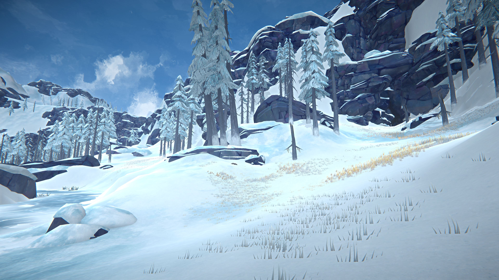
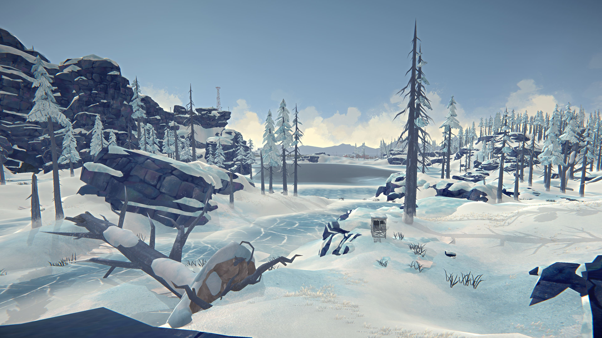
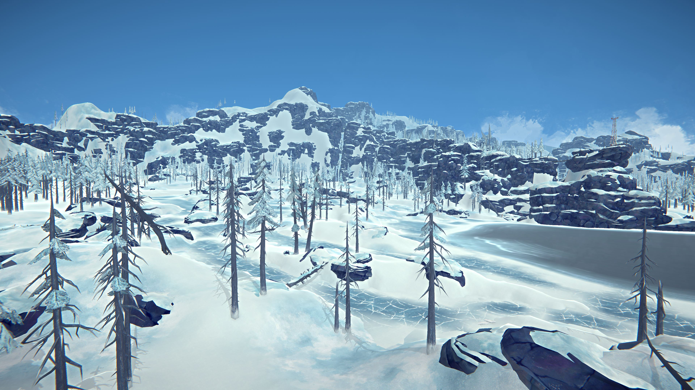

# Frozen Delta

**Categories:** Locations, Locations in Bleak Inlet, Outdoor locations · **Source:** [Fandom](https://thelongdark.fandom.com/wiki/Frozen_Delta)

**Frozen Delta**

_SS-BI-FrozenDelta003.jpg_

**Location**

_Frozen\_Delta\_Location.png_

**Region:** [Bleak Inlet](./Bleak%20Inlet.md)

**Type:** Outdoors

## Overview

A [hunting blind](./Hunter%27s%20Blinds.md) is located a short distance north, which can allow the player to safely hunt the packs of [timberwolves](./Timberwolf.md) which frequent the area. Weak ice is a constant threat when exploring the delta, so caution is advised.

There are three separate [Moose](./Moose.md) Spawn within the Frozen Delta and it is highly likely that at least one of these Moose will be spawned at any one time (unless already killed), furthermore it is possible to kill all three Moose within the period of just a few days as these Moose spawns seem to be much higher frequency than is conventional.

_Frozen delta - cave to Forlorn Muskeg_

_Frozen delta - hunter's blind_

_SS-BI-FrozenDelta02.jpg_

_SS-BI-FrozenDelta01.jpg_
