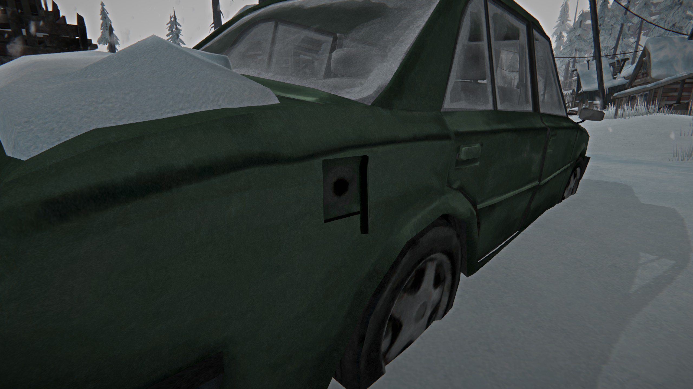

# Fuel Cover

**Fuel Cover**

| Property | Details |
| --- | --- |
| \[\[File: / \| Column 1 \| Column 2 \| Column 3 \| Column 4 \| / \| --- \| --- \| --- \| --- \| / \|  / *Truck* \|  / *Truck* \|  / *Car* \|  / *Car* \| | 250px\]\] |
|  / *Truck* |  / *Truck* /  / *Car* /  / *Car* |
| **General** |  |
| Item Type | Item |
| Wintermute | Yes\|} A **Fuel Cover** is an interactable object always found on the right sides of a [Car](./Car.md) or [Truck](./Truck.md). They can be opened to expose the fuel tank hole, however no gasoline can be syphoned out. They can be used to mark whether a Car or Truck has been searched, if the hood cannot be raised. **Lua execution error in Module:Navbox function navbox** |
