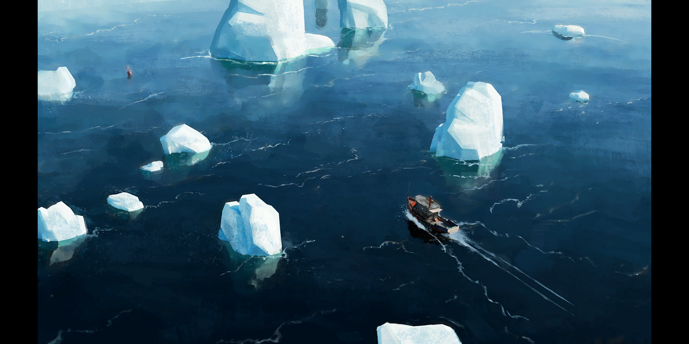
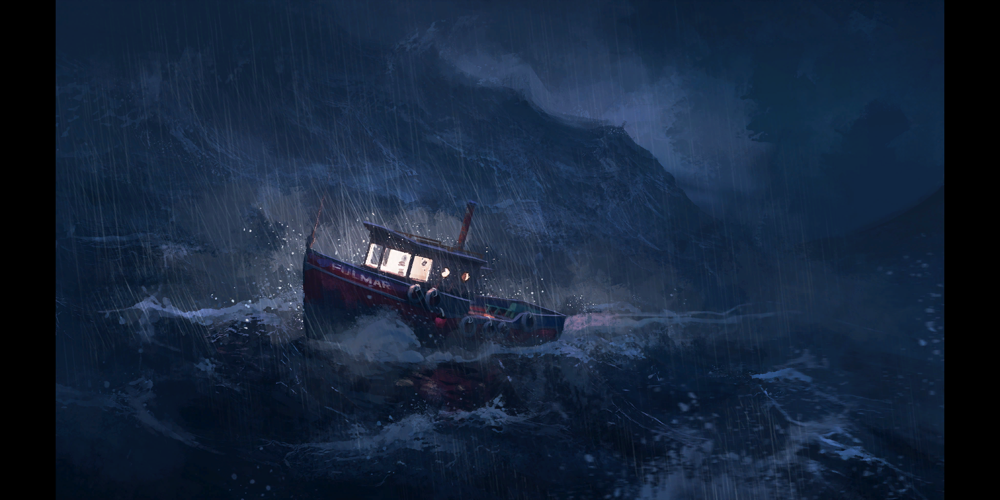

# Fulmar Autopilot Boat

<table>
<colgroup>
<col style="width: 33%" />
<col style="width: 33%" />
<col style="width: 33%" />
</colgroup>
<tbody>
<tr>
<td width="40px"><figure>

<figcaption>Seal_icon.png</figcaption>
</figure></td>
<td>
<strong>DLC-Exclusive content.</strong> 

This content requires the <a href="./Iron%20Road.md" class="wikilink" title="Iron Road">Iron Road</a> addon to be installed before it can be seen or used in regular gameplay.

</td>
<td>
|}

<table class="infobox">
<caption>Fulmar Autopilot Boat</caption>
<colgroup>
<col style="width: 50%" />
<col style="width: 50%" />
</colgroup>
<tbody>
<tr>
<td colspan="2"><figure>

<figcaption>Fulmar_Desolation_Point_GBI.png</figcaption>
</figure></td>
</tr>
<tr>
<td colspan="2" class="section">
<strong>Location</strong>
</td>
</tr>
<tr>
<td>
Region
</td>
<td>
<a href="./Desolation%20Point.md" class="wikilink" title="Desolation Point">Desolation Point</a>|-
</td>
</tr>
<tr>
<td></td>
<td>
Has no shelter|} The <strong>Fulmar Autopilot Boat</strong> is a <a href="./Vehicle.md" class="wikilink" title="Vehicle">Vehicle</a> in <a href="./The%20Long%20Dark.md" class="wikilink" title="The Long Dark"><em>The Long Dark</em></a>.

<h2 id="Overview">Overview</h2>

The Fulmar Autopilot Boat is the only way to travel to <a href="./Cauldron%20Island.md" class="wikilink" title="Cauldron Island">Cauldron Island</a> and back. It is located in <a href="./Desolation%20Point.md" class="wikilink" title="Desolation Point">Desolation Point</a> in front of the <a href="./Hibernia%20Processing.md" class="wikilink" title="Hibernia Processing">Hibernia Processing</a> location, near the docks.

<a href="./Play%20Me.md" class="wikilink" title="Play Me">Play Me</a>, <a href="./Wax%20Cylinder%201.md" class="wikilink" title="Wax Cylinder 1">Wax Cylinder 1</a>, and the <a href="./Wax%20Cylinder%20Player.md" class="wikilink" title="Wax Cylinder Player">Wax Cylinder Player</a> are found inside the Fulmar. Listening to Wax Cylinder 1 unlocks the supply container that needs to be filled with various supplies required for travel. Wax Cylinder 1 must be listened to in order to be able to open the container located in the back of the boat.

Traveling to Cauldron Island is not free, as the voyage is long and requires the following items for travel:

<ul>
<li>5 <a href="./Tinder%20Plug.md" class="wikilink" title="Tinder Plug">Tinder Plug</a></li>
<li>20.00 L <a href="./Water%20%28Potable%29.md" class="wikilink" title="Water (Potable)">Water (Potable)</a></li>
<li>5000 Calories (any kind of <a href="./Food%20And%20Drink.md" class="wikilink" title="Food And Drink">Food And Drink</a> above 50%)
<ul>
<li>Although food and drink at more than 20% Condition can be added to the Fulmar Boat's Supplies, only food at greater than 50% Condition will count towards the calorie total.</li>
</ul></li>
<li>20.00 KG Fuel (weight is the requirement here, not burn time)</li>
</ul>

Starting the boat does not require lighting the <a href="./Pot%20Belly%20Stove.md" class="wikilink" title="Pot Belly Stove">Pot Belly Stove</a>, it is activated simply by interacting with the lever beside the steering wheel. After that, an automated sequence of images is showing the trip to <a href="./Cauldron%20Island.md" class="wikilink" title="Cauldron Island">Cauldron Island</a> with no manual steering required. Traveling does not take time.

There is also a 150.00KG storage trunk next to the supplies container for transporting more supplies between Great Bear Island and Cauldron Island.

Upon arrival at <a href="./Cauldron%20Island.md" class="wikilink" title="Cauldron Island">Cauldron Island</a>, a warm shelter is available, featuring a <a href="./Bed.md" class="wikilink" title="Bed">Bed</a>, a <a href="./Fire%20Barrel.md" class="wikilink" title="Fire Barrel">Fire Barrel</a> and various <a href="./Clothing.md" class="wikilink" title="Clothing">Clothing</a> and other loot.

The boat must be resupplied each time you wish to travel between the 2 major islands.

<h2 id="Trivia">Trivia</h2>

Fulmar are two gull like birds that live in the Arctic or Antarctic regions of the world, having bluish-gray and white plumage.

<h2 id="Gallery">Gallery</h2>
<table class="gallery">
<colgroup>
<col style="width: 25%" />
<col style="width: 25%" />
<col style="width: 25%" />
<col style="width: 25%" />
</colgroup>
<tbody>
<tr>
<td><figure>

<figcaption><strong>Fulmar Port Remnant Cauldron Island</strong></figcaption>
</figure></td>
<td><figure>

<figcaption><strong>Fulmar Interior with a gold Pot Belly Stove</strong></figcaption>
</figure></td>
<td><figure>

<figcaption>Travel Requirements</figcaption>
</figure></td>
<td><figure>

<figcaption>Loading Screen</figcaption>
</figure></td>
</tr>
<tr>
<td><figure>

<figcaption>Loading Screen</figcaption>
</figure></td>
<td><figure>

<figcaption>Loading Screen</figcaption>
</figure></td>
<td><figure>

<figcaption>Loading Screen</figcaption>
</figure></td>
<td><figure>

<figcaption>Loading Screen</figcaption>
</figure></td>
</tr>
</tbody>
</table>

<strong>Lua execution error in Module:Navbox function navbox</strong> <a href="ru:%D0%9A%D0%B0%D1%82%D0%B5%D1%80_%D0%A4%D1%83%D0%BB%D0%BC%D0%B0%D1%80" class="wikilink" title="ru:Катер Фулмар">ru:Катер Фулмар</a>
</td>
</tr>
</tbody>
</table></td>
</tr>
</tbody>
</table>

