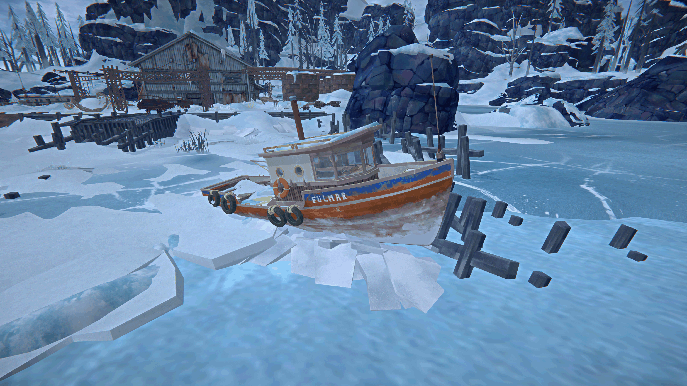
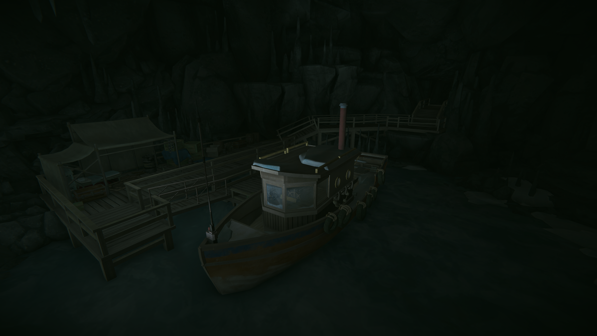
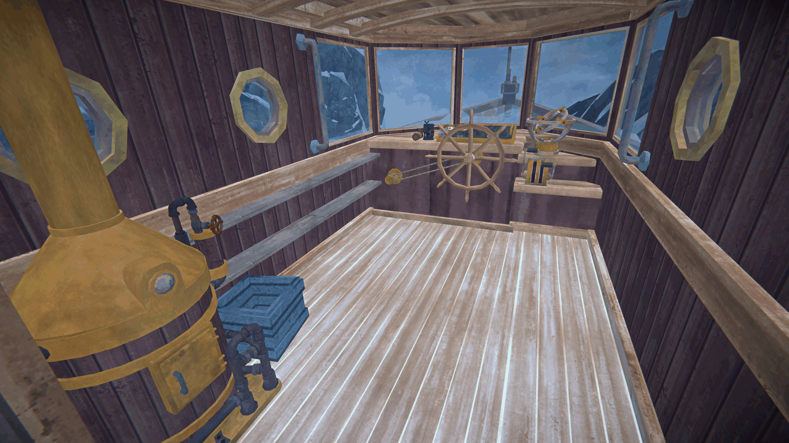

# Fulmar Autopilot Boat

**Categories:** DLC Content, Interactable Objects, Locations, Locations in Desolation Point, Outdoor locations · **Source:** [Fandom](https://thelongdark.fandom.com/wiki/Fulmar_Autopilot_Boat)

| Column 1 | Column 2 | Column 3 | Column 4 |
| --- | --- | --- | --- |

|  / _Fulmar\_Desolation\_Point\_GBI.png_ |  |  |  |
| **Location** |  |  |  |
| Region | [Desolation Point](./Desolation%20Point.md)\|- |  |  |

|  / _**Fulmar Port Remnant Cauldron Island**_ |  / _**Fulmar Interior with a gold Pot Belly Stove**_ |  / _Travel Requirements_ |  / _Loading Screen_ |
|  / _Loading Screen_ |  / _Loading Screen_ |  / _Loading Screen_ |  / _Loading Screen_ |
