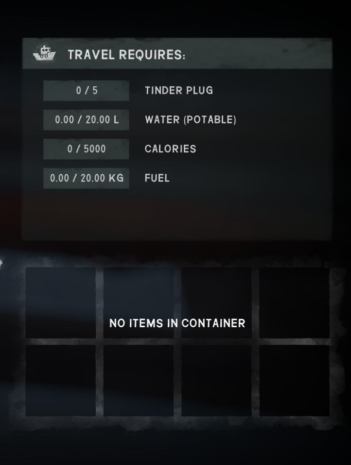

# Fulmar Autopilot Boat

**Categories:** DLC Content, Interactable Objects, Locations, Locations in Desolation Point, Outdoor locations · **Source:** [Fandom](https://thelongdark.fandom.com/wiki/Fulmar_Autopilot_Boat)

**DLC-Exclusive content.**

This content requires the [Iron Road](./Iron%20Road.md) addon to be installed before it can be seen or used in regular gameplay.

**Fulmar Autopilot Boat**

**Location**

**Region:** [Desolation Point](./Desolation%20Point.md)

Has no shelter The **Fulmar Autopilot Boat** is a [Vehicle](./Vehicle.md) in [_The Long Dark_](./The%20Long%20Dark.md).

## Overview

The Fulmar Autopilot Boat is the only way to travel to [Cauldron Island](./Cauldron%20Island.md) and back. It is located in [Desolation Point](./Desolation%20Point.md) in front of the [Hibernia Processing](./Hibernia%20Processing.md) location, near the docks.

[Play Me](./Play%20Me.md), [Wax Cylinder 1](./Wax%20Cylinder%201.md), and the [Wax Cylinder Player](./Wax%20Cylinder%20Player.md) are found inside the Fulmar. Listening to Wax Cylinder 1 unlocks the supply container that needs to be filled with various supplies required for travel. Wax Cylinder 1 must be listened to in order to be able to open the container located in the back of the boat.

Traveling to Cauldron Island is not free, as the voyage is long and requires the following items for travel:

- 5 [Tinder Plug](./Tinder%20Plug.md)
- 20.00 L [Water (Potable)](./Water%20%28Potable%29.md)
- 5000 Calories (any kind of [Food And Drink](./Food%20And%20Drink.md) above 50%)
  - Although food and drink at more than 20% Condition can be added to the Fulmar Boat's Supplies, only food at greater than 50% Condition will count towards the calorie total.
- 20.00 KG Fuel (weight is the requirement here, not burn time)

Starting the boat does not require lighting the [Pot Belly Stove](./Pot%20Belly%20Stove.md), it is activated simply by interacting with the lever beside the steering wheel. After that, an automated sequence of images is showing the trip to [Cauldron Island](./Cauldron%20Island.md) with no manual steering required. Traveling does not take time.

There is also a 150.00KG storage trunk next to the supplies container for transporting more supplies between Great Bear Island and Cauldron Island.

Upon arrival at [Cauldron Island](./Cauldron%20Island.md), a warm shelter is available, featuring a [Bed](./Bed.md), a [Fire Barrel](./Fire%20Barrel.md) and various [Clothing](./Clothing.md) and other loot.

The boat must be resupplied each time you wish to travel between the 2 major islands.

## Trivia

Fulmar are two gull like birds that live in the Arctic or Antarctic regions of the world, having bluish-gray and white plumage.

## Gallery

_**Fulmar Port Remnant Cauldron Island**_

_**Fulmar Interior with a gold Pot Belly Stove**_

