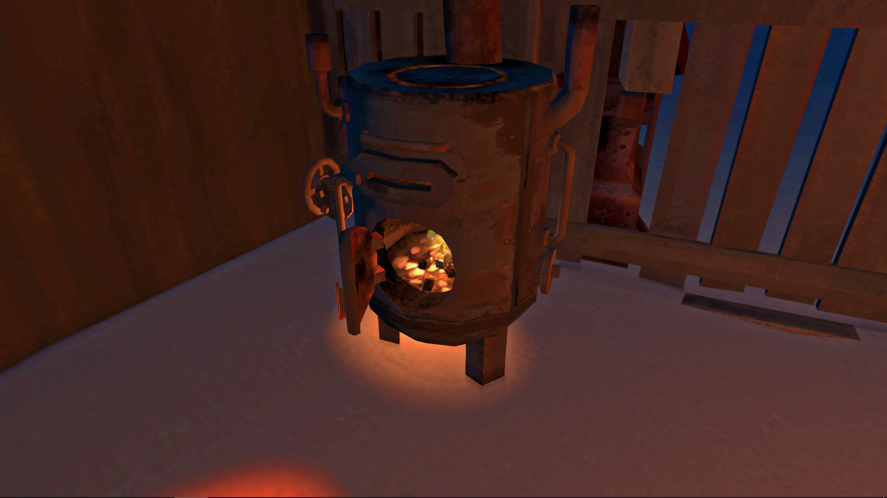

# Furnace

<table class="infobox">
<caption>Furnace</caption>
<colgroup>
<col style="width: 50%" />
<col style="width: 50%" />
</colgroup>
<tbody>
<tr>
<td colspan="2"><figure>

<figcaption>Furnace.png</figcaption>
</figure></td>
</tr>
<tr>
<td colspan="2" class="section">
<strong>General</strong>
</td>
</tr>
<tr>
<td>
Type
</td>
<td>
Fire Starting|-
</td>
</tr>
<tr>
<td>
Max temperature
</td>
<td>
200 °C 
(360 °F)
</td>
</tr>
<tr>
<td>
Cooking slots
</td>
<td>
1
</td>
</tr>
</tbody>
</table>

A **Furnace** is an unmovable <a href="./Fire.md#Contained_fires" class="wikilink" title="contained fire">contained fire</a>. Notably, furnaces also have an attached <a href="./Forge.md" class="wikilink" title="Forge">Forge</a> that can be used for crafting items. Furnaces have a maximum temperature of 200°C. Minimum temperature for forging is 150°C. To achieve a temperature above 80°C, <a href="./Coal.md" class="wikilink" title="Coal">Coal</a> must be added to the furnace. For <a href="./Cooking.md" class="wikilink" title="Cooking">Cooking</a> and heating, the furnace functions identically to other contained fires and player-made <a href="./Campfire.md" class="wikilink" title="Campfire">Campfire</a>. It provides no advantage over other contained fires, but it does allow protection against wind, unlike the player-made campfire. It has one cooking slot.

The furnace can be re-lit indefinitely, though it requires fresh starter, tinder, and fuel each time.

## Locations

Furnaces have fixed locations that do not change between games.

### Known locations (incomplete)

- <a href="./Old%20Spence%20Family%20Homestead.md" class="wikilink" title="Old Spence Family Homestead">Old Spence Family Homestead</a> in <a href="./Forlorn%20Muskeg.md" class="wikilink" title="Forlorn Muskeg">Forlorn Muskeg</a>
- <a href="./The%20Riken.md" class="wikilink" title="The Riken">The Riken</a> in <a href="./Desolation%20Point.md" class="wikilink" title="Desolation Point">Desolation Point</a>
- <a href="./Maintenance%20Yard.md" class="wikilink" title="Maintenance Yard">Maintenance Yard</a> in <a href="./Broken%20Railroad.md" class="wikilink" title="Broken Railroad">Broken Railroad</a>
- <a href="./Hangar%20Basement.md" class="wikilink" title="Hangar Basement">Hangar Basement</a> of the <a href="./Main%20Hangar.md" class="wikilink" title="Main Hangar">Main Hangar</a> in <a href="./Forsaken%20Airfield.md" class="wikilink" title="Forsaken Airfield">Forsaken Airfield</a>

**Lua execution error in Module:Navbox function navbox** **Lua execution error in Module:Navbox function navbox** <a href="ru:%D0%9A%D1%83%D0%B7%D0%BD%D0%B5%D1%87%D0%BD%D1%8B%D0%B9_%D0%B3%D0%BE%D1%80%D0%BD" class="wikilink" title="ru:Кузнечный горн">ru:Кузнечный горн</a>

