# Furniture Workbench

**Contents**

- [Overview](#Overview)
- [Crafting](#Crafting)
- [Craftable Items](#Craftable_Items)
- [Update History](#Update_History)

<table class="infobox">
<caption>Furniture Workbench</caption>
<colgroup>
<col style="width: 50%" />
<col style="width: 50%" />
</colgroup>
<tbody>
<tr>
<td colspan="2"><figure>
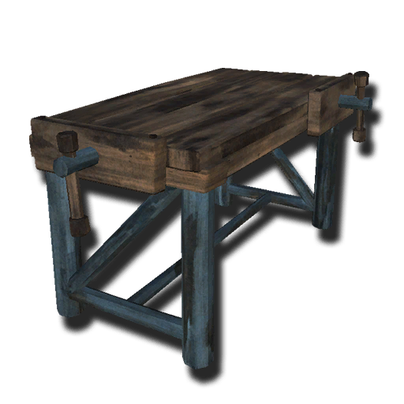
<figcaption>Furniture_Workbench_icon.png</figcaption>
</figure></td>
</tr>
<tr>
<td>
Release
</td>
<td>
<a href="./The%20Long%20Dark%20%E2%80%94%20Changelog.md#2.33" class="wikilink" title="TFTFT Part 6 Broken Silence">TFTFT Part 6 Broken Silence</a>
</td>
</tr>
<tr>
<td colspan="2" class="section">
<strong>Values</strong>
</td>
</tr>
<tr>
<td>
Weight
</td>
<td>
15.00 kg (33 lbs)
</td>
</tr>
<tr>
<td colspan="2" class="section">
<strong>Actions</strong>
</td>
</tr>
<tr>
<td>
Backpack
</td>
<td>
Drop, Place
</td>
</tr>
</tbody>
</table>

The **Furniture Workbench** is a <a href="./Decorations.md" class="wikilink" title="Decorations">Decorations</a> item that can be <a href="./Crafting.md" class="wikilink" title="Crafted">Crafted</a> as part of the <a href="./Safehouse%20Customization.md" class="wikilink" title="Safehouse Customization">Safehouse Customization</a> feature.

## Overview

The Furniture Workbench is the primary crafting facility used to build large decorative furniture items within any interior Safehouse. It can be crafted and carried anywhere (though it weighs as much as a <a href="./Car%20Battery.md" class="wikilink" title="Car Battery">Car Battery</a>), but requires the very rare <a href="./Woodworking%20Tools.md" class="wikilink" title="Woodworking Tools">Woodworking Tools</a> before it can be built. The Furniture Workbench can only be placed on a wide, clear space on the floor when in Customization Mode.

Once placed in a Safehouse, the Furniture Workbench cannot be picked up and placed back into the player's inventory, and so it cannot be carried from one base to another. The only option is to move or destroy it (destroying the Furniture Workbench will yield no resources, so consider the material cost/time investment before placing this item).

## Crafting

Any large in-progress/created Decorations made at a Furniture Workbench are deposited inside an invisible container tied to that Furniture Workbench.

- Opening the Workbench crafting menu and selecting Container will allow you to place large finished items around your Safehouse
- Smaller crafted items are placed in the player's inventory instead.
- An unlimited amount of large completed furniture can be stored in the Furniture Workbench's container, and will remain there until placed in the surrounding Safehouse.

<table class="infobox">
<caption>Furniture Workbench</caption>
<tbody>
<tr>
<td colspan="2">
-
</td>
</tr>
<tr>
<td colspan="2">
-
</td>
</tr>
<tr>
<td colspan="2">
240 minutes (4 hour 0 minutes)
</td>
</tr>
<tr>
<td colspan="2" class="section">
<strong>Requirements</strong>
</td>
</tr>
<tr>
<td>
Facility
</td>
<td>
[[File:Anywhere icon.png
</td>
</tr>
<tr>
<td>
Tool
</td>
<td>
<strong>Template:iconlink</strong>
</td>
</tr>
<tr>
<td colspan="2" class="section">
<strong>Materials</strong>
</td>
</tr>
<tr>
<td colspan="2" class="section">
<strong>Template:iconlink plain</strong>
</td>
</tr>
<tr>
<td>
Item
</td>
<td>
<a href="./Cedar%20Firewood.md" class="wikilink" title="Cedar Firewood">Cedar Firewood</a>
</td>
</tr>
<tr>
<td>
Quantity
</td>
<td>
10
</td>
</tr>
</tbody>
</table>

## Craftable Items

Once crafted, the following Decorations crafted at a Furniture Workbench will be placed in a container in that Workbench (they can be placed your Safehouse by opening the Furniture Workbench and selecting them). They cannot be placed in the player's inventory despite having a weight class, and furniture with containers cannot be broken down to regain some of their resources once placed in the Safehouse.

<table>
<colgroup>
<col style="width: 20%" />
<col style="width: 20%" />
<col style="width: 20%" />
<col style="width: 20%" />
<col style="width: 20%" />
</colgroup>
<thead>
<tr>
<th>
Recipe
</th>
<th>
Materials
</th>
<th>
Time
</th>
<th>
Weight
</th>
<th>
Crafted
</th>
</tr>
</thead>
<tbody>
<tr>
<td>
 <a href="./Bear%20Hide%20Bed.md" class="wikilink" title="Bear Hide Bed">Bear Hide Bed</a>
</td>
<td>
18x  <a href="./Fir%20Firewood.md" class="wikilink" title="Fir Firewood">Fir Firewood</a> 4x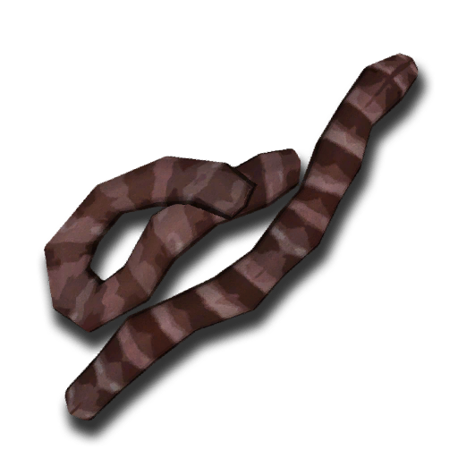 <a href="./Cured%20Gut.md" class="wikilink" title="Cured Gut">Cured Gut</a>

1x  <a href="./Cured%20Black%20Bear%20Hide.md" class="wikilink" title="Cured Black Bear Hide">Cured Black Bear Hide</a>

16x  <a href="./Ptarmigan%20Down.md" class="wikilink" title="Ptarmigan Down">Ptarmigan Down</a>
</td>
<td>
24 Hours
</td>
<td>
10.00 kg 
(22 lb)
</td>
<td>
<a href="./Furniture%20Workbench.md" class="wikilink" title="Furniture Workbench">Furniture Workbench</a>
</td>
</tr>
<tr>
<td>
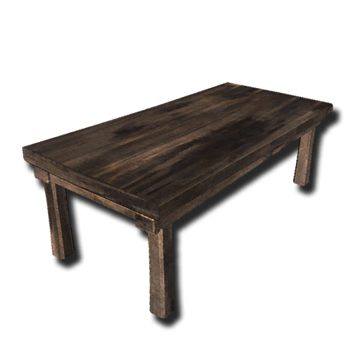 <a href="./Coffee%20Table.md" class="wikilink" title="Coffee Table">Coffee Table</a>
</td>
<td>
6x  <a href="./Fir%20Firewood.md" class="wikilink" title="Fir Firewood">Fir Firewood</a>
</td>
<td>
4 Hours
</td>
<td>
5.00 kg 
(11 lb)
</td>
<td>
<a href="./Furniture%20Workbench.md" class="wikilink" title="Furniture Workbench">Furniture Workbench</a>
</td>
</tr>
<tr>
<td>
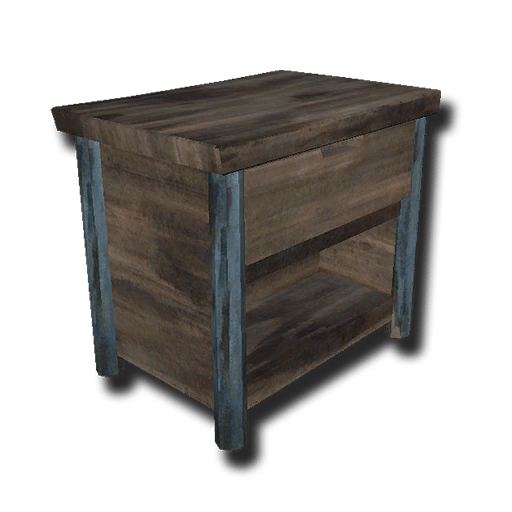 <a href="./Rustic%20End%20Table.md" class="wikilink" title="Rustic End Table">Rustic End Table</a>
</td>
<td>
6x  <a href="./Cedar%20Firewood.md" class="wikilink" title="Cedar Firewood">Cedar Firewood</a> 2x  <a href="./Reclaimed%20Wood.md" class="wikilink" title="Reclaimed Wood">Reclaimed Wood</a>
</td>
<td>
6 Hours
</td>
<td>
20.00 kg 
(44 lb)
</td>
<td>
<a href="./Furniture%20Workbench.md" class="wikilink" title="Furniture Workbench">Furniture Workbench</a>
</td>
</tr>
<tr>
<td>
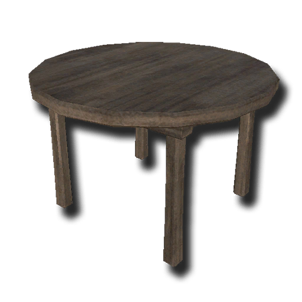 <a href="./Round%20Table.md" class="wikilink" title="Round Table">Round Table</a>
</td>
<td>
12x  <a href="./Fir%20Firewood.md" class="wikilink" title="Fir Firewood">Fir Firewood</a>
</td>
<td>
9 Hours
</td>
<td>
5.00 kg 
(11 lb)
</td>
<td>
<a href="./Furniture%20Workbench.md" class="wikilink" title="Furniture Workbench">Furniture Workbench</a>
</td>
</tr>
<tr>
<td>
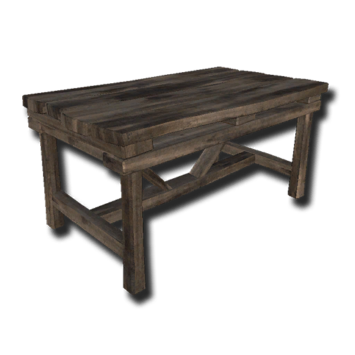 <a href="./Rustic%20Table.md" class="wikilink" title="Rustic Table">Rustic Table</a>
</td>
<td>
10x  <a href="./Fir%20Firewood.md" class="wikilink" title="Fir Firewood">Fir Firewood</a>
</td>
<td>
8 Hours
</td>
<td>
8.00 kg 
(17.6 lb)
</td>
<td>
<a href="./Furniture%20Workbench.md" class="wikilink" title="Furniture Workbench">Furniture Workbench</a>
</td>
</tr>
<tr>
<td>
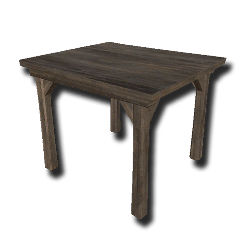 <a href="./Square%20Table.md" class="wikilink" title="Square Table">Square Table</a>
</td>
<td>
8x  <a href="./Fir%20Firewood.md" class="wikilink" title="Fir Firewood">Fir Firewood</a>
</td>
<td>
7 Hours
</td>
<td>
5.00 kg 
(11 lb)
</td>
<td>
<a href="./Furniture%20Workbench.md" class="wikilink" title="Furniture Workbench">Furniture Workbench</a>
</td>
</tr>
<tr>
<td>
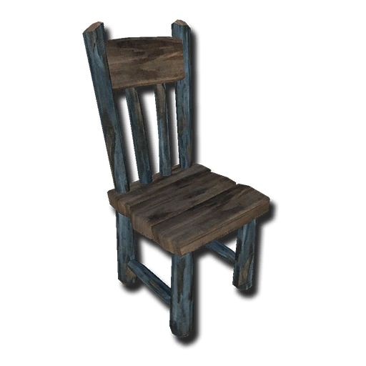 <a href="./Rustic%20Chair.md" class="wikilink" title="Rustic Chair">Rustic Chair</a>
</td>
<td>
4x  <a href="./Cedar%20Firewood.md" class="wikilink" title="Cedar Firewood">Cedar Firewood</a> 2x  <a href="./Reclaimed%20Wood.md" class="wikilink" title="Reclaimed Wood">Reclaimed Wood</a>
</td>
<td>
4 Hours
</td>
<td>
2.00 kg 
(4.4 lb)
</td>
<td>
<a href="./Furniture%20Workbench.md" class="wikilink" title="Furniture Workbench">Furniture Workbench</a>
</td>
</tr>
<tr>
<td>
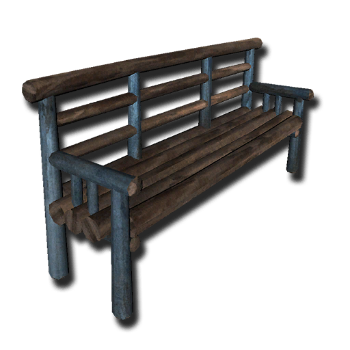 <a href="./Rustic%20Bench.md" class="wikilink" title="Rustic Bench">Rustic Bench</a>
</td>
<td>
10x  <a href="./Cedar%20Firewood.md" class="wikilink" title="Cedar Firewood">Cedar Firewood</a> 2x  <a href="./Reclaimed%20Wood.md" class="wikilink" title="Reclaimed Wood">Reclaimed Wood</a>
</td>
<td>
8 Hours
</td>
<td>
2.00 kg 
(4.4 lb)
</td>
<td>
<a href="./Furniture%20Workbench.md" class="wikilink" title="Furniture Workbench">Furniture Workbench</a>
</td>
</tr>
<tr>
<td>
 <a href="./Dresser.md" class="wikilink" title="Dresser">Dresser</a>
</td>
<td>
10x  <a href="./Cedar%20Firewood.md" class="wikilink" title="Cedar Firewood">Cedar Firewood</a> 4x  <a href="./Reclaimed%20Wood.md" class="wikilink" title="Reclaimed Wood">Reclaimed Wood</a>
</td>
<td>
8 Hours
</td>
<td>
25.00 kg 
(55 lb)
</td>
<td>
<a href="./Furniture%20Workbench.md" class="wikilink" title="Furniture Workbench">Furniture Workbench</a>
</td>
</tr>
<tr>
<td>
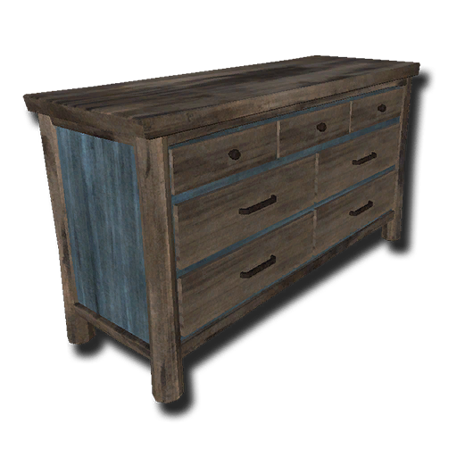 <a href="./Wide%20Dresser.md" class="wikilink" title="Wide Dresser">Wide Dresser</a>
</td>
<td>
16x  <a href="./Fir%20Firewood.md" class="wikilink" title="Fir Firewood">Fir Firewood</a> 6x  <a href="./Reclaimed%20Wood.md" class="wikilink" title="Reclaimed Wood">Reclaimed Wood</a>
</td>
<td>
11 Hours
</td>
<td>
25.00 kg 
(55 lb)
</td>
<td>
<a href="./Furniture%20Workbench.md" class="wikilink" title="Furniture Workbench">Furniture Workbench</a>
</td>
</tr>
<tr>
<td>
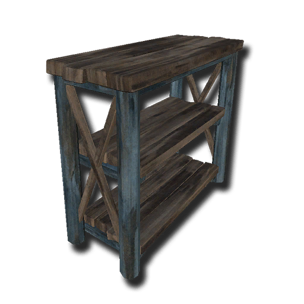 <a href="./Rustic%20Shelf.md" class="wikilink" title="Rustic Shelf">Rustic Shelf</a>
</td>
<td>
8x  <a href="./Cedar%20Firewood.md" class="wikilink" title="Cedar Firewood">Cedar Firewood</a>
</td>
<td>
6 Hours
</td>
<td>
6.00 kg 
(13.2 lb)
</td>
<td>
<a href="./Furniture%20Workbench.md" class="wikilink" title="Furniture Workbench">Furniture Workbench</a>
</td>
</tr>
<tr>
<td>
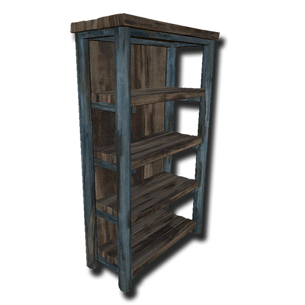 <a href="./Tall%20Rustic%20Shelf.md" class="wikilink" title="Tall Rustic Shelf">Tall Rustic Shelf</a>
</td>
<td>
10x  <a href="./Cedar%20Firewood.md" class="wikilink" title="Cedar Firewood">Cedar Firewood</a>
</td>
<td>
8 Hours
</td>
<td>
5.00 kg 
(11 lb)
</td>
<td>
<a href="./Furniture%20Workbench.md" class="wikilink" title="Furniture Workbench">Furniture Workbench</a>
</td>
</tr>
<tr>
<td>
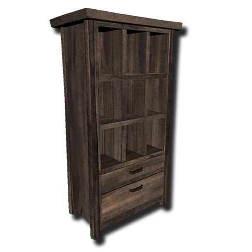 <a href="./Display%20Shelf.md" class="wikilink" title="Display Shelf">Display Shelf</a>
</td>
<td>
12x  <a href="./Fir%20Firewood.md" class="wikilink" title="Fir Firewood">Fir Firewood</a> 4x  <a href="./Reclaimed%20Wood.md" class="wikilink" title="Reclaimed Wood">Reclaimed Wood</a>
</td>
<td>
10 Hours
</td>
<td>
20.00 kg 
(44 lb)
</td>
<td>
<a href="./Furniture%20Workbench.md" class="wikilink" title="Furniture Workbench">Furniture Workbench</a>
</td>
</tr>
<tr>
<td>
 <a href="./Rustic%20Closet.md" class="wikilink" title="Rustic Closet">Rustic Closet</a>
</td>
<td>
18x  <a href="./Fir%20Firewood.md" class="wikilink" title="Fir Firewood">Fir Firewood</a> 3x  <a href="./Reclaimed%20Wood.md" class="wikilink" title="Reclaimed Wood">Reclaimed Wood</a>

2x  <a href="./Scrap%20Metal.md" class="wikilink" title="Scrap Metal">Scrap Metal</a>
</td>
<td>
9 Hours
</td>
<td>
15.00 kg 
(33 lb)
</td>
<td>
<a href="./Furniture%20Workbench.md" class="wikilink" title="Furniture Workbench">Furniture Workbench</a>
</td>
</tr>
<tr>
<td>
 <a href="./Tall%20Rustic%20Closet.md" class="wikilink" title="Tall Rustic Closet">Tall Rustic Closet</a>
</td>
<td>
24x  <a href="./Fir%20Firewood.md" class="wikilink" title="Fir Firewood">Fir Firewood</a> 4x  <a href="./Reclaimed%20Wood.md" class="wikilink" title="Reclaimed Wood">Reclaimed Wood</a>

2x  <a href="./Scrap%20Metal.md" class="wikilink" title="Scrap Metal">Scrap Metal</a>
</td>
<td>
10 Hours
</td>
<td>
15.00 kg 
(33 lb)
</td>
<td>
<a href="./Furniture%20Workbench.md" class="wikilink" title="Furniture Workbench">Furniture Workbench</a>
</td>
</tr>
<tr>
<td>
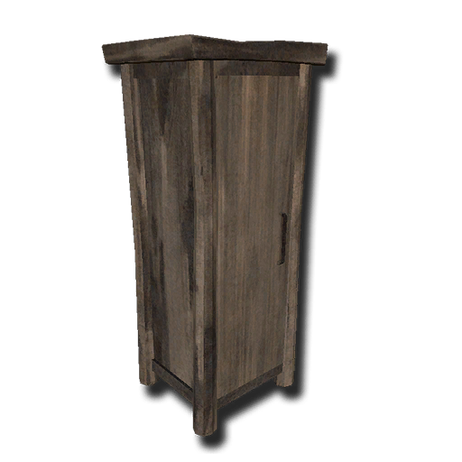 <a href="./Rustic%20Cupboard.md" class="wikilink" title="Rustic Cupboard">Rustic Cupboard</a>
</td>
<td>
10x  <a href="./Fir%20Firewood.md" class="wikilink" title="Fir Firewood">Fir Firewood</a> 2x  <a href="./Reclaimed%20Wood.md" class="wikilink" title="Reclaimed Wood">Reclaimed Wood</a>

1x  <a href="./Scrap%20Metal.md" class="wikilink" title="Scrap Metal">Scrap Metal</a>
</td>
<td>
8 Hours
</td>
<td>
15.00 kg 
(33 lb)
</td>
<td>
<a href="./Furniture%20Workbench.md" class="wikilink" title="Furniture Workbench">Furniture Workbench</a>
</td>
</tr>
<tr>
<td>
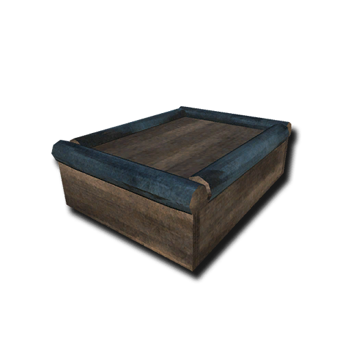 <a href="./Rustic%20Storage%20Box.md" class="wikilink" title="Rustic Storage Box">Rustic Storage Box</a>
</td>
<td>
8x  <a href="./Cedar%20Firewood.md" class="wikilink" title="Cedar Firewood">Cedar Firewood</a>
</td>
<td>
6 Hours
</td>
<td>
2.00 kg 
(4.4 lb)
</td>
<td>
<a href="./Furniture%20Workbench.md" class="wikilink" title="Furniture Workbench">Furniture Workbench</a>
</td>
</tr>
<tr>
<td>
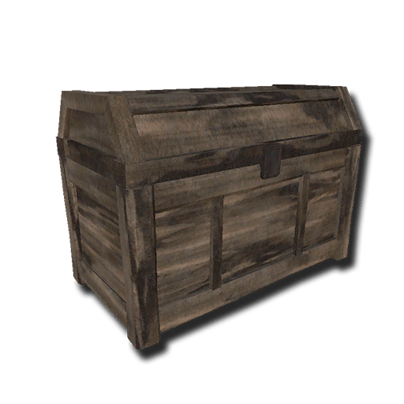 <a href="./Rustic%20Storage%20Trunk.md" class="wikilink" title="Rustic Storage Trunk">Rustic Storage Trunk</a>
</td>
<td>
9x  <a href="./Fir%20Firewood.md" class="wikilink" title="Fir Firewood">Fir Firewood</a>
</td>
<td>
4 Hours
</td>
<td>
5.00 kg 
(11 lb)
</td>
<td>
<a href="./Furniture%20Workbench.md" class="wikilink" title="Furniture Workbench">Furniture Workbench</a>
</td>
</tr>
<tr>
<td>
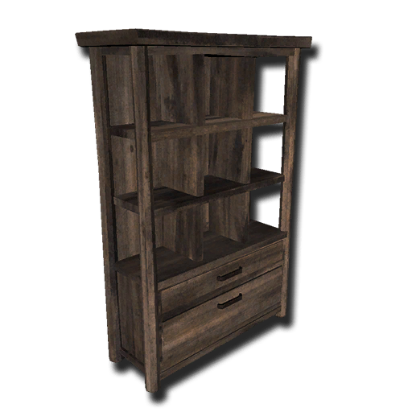 <a href="./Wide%20Display%20Shelf.md" class="wikilink" title="Wide Display Shelf">Wide Display Shelf</a>
</td>
<td>
18x  <a href="./Fir%20Firewood.md" class="wikilink" title="Fir Firewood">Fir Firewood</a> 4x  <a href="./Reclaimed%20Wood.md" class="wikilink" title="Reclaimed Wood">Reclaimed Wood</a>
</td>
<td>
11 Hours
</td>
<td>
20.00 kg 
(44 lb)
</td>
<td>
<a href="./Furniture%20Workbench.md" class="wikilink" title="Furniture Workbench">Furniture Workbench</a>
</td>
</tr>
<tr>
<td>
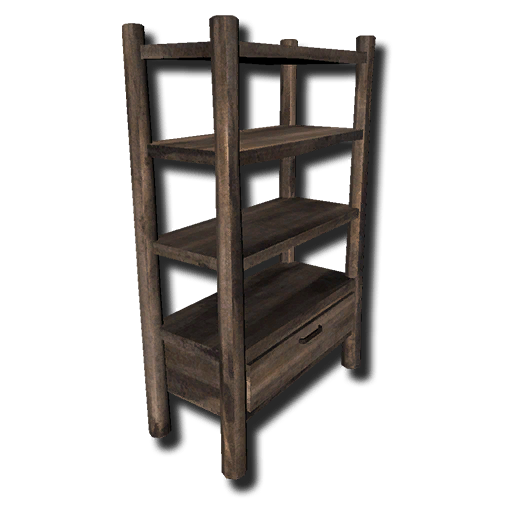 <a href="./Rustic%20Display%20Shelf.md" class="wikilink" title="Rustic Display Shelf">Rustic Display Shelf</a>
</td>
<td>
10x  <a href="./Fir%20Firewood.md" class="wikilink" title="Fir Firewood">Fir Firewood</a> 2x  <a href="./Reclaimed%20Wood.md" class="wikilink" title="Reclaimed Wood">Reclaimed Wood</a>
</td>
<td>
9 Hours
</td>
<td>
20.00 kg 
(44 lb)
</td>
<td>
<a href="./Furniture%20Workbench.md" class="wikilink" title="Furniture Workbench">Furniture Workbench</a>
</td>
</tr>
<tr>
<td>
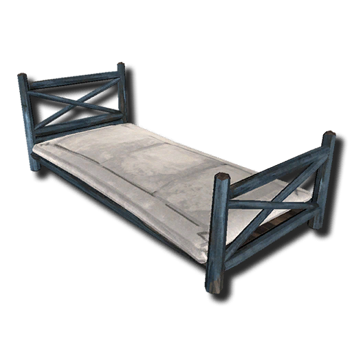 <a href="./Rustic%20Bed.md" class="wikilink" title="Rustic Bed">Rustic Bed</a>
</td>
<td>
10x  <a href="./Cedar%20Firewood.md" class="wikilink" title="Cedar Firewood">Cedar Firewood</a> 12x  <a href="./Cloth.md" class="wikilink" title="Cloth">Cloth</a>

2x <a href="./Cured%20Gut.md" class="wikilink" title="Cured Gut">Cured Gut</a>
</td>
<td>
12 Hours
</td>
<td>
5.00 kg 
(11 lb)
</td>
<td>
<a href="./Furniture%20Workbench.md" class="wikilink" title="Furniture Workbench">Furniture Workbench</a>
</td>
</tr>
<tr>
<td>
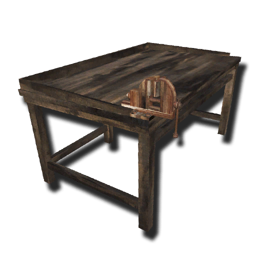 <a href="./Work%20Bench.md" class="wikilink" title="Work Bench">Work Bench</a>
</td>
<td>
15x  <a href="./Cedar%20Firewood.md" class="wikilink" title="Cedar Firewood">Cedar Firewood</a> 1x 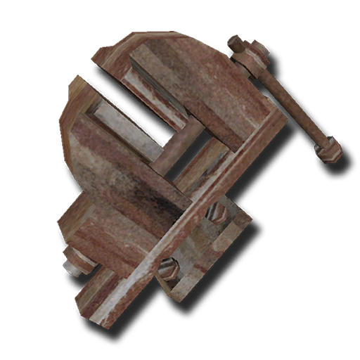 <a href="./Workbench%20Vice.md" class="wikilink" title="Workbench Vice">Workbench Vice</a>
</td>
<td>
18 Hours
</td>
<td>
5.00 kg 
(11 lb)
</td>
<td>
<a href="./Furniture%20Workbench.md" class="wikilink" title="Furniture Workbench">Furniture Workbench</a>
</td>
</tr>
<tr>
<td>
 <a href="./Meat%20Curing%20Box.md" class="wikilink" title="Meat Curing Box">Meat Curing Box</a>
</td>
<td>
10x  <a href="./Fir%20Firewood.md" class="wikilink" title="Fir Firewood">Fir Firewood</a> 8.00kg x 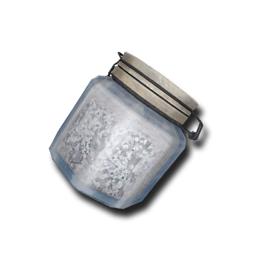 <a href="./Salt.md" class="wikilink" title="Salt">Salt</a>
</td>
<td>
6 Hours
</td>
<td>
10.00 kg 
(22 lb)
</td>
<td>
<a href="./Furniture%20Workbench.md" class="wikilink" title="Furniture Workbench">Furniture Workbench</a>
</td>
</tr>
<tr>
<td>
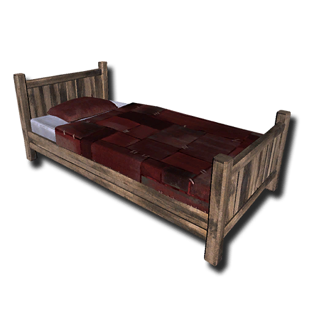 <a href="./Quilted%20Bed.md" class="wikilink" title="Quilted Bed">Quilted Bed</a>
</td>
<td>
12x  <a href="./Fir%20Firewood.md" class="wikilink" title="Fir Firewood">Fir Firewood</a> 10x  <a href="./Cloth.md" class="wikilink" title="Cloth">Cloth</a>

6x <a href="./Cured%20Gut.md" class="wikilink" title="Cured Gut">Cured Gut</a>

16x  <a href="./Ptarmigan%20Down.md" class="wikilink" title="Ptarmigan Down">Ptarmigan Down</a>
</td>
<td>
20 Hours
</td>
<td>
10.00 kg 
(22 lb)
</td>
<td>
<a href="./Furniture%20Workbench.md" class="wikilink" title="Furniture Workbench">Furniture Workbench</a>
</td>
</tr>
<tr>
<td>
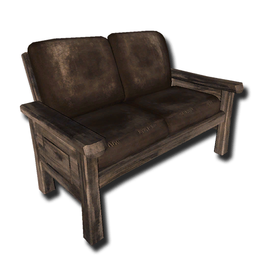 <a href="./Hide%20Couch.md" class="wikilink" title="Hide Couch">Hide Couch</a>
</td>
<td>
15x  <a href="./Fir%20Firewood.md" class="wikilink" title="Fir Firewood">Fir Firewood</a> 4x  <a href="./Cured%20Deer%20Hide.md" class="wikilink" title="Cured Deer Hide">Cured Deer Hide</a>

16x  <a href="./Ptarmigan%20Down.md" class="wikilink" title="Ptarmigan Down">Ptarmigan Down</a>

5x <a href="./Cured%20Gut.md" class="wikilink" title="Cured Gut">Cured Gut</a>
</td>
<td>
16 Hours
</td>
<td>
10.00 kg 
(22 lb)
</td>
<td>
<a href="./Furniture%20Workbench.md" class="wikilink" title="Furniture Workbench">Furniture Workbench</a>
</td>
</tr>
<tr>
<td>
 <a href="./Hide%20Chair.md" class="wikilink" title="Hide Chair">Hide Chair</a>
</td>
<td>
8x  <a href="./Fir%20Firewood.md" class="wikilink" title="Fir Firewood">Fir Firewood</a> 2x  <a href="./Cured%20Deer%20Hide.md" class="wikilink" title="Cured Deer Hide">Cured Deer Hide</a>

8x  <a href="./Ptarmigan%20Down.md" class="wikilink" title="Ptarmigan Down">Ptarmigan Down</a>

3x <a href="./Cured%20Gut.md" class="wikilink" title="Cured Gut">Cured Gut</a>
</td>
<td>
13 Hours
</td>
<td>
5.00 kg 
(11 lb)
</td>
<td>
<a href="./Furniture%20Workbench.md" class="wikilink" title="Furniture Workbench">Furniture Workbench</a>
</td>
</tr>
</tbody>
</table>

The following Decorations are automatically placed into the player's inventory once crafted.

<table>
<colgroup>
<col style="width: 20%" />
<col style="width: 20%" />
<col style="width: 20%" />
<col style="width: 20%" />
<col style="width: 20%" />
</colgroup>
<thead>
<tr>
<th>
Recipe
</th>
<th>
Materials
</th>
<th>
Time
</th>
<th>
Weight
</th>
<th>
Crafted
</th>
</tr>
</thead>
<tbody>
<tr>
<td>
 <a href="./Framed%20Hockey%20Jersey.md" class="wikilink" title="Framed Hockey Jersey">Framed Hockey Jersey</a>
</td>
<td>
2x  <a href="./Fir%20Firewood.md" class="wikilink" title="Fir Firewood">Fir Firewood</a> 1x  <a href="./Scrap%20Metal.md" class="wikilink" title="Scrap Metal">Scrap Metal</a>

1x  <a href="./Hockey%20Jersey.md" class="wikilink" title="Hockey Jersey">Hockey Jersey</a>
</td>
<td>
4 Hours
</td>
<td>
2.00 kg 
(4.4 lb)
</td>
<td>
<a href="./Furniture%20Workbench.md" class="wikilink" title="Furniture Workbench">Furniture Workbench</a>
</td>
</tr>
<tr>
<td>
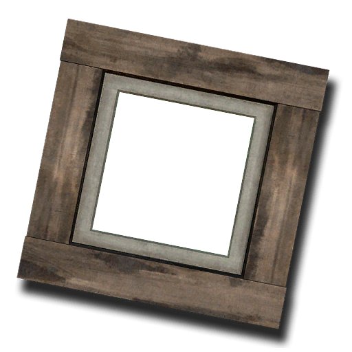 <a href="./Framed%20Photo.md" class="wikilink" title="Framed Photo">Framed Photo</a>
</td>
<td>
1x  <a href="./Fir%20Firewood.md" class="wikilink" title="Fir Firewood">Fir Firewood</a> 1x 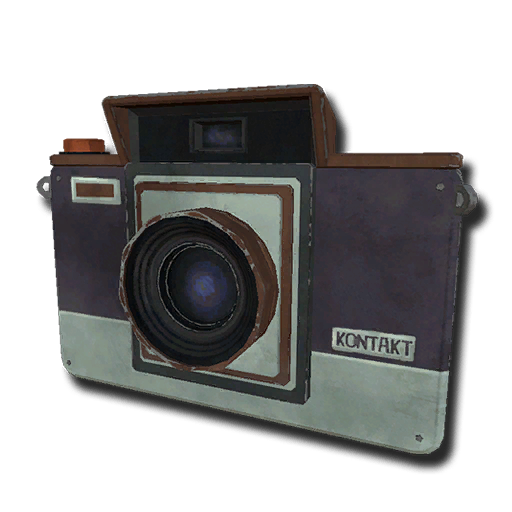 <a href="./Camera.md" class="wikilink" title="Camera">Camera</a> Photo
</td>
<td>
2 Hours
</td>
<td>
0.25 kg 
(0.55 lb)
</td>
<td>
<a href="./Furniture%20Workbench.md" class="wikilink" title="Furniture Workbench">Furniture Workbench</a>
</td>
</tr>
<tr>
<td>
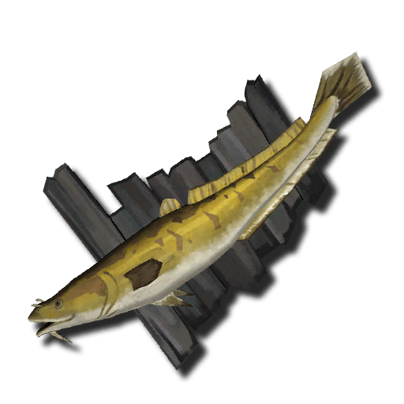 <a href="./Mounted%20Burbot.md" class="wikilink" title="Mounted Burbot">Mounted Burbot</a>
</td>
<td>
1x  <a href="./Fir%20Firewood.md" class="wikilink" title="Fir Firewood">Fir Firewood</a> 1x  <a href="./Burbot%20%28Raw%29.md" class="wikilink" title="Burbot (Raw)">Burbot (Raw)</a>
</td>
<td>
4 Hours
</td>
<td>
0.50 kg 
(1.1 lb)
</td>
<td>
<a href="./Furniture%20Workbench.md" class="wikilink" title="Furniture Workbench">Furniture Workbench</a>
</td>
</tr>
<tr>
<td>
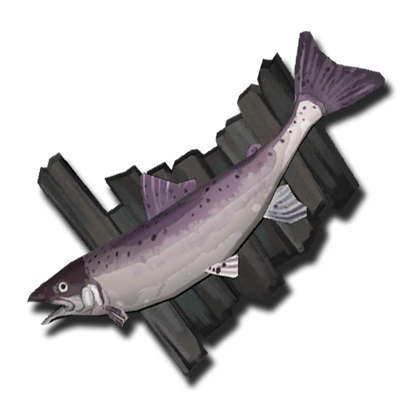 <a href="./Mounted%20Coho%20Salmon.md" class="wikilink" title="Mounted Coho Salmon">Mounted Coho Salmon</a>
</td>
<td>
1x  <a href="./Fir%20Firewood.md" class="wikilink" title="Fir Firewood">Fir Firewood</a> 1x  <a href="./Coho%20Salmon%20%28Raw%29.md" class="wikilink" title="Coho Salmon (Raw)">Coho Salmon (Raw)</a>
</td>
<td>
4 Hours
</td>
<td>
1.00 kg 
(2.2 lb)
</td>
<td>
<a href="./Furniture%20Workbench.md" class="wikilink" title="Furniture Workbench">Furniture Workbench</a>
</td>
</tr>
<tr>
<td>
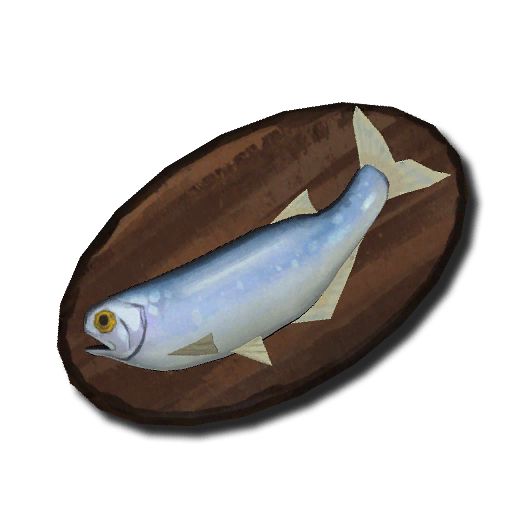 <a href="./Mounted%20Goldeye.md" class="wikilink" title="Mounted Goldeye">Mounted Goldeye</a>
</td>
<td>
1x  <a href="./Fir%20Firewood.md" class="wikilink" title="Fir Firewood">Fir Firewood</a> 1x  <a href="./Goldeye%20%28Raw%29.md" class="wikilink" title="Goldeye (Raw)">Goldeye (Raw)</a>
</td>
<td>
4 Hours
</td>
<td>
0.50 kg 
(1.1 lb)
</td>
<td>
<a href="./Furniture%20Workbench.md" class="wikilink" title="Furniture Workbench">Furniture Workbench</a>
</td>
</tr>
<tr>
<td>
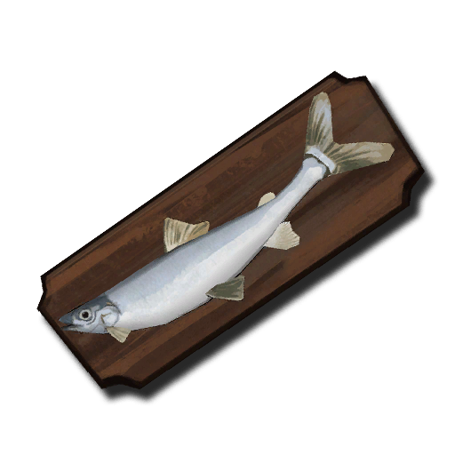 <a href="./Mounted%20Lake%20Whitefish.md" class="wikilink" title="Mounted Lake Whitefish">Mounted Lake Whitefish</a>
</td>
<td>
1x  <a href="./Fir%20Firewood.md" class="wikilink" title="Fir Firewood">Fir Firewood</a> 1x  <a href="./Lake%20Whitefish%20%28Raw%29.md" class="wikilink" title="Lake Whitefish (Raw)">Lake Whitefish (Raw)</a>
</td>
<td>
4 Hours
</td>
<td>
0.50 kg 
(1.1 lb)
</td>
<td>
<a href="./Furniture%20Workbench.md" class="wikilink" title="Furniture Workbench">Furniture Workbench</a>
</td>
</tr>
<tr>
<td>
 <a href="./Mounted%20Rainbow%20Trout.md" class="wikilink" title="Mounted Rainbow Trout">Mounted Rainbow Trout</a>
</td>
<td>
1x  <a href="./Fir%20Firewood.md" class="wikilink" title="Fir Firewood">Fir Firewood</a> 1x  <a href="./Rainbow%20Trout%20%28Raw%29.md" class="wikilink" title="Rainbow Trout (Raw)">Rainbow Trout (Raw)</a>
</td>
<td>
4 Hours
</td>
<td>
0.50 kg 
(1.1 lb)
</td>
<td>
<a href="./Furniture%20Workbench.md" class="wikilink" title="Furniture Workbench">Furniture Workbench</a>
</td>
</tr>
<tr>
<td>
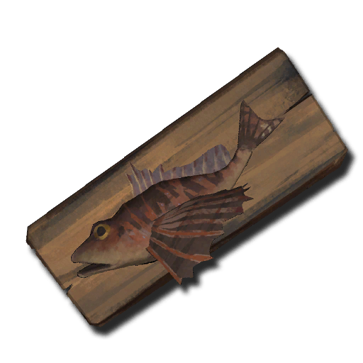 <a href="./Mounted%20Red%20Irish%20Lord.md" class="wikilink" title="Mounted Red Irish Lord">Mounted Red Irish Lord</a>
</td>
<td>
1x  <a href="./Fir%20Firewood.md" class="wikilink" title="Fir Firewood">Fir Firewood</a> 1x  <a href="./Red%20Irish%20Lord%20%28Raw%29.md" class="wikilink" title="Red Irish Lord (Raw)">Red Irish Lord (Raw)</a>
</td>
<td>
4 Hours
</td>
<td>
0.50 kg 
(1.1 lb)
</td>
<td>
<a href="./Furniture%20Workbench.md" class="wikilink" title="Furniture Workbench">Furniture Workbench</a>
</td>
</tr>
<tr>
<td>
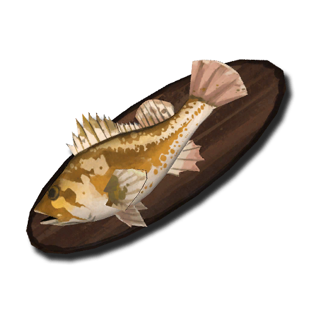 <a href="./Mounted%20Rockfish.md" class="wikilink" title="Mounted Rockfish">Mounted Rockfish</a>
</td>
<td>
1x  <a href="./Fir%20Firewood.md" class="wikilink" title="Fir Firewood">Fir Firewood</a> 1x  <a href="./Rockfish%20%28Raw%29.md" class="wikilink" title="Rockfish (Raw)">Rockfish (Raw)</a>
</td>
<td>
4 Hours
</td>
<td>
0.50 kg 
(1.1 lb)
</td>
<td>
<a href="./Furniture%20Workbench.md" class="wikilink" title="Furniture Workbench">Furniture Workbench</a>
</td>
</tr>
<tr>
<td>
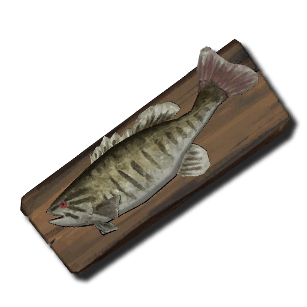 <a href="./Mounted%20Smallmouth%20Bass.md" class="wikilink" title="Mounted Smallmouth Bass">Mounted Smallmouth Bass</a>
</td>
<td>
1x  <a href="./Fir%20Firewood.md" class="wikilink" title="Fir Firewood">Fir Firewood</a> 1x  <a href="./Smallmouth%20Bass%20%28Raw%29.md" class="wikilink" title="Smallmouth Bass (Raw)">Smallmouth Bass (Raw)</a>
</td>
<td>
4 Hours
</td>
<td>
0.50 kg 
(1.1 lb)
</td>
<td>
<a href="./Furniture%20Workbench.md" class="wikilink" title="Furniture Workbench">Furniture Workbench</a>
</td>
</tr>
<tr>
<td>
 <a href="./Rustic%20Stool.md" class="wikilink" title="Rustic Stool">Rustic Stool</a>
</td>
<td>
4x  <a href="./Fir%20Firewood.md" class="wikilink" title="Fir Firewood">Fir Firewood</a>
</td>
<td>
2 Hours
</td>
<td>
2.00 kg 
(4.4 lb)
</td>
<td>
<a href="./Furniture%20Workbench.md" class="wikilink" title="Furniture Workbench">Furniture Workbench</a>
</td>
</tr>
</tbody>
</table>

## Update History

**Template:update historyLua execution error in Module:Navbox function navbox**

