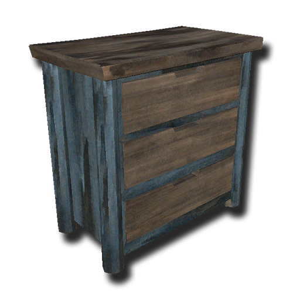
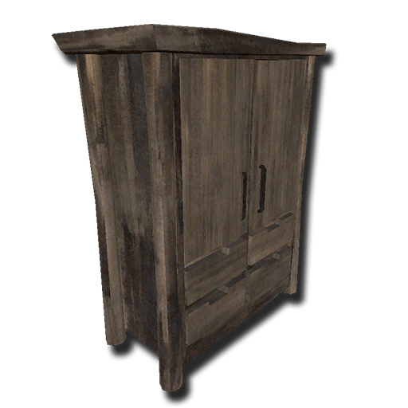
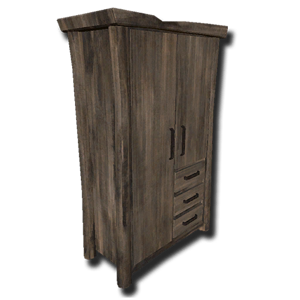
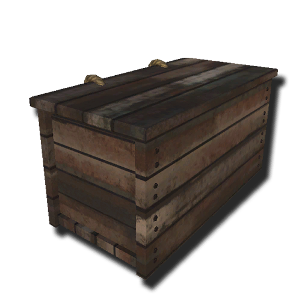
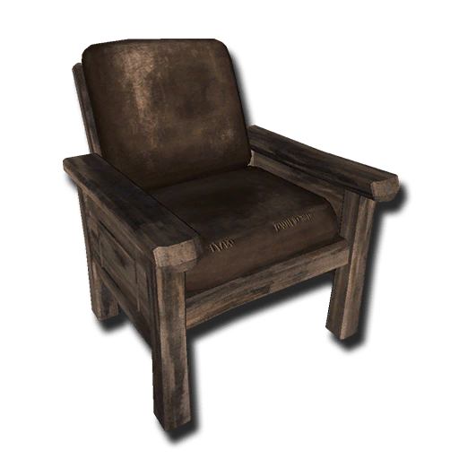
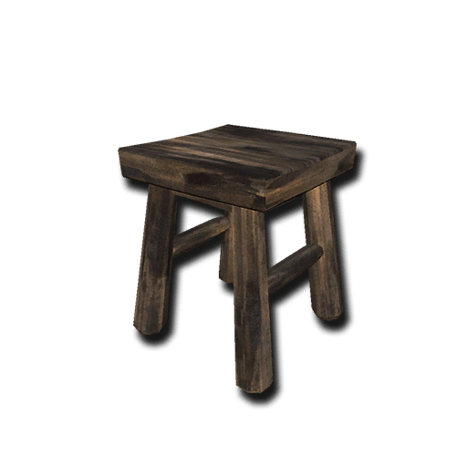

# Furniture Workbench

**Categories:** Interactable Objects · **Source:** [Fandom](https://thelongdark.fandom.com/wiki/Furniture_Workbench)

**Contents**

- [Overview](#overview)
- [Crafting](#crafting)
- [Craftable Items](#craftable-items)
- [Update History](#update-history)

**Furniture Workbench**

_Furniture\_Workbench\_icon.png_

**Release:** [TFTFT Part 6 Broken Silence](./The%20Long%20Dark%20%E2%80%94%20Changelog.md#2.33)

**Values**

**Weight:** 15.00 kg (33 lbs)

**Actions**

**Backpack:** Drop, Place

The **Furniture Workbench** is a [Decorations](./Decorations.md) item that can be [Crafted](./Crafting.md) as part of the [Safehouse Customization](./Safehouse%20Customization.md) feature.

## Overview

The Furniture Workbench is the primary crafting facility used to build large decorative furniture items within any interior Safehouse. It can be crafted and carried anywhere (though it weighs as much as a [Car Battery](./Car%20Battery.md)), but requires the very rare [Woodworking Tools](./Woodworking%20Tools.md) before it can be built. The Furniture Workbench can only be placed on a wide, clear space on the floor when in Customization Mode.

Once placed in a Safehouse, the Furniture Workbench cannot be picked up and placed back into the player's inventory, and so it cannot be carried from one base to another. The only option is to move or destroy it (destroying the Furniture Workbench will yield no resources, so consider the material cost/time investment before placing this item).

## Crafting

Any large in-progress/created Decorations made at a Furniture Workbench are deposited inside an invisible container tied to that Furniture Workbench.

- Opening the Workbench crafting menu and selecting Container will allow you to place large finished items around your Safehouse
- Smaller crafted items are placed in the player's inventory instead.
- An unlimited amount of large completed furniture can be stored in the Furniture Workbench's container, and will remain there until placed in the surrounding Safehouse.

**Furniture Workbench**

| Property | Details |
| --- | --- |
|  | - |
|  | - |
|  | 240 minutes (4 hour 0 minutes) |
| **Requirements** |  |
| Facility | \[\[File:Anywhere icon.png |
| Tool | **Template:iconlink** |
| **Materials** |  |
| **Template:iconlink plain** |  |
| Item | [Cedar Firewood](./Cedar%20Firewood.md) |
| Quantity | 10 |

## Craftable Items

Once crafted, the following Decorations crafted at a Furniture Workbench will be placed in a container in that Workbench (they can be placed your Safehouse by opening the Furniture Workbench and selecting them). They cannot be placed in the player's inventory despite having a weight class, and furniture with containers cannot be broken down to regain some of their resources once placed in the Safehouse.

Recipe

Materials

Time

Weight

Crafted

 [Bear Hide Bed](./Bear%20Hide%20Bed.md)

18x  [Fir Firewood](./Fir%20Firewood.md) 4x [Cured Gut](./Cured%20Gut.md) / 1x  [Cured Black Bear Hide](./Cured%20Black%20Bear%20Hide.md) / 16x  [Ptarmigan Down](./Ptarmigan%20Down.md)

24 Hours

10.00 kg / _(22 lb)_

[Furniture Workbench](./Furniture%20Workbench.md)

 [Coffee Table](./Coffee%20Table.md)

6x  [Fir Firewood](./Fir%20Firewood.md)

4 Hours

5.00 kg / _(11 lb)_

[Furniture Workbench](./Furniture%20Workbench.md)

 [Rustic End Table](./Rustic%20End%20Table.md)

6x  [Cedar Firewood](./Cedar%20Firewood.md) 2x  [Reclaimed Wood](./Reclaimed%20Wood.md)

6 Hours

20.00 kg / _(44 lb)_

[Furniture Workbench](./Furniture%20Workbench.md)

 [Round Table](./Round%20Table.md)

12x  [Fir Firewood](./Fir%20Firewood.md)

9 Hours

5.00 kg / _(11 lb)_

[Furniture Workbench](./Furniture%20Workbench.md)

 [Rustic Table](./Rustic%20Table.md)

10x  [Fir Firewood](./Fir%20Firewood.md)

8 Hours

8.00 kg / _(17.6 lb)_

[Furniture Workbench](./Furniture%20Workbench.md)

 [Square Table](./Square%20Table.md)

8x  [Fir Firewood](./Fir%20Firewood.md)

7 Hours

5.00 kg / _(11 lb)_

[Furniture Workbench](./Furniture%20Workbench.md)

 [Rustic Chair](./Rustic%20Chair.md)

4x  [Cedar Firewood](./Cedar%20Firewood.md) 2x  [Reclaimed Wood](./Reclaimed%20Wood.md)

4 Hours

2.00 kg / _(4.4 lb)_

[Furniture Workbench](./Furniture%20Workbench.md)

 [Rustic Bench](./Rustic%20Bench.md)

10x  [Cedar Firewood](./Cedar%20Firewood.md) 2x  [Reclaimed Wood](./Reclaimed%20Wood.md)

8 Hours

2.00 kg / _(4.4 lb)_

[Furniture Workbench](./Furniture%20Workbench.md)

 [Dresser](./Dresser.md)

10x  [Cedar Firewood](./Cedar%20Firewood.md) 4x  [Reclaimed Wood](./Reclaimed%20Wood.md)

8 Hours

25.00 kg / _(55 lb)_

[Furniture Workbench](./Furniture%20Workbench.md)

 [Wide Dresser](./Wide%20Dresser.md)

16x  [Fir Firewood](./Fir%20Firewood.md) 6x  [Reclaimed Wood](./Reclaimed%20Wood.md)

11 Hours

25.00 kg / _(55 lb)_

[Furniture Workbench](./Furniture%20Workbench.md)

 [Rustic Shelf](./Rustic%20Shelf.md)

8x  [Cedar Firewood](./Cedar%20Firewood.md)

6 Hours

6.00 kg / _(13.2 lb)_

[Furniture Workbench](./Furniture%20Workbench.md)

 [Tall Rustic Shelf](./Tall%20Rustic%20Shelf.md)

10x  [Cedar Firewood](./Cedar%20Firewood.md)

8 Hours

5.00 kg / _(11 lb)_

[Furniture Workbench](./Furniture%20Workbench.md)

 [Display Shelf](./Display%20Shelf.md)

12x  [Fir Firewood](./Fir%20Firewood.md) 4x  [Reclaimed Wood](./Reclaimed%20Wood.md)

10 Hours

20.00 kg / _(44 lb)_

[Furniture Workbench](./Furniture%20Workbench.md)

 [Rustic Closet](./Rustic%20Closet.md)

18x  [Fir Firewood](./Fir%20Firewood.md) 3x  [Reclaimed Wood](./Reclaimed%20Wood.md) / 2x  [Scrap Metal](./Scrap%20Metal.md)

9 Hours

15.00 kg / _(33 lb)_

[Furniture Workbench](./Furniture%20Workbench.md)

 [Tall Rustic Closet](./Tall%20Rustic%20Closet.md)

24x  [Fir Firewood](./Fir%20Firewood.md) 4x  [Reclaimed Wood](./Reclaimed%20Wood.md) / 2x  [Scrap Metal](./Scrap%20Metal.md)

10 Hours

15.00 kg / _(33 lb)_

[Furniture Workbench](./Furniture%20Workbench.md)

 [Rustic Cupboard](./Rustic%20Cupboard.md)

10x  [Fir Firewood](./Fir%20Firewood.md) 2x  [Reclaimed Wood](./Reclaimed%20Wood.md) / 1x  [Scrap Metal](./Scrap%20Metal.md)

8 Hours

15.00 kg / _(33 lb)_

[Furniture Workbench](./Furniture%20Workbench.md)

 [Rustic Storage Box](./Rustic%20Storage%20Box.md)

8x  [Cedar Firewood](./Cedar%20Firewood.md)

6 Hours

2.00 kg / _(4.4 lb)_

[Furniture Workbench](./Furniture%20Workbench.md)

 [Rustic Storage Trunk](./Rustic%20Storage%20Trunk.md)

9x  [Fir Firewood](./Fir%20Firewood.md)

4 Hours

5.00 kg / _(11 lb)_

[Furniture Workbench](./Furniture%20Workbench.md)

 [Wide Display Shelf](./Wide%20Display%20Shelf.md)

18x  [Fir Firewood](./Fir%20Firewood.md) 4x  [Reclaimed Wood](./Reclaimed%20Wood.md)

11 Hours

20.00 kg / _(44 lb)_

[Furniture Workbench](./Furniture%20Workbench.md)

 [Rustic Display Shelf](./Rustic%20Display%20Shelf.md)

10x  [Fir Firewood](./Fir%20Firewood.md) 2x  [Reclaimed Wood](./Reclaimed%20Wood.md)

9 Hours

20.00 kg / _(44 lb)_

[Furniture Workbench](./Furniture%20Workbench.md)

 [Rustic Bed](./Rustic%20Bed.md)

10x  [Cedar Firewood](./Cedar%20Firewood.md) 12x  [Cloth](./Cloth.md) / 2x [Cured Gut](./Cured%20Gut.md)

12 Hours

5.00 kg / _(11 lb)_

[Furniture Workbench](./Furniture%20Workbench.md)

 [Work Bench](./Work%20Bench.md)

15x  [Cedar Firewood](./Cedar%20Firewood.md) 1x  [Workbench Vice](./Workbench%20Vice.md)

18 Hours

5.00 kg / _(11 lb)_

[Furniture Workbench](./Furniture%20Workbench.md)

 [Meat Curing Box](./Meat%20Curing%20Box.md)

10x  [Fir Firewood](./Fir%20Firewood.md) 8.00kg x  [Salt](./Salt.md)

6 Hours

10.00 kg / _(22 lb)_

[Furniture Workbench](./Furniture%20Workbench.md)

 [Quilted Bed](./Quilted%20Bed.md)

12x  [Fir Firewood](./Fir%20Firewood.md) 10x  [Cloth](./Cloth.md) / 6x [Cured Gut](./Cured%20Gut.md) / 16x  [Ptarmigan Down](./Ptarmigan%20Down.md)

20 Hours

10.00 kg / _(22 lb)_

[Furniture Workbench](./Furniture%20Workbench.md)

 [Hide Couch](./Hide%20Couch.md)

15x  [Fir Firewood](./Fir%20Firewood.md) 4x  [Cured Deer Hide](./Cured%20Deer%20Hide.md) / 16x  [Ptarmigan Down](./Ptarmigan%20Down.md) / 5x [Cured Gut](./Cured%20Gut.md)

16 Hours

10.00 kg / _(22 lb)_

[Furniture Workbench](./Furniture%20Workbench.md)

 [Hide Chair](./Hide%20Chair.md)

8x  [Fir Firewood](./Fir%20Firewood.md) 2x  [Cured Deer Hide](./Cured%20Deer%20Hide.md) / 8x  [Ptarmigan Down](./Ptarmigan%20Down.md) / 3x [Cured Gut](./Cured%20Gut.md)

13 Hours

5.00 kg / _(11 lb)_

[Furniture Workbench](./Furniture%20Workbench.md)

The following Decorations are automatically placed into the player's inventory once crafted.

Recipe

Materials

Time

Weight

Crafted

 [Framed Hockey Jersey](./Framed%20Hockey%20Jersey.md)

2x  [Fir Firewood](./Fir%20Firewood.md) 1x  [Scrap Metal](./Scrap%20Metal.md) / 1x  [Hockey Jersey](./Hockey%20Jersey.md)

4 Hours

2.00 kg / _(4.4 lb)_

[Furniture Workbench](./Furniture%20Workbench.md)

 [Framed Photo](./Framed%20Photo.md)

1x  [Fir Firewood](./Fir%20Firewood.md) 1x  [Camera](./Camera.md) Photo

2 Hours

0.25 kg / _(0.55 lb)_

[Furniture Workbench](./Furniture%20Workbench.md)

 [Mounted Burbot](./Mounted%20Burbot.md)

1x  [Fir Firewood](./Fir%20Firewood.md) 1x  [Burbot (Raw)](./Burbot%20%28Raw%29.md)

4 Hours

0.50 kg / _(1.1 lb)_

[Furniture Workbench](./Furniture%20Workbench.md)

 [Mounted Coho Salmon](./Mounted%20Coho%20Salmon.md)

1x  [Fir Firewood](./Fir%20Firewood.md) 1x  [Coho Salmon (Raw)](./Coho%20Salmon%20%28Raw%29.md)

4 Hours

1.00 kg / _(2.2 lb)_

[Furniture Workbench](./Furniture%20Workbench.md)

 [Mounted Goldeye](./Mounted%20Goldeye.md)

1x  [Fir Firewood](./Fir%20Firewood.md) 1x  [Goldeye (Raw)](./Goldeye%20%28Raw%29.md)

4 Hours

0.50 kg / _(1.1 lb)_

[Furniture Workbench](./Furniture%20Workbench.md)

 [Mounted Lake Whitefish](./Mounted%20Lake%20Whitefish.md)

1x  [Fir Firewood](./Fir%20Firewood.md) 1x  [Lake Whitefish (Raw)](./Lake%20Whitefish%20%28Raw%29.md)

4 Hours

0.50 kg / _(1.1 lb)_

[Furniture Workbench](./Furniture%20Workbench.md)

 [Mounted Rainbow Trout](./Mounted%20Rainbow%20Trout.md)

1x  [Fir Firewood](./Fir%20Firewood.md) 1x  [Rainbow Trout (Raw)](./Rainbow%20Trout%20%28Raw%29.md)

4 Hours

0.50 kg / _(1.1 lb)_

[Furniture Workbench](./Furniture%20Workbench.md)

 [Mounted Red Irish Lord](./Mounted%20Red%20Irish%20Lord.md)

1x  [Fir Firewood](./Fir%20Firewood.md) 1x  [Red Irish Lord (Raw)](./Red%20Irish%20Lord%20%28Raw%29.md)

4 Hours

0.50 kg / _(1.1 lb)_

[Furniture Workbench](./Furniture%20Workbench.md)

 [Mounted Rockfish](./Mounted%20Rockfish.md)

1x  [Fir Firewood](./Fir%20Firewood.md) 1x  [Rockfish (Raw)](./Rockfish%20%28Raw%29.md)

4 Hours

0.50 kg / _(1.1 lb)_

[Furniture Workbench](./Furniture%20Workbench.md)

 [Mounted Smallmouth Bass](./Mounted%20Smallmouth%20Bass.md)

1x  [Fir Firewood](./Fir%20Firewood.md) 1x  [Smallmouth Bass (Raw)](./Smallmouth%20Bass%20%28Raw%29.md)

4 Hours

0.50 kg / _(1.1 lb)_

[Furniture Workbench](./Furniture%20Workbench.md)

 [Rustic Stool](./Rustic%20Stool.md)

4x  [Fir Firewood](./Fir%20Firewood.md)

2 Hours

2.00 kg / _(4.4 lb)_

[Furniture Workbench](./Furniture%20Workbench.md)

## Update History
