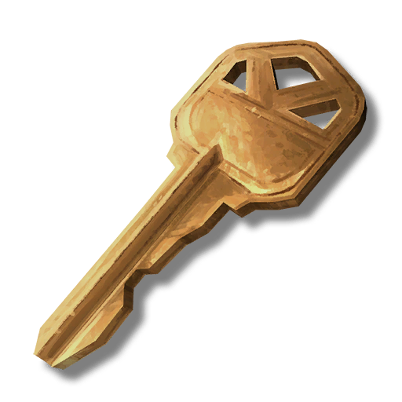

# Garage Key

**Categories:** Collectibles, Pages with update history · **Source:** [Fandom](https://thelongdark.fandom.com/wiki/Garage_Key)

**Garage Key**

_Garage\_Key\_icon.png_

**Release:** [31 March 2026](./The%20Long%20Dark%20%E2%80%94%20Changelog.md#2.52)

**Wintermute:** [Episode 5: The Light At The End Of All Things](./Episode%205%20-%20The%20Light%20At%20The%20End%20Of%20All%20Things.md)

**Properties**

**Item type:** [Collectibles](./Collectibles.md)

**Stackable:** No

**Examine:** On the tag, the word "garage" is crossed out, replaced by "morgue".

**Values**

**Weight:** 0.00 kg (0 lbs)

**Actions**

**Backpack:** Examine

**On ground:** Take It, Read Text, Leave It

**Garage Key** is a [Collectibles](./Collectibles.md) found in [Episode 5](./Episode%205%20-%20The%20Light%20At%20The%20End%20Of%20All%20Things.md) of the [Wintermute](./Wintermute.md) story. It is found inside the [Constable's Office](./Constable%27s%20Office.md) during the main mission [Perseverance](./Perseverance.md). It is used to open the Clinic's locked Morgue door.

## Update history

\* UPDATE **31 March 2026 ([Update](./The%20Long%20Dark%20%E2%80%94%20Changelog.md#2.52)):**

  - Added to game.
