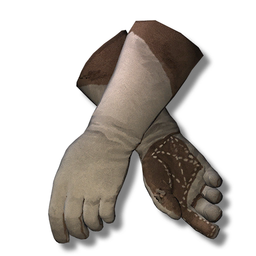
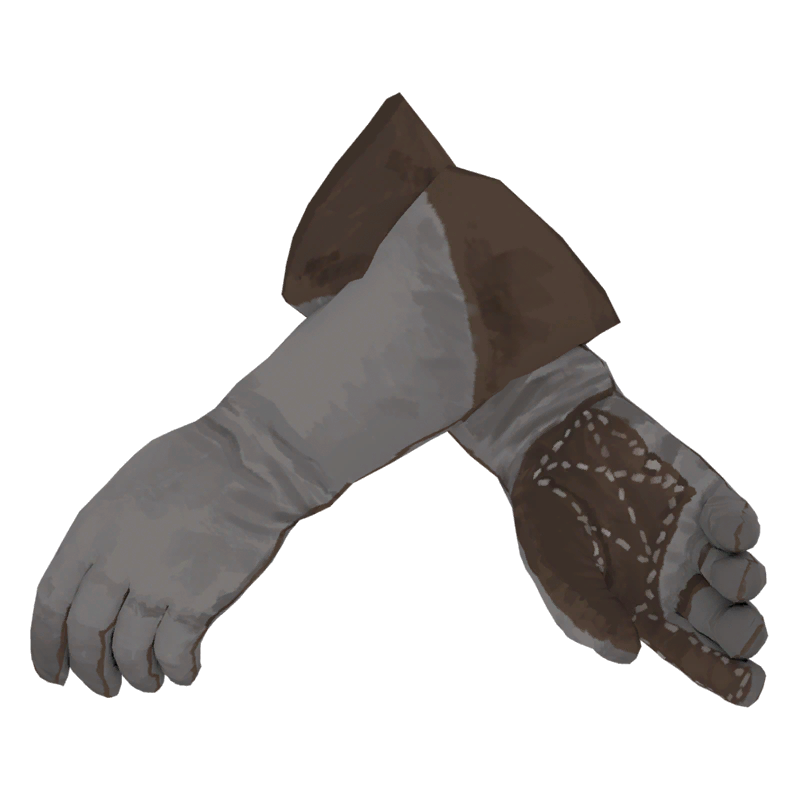

# Gauntlets

<table class="infobox">
<caption>Gauntlets</caption>
<colgroup>
<col style="width: 50%" />
<col style="width: 50%" />
</colgroup>
<tbody>
<tr>
<td colspan="2"><figure>

<figcaption>Gauntlets_icon.png</figcaption>
</figure></td>
</tr>
<tr>
<td colspan="2" class="section">
<strong>General</strong>
</td>
</tr>
<tr>
<td>
Item Type
</td>
<td>
Clothing|-
</td>
</tr>
<tr>
<td colspan="2" class="section">
<strong>Statistics</strong>
</td>
</tr>
<tr>
<td>
Weight
</td>
<td>
1.00 kg(2.2 lbs)
</td>
</tr>
<tr>
<td>
Warmth bonus
</td>
<td>
2.0 °C(3.6 °F)
</td>
</tr>
<tr>
<td>
Windproof bonus
</td>
<td>
2.0 °C(3.6 °F)
</td>
</tr>
<tr>
<td>
Waterproof bonus
</td>
<td>
40%
</td>
</tr>
<tr>
<td>
Protection
</td>
<td>
6%
</td>
</tr>
<tr>
<td>
Mobility
</td>
<td>
-3%
</td>
</tr>
<tr>
<td>
Harvest
</td>
<td>
1 × <a href="./Cured%20Leather.md" class="wikilink" title="Cured leather">Cured leather</a> 10 minutes
</td>
</tr>
<tr>
<td>
Repair
</td>
<td>
1 × <a href="./Cured%20Leather.md" class="wikilink" title="Cured leather">Cured leather</a> 30 minutes 
65% condition
</td>
</tr>
</tbody>
</table>

<table>
<colgroup>
<col style="width: 33%" />
<col style="width: 33%" />
<col style="width: 33%" />
</colgroup>
<tbody>
<tr>
<td style="vertical-align: top; font-size: 3em; color: #5d5980; padding-right: 10px">
“
</td>
<td>
Heavy duty hand coverings that extend part way up the arm. Leather outers and wool liners. Warm and tough, just like you want to be.

&#10;

In-game description

</td>
<td style="vertical-align: bottom; font-size: 3em; color: #5d5980; padding-left: 10px">
”
</td>
</tr>
</tbody>
</table>

**Gauntlets** are a type of <a href="./Clothing.md" class="wikilink" title="clothing">clothing</a> in *<a href="./The%20Long%20Dark.md" class="wikilink" title="The Long Dark">The Long Dark</a>*. Gauntlets provide the highest warmth bonus of any pair of naturally spawning gloves. Unfortunately, they also have the worst warmth-to-weight ratio (tied with <a href="./Rabbitskin%20Mitts.md" class="wikilink" title="Rabbitskin Mitts">Rabbitskin Mitts</a> and <a href="./Ski%20Gloves.md" class="wikilink" title="Ski Gloves">Ski Gloves</a>). Gauntlets have nearly identical stats to the Rabbitskin Mitts, but need <a href="./Cured%20Leather.md" class="wikilink" title="cured leather">cured leather</a> for repair. Gauntlets tend to be rather rare, but may be found in:

- <a href="./Old%20Spence%20Family%20Homestead.md" class="wikilink" title="Old Spence Family Homestead">Old Spence Family Homestead</a> in <a href="./Forlorn%20Muskeg.md" class="wikilink" title="Forlorn Muskeg">Forlorn Muskeg</a>
- <a href="./Hunting%20Lodge.md" class="wikilink" title="Hunting Lodge">Hunting Lodge</a> in <a href="./Broken%20Railroad.md" class="wikilink" title="Broken Railroad">Broken Railroad</a>
- A random house in <a href="./Milton.md" class="wikilink" title="Milton">Milton</a>
- <a href="./Carter%20Hydro%20Dam.md" class="wikilink" title="Carter Hydro Dam">Carter Hydro Dam</a> in a tool box
- A crate in the <a href="./Maintenance%20Yard.md" class="wikilink" title="Maintenance Yard">Maintenance Yard</a> warehouse in <a href="./Broken%20Railroad.md" class="wikilink" title="Broken Railroad">Broken Railroad</a>
- In Blackrock prepper cache behind ladder on metal shelf

Not available in Interloper mode.

## Gallery

<table class="gallery">
<colgroup>
<col style="width: 50%" />
<col style="width: 50%" />
</colgroup>
<tbody>
<tr>
<td><figure>

<figcaption>Clothing model</figcaption>
</figure></td>
<td><figure>

<figcaption>Clothing model damaged</figcaption>
</figure></td>
</tr>
</tbody>
</table>

## Update history

- UPDATE **19 December 2016 (<a href="./The%20Long%20Dark%20%E2%80%94%20Early%20Access%20Changelog.md#0.386" class="wikilink" title="Update">Update</a>):**
  - Added to game

**Lua execution error in Module:Navbox function navbox** <a href="ru:%D0%A0%D1%83%D0%BA%D0%B0%D0%B2%D0%B8%D1%86%D1%8B" class="wikilink" title="ru:Рукавицы">ru:Рукавицы</a>

