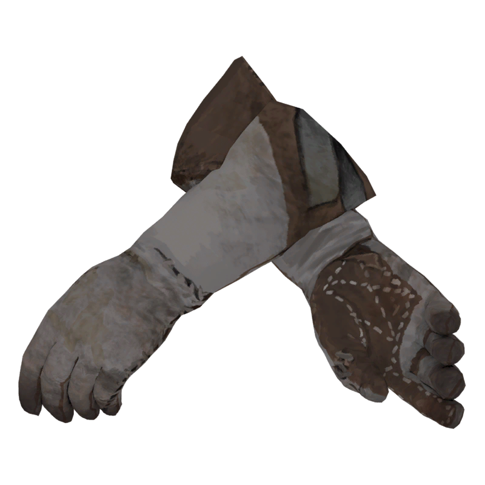

# Gauntlets

**Gauntlets**

| Property | Details |
| --- | --- |
|  |  / *Gauntlets\_icon.png* |
| **General** |  |
| Item Type | Clothing\|- |
| **Statistics** |  |
| Weight | 1.00 kg(2.2 lbs) |
| Warmth bonus | 2.0 °C(3.6 °F) |
| Windproof bonus | 2.0 °C(3.6 °F) |
| Waterproof bonus | 40% |
| Protection | 6% |
| Mobility | -3% |
| Harvest | 1 × [Cured leather](./Cured%20Leather.md) 10 minutes |
| Repair | 1 × [Cured leather](./Cured%20Leather.md) 30 minutes / 65% condition |

> “**Heavy duty hand coverings that extend part way up the arm. Leather outers and wool liners. Warm and tough, just like you want to be.**”
>
> — In-game description

**Gauntlets** are a type of [clothing](./Clothing.md) in *[The Long Dark](./The%20Long%20Dark.md)*. Gauntlets provide the highest warmth bonus of any pair of naturally spawning gloves. Unfortunately, they also have the worst warmth-to-weight ratio (tied with [Rabbitskin Mitts](./Rabbitskin%20Mitts.md) and [Ski Gloves](./Ski%20Gloves.md)). Gauntlets have nearly identical stats to the Rabbitskin Mitts, but need [cured leather](./Cured%20Leather.md) for repair. Gauntlets tend to be rather rare, but may be found in:

- [Old Spence Family Homestead](./Old%20Spence%20Family%20Homestead.md) in [Forlorn Muskeg](./Forlorn%20Muskeg.md)
- [Hunting Lodge](./Hunting%20Lodge.md) in [Broken Railroad](./Broken%20Railroad.md)
- A random house in [Milton](./Milton.md)
- [Carter Hydro Dam](./Carter%20Hydro%20Dam.md) in a tool box
- A crate in the [Maintenance Yard](./Maintenance%20Yard.md) warehouse in [Broken Railroad](./Broken%20Railroad.md)
- In Blackrock prepper cache behind ladder on metal shelf

Not available in Interloper mode.

## Gallery

| Column 1 | Column 2 |
| --- | --- |
|  / *Clothing model* |  / *Clothing model damaged* |

## Update history

- UPDATE **19 December 2016 ([Update](./The%20Long%20Dark%20%E2%80%94%20Early%20Access%20Changelog.md#0.386)):**
  - Added to game

**Lua execution error in Module:Navbox function navbox** [ru:Рукавицы](ru:%D0%A0%D1%83%D0%BA%D0%B0%D0%B2%D0%B8%D1%86%D1%8B)
