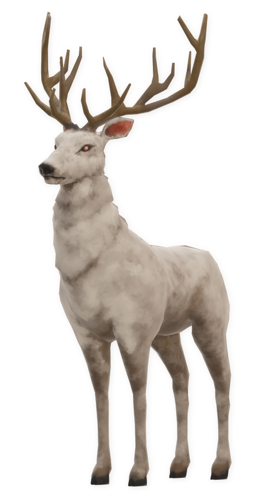

# Ghost Stag

<table class="infobox">
<caption>Ghost Stag</caption>
<colgroup>
<col style="width: 50%" />
<col style="width: 50%" />
</colgroup>
<tbody>
<tr>
<td colspan="2"><figure>

<figcaption>Ghost_Stag.png</figcaption>
</figure></td>
</tr>
<tr>
<td colspan="2" class="section">
<strong>Basic Information</strong>
</td>
</tr>
<tr>
<td>
Release
</td>
<td>
<a href="./The%20Long%20Dark%20%E2%80%94%20Changelog.md#1.60" class="wikilink" title="22 October 2019">22 October 2019</a>
</td>
</tr>
<tr>
<td>
Role
</td>
<td>
Prey
</td>
</tr>
<tr>
<td colspan="2" class="section">
<strong>Physical Information</strong>
</td>
</tr>
<tr>
<td>
Color
</td>
<td>
White
</td>
</tr>
<tr>
<td>
Size
</td>
<td>
Medium
</td>
</tr>
<tr>
<td>
Eyes
</td>
<td>
Red
</td>
</tr>
</tbody>
</table>

**Spoiler Warning:***This page may contain spoilers from the <a href="./Wintermute.md" class="wikilink" title="story">story</a> of The Long Dark.*

<table>
<colgroup>
<col style="width: 33%" />
<col style="width: 33%" />
<col style="width: 33%" />
</colgroup>
<tbody>
<tr>
<td style="vertical-align: top; font-size: 3em; color: #5d5980; padding-right: 10px">
“
</td>
<td>
Long battered by harsh winters and isolation, Pleasant Valley residents often sought refuge and comfort in nature. A favourite pastime was standing watch for a legendary stag, which the older locals claimed could bring about a special insight. 
That is if you could ever find the wild creature. Whether it was the mysterious animal itself, or the very act of peaceful observation which brought this new awareness to light, no one rightly knows any more.

&#10;

<a href="./Local%20Legends%20-%20Ghost%20Stag.md" class="wikilink" title="Local Legends - Ghost Stag">Local Legends - Ghost Stag</a>

</td>
<td style="vertical-align: bottom; font-size: 3em; color: #5d5980; padding-left: 10px">
”
</td>
</tr>
</tbody>
</table>

The **Ghost Stag** is a legendary <a href="./Deer.md" class="wikilink" title="Deer">Deer</a> rumored to be located within <a href="./Pleasant%20Valley.md" class="wikilink" title="Pleasant Valley">Pleasant Valley</a> and is sought after in the <a href="./Tall%20Tales.md" class="wikilink" title="Tall Tales">Tall Tales</a> side mission of <a href="./Episode%203%20-%20Crossroads%20Elegy.md" class="wikilink" title="Episode 3">Episode 3</a> of <a href="./Wintermute.md" class="wikilink" title="Wintermute">Wintermute</a>. It is an albino Deer and the only one of its kind in the game.

## Story

The Ghost Stag is first learned about by the player after reading the book <a href="./Local%20Legends%20-%20Ghost%20Stag.md" class="wikilink" title="Local Legends - Ghost Stag">Local Legends - Ghost Stag</a>. This book can be found in the <a href="./Draft%20Dodger%27s%20Cabin.md" class="wikilink" title="Draft Dodger&#39;s Cabin">Draft Dodger's Cabin</a> within <a href="./Pleasant%20Valley.md" class="wikilink" title="Pleasant Valley">Pleasant Valley</a>.

After reading this book, the Ghost Stag will appear after the player sleep inside the <a href="./Snow%20Shelter.md" class="wikilink" title="Snow Shelter">Snow Shelter</a> adjacent to the <a href="./Three%20Strikes%20Farmstead.md" class="wikilink" title="Three Strikes Farmstead">Three Strikes Farmstead</a>. Upon awakening and seeing the Ghost Stag, the side mission objective will complete, and the player will be rewarded with insight on how to craft <a href="./Deerskin%20Boots.md" class="wikilink" title="Deerskin Boots">Deerskin Boots</a> and <a href="./Deerskin%20Pants.md" class="wikilink" title="Deerskin Pants">Deerskin Pants</a>.

Once the player leaves the Snow Shelter, the Ghost Stag will run away upon spotting the player. It cannot be killed, even if shot repeatedly by the player, and will simply run off and despawn after enough time passes.

## Gallery

<table class="gallery">
<colgroup>
<col style="width: 100%" />
</colgroup>
<tbody>
<tr>
<td><figure>
[Missing image: Ghost_stag.jpg]
<figcaption>The Ghost Stag</figcaption>
</figure></td>
</tr>
</tbody>
</table>

**Lua execution error in Module:Navbox function navbox**

