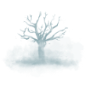

# Glimmer Fog

**Contents**

- [Overview](#Overview)
- [Wintermute](#Wintermute)
- [Origin](#Origin)
- [Effects](#Effects)
- [Gallery](#Gallery)
- [Trivia](#Trivia)

<table style="width:100%;">
<colgroup>
<col style="width: 16%" />
<col style="width: 16%" />
<col style="width: 16%" />
<col style="width: 16%" />
<col style="width: 16%" />
<col style="width: 16%" />
</colgroup>
<tbody>
<tr>
<td width="40px"><figure>
[Missing image: Ptarmigan_icon.png]
<figcaption>Ptarmigan_icon.png</figcaption>
</figure></td>
<td>
<strong>DLC-Exclusive content.</strong> 

This content requires the <a href="./Tales%20from%20the%20Far%20Territory.md" class="wikilink" title="Tales from the Far Territory">Tales from the Far Territory</a> addon to be installed before it can be seen or used in regular gameplay.

</td>
<td>
|}{| style="margin:auto"
</td>
<td style="vertical-align: top; font-size: 3em; color: #5d5980; padding-right: 10px">
“
</td>
<td>
A mysterious phenomenon first encountered in the Far Territory, Glimmer Fog charges the air and ground with electrostatic energy, animating some electronics in entirely unpredictable ways.
</td>
<td style="vertical-align: bottom; font-size: 3em; color: #5d5980; padding-left: 10px">
”
</td>
</tr>
</tbody>
</table>

\- [Official description](https://www.thelongdark.com/expansion/) from the Tales From the Far Territory Website Page

## Overview

Glimmer Fog is a unique variant of heavy fog within <a href="./Region.md" class="wikilink" title="Regions">Regions</a> of the <a href="./Tales%20from%20the%20Far%20Territory.md" class="wikilink" title="Far Territory">Far Territory</a> of <a href="./Great%20Bear%20Island.md" class="wikilink" title="Great Bear Island">Great Bear Island</a>: <a href="./Forsaken%20Airfield.md" class="wikilink" title="Forsaken Airfield">Forsaken Airfield</a>, <a href="./Zone%20of%20Contamination.md" class="wikilink" title="Zone of Contamination">Zone of Contamination</a>, and <a href="./Sundered%20Pass.md" class="wikilink" title="Sundered Pass">Sundered Pass</a> in <a href="./Survival%20Mode.md" class="wikilink" title="Survival Mode">Survival Mode</a>.

Like <a href="./Weather.md" class="wikilink" title="Heavy Fog">Heavy Fog</a>, Glimmer Fog reduces visibility (preventing <a href="./Charcoal.md" class="wikilink" title="Surveying">Surveying</a> and use of the <a href="./Magnifying%20Lens.md" class="wikilink" title="Magnifying Lens">Magnifying Lens</a>) but also risks <a href="./Insomnia.md" class="wikilink" title="Insomnia">Insomnia</a> when the survivor is above-ground, and similar to <a href="./Aurora.md" class="wikilink" title="Auroras">Auroras</a>: temporarily powers electronics (e.g. <a href="./Handheld%20Shortwave%20Radio.md" class="wikilink" title="Handheld Shortwave Radio">Handheld Shortwave Radio</a>, <a href="./Flashlight.md" class="wikilink" title="Flashlight">Flashlight</a>, vehicle headlights). Glimmer Fog causes snow and ice to crackle and discharge electricity constantly, while patches of fog flash with misty spectral colored lights.

Insomnia Risk may be avoided by traveling to specific underground areas or traveling to <a href="./Transfer%20Pass.md" class="wikilink" title="Transfer Pass">Transfer Pass</a>.

The nighttime equivalent to Glimmer Fog is the <a href="./Aurora.md" class="wikilink" title="Aurora">Aurora</a>.

### Wintermute

Glimmer Fog is also present near the <a href="./Suzuki%20Radio%20Telescope.md" class="wikilink" title="Suzuki Radio Telescope">Suzuki Radio Telescope</a> in <a href="./Episode%205%20-%20The%20Light%20At%20The%20End%20Of%20All%20Things.md" class="wikilink" title="Episode 5">Episode 5</a> of <a href="./Wintermute.md" class="wikilink" title="Wintermute">Wintermute</a> after two of the geothermal substations are repaired, though it does not cause <a href="./Insomnia.md" class="wikilink" title="Insomnia">Insomnia</a>. <a href="./Will%20Mackenzie.md" class="wikilink" title="Will Mackenzie">Will Mackenzie</a> comments that the air tastes like "metal in my mouth" as he passes through it.

### Origin

Despite its specific origin being unclear, Glimmer Fog is not a natural phenomenon and is artificially produced. <a href="./R%C3%BCdiger%27s%20Machine.md" class="wikilink" title="Rüdiger&#39;s Machine">Rüdiger's Machine</a> in the <a href="./Zone%20of%20Contamination.md" class="wikilink" title="Zone of Contamination">Zone of Contamination</a> and the Geothermal Substations in the <a href="./Suzuki%20Geothermal%20Region.md" class="wikilink" title="Suzuki Geothermal Region">Suzuki Geothermal Region</a> both appear to concentrate the <a href="./Aurora.md" class="wikilink" title="Aurora&#39;s">Aurora's</a> electrical capabilities in such a way that they create electrostatic fog in the surrounding atmosphere. It can be theorized that other similar man made devices around the world can create Glimmer Fog.

## Effects

Glimmer Fog shares similarities to Auroras, but both weather types are distinct.

|                      | Aurora     | Glimmer Fog   |
|----------------------|------------|---------------|
| Occurs               | Night      | Day           |
| Powers Electronics   | Yes        | Yes           |
| Aurora Predators     | Yes        | No            |
| Electrocution Hazard | Yes        | No            |
| Insomnia Risk        | No         | Yes           |
| Occurs In            | Any Region | Far Territory |

Aurora and Glimmer Fog Properties

Note: Flashlights "high beam" mode are effective deterrents against aurora predators (during an Aurora), and while they will be powered during Glimmer Fog, flashlights **will be ineffective at deterring non-aurora predators**.

## Gallery

<table class="gallery">
<colgroup>
<col style="width: 50%" />
<col style="width: 50%" />
</colgroup>
<tbody>
<tr>
<td><figure>
[Missing image: Glimmer_Fog.jpg]
<figcaption>An example of Glimmer Fog. Notice the blue light patches in the fog.</figcaption>
</figure></td>
<td><figure>
[Missing image: Rüdiger's_Machine.jpg]
<figcaption>The machine inside the Langston Mine that creates Glimmer Fog</figcaption>
</figure></td>
</tr>
</tbody>
</table>

## Trivia

- A <a href="./Note%20%28Forsaken%20Airfield%29.md" class="wikilink" title="written note">written note</a> in Forsaken Airfield where the author details suffering from insomnia following glimmer fog, and their desire to evacuate the region.
- Glimmer Fog was introduced in the Part 1 Tales From The Far Territory DLC update.

**Lua execution error in Module:Navbox function navbox** <a href="ru:%D0%9C%D0%B5%D1%80%D1%86%D0%B0%D1%8E%D1%89%D0%B8%D0%B9_%D1%82%D1%83%D0%BC%D0%B0%D0%BD" class="wikilink" title="ru:Мерцающий туман">ru:Мерцающий туман</a>

