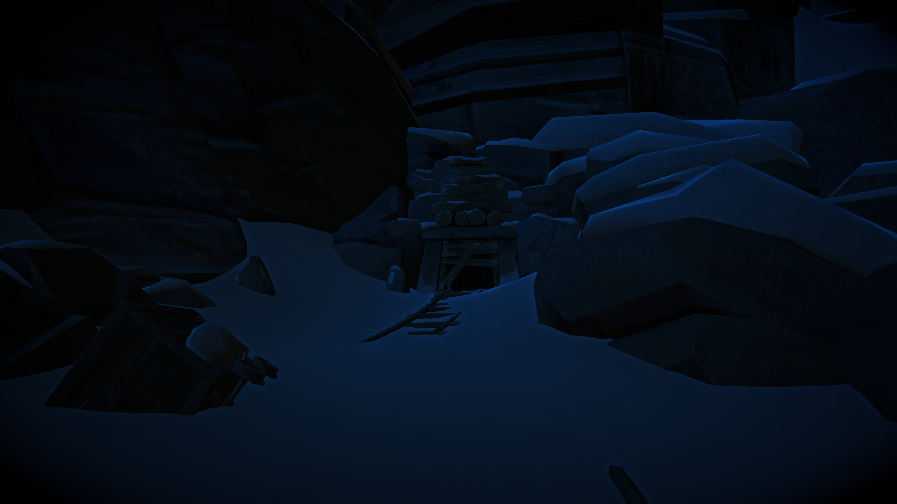
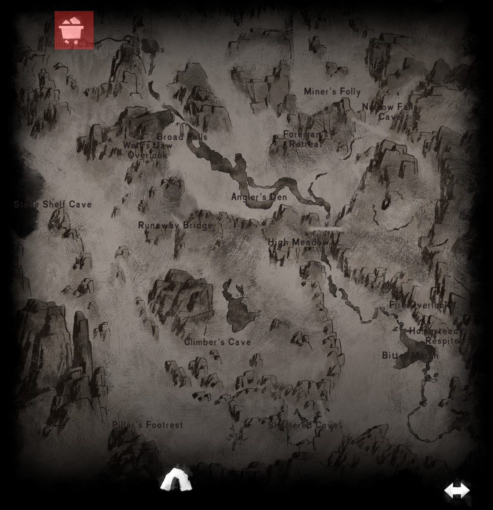

# Gold Mine

**Gold Mine**

| Property | Details |
| --- | --- |
|  |  / *Screen\_a7808681-3b40-4f43-919e-586a759f76bf\_hi.png* |
| **Location** |  |
|  |  / *Gold\_Mine\_Location.png* |
| Region | [Ash Canyon](./Ash%20Canyon.md)\|- |
| Description | An abandoned mine housing the [Technical Backpack](./Technical%20Backpack.md) and [Crampons](./Crampons.md) |
| **General** |  |
| Type | Cave\|- |
|  / *bed\_icon.png* | Has a bed |
|  / *workbench\_icon\_green.png* | Has a workbench\|- |
