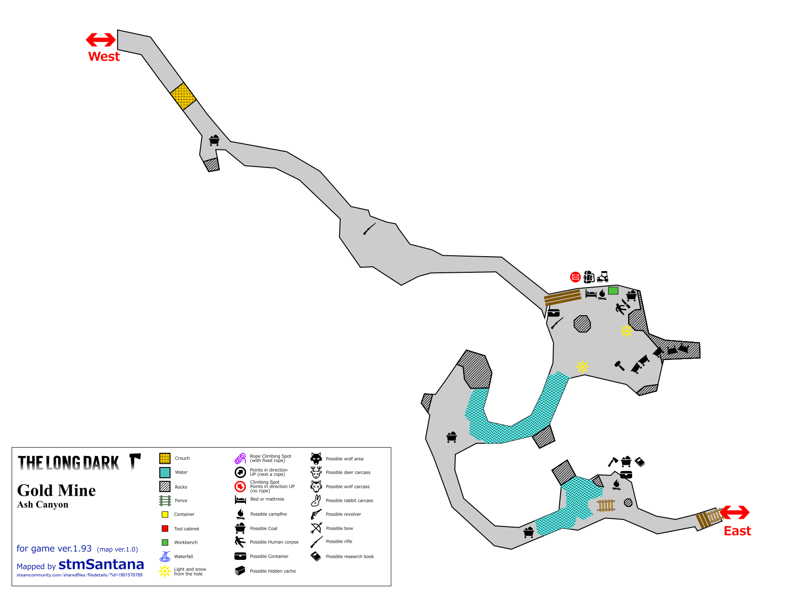

# Gold Mine

**Categories:** Caves, Indoor locations, Locations, Locations in Ash Canyon, Locations with a workbench · **Source:** [Fandom](https://thelongdark.fandom.com/wiki/Gold_Mine)

**Contents**

- [Overview](#overview)
- [Navigation](#navigation)
- [Resources](#resources)
- [Gallery](#gallery)

**Gold Mine**

| Property | Details |
| --- | --- |
|  | [Screen a7808681 3b40 4f43 919e 586a759f76bf hi](../assets/Screen_a7808681-3b40-4f43-919e-586a759f76bf_hi.png) |
| **Location** |  |
|  | [Gold Mine Location](../assets/Gold_Mine_Location.png) |
| Region | [Ash Canyon](./Ash%20Canyon.md)\|- |
| Description | An abandoned mine housing the [Technical Backpack](./Technical%20Backpack.md) and [Crampons](./Crampons.md) |
| **General** |  |
| Type | Cave\|- |
| [Bed icon](../assets/Bed_icon.png) | Has a bed |
| [Workbench icon green](../assets/Workbench_icon_green.png) | Has a workbench\|- |

## Overview

The Gold Mine is a mine next to the Mining Camp that is a must-visit for late-game players. The main entrance to the Gold Mine is next to the Mining Camp, but there is a back entrance on a cliff overlooking the ropes going from the overlook of the Mining Camp down near [Stone Shelf Cave](./Stone%20Shelf%20Cave.md). At the back entrance there is a [Frozen Corpse](./Frozen%20Corpse.md) in the middle of a steep drop down the mountain to the second plateau of the aforementioned rope climb. Higher on the plateau after the first rope climb and before the second, a snow shelter and a burnt out campfire may occasionally spawn, with a variety of tools and supplies (including a possible bow, hunting knife and hammer).

## Navigation

Navigating the Gold Mine is quite easy due to its very linear layout. You will need some sort of light source to be able to see, however. In between the entrance and the technical backpack spawn location, there is water in the mine that will freeze your boots and socks quite quickly; temporarily removing the feet clothing items to cross the water will avoid getting them wet.

## Resources

This is the only location in the game where Technical Backpack and the Crampons can be found. They are located far into the mine in an open section next to a frozen corpse, a [Fire Barrel](./Fire%20Barrel.md), a [Bed](./Bed.md), and a [Work Bench](./Work%20Bench.md). Besides these, the Gold Mine may also contain other items such as an [Expedition Parka](./Expedition%20Parka.md) , [Combat Pants](./Combat%20Pants.md) or very rarely a [Cowichan Sweater](./Cowichan%20Sweater.md). A [Hunting Rifle](./Hunting%20Rifle.md) located deeper into the mine near the back entrance, [Rifle Ammunition](./Rifle%20Ammunition.md), fire starting materials and an assortment of food items. Despite it being called a gold mine, it is impossible to find any gold anywhere in or around the mine. However, exploring the mine _will_ yield a backpack full of [Coal](./Coal.md).

## Gallery

