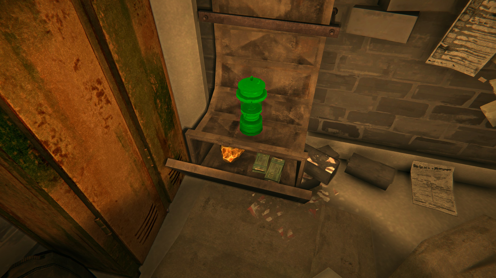

# Gold Nugget

**Categories:** Collectibles, DLC Content, Pages with update history, Wintermute · **Source:** [Fandom](https://thelongdark.fandom.com/wiki/Gold_Nugget)

**Contents**

- [Overview](#overview)
- [Wintermute](#wintermute)
- [Survival Mode](#survival-mode)
- [Langston Mine](#langston-mine)
- [Prepper Cache](#prepper-cache)
- [Gallery](#gallery)
- [Update history](#update-history)

**Gold Nugget**

[Gold Nugget icon](../assets/Gold_Nugget_icon.png)

**Wintermute:** Yes

**Properties**

**Item type:** [Collectibles](./Collectibles.md)

**Values**

**Weight:** 0.25 kg (0.55 lbs)

**Advanced data**

**Item key:** GAMEPLAY\_Ep4GoldNugget

[2120907963 TLD Wintermute v2.png.de8a285930f6a8f5ad9cf5878754cf5b](../assets/2120907963_TLD-Wintermute-v2.png.de8a285930f6a8f5ad9cf5878754cf5b.png)

**Wintermute-Exclusive content.** This content only appears in [Wintermute](./Wintermute.md).

{\| class="messagebox"

[Ptarmigan icon](../assets/Ptarmigan_icon.png)

**DLC-Exclusive content.** This content requires the [Tales from the Far Territory](./Tales%20from%20the%20Far%20Territory.md) addon to be installed before it can be seen or used in regular gameplay.

 A **Gold Nugget** is a [Collectible](./Collectibles.md) and [Tool](./Tools.md) in _The Long Dark_.

<!-- #Overview -->
​

<!-- #overview -->
## Overview

Golds Nuggets are rare collectible items with no function other than being a reward for exploration. Like other items, they may be inspected, picked up, and dropped but currently do not provide any other function.

<!-- #Wintermute -->
​

<!-- #wintermute -->
## Wintermute

A Gold Nugget is offered as the reward for the optional side-mission ([Blackrock Rumours](./Blackrock%20Rumours.md)) "Late Employee". It is treated as a Collectibles reward in [Wintermute](./Wintermute.md).

<!-- #survival_mode -->
​

<!-- #Survival_Mode -->
​

<!-- #Survival_mode -->
​

<!-- #survival-mode -->
## Survival Mode

It is treated as a Tool in Survival Mode, but serves no gameplay function. 2 Gold Nuggets can potentially be found in a single Survival run save.

<!-- #langston_mine -->
​

<!-- #Langston_Mine -->
​

<!-- #Langston_mine -->
​

<!-- #langston-mine -->
### Langston Mine

A Gold Nugget can always be found in Level 1 of the [Langston Mine](./Langston%20Mine.md) in [Zone of Contamination](./Zone%20of%20Contamination.md); it is inside of a trailer near a [Medical Locker](./Medical%20Locker.md), in a [Lock Box](./Lock%20Box.md) opened with the [Mine Lockbox Key](./Mine%20Lockbox%20Key.md). (requires [Tales from the Far Territory](./Tales%20from%20the%20Far%20Territory.md) to access).

<!-- #prepper_cache -->
​

<!-- #Prepper_Cache -->
​

<!-- #Prepper_cache -->
​

<!-- #prepper-cache -->
### Prepper Cache

A second Gold Nugget can also be found inside one of the stocked "Conspiracy" type [Prepper Caches](./Prepper%20Cache.md).

Depending on the cache layout generated, it spawns inside:

- Type 1 layout: 2 room cache layout thats spawns inside a [Grate](./Grate.md) (guaranteed).
- Type 2 layout: 1 room cache layout that potentially spawns inside a hidden [Safe](./Safe.md) behind the hatch ladder (randomly generated, not guaranteed to spawn).

<!-- #Gallery -->
​

<!-- #gallery -->
## Gallery

<!-- #update_history -->
​

<!-- #Update_history -->
​

<!-- #Update_History -->
​

<!-- #update-history -->
## Update history

- UPDATE **6 October 2021 ([Update](./The%20Long%20Dark%20%E2%80%94%20Changelog%20%E2%80%94%20Archive%202.md#1.95)):**
  - Added to game.
- UPDATE **21 June 2023 ([Update](./The%20Long%20Dark%20%E2%80%94%20Changelog.md#2.17)):**
  - Added to Survival Mode.

[ru:Золотой самородок](https://ru.wikipedia.org/wiki/%D0%97%D0%BE%D0%BB%D0%BE%D1%82%D0%BE%D0%B9_%D1%81%D0%B0%D0%BC%D0%BE%D1%80%D0%BE%D0%B4%D0%BE%D0%BA)
