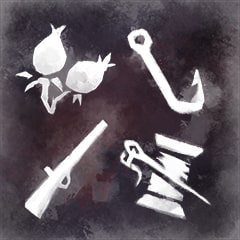

# Graduation Day

<table class="infobox">
<caption>Graduation Day</caption>
<colgroup>
<col style="width: 50%" />
<col style="width: 50%" />
</colgroup>
<tbody>
<tr>
<td colspan="2"><figure>

<figcaption>Graduation_Day_icon.png</figcaption>
</figure></td>
</tr>
<tr>
<td>
Description
</td>
<td>
Complete all six Survival School objectives across Episodes One and Two.
</td>
</tr>
</tbody>
</table>

**Graduation Day** is a <a href="./Wintermute.md" class="wikilink" title="Wintermute">Wintermute</a> <a href="./The%20Long%20Dark%20%E2%80%94%20Achievements.md" class="wikilink" title="Achievement">Achievement</a> across <a href="./Episode%201%20-%20Do%20Not%20Go%20Gentle.md" class="wikilink" title="Episode 1: Do Not Go Gentle">Episode 1: Do Not Go Gentle</a> and <a href="./Episode%202%20-%20Luminance%20Fugue.md" class="wikilink" title="Episode 2: Luminance Fugue">Episode 2: Luminance Fugue</a> of *<a href="./The%20Long%20Dark.md" class="wikilink" title="The Long Dark">The Long Dark</a>*.

## Guide

This is a side story achievement achieved after finding the following books and completing the following side missions across Episode 1 and 2:

- <a href="./The%20Basics%20of%20Survival.md" class="wikilink" title="The Basics of Survival">The Basics of Survival</a> in Episode 1
  - <a href="./A%20Sewing%20Primer%20%28The%20Basics%20of%20Survival%29.md" class="wikilink" title="A Sewing Primer (The Basics of Survival)">A Sewing Primer (The Basics of Survival)</a>
  - <a href="./Medicinal%20Plants%20of%20Great%20Bear.md" class="wikilink" title="Medicinal Plants of Great Bear">Medicinal Plants of Great Bear</a>
  - <a href="./Field%20Dressing%20Your%20Kill%2C%20Vol.%20I%20%28The%20Basics%20of%20Survival%29.md" class="wikilink" title="Field Dressing Your Kill, Vol. I (The Basics of Survival)">Field Dressing Your Kill, Vol. I (The Basics of Survival)</a>
- <a href="./Survival%20School.md" class="wikilink" title="Survival School">Survival School</a> for Episode 2.
  - <a href="./Frontier%20Shooting%20Guide%20%28Survival%20School%29.md" class="wikilink" title="Frontier Shooting Guide (Survival School)">Frontier Shooting Guide (Survival School)</a>
  - <a href="./Advanced%20Guns%20Guns%20Guns!%20%28Survival%20School%29.md" class="wikilink" title="Advanced Guns Guns Guns! (Survival School)">Advanced Guns Guns Guns! (Survival School)</a>
  - <a href="./The%20Frozen%20Angler%20%28Survival%20School%29.md" class="wikilink" title="The Frozen Angler (Survival School)">The Frozen Angler (Survival School)</a>

## Predux

The achievement is awarded after finishing the mission <a href="./Survival%20School%20%28Predux%29.md" class="wikilink" title="Survival School (Predux)">Survival School (Predux)</a>.

## Game History

- UPDATE **1 August 2017 (<a href="./The%20Long%20Dark%20%E2%80%94%20Changelog.md#1.00" class="wikilink" title="Update">Update</a>):**
  - Added to game.
- UPDATE **17 December 2018 (<a href="./The%20Long%20Dark%20%E2%80%94%20Changelog.md#1.41" class="wikilink" title="Update">Update</a>):**
  - Renamed "Jeremiah's Survival School" to just Survival School and made it an optional side mission. Changed Achievement description, used to say "Complete Jeremiah's Survival School."

**Lua execution error in Module:Navbox function navbox**

