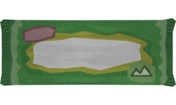

# Granola Bar

**Categories:** Food And Drink, Pages with update history · **Source:** [Fandom](https://thelongdark.fandom.com/wiki/Granola_Bar)

**Contents**

- [Overview](#overview)
- [Trivia](#trivia)
- [Gallery](#gallery)
- [Update history](#update-history)

**Granola Bar**

[Granola Bar icon](../assets/Granola_Bar_icon.png)

**Release:** [22 September 2014](./The%20Long%20Dark%20%E2%80%94%20Early%20Access%20Changelog.md#0.117)

**Wintermute:** No

**Renewable:** Yes (rare [Beachcombing](./Beachcombing.md))

**Properties**

**Item type:** [Food And Drink](./Food%20And%20Drink.md)

**Stackable:** No

**Examine:** Dry and crunchy.

**Values**

**Calories:** 300 kcal

**Hydration:** -5%

**[Vitamin C](./Scurvy.md):** Minor (2%)

**Weight:** 0.10 kg (0.22 lbs)

**Advanced data**

**Item key:** GAMEPLAY\_GranolaBar

**Granola Bar** is a packaged [food](./Food%20And%20Drink.md) item in [_The Long Dark_](./The%20Long%20Dark.md).

## Overview

Consuming a Granola Bar provides up to 300 calories of [energy](./Hunger.md), at the cost of minor [dehydration](./Thirst.md). The Granola Bar weighs a mere 0.10 kg, making its energy density a high 3,000 calories-per-kilogram. It also lasts practically forever if stored outside. The Granola Bar, like other packaged food and drink, is most commonly found inside of houses, shops, [Vehicles](./Vehicle.md) and on [Frozen Corpses](./Frozen%20Corpse.md).

Granola Bars can cause [Food Poisoning](./Food%20Poisoning.md), but [decays](./Decay.md) very slowly, especially when outdoors.

## Trivia

- The granola bar is packaged as a product called "_Crunchy Stuff"_, and it is "fat free!"
- The back of the wrapper lists "Ingredients: Rolled Oats, Honey, Almonds, Pecan, Salt, Cinnamon, Tocopherols."

## Gallery

## Update history

- UPDATE **22 September 2014 ([Update](./The%20Long%20Dark%20%E2%80%94%20Early%20Access%20Changelog.md#0.117)):**
  - Added to game.
