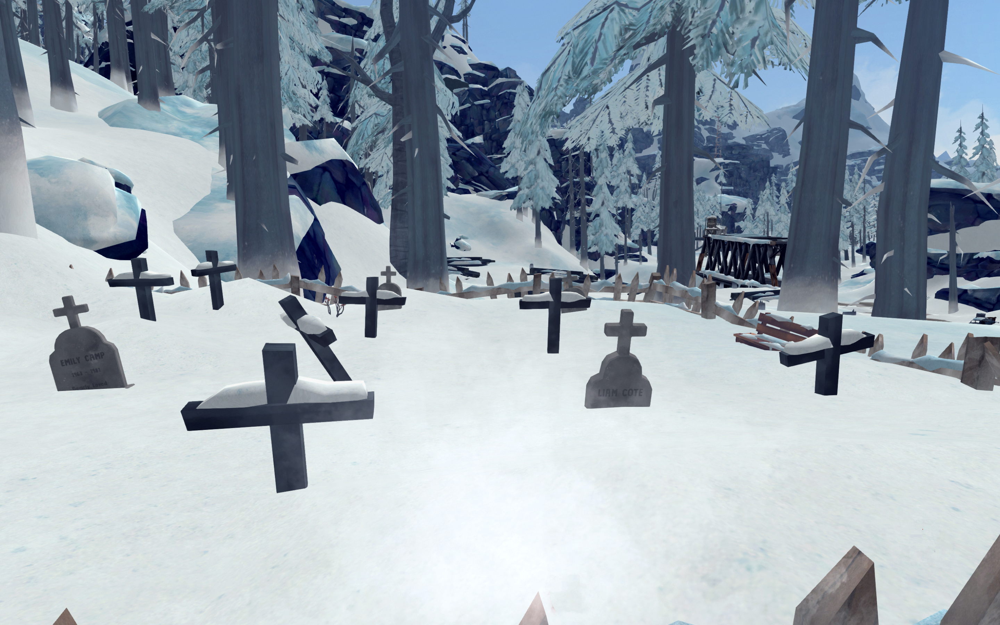
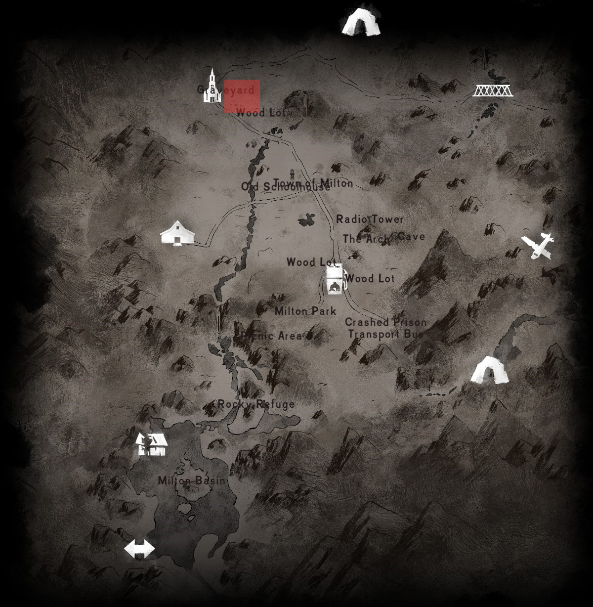

# Graveyard

**Categories:** Indoor locations, Locations, Residential locations · **Source:** [Fandom](https://thelongdark.fandom.com/wiki/Graveyard)

**Graveyard**

| Column 1 | Column 2 |
| --- | --- |
|  / _Graveyard.png_ |  |
| **Location** |  |
|  / _Graveyard\_Location.png_ |  |
| Region |  |
| Location | A short walk up the road from [Milton](./Milton.md) |
| Description | A church and graveyard |
| **General** |  |
| Type | Residential\|- |
