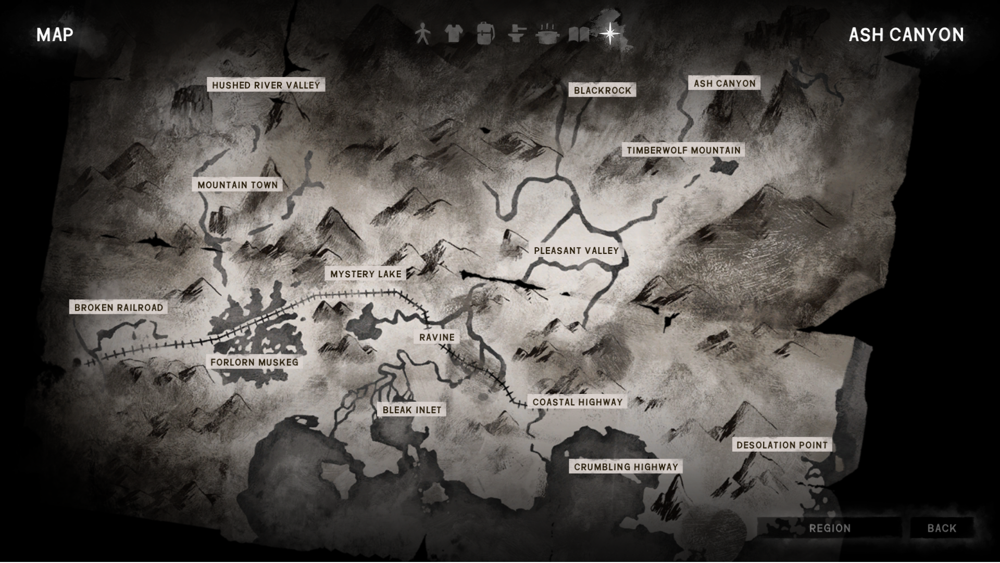
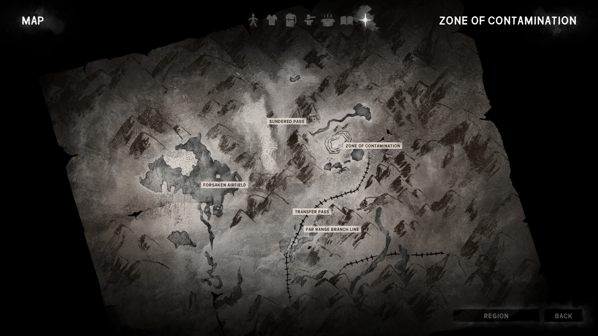
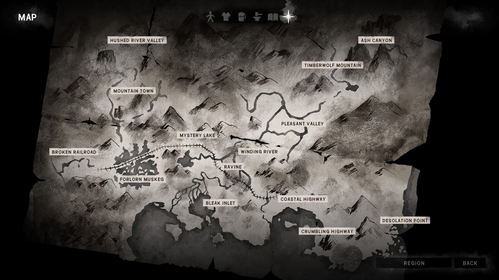
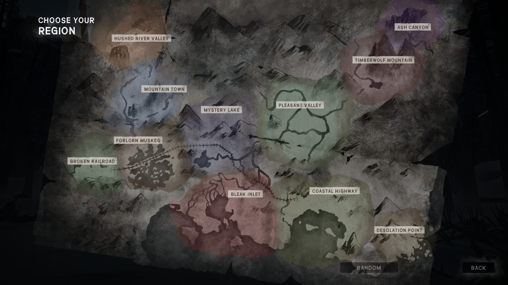
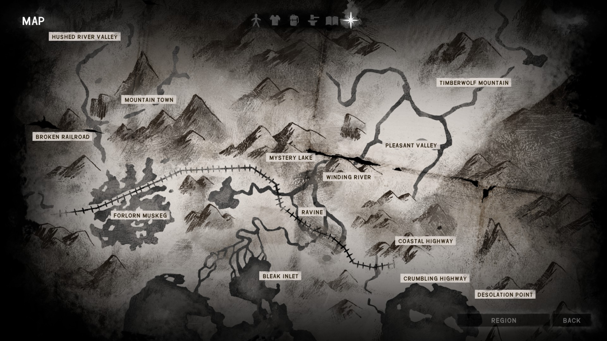
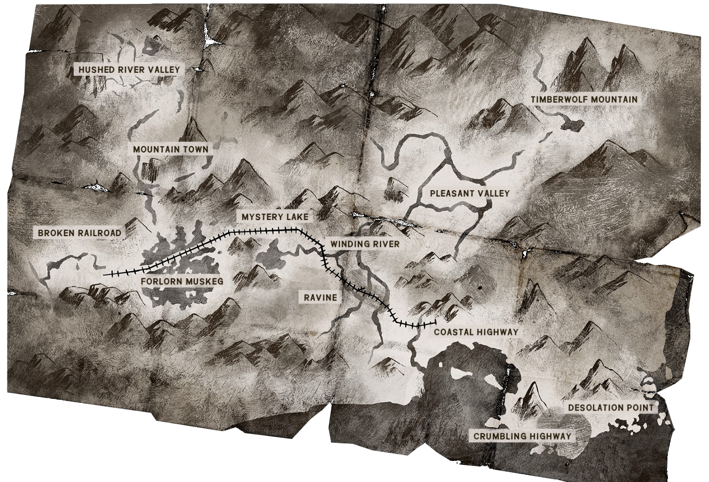
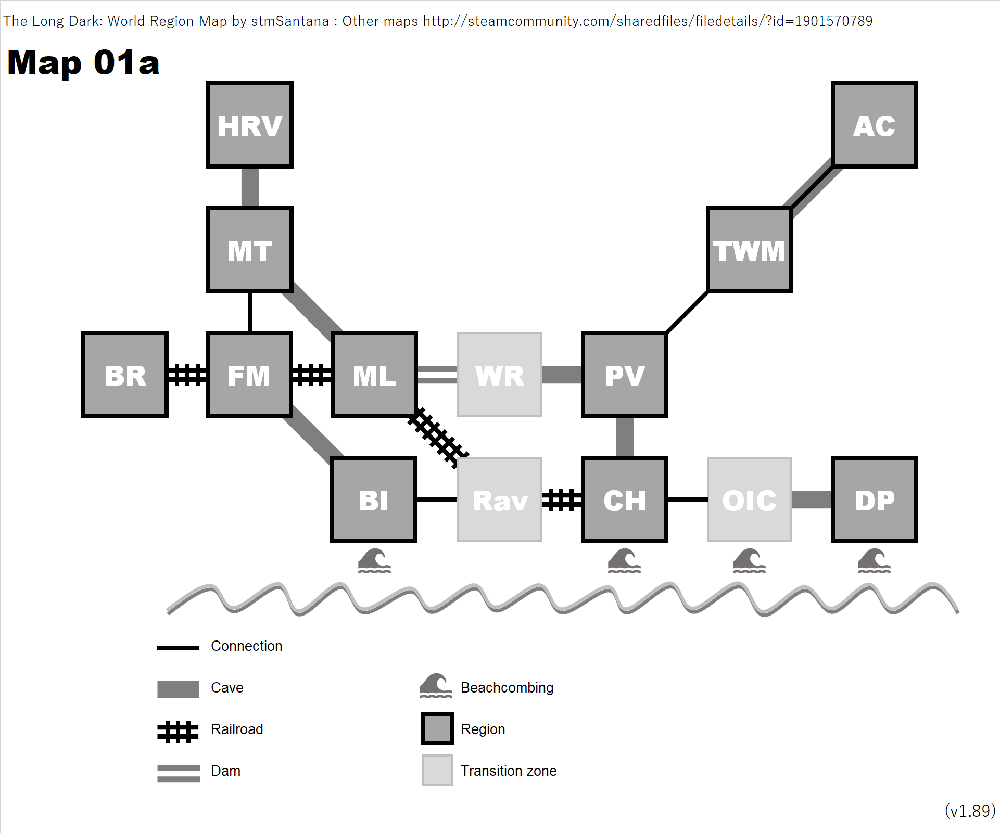
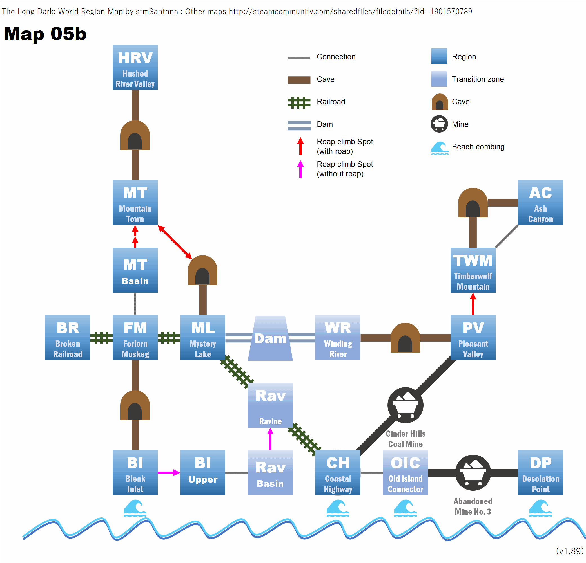
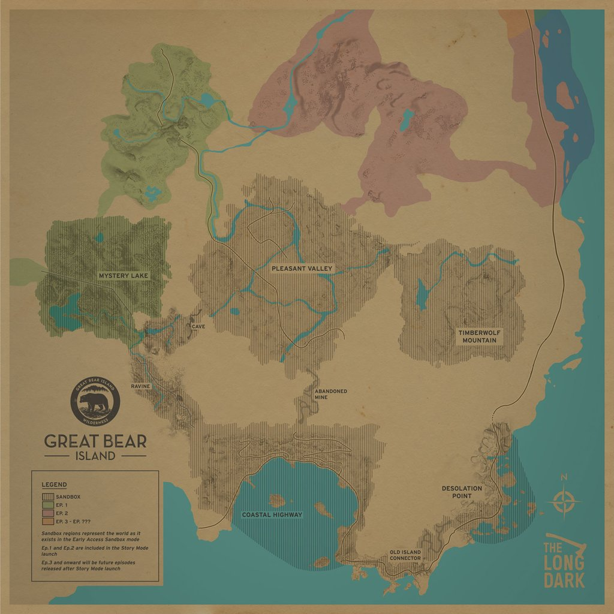
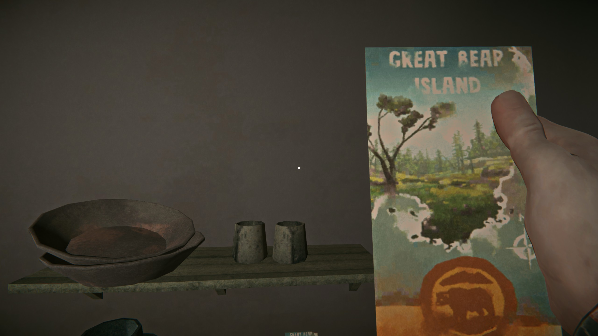

# Great Bear Island

**Categories:** Locations · **Source:** [Fandom](https://thelongdark.fandom.com/wiki/Great_Bear_Island)

**Contents**

- [History](#history)
- [Notable Island Landmarks and Regions](#notable-island-landmarks-and-regions)
- [Notable Inhabitants](#notable-inhabitants)
- ["Islanders"](#islanders)
- ["Mainlanders"](#mainlanders)
- [Native Wildlife Species](#native-wildlife-species)
- [Fauna](#fauna)
- [Flora](#flora)
- [Maps](#maps)

- [Broken Railroad](./Broken%20Railroad.md)
- [Forlorn Muskeg](./Forlorn%20Muskeg.md)
- [Mountain Town](./Mountain%20Town.md)
- [Mystery Lake)](./Mystery%20Lake%20%28region%29.md)
- [The Ravine](./The%20Ravine.md)
- [Winding River](./Winding%20River.md)
- [Pleasant Valley](./Pleasant%20Valley.md)
- [Timberwolf Mountain](./Timberwolf%20Mountain.md)
- [Coastal Highway](./Coastal%20Highway.md)
- [Crumbling Highway](./Crumbling%20Highway.md)
- [Desolation Point](./Desolation%20Point.md)
- [Hushed River Valley](./Hushed%20River%20Valley.md)
- [Bleak Inlet](./Bleak%20Inlet.md)
- [Blackrock](./Blackrock.md)
- [Ash Canyon](./Ash%20Canyon.md)

- [Forsaken Airfield](./Forsaken%20Airfield.md)
- [Zone of Contamination](./Zone%20of%20Contamination.md)
- [Transfer Pass](./Transfer%20Pass.md)
- [Far Range Branch Line](./Far%20Range%20Branch%20Line.md)

 **Great Bear Island**is a fictional island that is the main setting of [_The Long Dark_](./The%20Long%20Dark.md). The Island is geographically located off the northern-western coast of mainland [Canada](./The%20Collapse.md), and is entirely surrounded by the Pacific Ocean. It is also located inside the [Ring of Fire](https://en.wikipedia.org/wiki/Ring_of_Fire), resulting a higher than average amount of earthquakes.

 The Island is inspired by the real world [Vancouver Island](https://en.wikipedia.org/wiki/Vancouver_Island).

## History

Great Bear Island was once a lively region rich in natural resources and rustic communities. The abundance of coal, the flowing rivers, and the pristine forests on the island attracted the attention of corporations from the mainland. Over the course of many years, these industrial barons established mines, logging camps, and dams to exploit the natural wonders of Great Bear.

While this industrial boom brought economic prosperity and stability to many island residents, the unsustainable harvesting of the island's resources also upset some of the locals. Tourism and many modern amenities (such as banks and convenience stores) accompanied industry growth, further scarring the island's once primal landscape and deepening many islanders' dependence on outside interests. Because of the often destructive, exploitive encroachment of technology and industrialization on the island's traditional way of life, many Great Bear residents developed a deep resentment and distrust of "mainlanders" and outsiders.

During the turmoil of [The Collapse](./The%20Collapse.md), approximately ten years before the events of _The Long Dark_, a series of major earthquakes rocked Great Bear, destroying much of the island's infrastructure and industry during the ongoing economic crisis. As a result, the corporations that once flocked to reap the island's resources abandoned their camps and mines, sending what was left of the local communities into economic turmoil. Great Bear never fully recovered from the quakes, and, as a result, many abandoned facilities, destroyed roadways, and ghost towns dot the island--remnants of a once thriving region.

## Notable Island Landmarks and Regions

- [The Town of Milton](./Milton.md) ([Mountain Town](./Mountain%20Town.md))
- [Trans-Island Railway Line](./Trans-Island%20Railway%20Line.md)
- [Great Bear Highway](./Great%20Bear%20Highway.md)
- [Carter Hydro Dam](./Carter%20Hydro%20Dam.md)
- [Cinder Hills Coal Mine](./Cinder%20Hills%20Coal%20Mine.md)
- [Abandoned Mine No. 3](./No.%203%20Coal%20Mine.md)
- [Perseverance Mills](./Perseverance%20Mills.md)
- Port Mary (mentioned in [Town of Milton](./Town%20of%20Milton.md))
- Rupert's Landing (mentioned by Jeremiah and [Mystery Lake & Area](./Mystery%20Lake%20%26%20Area.md)) [Risk of Infection/TranscriptMackenzie](./Risk%20of%20Infection%20%E2%80%94%20Transcript.md): "You alone out here?"

Jeremiah: "Yeah, I keep to myself. Hunt a bit. Fish in the summer. Keep my traplines full. Once a couple of month's, I head down to Rupert's Landing. Trade for what I need."

- [Mystery Lake](./Mystery%20Lake%20%28region%29.md)
- [Coastal Highway](./Coastal%20Highway.md)
- [Hibernia Processing](./Hibernia%20Processing.md), [Lonely Lighthouse](./Lonely%20Lighthouse.md) ([Desolation Point](./Desolation%20Point.md))
- [Thomson's Crossing](./Thomson%27s%20Crossing.md) ([Pleasant Valley](./Pleasant%20Valley.md))
- [Timberwolf Mountain](./Timberwolf%20Mountain.md)
- [Forlorn Muskeg](./Forlorn%20Muskeg.md)
- [Broken Railroad](./Broken%20Railroad.md)
- [Blackrock Federal Penitentiary](./Blackrock%20Prison.md) ([Blackrock Region](./Blackrock.md))
- [Keeper's Pass North](./Keeper%27s%20Pass%20North.md)
- [Keeper's Pass South](./Keeper%27s%20Pass%20South.md)
- [Hushed River Valley](./Hushed%20River%20Valley.md)
- [Last Resort Cannery](./Last%20Resort%20Cannery.md) ([Bleak Inlet](./Bleak%20Inlet.md))
- [Ash Canyon](./Ash%20Canyon.md)
- [The Ravine](./The%20Ravine.md) (Raven Falls)
- [Winding River](./Winding%20River.md)
- [Crumbling Highway](./Crumbling%20Highway.md) (Old Island Connector)
- [Transfer Pass](./Transfer%20Pass.md)
- [Far Range Branch Line](./Far%20Range%20Branch%20Line.md)
- [Field 31](./Field%2031.md) ([Forsaken Airfield](./Forsaken%20Airfield.md))
- [Langston Mine](./Langston%20Mine.md) ([Zone of Contamination](./Zone%20of%20Contamination.md))
- [Weather Station](./Weather%20Station.md) ([Sundered Pass](./Sundered%20Pass.md))

## Notable Inhabitants

_For more information, see [Characters](./Characters.md)._

### "Islanders"

- [Grey Mother](./Grey%20Mother.md)
- [Martin Barker](./Martin%20Barker.md)
- [Lilith Barker](./Lilith%20Barker.md)
- [Jeremiah](./Jeremiah.md)
- [Methuselah](./Methuselah.md)
- [Father Thomas](./Father%20Thomas.md)
- [Molly](./Molly.md)
- [Molly's Husband](./Molly%27s%20Husband.md)
- [Jane Yang](./Jane%20Yang.md)
- [Atwood](./Atwood.md)
- Sutherland the [Trader](./Trader.md) and his brother Wyatt
- The inhabitants of [Milton](./Milton.md)
- The inhabitants of [Pleasant Valley](./Pleasant%20Valley.md)
- The inhabitants of [Perseverance Mills](./Perseverance%20Mills.md)
- Various islanders working under the banner of the [Forest Talkers](./Forest%20Talkers.md)

### "Mainlanders"

- [Mathis](./Mathis.md)
- [Hobbs](./Hobbs.md)
- [Jace](./Jace.md)
- [Donner](./Donner.md)
- [Vachon](./Vachon.md)
- [Heller](./Heller.md)
- [Franklin](./Franklin.md)
- [Astrid Greenwood](./Astrid%20Greenwood.md)
- [Will Mackenzie](./Will%20Mackenzie.md)
- Various [Convicts](./Convicts.md) and employee personal of [Blackrock Penitentiary](./Blackrock%20Prison.md)
- [Plane Crash Survivors](./Crash%20Survivor.md) of the [North Star Charters Flight 7030](./Crash%20Site%20%28Pleasant%20Valley%29.md) airline

## Native Wildlife Species

_For more information, see [Wildlife](./Wildlife.md)._

#### Fauna

- [Wolf](./Wolf.md)
- [Timberwolf](./Timberwolf.md)
- [Poisoned Wolf](./Poisoned%20Wolf.md)
- [Rabbit](./Rabbit.md)
- [Bear](./Bear.md) ([Old Bear](./Old%20Bear.md))
- [Deer](./Deer.md) ([Ghost Stag](./Ghost%20Stag.md))
- [Moose](./Moose.md)
- [Crow](./Crow.md)
- [Cougar](./Cougar.md)
- [Ptarmigan](./Ptarmigan.md)
- Various species of Freshwater and Saltwater Fish ([Lake Whitefish](./Lake%20Whitefish%20%28Raw%29.md), [Coho Salmon](./Coho%20Salmon%20%28Raw%29.md), [Rainbow Trout](./Rainbow%20Trout%20%28Raw%29.md), [Smallmouth Bass](./Smallmouth%20Bass%20%28Raw%29.md), ([Big Bass](./Big%20Bass%20%28Raw%29.md)), [Red Irish Lord](./Red%20Irish%20Lord%20%28Raw%29.md), [Goldeye](./Goldeye%20%28Raw%29.md), [Burbot](./Burbot%20%28Raw%29.md), [Rockfish](./Rockfish%20%28Raw%29.md))
- Killer Whales (as seen in the ending of [Episode 3: Crossroads Elegy](./Episode%203%20-%20Crossroads%20Elegy.md)) and other various unseen wildlife (owls, woodpeckers, etc.)

#### Flora

- [Burdock](./Burdock.md)
- [Rose Hip](./Rose%20Hip.md)
- [Reishi Mushroom](./Reishi%20Mushroom.md)
- [Old Man's Beard Lichen](./Old%20Man%27s%20Beard%20Lichen.md)
- [Oak Trees](./Oak%20Tree.md) and [Acorns](./Acorns.md)
- Fir trees ([Fir Firewood](./Fir%20Firewood.md))
- Cedar trees ([Cedar Firewood](./Cedar%20Firewood.md))
- Birch Trees ([Birch Sapling](./Green%20Birch%20Sapling.md), [Birch Bark](./Birch%20Bark.md))
- Maple Trees ([Maple Sapling](./Green%20Maple%20Sapling.md))
- [Cat Tails](./Cat%20Tail.md)
- [Scrub Brush](./Scrub%20Brush.md)
- Various grasses (golden grass, red grass) and shrubs
- Bio luminescent moss found in [Ice Caves](./Ice%20Cave.md)

## Maps

_The travel brochure of the island found in [Memories](./Memories.md)_
