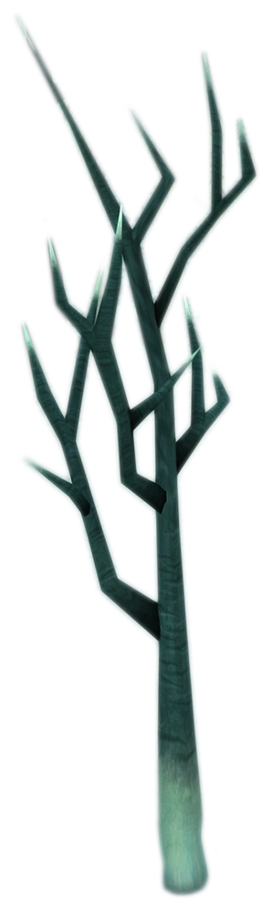

# Green Birch Sapling

**Contents**

- [Products](#Products)
- [Trivia](#Trivia)
- [Gallery](#Gallery)
- [Update history](#Update_history)

<table class="infobox">
<caption>Green Birch Sapling</caption>
<colgroup>
<col style="width: 50%" />
<col style="width: 50%" />
</colgroup>
<tbody>
<tr>
<td colspan="2"><figure>

<figcaption>Green_Birch_Sapling_icon.png</figcaption>
</figure></td>
</tr>
<tr>
<td>
Release
</td>
<td>
<a href="./The%20Long%20Dark%20%E2%80%94%20Changelog.md#0.233" class="wikilink" title="22 May 2015">22 May 2015</a>
</td>
</tr>
<tr>
<td>
Wintermute
</td>
<td>
Yes
</td>
</tr>
<tr>
<td>
Renewable
</td>
<td>
Yes (<a href="./Beachcombing.md" class="wikilink" title="Beachcombing">Beachcombing</a>)
</td>
</tr>
<tr>
<td colspan="2" class="section">
<strong>Properties</strong>
</td>
</tr>
<tr>
<td>
Item type
</td>
<td>
<a href="./Materials.md" class="wikilink" title="Materials">Materials</a>|-
</td>
</tr>
<tr>
<td>
Stackable
</td>
<td>
No
</td>
</tr>
<tr>
<td>
Examine
</td>
<td>
Freshly harvested birch sapling. Needs to be cured before it can be used for crafting and repair. 
Can be used for crafting and repair after air-drying indoors for 4 days.
</td>
</tr>
<tr>
<td colspan="2" class="section">
<strong>Values</strong>
</td>
</tr>
<tr>
<td>
Weight
</td>
<td>
0.20 kg (0.44 lbs)
</td>
</tr>
<tr>
<td colspan="2" class="section">
<strong>Actions</strong>
</td>
</tr>
<tr>
<td>
Backpack
</td>
<td>
Take It, Leave It
</td>
</tr>
<tr>
<td colspan="2" class="section">
<strong>Advanced data</strong>
</td>
</tr>
<tr>
<td>
Item key
</td>
<td>
GAMEPLAY_BirchSapling
</td>
</tr>
</tbody>
</table>

**Green Birch Sapling** can be found growing near birch trees and in a variety of wild landscapes, usually in groups of 2-5.

Green Birch Saplings can be harvested with a <a href="./Hatchet.md" class="wikilink" title="Hatchet">Hatchet</a>, <a href="./Improvised%20Hatchet.md" class="wikilink" title="Improvised Hatchet">Improvised Hatchet</a>, or a <a href="./Hacksaw.md" class="wikilink" title="Hacksaw">Hacksaw</a>. Where the green Birch Sapling used to stand, a small root stump will remain, though this stump cannot be interacted with and will not regrow. Tools do not suffer condition loss for harvesting saplings.

A Green Birch Sapling can be cured by leaving it to dry indoors or inside a deep cave for four days. Note that the sapling will continue to cure when placed inside a container, but will be ejected when fully cured. During this time, if the sapling is curing it will show the percent of the process completed, either when hovering over the sapling or viewing it in one's inventory.

Once dried, the green birch sapling will become a cured birch sapling and will appear to be a more dull brown colour. The cured sapling can then be used for crafting <a href="./Arrow%20Shaft.md" class="wikilink" title="Arrow Shafts">Arrow Shafts</a>. Both Green and Cured Birch Saplings do not <a href="./Decay.md" class="wikilink" title="Decay">Decay</a>, and will always be at 100% condition.

## Products

2 Green Birch Saplings are required to craft the <a href="./Trader.md" class="wikilink" title="Trader">Trader</a> blueprint item the <a href="./Bushcraft%20Bow.md" class="wikilink" title="Bushcraft Bow">Bushcraft Bow</a>, being the only tool in the game requiring the uncured saplings.

## Trivia

<a href="./Methuselah.md" class="wikilink" title="Methuselah">Methuselah</a> uses a Green Birch Sapling to poke at his various Campfires in <a href="./Wintermute.md" class="wikilink" title="Wintermute">Wintermute</a> in Episode 1.

## Gallery

<table class="gallery">
<colgroup>
<col style="width: 25%" />
<col style="width: 25%" />
<col style="width: 25%" />
<col style="width: 25%" />
</colgroup>
<tbody>
<tr>
<td><figure>
[Missing image: Birch_Sapling.jpg]
<figcaption>A Birch Sapling next to a Rose Bush</figcaption>
</figure></td>
<td><figure>
[Missing image: 20170705181527_1.jpg]
<figcaption>A birch sapling near several birch trees (old model)</figcaption>
</figure></td>
<td><figure>

<figcaption>A growing birch sapling (old model)</figcaption>
</figure></td>
<td><figure>
[Missing image: Birch_sapling.jpg]
<figcaption>A birch sapling as it appears on the <a href="./Map.md" class="wikilink" title="map">map</a></figcaption>
</figure></td>
</tr>
<tr>
<td><figure>

<figcaption>Old model.</figcaption>
</figure></td>
<td><figure>
[Missing image: Methuselah_paradise_lost.jpg]
<figcaption>Methuselah holding a birch sapling</figcaption>
</figure></td>
<td></td>
<td></td>
</tr>
</tbody>
</table>

## Update history

- UPDATE **22 May 2015 (<a href="./The%20Long%20Dark%20%E2%80%94%20Early%20Access%20Changelog.md#0.223" class="wikilink" title="Update">Update</a>):**
  - Added to game

**Lua execution error in Module:Navbox function navboxLua execution error in Module:Navbox function navbox** <a href="ru:%D0%97%D0%B5%D0%BB%D0%B5%D0%BD%D0%BE%D0%B5_%D0%B1%D0%B5%D1%80%D0%B5%D0%B7%D0%BE%D0%B2%D0%BE%D0%B5_%D0%B4%D0%B5%D1%80%D0%B5%D0%B2%D1%86%D0%B5" class="wikilink" title="ru:Зеленое березовое деревце">ru:Зеленое березовое деревце</a>

