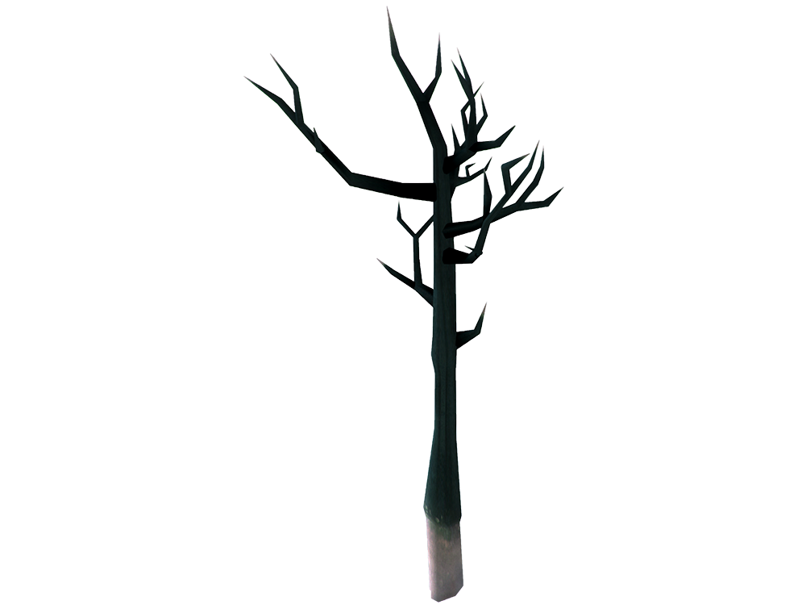
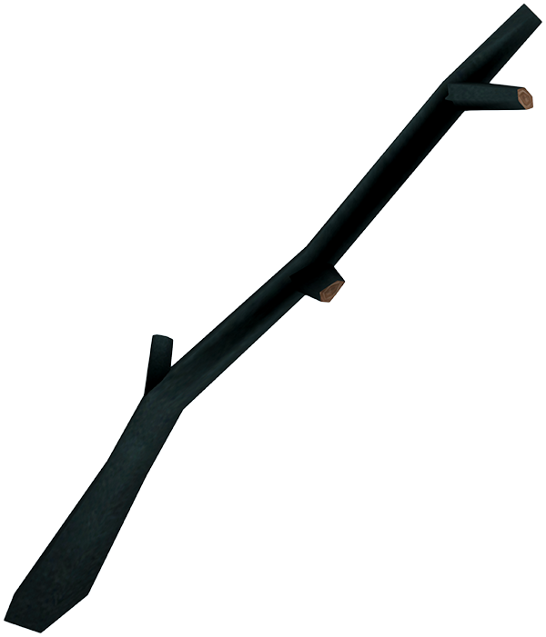

# Green Maple Sapling

**Categories:** Materials, Pages with update history, Plants · **Source:** [Fandom](https://thelongdark.fandom.com/wiki/Green_Maple_Sapling)

**Green Maple Sapling**

| Property | Details |
| --- | --- |
|  | [Green Maple Sapling icon](../assets/Green_Maple_Sapling_icon.png) |
| Release | [22 May 2015](./The%20Long%20Dark%20%E2%80%94%20Early%20Access%20Changelog.md#0.233) |
| Wintermute | Yes (Bug?) |
| Renewable | Yes ([Beachcombing](./Beachcombing.md)) |
| **Properties** |  |
| Item type | [Materials](./Materials.md) |
| Equipable | No |
| Stackable | No |
| Examine | Freshly harvested maple sapling. Needs to be cured before it can be used for crafting and repair. / Can be used for crafting and repairs after air-drying indoors for 6 days. |
| **Values** |  |
| Weight | 0.30 kg (0.66 lbs) |
| **Actions** |  |
| Backpack | Take It, Leave It |
| **Advanced data** |  |
| Item key | GAMEPLAY\_MapleSapling |

A **Green Maple Sapling** is a plant-based [Material](./Materials.md) that can be harvested and cured into a [Cured Maple Sapling](./Cured%20Maple%20Sapling.md) to craft a [Survival Bow](./Survival%20Bow.md) or [Travois](./Travois.md) at a [Work Bench](./Work%20Bench.md). Contrary to the in-game description, the sapling cannot be used for repairs. Both Green and Cured Maple Saplings do not [Decay](./Decay.md), and will always be at 100% condition.

Maple saplings are found out in forested and occasionally open landscapes. They usually come in alone or in pairs, but are normally not found in close proximity to [Green Birch Saplings](./Green%20Birch%20Sapling.md). Occasionally they can be found in groups of 3 or more, though this is very rare.

Green Maple Saplings can be harvested with a [Hatchet](./Hatchet.md), [Improvised Hatchet](./Improvised%20Hatchet.md), or a [Hacksaw](./Hacksaw.md), for one green Maple Sapling. Saplings do not regrow. Tools do not suffer condition loss for harvesting saplings.

A Green Maple Sapling can be cured by leaving it to dry indoors or inside a deep cave for six days. Note that the sapling will continue to cure when placed inside a container, but will be ejected when fully cured. During this time, if the sapling is curing it will show the percent of the process completed, either when hovering over the sapling or viewing it in one's inventory. Once dried, the green birch sapling will become a cured birch sapling and will appear to be a more brown colour.

Both Green and Cured Maple Saplings do not [Decay](./Decay.md), and will always be at 100% condition.

Green Maple Saplings can be found in [Episode 2: Luminance Fugue](./Episode%202%20-%20Luminance%20Fugue.md) in the [Forlorn Muskeg](./Forlorn%20Muskeg.md) on the way to the [Old Spence Family Homestead](./Old%20Spence%20Family%20Homestead.md), as well as in [Broken Railroad](./Broken%20Railroad.md). It is not currently known if this is intended.

## Gallery

_Maple sapling as it appears on the [map](./Map.md)_

## Update history

- UPDATE **22 May 2015 ([Update](./The%20Long%20Dark%20%E2%80%94%20Early%20Access%20Changelog.md#0.223)):**
  - Added to game
