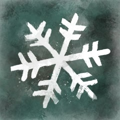
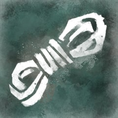

# Grey Mother

**Contents**

- [History](#History)
- [Episode 1: Do Not Go Gentle](#Episode_1%3A_Do_Not_Go_Gentle)
- [The Crash](#The_Crash)
- [The Grey Mother](#The_Grey_Mother)
- [Paradise Lost](#Paradise_Lost)
- [Episode 3: Crossroads Elegy](#Episode_3%3A_Crossroads_Elegy)
- [Episode 5: The Light At The End Of All Things](#Episode_5%3A_The_Light_At_The_End_Of_All_Things)
- [Achievements](#Achievements)
- [Gallery](#Gallery)
- [Update history](#Update_history)

<table class="infobox">
<caption>Grey Mother</caption>
<colgroup>
<col style="width: 50%" />
<col style="width: 50%" />
</colgroup>
<tbody>
<tr>
<td colspan="2"><figure>

<figcaption>Grey_Mother.png</figcaption>
</figure></td>
</tr>
<tr>
<td>
Release
</td>
<td>
<a href="./The%20Long%20Dark%20%E2%80%94%20Changelog.md#1.00" class="wikilink" title="Wintermute Launch (v1.0)">Wintermute Launch (v1.0)</a>
</td>
</tr>
<tr>
<td>
Date
</td>
<td>
1 August 2017
</td>
</tr>
<tr>
<td>
Wintermute
</td>
<td>
<a href="./Episode%201%20-%20Do%20Not%20Go%20Gentle.md" class="wikilink" title="Episode 1">Episode 1</a>
</td>
</tr>
<tr>
<td>
Mission
</td>
<td>
<a href="./The%20Grey%20Mother.md" class="wikilink" title="The Grey Mother">The Grey Mother</a>
</td>
</tr>
<tr>
<td>
Location(s)
</td>
<td>
<a href="./Milton%20House%20%28Grey%20Mother%27s%29.md" class="wikilink" title="Milton House (Grey Mother&#39;s)">Milton House (Grey Mother's)</a>
</td>
</tr>
<tr>
<td colspan="2" class="section">
<strong>Biographical Information</strong>
</td>
</tr>
<tr>
<td>
Age
</td>
<td>
70's - 80's
</td>
</tr>
<tr>
<td>
Status
</td>
<td>
Deceased
</td>
</tr>
<tr>
<td>
Hometown
</td>
<td>
<a href="./Milton.md" class="wikilink" title="Milton">Milton</a>
</td>
</tr>
<tr>
<td>
Relatives
</td>
<td>
<strong>•</strong> <a href="./Martin%20Barker.md" class="wikilink" title="Martin Barker">Martin Barker</a> (ex-Husband) 
<strong>•</strong> <a href="./Lilith%20Barker.md" class="wikilink" title="Lilith Barker">Lilith Barker</a> (Daughter)
</td>
</tr>
<tr>
<td colspan="2" class="section">
<strong>Physical Information</strong>
</td>
</tr>
<tr>
<td>
Hair
</td>
<td>
Grey
</td>
</tr>
<tr>
<td colspan="2" class="section">
<strong>Game Information</strong>
</td>
</tr>
<tr>
<td>
Equipment
</td>
<td>
<a href="./Hunting%20Rifle.md" class="wikilink" title="Hunting Rifle">Hunting Rifle</a>
</td>
</tr>
<tr>
<td>
Voiced by
</td>
<td>
<a href="wikipedia:Gwynyth_Walsh" class="wikilink" title="Gwynyth Walsh">Gwynyth Walsh</a>
</td>
</tr>
</tbody>
</table>

<table>
<colgroup>
<col style="width: 33%" />
<col style="width: 33%" />
<col style="width: 33%" />
</colgroup>
<tbody>
<tr>
<td style="vertical-align: top; font-size: 3em; color: #5d5980; padding-right: 10px">
“
</td>
<td>
An elderly blind woman, and possibly the last remaining survivor in Milton. She seems to know something about where Astrid might have gone.

&#10;

In-game description

</td>
<td style="vertical-align: bottom; font-size: 3em; color: #5d5980; padding-left: 10px">
”
</td>
</tr>
</tbody>
</table>

<table>
<colgroup>
<col style="width: 33%" />
<col style="width: 33%" />
<col style="width: 33%" />
</colgroup>
<tbody>
<tr>
<td style="vertical-align: top; font-size: 3em; color: #5d5980; padding-right: 10px">
“
</td>
<td>
Over the years...I have learned that most people disappoint you, given the chance.

&#10;

Grey Mother

</td>
<td style="vertical-align: bottom; font-size: 3em; color: #5d5980; padding-left: 10px">
”
</td>
</tr>
</tbody>
</table>

**Grey Mother** is a major character that appears in <a href="./Episode%201%20-%20Do%20Not%20Go%20Gentle.md" class="wikilink" title="Episode 1">Episode 1</a> of <a href="./Wintermute.md" class="wikilink" title="Wintermute">Wintermute</a>. She is the first NPC that <a href="./Will%20Mackenzie.md" class="wikilink" title="Will Mackenzie">Will Mackenzie</a> encounters after his plane crashes, and the only remaining resident in the town of <a href="./Milton.md" class="wikilink" title="Milton">Milton</a>.

## History

Years before the events of *The Long Dark*, Grey Mother was married to a farmer named <a href="./Martin%20Barker.md" class="wikilink" title="Martin Barker">Martin Barker</a>. Together they had a daughter named <a href="./Lilith%20Barker.md" class="wikilink" title="Lilith">Lilith</a>. Tragedy struck when Lilith died in a climbing accident, and Grey Mother blamed her death on Martin, driving a wedge between them and causing them to live in separate homes. Things only got worse when the quakes devastated the island, and Grey Mother eventually became a recluse, abandoning the name of Barker and developing a reputation as a senile old blind lady.

When the <a href="./First%20Flare.md" class="wikilink" title="First Flare">First Flare</a> struck, she remained in her Milton home after the surviving residents were killed by <a href="./Convicts.md" class="wikilink" title="Convicts">Convicts</a>.

## Episode 1: Do Not Go Gentle

### <a href="./The%20Crash.md" class="wikilink" title="The Crash">The Crash</a>

Grey Mother is first seen sleeping in a chair in front of her fireplace with a rifle. When Will Mackenzie tries to wake her up, she fires a warning shot. After a brief but tense standoff, the two have a conversation. Grey Mother makes it clear that she does not trust Will due to him being a "mainlander", but he begins to gain her trust after he gathers enough food and firewood for her to last the winter.

### <a href="./The%20Grey%20Mother.md" class="wikilink" title="The Grey Mother">The Grey Mother</a>

The two of them make a deal after Mackenzie gets enough food and fuel for the old woman: Grey Mother will tell him all she knows about the whereabouts of <a href="./Astrid%20Greenwood.md" class="wikilink" title="Dr. Astrid Greenwood">Dr. Astrid Greenwood</a> in exchange for a few favors. One of these favors includes scouting the main tunnel through the mountains outside Milton, the only way out of town besides climbing. When Will informs Grey Mother that the tunnel has collapsed, she is distraught, knowing that she is effectively trapped in Milton with no hope of rescue. As a result, she asks Will for one more favor: retrieve Lilith Barker's necklace from a safety deposit box at the bank and place it on her grave outside of town. After Will does this, Grey Mother tells him all she knows about Astrid. She also reveals that Lilith was her daughter and that she was once married to Martin Barker, the deceased farmer whose safety deposit box contained Lilith's necklace. She gives Will some old climbing gear that once belonged to Lilith, in order for him to make his way out of Milton.

### <a href="./Paradise%20Lost.md" class="wikilink" title="Paradise Lost">Paradise Lost</a>

|  |  |  |
|----|----|----|
| “ | My journey is finished. But yours is only beginning. Go, and don't think of Grey Mother, or Milton. We're of the old world now. The new world is for the strong to survive. | ” |

Before Mackeznie leaves Milton, he has a chance to right a wrong from the past in an optional side quest, <a href="./One%20Last%20Thing.md" class="wikilink" title="One Last Thing">One Last Thing</a>, where he places the pearls on Lilith's tomb. Doing so leaves Grey Mother at peace, as she is content to sit and think of her Lily, urging Mackenzie to forget about about old Grey Mother and to find his friend.

After Will leaves Milton, she is not seen again.

## Episode 3: Crossroads Elegy

Grey Mother does not appear in this episode, but appears during the intro story recap talking about <a href="./Perseverance%20Mills.md" class="wikilink" title="Perseverance Mills">Perseverance Mills</a>.

## Episode 5: The Light At The End Of All Things

Grey Mother seemingly passed away in her home in the time since MacKenzie left Milton. At the end of the episode, MacKenzie is seen carrying her corpse, wrapped in a blanket, from her house to the <a href="./Graveyard.md" class="wikilink" title="Graveyard">Graveyard</a>, where she is cremated on a pyre. He erects a wooden cross with the name "Grey Mother" written on it next to <a href="./Lilith%20Barker.md" class="wikilink" title="Lily&#39;s">Lily's</a> grave.

## Achievements

-  <a href="./The%20Long%20Dark%20%E2%80%94%20Achievements.md#Hidden_achievements" class="wikilink" title="The Long Winter">The Long Winter</a>
-  <a href="./The%20Long%20Dark%20%E2%80%94%20Achievements.md#Hidden_achievements" class="wikilink" title="Losing a Child is Like...">Losing a Child is Like...</a>

## Gallery

<table class="gallery">
<colgroup>
<col style="width: 25%" />
<col style="width: 25%" />
<col style="width: 25%" />
<col style="width: 25%" />
</colgroup>
<tbody>
<tr>
<td><figure>

<figcaption>Steam Trading Card</figcaption>
</figure></td>
<td><figure>
[Missing image: Grey_Mother_Steam_Card.jpg]
<figcaption>Ditto, full screen</figcaption>
</figure></td>
<td><figure>
[Missing image: Barker_Family_Portrait.jpg]
<figcaption>A portrait found in <a href="./Milton%20House%20%28Grey%20Mother%27s%29.md" class="wikilink" title="Milton House (Grey Mother&#39;s)">Milton House (Grey Mother's)</a>, likely of <a href="./Martin%20Barker.md" class="wikilink" title="Martin Barker">Martin Barker</a>, <a href="./Lilith%20Barker.md" class="wikilink" title="Lilith Barker">Lilith Barker</a> and Grey Mother.</figcaption>
</figure></td>
<td><figure>

<figcaption>Grey Mother's family</figcaption>
</figure></td>
</tr>
<tr>
<td><figure>
[Missing image: Grey_Mother.jpg]
<figcaption>Grey_Mother.jpg</figcaption>
</figure></td>
<td><figure>
[Missing image: Grey_mother_gun.jpg]
<figcaption>Grey Mother aiming her weapon at Mackenzie in their first encounter</figcaption>
</figure></td>
<td><figure>
[Missing image: GreyMotherTrustOutdated.jpg]
<figcaption>Grey Mother's Cut Trust menu</figcaption>
</figure></td>
<td></td>
</tr>
</tbody>
</table>

## Update history

- HOTFIX **17 January 2019 (<a href="./The%20Long%20Dark%20%E2%80%94%20Changelog.md#1.46" class="wikilink" title="Update">Update</a>):**
  - \[WINTERMUTE\] Fixed issue causing Grey Mother to float if a Deer Hide was placed under her chair.

<!-- -->

- HOTFIX **20 March 2018 (<a href="./The%20Long%20Dark%20%E2%80%94%20Changelog.md#1.27" class="wikilink" title="Update">Update</a>):**
  - \[Wintermute\] Players can now transfer stacked items to Grey Mother during a Trust interaction.
  - \[Wintermute\] Improved Fire audio during Grey Mother cinematics in Episode One.
  - \[Wintermute\] Fixed issue where a chair would appear incorrectly during a Grey Mother cinematic.
  - \[Wintermute\] Fixed collision issue that allowed Will to partially walk through Grey Mother's rocking chair.
  - \[Wintermute\] Players can no longer place a Storm Lantern on Grey Mother's head.
  - \[Wintermute\] Fixed issue where inventory items could be lost after cancelling out of a Trust interaction with Grey Mother.
  - \[Wintermute\] Fixed issue where player would sometimes be standing on a chair after finishing dialogue with Grey Mother.

<!-- -->

- HOTFIX **23 August 2017 (<a href="./The%20Long%20Dark%20%E2%80%94%20Changelog.md#1.12" class="wikilink" title="Update">Update</a>):**
  - Fixed issue where duplicate Trust option appeared for Grey Mother.

<!-- -->

- HOTFIX **2 August 2017 (<a href="./The%20Long%20Dark%20%E2%80%94%20Changelog.md#1.01" class="wikilink" title="Update">Update</a>):**
  - Fixed floating necklace when speaking with Grey Mother

<!-- -->

- UPDATE **1 August 2017 (<a href="./The%20Long%20Dark%20%E2%80%94%20Changelog.md#1.00" class="wikilink" title="Update">Update</a>):**
  - Added to game.

**Lua execution error in Module:Navbox function navbox** <a href="fr:Grey_Mother" class="wikilink" title="fr:Grey_Mother">fr:Grey_Mother</a> <a href="ru:%D0%A1%D0%B5%D1%80%D0%B0%D1%8F_%D0%9C%D0%B0%D1%82%D1%8C" class="wikilink" title="ru:Серая Мать">ru:Серая Мать</a>

