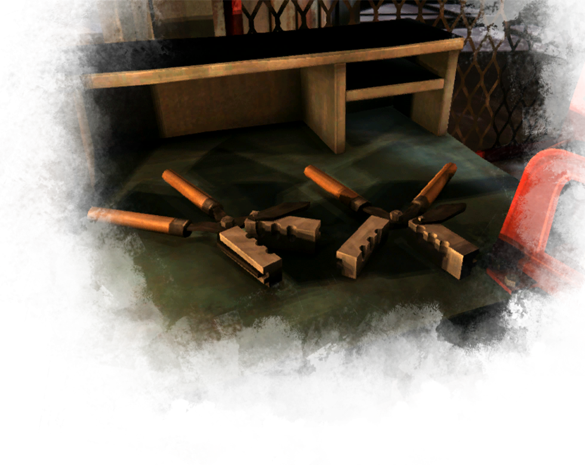

# Gunsmithing

**Categories:** Pages with update history, Skills · **Source:** [Fandom](https://thelongdark.fandom.com/wiki/Gunsmithing)

**Contents**

- [Overview](#overview)
- [Crafting](#crafting)
- [Crafted Ammunition](#crafted-ammunition)
- [Harvesting Ammunition](#harvesting-ammunition)
- [Notes](#notes)
- [Skill levels](#skill-levels)
- [Update History](#update-history)

**Gunsmithing**

_Gunsmithing\_background.png_

**Release:** [Errant Pilgrim (v1.64)](./The%20Long%20Dark%20%E2%80%94%20Changelog.md#1.64)

**Date:** 10 December 2019

_Gunsmithing.png_

**Gunsmithing** is a Survival [Skill](./Skills.md) that enables the player to craft ammunition for the [Revolver](./Revolver.md) and [Hunting Rifle](./Hunting%20Rifle.md).

## Overview

The Gunsmithing skill allows the crafting of [Rifle Ammunition](./Rifle%20Ammunition.md) and [Revolver Ammunition](./Revolver%20Ammunition.md), but may only be utilized at the [Ammunition Work Bench](./Ammunition%20Work%20Bench.md) and [Ammunition Forge](./Ammunition%20Forge.md) inside:

- The [Workshop](./Workshop.md) at [Bleak Inlet](./Bleak%20Inlet.md)
- [Blackrock Prison](./Blackrock%20Prison.md)

Skill in Gunsmithing is increased by reading the [Research Book](./Research%20Book.md) "_Practical Gunsmithing"_, crafting Can of Gunpowder, Bullets, Revolver Ammunition and Rifle Ammunition. Ammunition crafted below maximum Gunsmithing (level 5) has a chance to misfire, ruining the round and not firing a bullet when used.

At the Ammunition Workbench, three ingredients are needed to craft ammunition:

1. [Revolver Shell Casing](./Revolver%20Shell%20Casing.md) or [Rifle Shell Casing](./Rifle%20Shell%20Casing.md): picked off the ground after firing the Hunting Rifle or reloading the Revolver, and occasionally as loot (usually on the ground at [Hunter's Blinds](./Hunter%27s%20Blinds.md)). Revolver Casings can also be claimed by unloading the Revolver in the player's inventory.
2. [Can of Gunpowder](./Can%20of%20Gunpowder.md): crafted from one [Stump Remover](./Stump%20Remover.md), [Dusting Sulfur](./Dusting%20Sulfur.md) and two [Charcoal](./Charcoal.md) (producing 0.5kg of Gunpowder), or found rarely as loot. 0.01kg of gunpowder is required per round, so one Can of Gunpowder can produce 50 rounds.
3. [Bullet](./Bullet.md): crafted from [Scrap Lead](./Scrap%20Lead.md) harvested from [Car Batteries](./Car%20Battery.md) with a [Hacksaw](./Hacksaw.md). One Car Battery contains 6 Scrap Lead, and each Scrap Lead can be made into 6 Bullet, so one Car Battery can produce 36 rounds.

## Crafting

1. To craft bullets, you need to have the [Ammunition Forge](./Ammunition%20Forge.md) active and fueled. While active, you can craft Bullets at the [Ammunition Work Bench](./Ammunition%20Work%20Bench.md) in sets of 6 in one hour. Each set of 6 Bullets crafted awards 1 skill point.
2. When crafting Gunpowder, it takes 30 minutes, but the forge does not need to be active to craft. Each container of gunpowder crafted awards 1 skill point.
3. Crafted ammunition takes just 5 minutes per cartridge and does not require the forge to be active to craft. Each individual round awards 1 skill point when crafted.

## Crafted Ammunition

Crafting quality Condition Revolver/Rifle Ammunition is based on the Gunsmithing skill Level, with lower levels producing lower quality cartridges that are more likely to misfire, no matter the Condition of the Hunting Rifle or Revolver. The quality and Condition of the crafted ammunition will always be found next to the name of the ammo:

- Poor 20% (Level 1)
- Mediocre 40% (Level 2)
- Good 60% (Level 3)
- Great 80% (Level 4)
- Perfect 100% (Level 5)

Ammunition that is found in the game world will always be in "Perfect" condition.

## Harvesting Ammunition

A single Revolver/Rifle Cartridge can be harvested anywhere, and has a chance to produce the following after 5 minutes of [Harvesting](./Harvesting.md):

- 1 [Bullet](./Bullet.md)
- 1 [Revolver Shell Casing](./Revolver%20Shell%20Casing.md)/[Rifle Shell Casing](./Rifle%20Shell%20Casing.md)
- 0.01kg [Can of Gunpowder](./Can%20of%20Gunpowder.md)

Higher level Gunsmithing Skill leads to a higher chance to recover most or all materials, but lower Gunsmithing Skill has a chance to successfully recover only 1 or 2 of the cartridge's components. One way to quickly level up Gunsmithing is to craft Poor quality ammunition and then simply harvest it at higher skill levels, then craft new ammunition again. Harvesting multiple rounds of ammunition can only be done one at a time however, making the process very tedious.

## Notes

- It's possible to increase Gunsmithing skill to 5 before crafting any actual ammunition by reading enough Research Books and crafting Bullets (or Gunpowder). Players can avoid ever crafting ammo capable of misfiring.
- Ammunition misfiring and the Hunting Rifle jamming are different mechanics: ammunition misfires are caused by low quality crafted ammunition; Hunting Rifle jams are caused by the firearm itself having low condition, and require reloading (default R) to eject the jammed round.
- Revolver Ammunition can be disassembled and reassembled into Rifle Ammunition at a 1:1 ratio with Gunsmithing Skill 5; or vice versa to take advantage of the Revolver's lighter weight (1.5kg VS 4.0kg) and utility in [Wolf Struggles](./Struggle.md), or the Hunting Rifle's increased stopping power.
  - Because of this, it is possible (though tedious) to craft to level 5, disassemble all lower-quality ammo one at a time, and then re-craft to make sure all ammo is at the highest quality.
- In Interloper difficulty Car Batteries, Scrap Lead and crafted Bullets are useless since no Hunting Rifle or Revolver will ever spawn. However, Gunpowder (and in turn, Dusting Sulfur and Stump Remover) can still be used as a [Fire Accelerant](./Fire%20Starting.md) (though finite and rarer than [Lantern Fuel](./Lantern%20Fuel.md)) as well as for crafting [Noisemakers](./Noisemaker.md).
- Gunsmithing is the fastest skill to level up, as long as you have the materials to craft ammunition. Each Rifle Cartridge or Revolver Cartridge crafted grants one skill point, and takes only 5 in game minutes to craft. You can craft as many as 24 rounds in only 2 in game hours, resulting in 24 skill points, or about 1/4 of all the skill points you need to get to level 5. Of course, the ammunition you will receive will not be full quality until you reach level 5.

## Skill levels

Players can increase their Gunsmithing skill by:

- Crafting ammunition
- Crafting [Can of Gunpowder](./Can%20of%20Gunpowder.md)
- Casting 6 [Bullets](./Bullet.md)
- By repairing a firearm at a [Milling Machine](./Milling%20Machine.md)
- A limited increase can be obtained from the [Research Book](./Research%20Book.md) _[Practical Gunsmithing](./Practical%20Gunsmithing.md)_, which increases the Gunsmithing by 10 skill points with 5 hours of research.

&lt;table-progress-tracking table-id="7" unique-column-index="1"&gt;

| Level | Skill points needed | Points to next level | Effects | Flavor text |
| --- | --- | --- | --- | --- |
| 1 | 0 | 15 | - Crafted ammunition condition is 20% / - 50% chance of ammunition component harvesting | You're new to Gunsmithing. You Craft poor-quality Ammunition that is likely to Misfire. When Harvesting Ammunition, you have an average chance to recover Bullets, Gunpowder and Shell Casings. |
| 2 | 15 | 15 | - Crafted ammunition condition is 40% / - 60% chance of ammunition component harvesting | You have rudimentary Gunsmithing skills. You Craft mediocre Ammunition that tends to Misfire. When Harvesting existing Ammunition, you have a better-than average chance to recover Bullets, Gunpowder and Shell Casings. |
| 3 | 30 | 20 | - Crafted ammunition condition is 60% / - 70% chance of ammunition component harvesting | You have well-developed Gunsmithing skills. You Craft good-quality Ammunition that is unlikely to Misfire. When Harvesting existing Ammunition, you have a good chance to recover Bullets, Gunpowder and Shell Casings. |
| 4 | 50 | 50 | - Crafted ammunition condition is 80% / - 80% chance of ammunition component harvesting | You very experinced at Gunsmithing. You Craft great Ammunition that almost never Misfires. When Harvesting existing Ammunition, you have a high chance to recover Bullets, Gunpowder and Shell Casings. |
| 5 | 100 | Max level | - Crafted ammunition condition is 100% / - 100% chance of ammunition component harvesting | You're an expert Gunsmith. You Craft exquisite Ammunition that will never Misfire. When Harvesting existing Ammunition, you will always successfully recover Bullets, Gunpowder and Shell Casings. |

&lt;/table-progress-tracking&gt;

## Update History

\* HOTFIX **18 December 2019 ([Update](./The%20Long%20Dark%20%E2%80%94%20Changelog%20%E2%80%94%20Archive%202.md#1.69)):**

  - \[Gameplay\] The Gunpowder Can will no longer refill, when loading to a new area.
  - \[Gameplay\] Increased amount of Gunpowder used, when using it as an accelerant, from 0.01 to 0.1.

- UPDATE **10 December 2019 ([Update](./The%20Long%20Dark%20%E2%80%94%20Changelog%20%E2%80%94%20Archive%202.md#1.64)):**
  - Added new gameplay system: Ammunition Workbench
  - Added new gameplay system: Gunsmithing
  - Added new gameplay system: Milling Machine
  - Added new raw material: Lead
  - Added new raw material: Stump Remover
  - Added new raw material: Dusting Sulfur
  - Added new craftable item: Gunpowder
  - Added new craftable item: Bullet(s)
  - Added new craftable item: Ammunition
