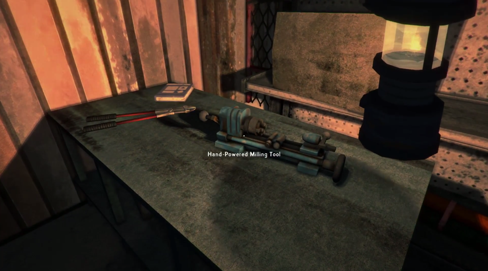

# Hand\-Powered Milling Tool

**Hand-Powered Milling Tool**

| Property | Details |
| --- | --- |
|  |  / *The\_Long\_Dark\_-\_episode\_two\_milling\_machine\_for\_rifle.png* |
| Release | Wintermute Release |
| Update | [1.00](./The%20Long%20Dark%20%E2%80%94%20Early%20Access%20Changelog.md#1.00) |
| Story item | You Fix My Rifle? |

The **Hand-Powered Milling Tool** was an interactable object found in the second mission of the Predux [Episode 2: Luminance Fugue](./Episode%202%20-%20Luminance%20Fugue.md) of the [Wintermute](./Wintermute.md) story. It has since been removed after the V1.47 Wintermute Redux version of the game, but can still be experienced for those that download versions V1.15, V1.30, or V1.37 of Steam version of *[The Long Dark](./The%20Long%20Dark.md)* by using the [Time Capsule](./Time%20Capsule.md).

## Overview

This item was used to fix [Jeremiah's Broken Rifle](./Jeremiah%27s%20Broken%20Rifle.md) to turn it into [Jeremiah's Repaired Rifle](./Jeremiah%27s%20Repaired%20Rifle.md). While the Hand-Powered Milling Tool was removed from the game, a successor to it appears in [Survival Mode](./Survival%20Mode.md) as the [Milling Machine](./Milling%20Machine.md), but this version requires electricity provided by an [Aurora](./Aurora.md) in order to function. **Lua execution error in Module:Navbox function navbox**
