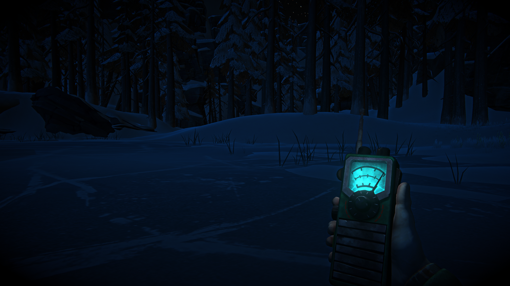

# Handheld Shortwave Radio

**Categories:** DLC Content, Pages with update history, Tools · **Source:** [Fandom](https://thelongdark.fandom.com/wiki/Handheld_Shortwave_Radio)

**Contents**

- [Overview](#overview)
- [Location](#location)
- [Operation](#operation)
- [Limitations](#limitations)
- [Gallery](#gallery)
- [Update history](#update-history)

**DLC-Exclusive content.**

This content requires the [Tales from the Far Territory](./Tales%20from%20the%20Far%20Territory.md) addon to be installed before it can be seen or used in regular gameplay.

**Handheld Shortwave Radio**

| Property | Details |
| --- | --- |
|  | [Handheld Shortwave Radio icon](../assets/Handheld_Shortwave_Radio_icon.png) |
| Release | [30 March 2023](./The%20Long%20Dark%20%E2%80%94%20Changelog.md#2.10) |
| Wintermute | Signal Void |
| **Properties** |  |
| Item type | [Tools](./Tools.md) |
| Equipable | Yes |
| Stackable | No |
| Examine | With a working Transmitter in range, home in on distant objects by navigating in the direction of the highest signal strength. The Shortwave's default tracking mode will detect signals of unknown origin, while its secondary setting is useful for locating hidden supply caches or downed aircraft. / Useless indoors or underground. |
| **Values** |  |
| Weight | 0 kg (0 lbs) |
| **Advanced data** |  |
| Item key | GAMEPLAY\_HandheldShortwave |

> “**During the Aurora, or when in Glimmer Fog, the Handheld Shortwave may pick up errant signals that could lead you to supplies and locations that you wouldn't otherwise find.**”
>
> — Official Hinterland description

The **Handheld Shortwave Radio** is a radio used in conjunction with a [Transmitter](./Transmitters.md) to locate items in the [Tales](./Tales.md) [Signal Void](./Signal%20Void.md), [Buried Echoes](./Buried%20Echoes.md), and [Last Horizon](./Last%20Horizon.md) in the _[Tales from the Far Territory](./Tales%20from%20the%20Far%20Territory.md)_ DLC.

It is one of the few items that cannot be dropped or placed in containers so it cannot be lost, similar to the [Camera](./Camera.md) and [Respirator](./Respirator.md).

## Overview

As with most electronics scattered across [Great Bear Island](./Great%20Bear%20Island.md), the battery of the Handheld Shortwave Radio is dead during normal gameplay, similar to the [Flashlight](./Flashlight.md). When an [Aurora](./Aurora.md) or [Glimmer Fog](./Glimmer%20Fog.md) event is active however, the Handheld Shortwave Radio will spark back to life, and can be used to track down nearby radio signals within a region. Radio signals indicate the locations of either hidden bunkers or [Supply Cache](./Supply%20Cache.md) depending on which operating channel the device is set to. Before the radio can even be used properly, a Transmitter must be repaired in a region in order to get radio coverage.

Being a quest item, the handheld radio has a unique property of weighing 0.00 kilograms.

## Location

The location for the radio is at the top of the [Control Tower](./Control%20Tower.md), besides the note [Field 31 Operation Memo](./Field%2031%20Operation%20Memo.md).

## Operation

The radio has two operating channels: The default channel, signified by a Blue Backdrop on the dial. This setting is used to locate the source of the anomalous transmissions related to the Signal Void Tale.

Right-clicking the radio will switch it to the secondary channel, indicated by the dial's Yellow Backdrop. This setting allows players to locate signals from either downed aircraft or hidden Transponder Caches.

When an Aurora or Glimmer Fog event is active, the radio will power back up and can be used for a limited time until the weather events end. If the player does not have the radio equipped, but walks near a signal source, the radio will beep in the player's inventory. The radio goes through 3 phases as the player gets closer to a signal.

The first phase begins when the player switches the radio to a channel and begins moving the camera around the game world with the radio equipped. The meter on the radio will swing from left to right and will audibly whir as it attunes to the signal. When it is fully on the right, the player is currently facing directly towards the source of the signal.

The second phase begins as the player begins getting closer to a signal, signified when the small light on the left side of the radio begins to pulse. As the player draws closer to the signal source, the radio light will flash with increasing intensity.

The third phase begins when the radio begins to audibly click/beep, showing that the player is very close to a signal location. This beeping will become more intense when the player is right on top of the signal source.

Once a player is right on top of the signal, the radio will flash and beep rapidly until the player uncovers the signal source. At this point a prompt will appear to dig up either the supply cache or hidden bunker entrance somewhere in the ground.

## Limitations

It is currently impossible to uncover a bunker or supply cache without an Aurora/Glimmer Fog event being active _AND_ having the Shortwave Radio equipped. Even if the player already possesses knowledge of the bunker/cache locations, or uses [Charcoal](./Charcoal.md) to map the location of a bunker (either by mapping the immediate vicinity or uncovering it via a [Polaroid](./Polaroids.md) Vista location), the player will be unable to dig up the bunker/supply cache due to the game not giving an interactive prompt to uncover anything.

As with any Aurora event, great care should be taken while exploring, as the cold night weather and Aurora Predators can quickly kill an ill equipped player as they search for signals.

If a player has investigated all radio signals in a region on either channels, the radio will no longer be useful. It will still power on but will otherwise never find any new signals to home in on.

As per the Part 4 update, the radio cannot be dropped or placed in containers. This is to keep it from being misplaced and accidentally lost.

## Gallery

## Update history

- UPDATE **30 March 2023 ([Update](./The%20Long%20Dark%20%E2%80%94%20Changelog.md#2.10)):**
  - Added to game.
