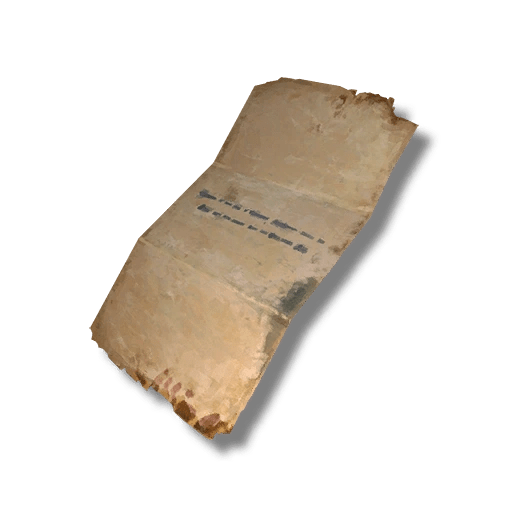

# Handwritten Note

**Categories:** Collectibles, Pages with update history · **Source:** [Fandom](https://thelongdark.fandom.com/wiki/Handwritten_Note)

**Handwritten Note**

_Handwritten\_Note\_icon.png_

**Release:** [1 August 2017](./The%20Long%20Dark%20%E2%80%94%20Early%20Access%20Changelog.md#1.00)

**Wintermute:** [Episode 2](./Episode%202%20-%20Luminance%20Fugue.md)

**Properties**

**Item type:** [Collectibles](./Collectibles.md)\|-

**Stackable:** No

**Examine:** A neatly written note suggesting the location of some supplies.

**Values**

**Weight:** 0.00 kg (0 lbs)

**Actions**

**Backpack:** Examine

**On ground:** Take It, Leave It

**Handwritten Note** is a [Collectible](./Collectibles.md) item found in [Episode 2](./Episode%202%20-%20Luminance%20Fugue.md) of the [Wintermute](./Wintermute.md) story mode. It is found at the base steps of the [Hunting Lodge](./Hunting%20Lodge.md).

## Transcript

_The following text is transcribed from **Handwritten Note**_

**The penmanship on this scrap paper seems out of place in this wilderness.

"I never really expected to be back here. Nor truly expected that you would be here either. But I had hoped. If you find this, know that I left something for you. Hidden away from those who simply take what they will."**

## Update history

- UPDATE **1 August 2017 ([Update](./The%20Long%20Dark%20%E2%80%94%20Changelog.md#1.00)):**
  - Added to game.
