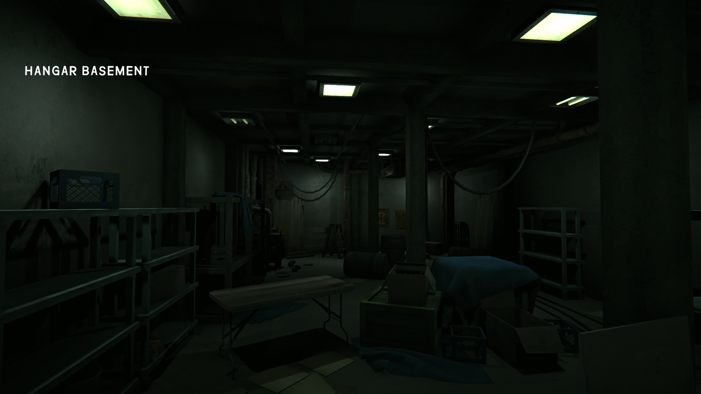

# Hangar Basement

**Hangar Basement**

| Property | Details |
| --- | --- |
|  |  / *HangarBasementLights.jpg* |
| **Location** |  |
| Region | [Forsaken Airfield](./Forsaken%20Airfield.md)\|- |
| **General** |  |
| Firebox |  |
|  / *bed\_icon.png* | Has a bed |
|  / *forge\_icon\_green.png* | Has a forge\|- |
