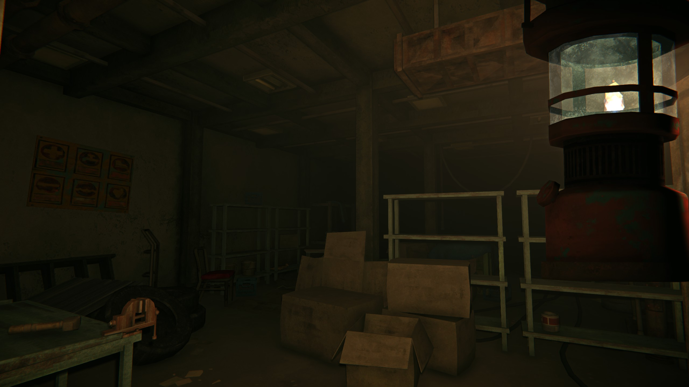

# Hangar Basement

**Categories:** Indoor locations, Locations, Locations in Forsaken Airfield, Locations with a forge, Locations with a workbench · **Source:** [Fandom](https://thelongdark.fandom.com/wiki/Hangar_Basement)

**Hangar Basement**

| Property | Details |
| --- | --- |
|  | [HangarBasementLights](../assets/HangarBasementLights.jpg) |
| **Location** |  |
| Region | [Forsaken Airfield](./Forsaken%20Airfield.md) |
| Description | Bottom floor of the Main Hangar |
| **General** |  |
| Firebox |  |
| [Bed icon](../assets/Bed_icon.png) | Has a bed |
| [Forge icon green](../assets/Forge_icon_green.png) | Has a forge |
| [Workbench icon green](../assets/Workbench_icon_green.png) | Has a workbench |
|  | Has an interior |

**Hangar Basement** is an unmarked, indoor location located at the bottom of the [Main Hangar](./Main%20Hangar.md) at the [Field 31](./Field%2031.md) airfield complex within [Forsaken Airfield](./Forsaken%20Airfield.md). It is one of the few shelters in the region that provides sanctuary from the [Insomnia](./Insomnia.md) [Affliction](./Afflictions.md) caused by the occasional [Glimmer Fog](./Glimmer%20Fog.md) that plagues the region.

The area can be found by taking the stairs from the west side of the main floor of the hangar. The basement has no windows and thus receives no natural light, requiring a light source to navigate except when an [Aurora](./Aurora.md) or Glimmer Fog event reactivates the lights.

The basement itself contains a [Work Bench](./Work%20Bench.md), [Forge](./Forge.md), [Bed](./Bed.md), and several [materials](./Materials.md) and [Tools](./Tools.md) such as a possible [Heavy Hammer](./Heavy%20Hammer.md) spawn, [Coal](./Coal.md), and tables and tarps for [Scrap Metal](./Scrap%20Metal.md), [Reclaimed Wood](./Reclaimed%20Wood.md), and [Cloth](./Cloth.md). The work bench can still, paradoxically, be used during the day without a light source, despite the pitch dark.

A [Note](./Notes.md) can be found on the table to the right of the doorway when first entering.

