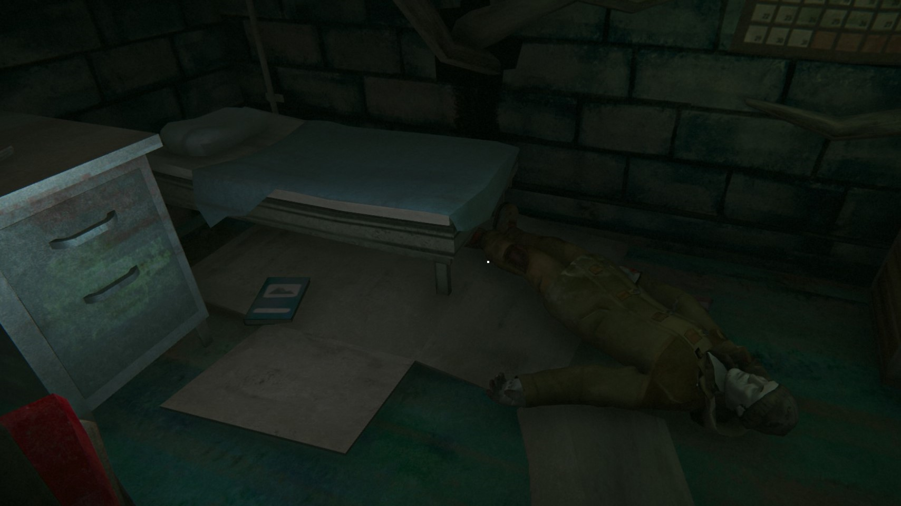
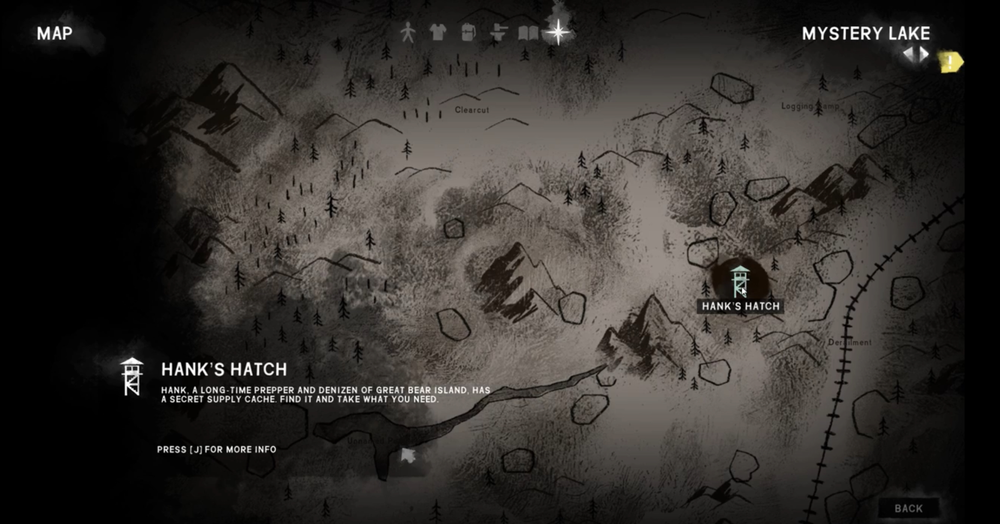

# Hank's Hatch

**Categories:** Episode 2 · **Source:** [Fandom](https://thelongdark.fandom.com/wiki/Hank's_Hatch)

**Contents**

- [Objectives](#objectives)
- [Walkthrough](#walkthrough)
- [Loot](#loot)
- [Trivia](#trivia)
- [Gallery](#gallery)

**Template:spoiler**

**Hank's Hatch**

| Property | Details |
| --- | --- |
|  | [Hank's prepper cache](../assets/Hank%27s_prepper_cache.jpg) |
| Episode | [Episode 2](./Episode%202%20-%20Luminance%20Fugue.md)\|- |
| Current | Hank's Hatch |
| Region | [Mystery Lake](./Mystery%20Lake%20%28disambiguation%29.md) |
| Characters | Hank |

> “**Hank, a long-time prepper and denizen of Great Bear Island, has a secret supply cache. Find it and take what you need.**”
>
> — In-game description

**Hank's Hatch** is a side mission in [Episode 2](./Episode%202%20-%20Luminance%20Fugue.md) of the [story](./Wintermute.md). Completing the mission allows access to Hank's prepper hatch, which contains ammunition, food, and drink supplies.

## Objectives

- Search the [Forestry Lookout](./Forestry%20Lookout.md) for Hank's Lock Box.
- Locate Hank's secret prepper hatch, and gain entry.
- Search Hank's prepper hatch for supplies.

## Walkthrough

The mission is started by finding [Hank's Lock Box Key](./Hank%27s%20Lock%20Box%20Key.md). The key, along with a [Letter for Hank's Niece](./Letter%20for%20Hank%27s%20Niece.md) can be found on a [corpse](./Frozen%20Corpse.md) next to a campfire at [Unnamed Pond](./Unnamed%20Pond.md), appearing at the start of [Signal to Noise](./Signal%20to%20Noise.md) ([Renewed Hope (Predux)](./Renewed%20Hope%20%28Predux%29.md) in Predux Episode 2). After acquiring the key, the player can open Hank's lockbox in the [Forestry Lookout](./Forestry%20Lookout.md). The lockbox contains [Hank's Journal - Part One](./Hank%27s%20Journal%20-%20Part%20One.md), which when picked up will mark the location of the bunker on the map. Also in the lockbox is [Hank's Prepper Cache Code](./Hank%27s%20Prepper%20Cache%20Code.md) with the code to open the hatch.

The bunker is located north of the [Train Loading Area](./Train%20Loading%20Area.md). It can be reached by following the rock boundary near the [Train Bridge](./Train%20Bridge.md).

Upon arriving at the bunker, the player will need to open the hatch, which has a combination dial lock on the top. The code found on the piece of paper in Hank's lockbox can be used to open the hatch. A corpse is on the ground near the hatch.

Inside the bunker, there is plenty of [canned food](./Food%20And%20Drink.md), [water](./Water%20%28Potable%29.md), [granola bars](./Granola%20Bar.md), [flares](./Flare.md), and [Rifle Ammunition](./Rifle%20Ammunition.md). Hank's corpse is lying on the floor inside the bunker.

## Loot

- **3x [Flare Shell](./Flare%20Shell.md)**
- **[Emergency Stim](./Emergency%20Stim.md)**
- **[Quality Tools](./Quality%20Tools.md)**
- [Firearm Cleaning Kit](./Firearm%20Cleaning%20Kit.md)
- **[Wool Longjohns](./Wool%20Longjohns.md)**
- **10x** [Pork and Beans](./Pork%20and%20Beans.md)
- [Can Opener](./Can%20Opener.md)
- [Storm Lantern](./Storm%20Lantern.md) + 0.6l of extra fuel
- 3,5l [Water (Potable)](./Water%20%28Potable%29.md)
- 24x [Wood Matches](./Wood%20Matches.md)
- 1650 kcal of other various food
- minor loot from 11 (randomised) containers(flares, matches, tinder, medicine, bandages, sewing kit, accelerant, cloth, books etc.)
- other basic clothing
- a functioning bed

## Trivia

- "Hank" is a nod to the protagonist ["Henry"](https://firewatch.fandom.com/wiki/Henry) from the videogame _Firewatch_. Hank (a common nickname for Henry) shares many similarities with his counterpart, including taking a job working in a fire tower in a nature park to be away from other people. In his journal, Hank complains about "the chatty lady" on the radio, a reference to [Delilah](https://firewatch.fandom.com/wiki/Delilah), Henry's supervisor in _Firewatch_ who communicates with him by radio throughout the game and also occasionally refers to him as "Hank". Hank's Journal refers to him finding a "weird old bunker," also a reference to the plot of _Firewatch._
- In his second journal entry, found in the bunker, Hank mentions hearing someone trying to get in. He does not open the door for them, and then dies from an infected leg wound from a Wolf attack. The body found outside, presumably his niece trying to enter, has antibiotics and antiseptic on them. Had he let her in, they both may have survived.

## Gallery

