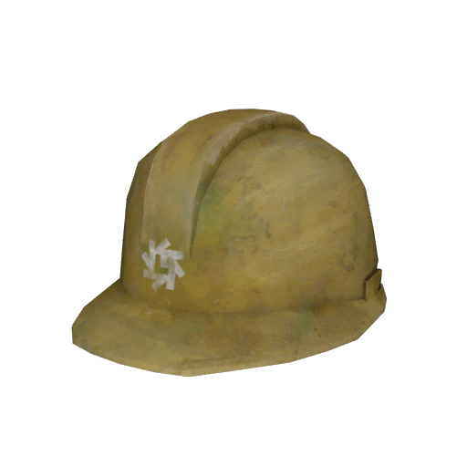
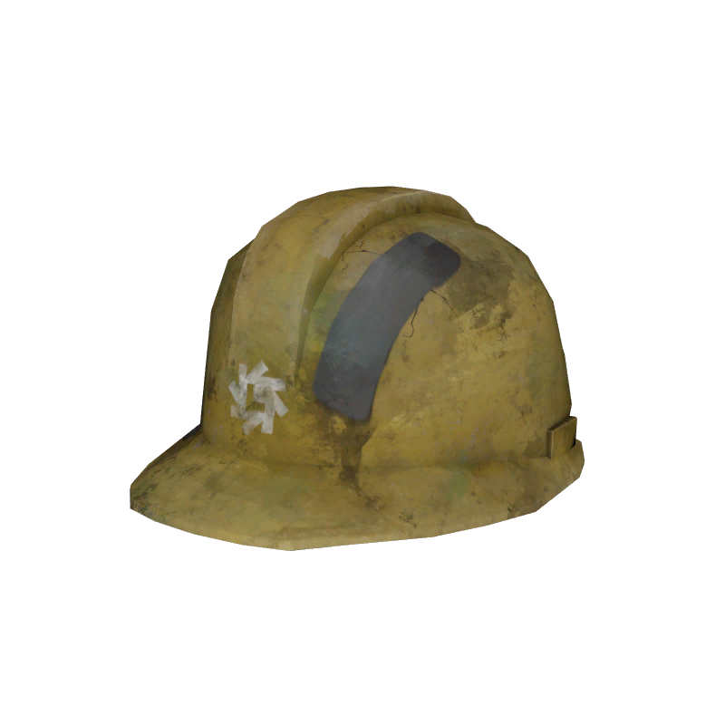

# Hardhat

**Categories:** Clothing, DLC Content, Pages with update history · **Source:** [Fandom](https://thelongdark.fandom.com/wiki/Hardhat)

**Hardhat**

| Property | Details |
| --- | --- |
|  |  / _Hardhat\_icon.png_ |
| **General** |  |
| Item Type | Clothing\|- |
| Renewable | Yes ([Trader](./Trader.md)) |
| Clothing Slot |  |
| **Statistics** |  |
| Weight | 0.40 kg(0.88 lbs) |
| Warmth bonus | 0 °C(0 °F) |
| Windproof bonus | 0 °C(0 °F) |
| Waterproof bonus | 30% |
| Protection | 4% |
| Mobility | 0% |
| Harvest | Cannot Harvest |
| Repair | Cannot Repair |

| Column 1 | Column 2 | Column 3 |
| --- | --- | --- |

|  / _Model icon_ |  / _Model icon damaged_ |  |
