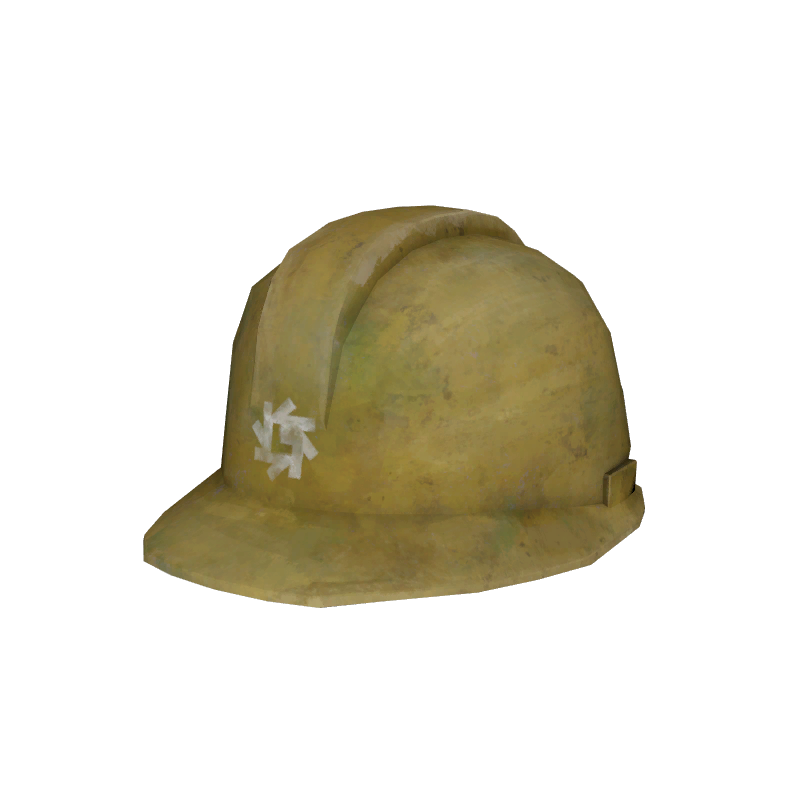

# Hardhat

**Hardhat**

| Property | Details |
| --- | --- |
|  |  / *Hardhat\_icon.png* |
| **General** |  |
| Item Type | Clothing\|- |
| Renewable | Yes ([Trader](./Trader.md)) |
| Clothing Slot |  |
| **Statistics** |  |
| Weight | 0.40 kg(0.88 lbs) |
| Warmth bonus | 0 °C(0 °F) |
| Windproof bonus | 0 °C(0 °F) |
| Waterproof bonus | 30% |
| Protection | 4% |
| Mobility | 0% |
| Harvest | Cannot Harvest |
| Repair | Cannot Repair |

| Column 1 | Column 2 | Column 3 |
| --- | --- | --- |
|  / *Ptarmigan\_icon.png* | **DLC-Exclusive content.** / This content requires the [Tales from the Far Territory](./Tales%20from%20the%20Far%20Territory.md) addon to be installed before it can be seen or used in regular gameplay. | \|}**Template:quote2** The **Hardhat** is a headgear [Clothing](./Clothing.md) that is found inside the [Langston Mine](./Langston%20Mine.md) in the [Zone of Contamination](./Zone%20of%20Contamination.md). / They can be found in the in the [Langston Mine](./Langston%20Mine.md), [Concentrator](./Concentrator.md), [Conveyor Room](./Conveyor%20Room.md), [Headframe Building](./Headframe%20Building.md), or [Idle Camp](./Idle%20Camp.md). / Unlike other Clothing, Hardhats cannot be harvested or repaired. / Possible to acquire from the [Trader](./Trader.md) for 2.00 L [Lantern Fuel](./Lantern%20Fuel.md), 8 [Coal](./Coal.md) and 5 [Cloth](./Cloth.md) / \| Column 1 \| Column 2 \| / \| --- \| --- \| / \|  / *Model icon* \|  / *Model icon damaged* \| / ## Trivia / The Hardhat bears the logo of the Langston Mining Corporation. / ## Update history / - UPDATE **5 December 2023 ([Update](./The%20Long%20Dark%20%E2%80%94%20Changelog.md#2.25)):** / - Added to game. / **Lua execution error in Module:Navbox function navbox** [ru:Каска](ru:%D0%9A%D0%B0%D1%81%D0%BA%D0%B0) |
|  / *Model icon* |  / *Model icon damaged* |  |
