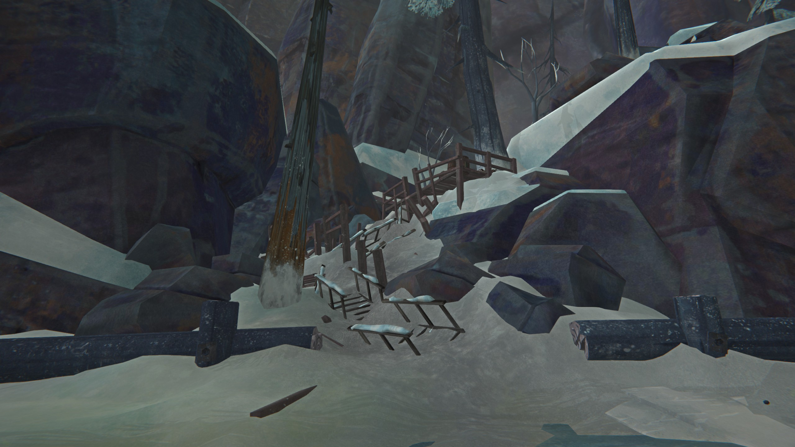

# Harrowed Residence

**Harrowed Residence**

| Property | Details |
| --- | --- |
|  |  / *Harrowed\_Residence.jpg* |
| **Location** |  |
|  |  / *Harrowed\_Residence\_Location.png* |
| Region | [Zone of Contamination](./Zone%20of%20Contamination.md)\|- |
| Description | A burned down trailer tucked away in the mountains |
| **General** |  |
|  | Has no shelter\|} **Harrowed Residence** is a location found in the [Zone of Contamination](./Zone%20of%20Contamination.md) near [Forgotten Exploration](./Forgotten%20Exploration.md). It is a burned down trailer with no real loot or shelter nearby. A ruined staircase has some [Barrels](./Barrel.md) at the top that can be salvaged. To the south west is the [Idle Camp](./Idle%20Camp.md), while farer to the southeast is the [Boss's Settlement](./Boss%27s%20Settlement.md). *The ruined stairs near the tracks* **Lua execution error in Module:Navbox function navbox** |
