# Harvesting

**Contents**

- [Overview](#overview)
- [Harvestable Environmental Objects:](#harvestable-environmental-objects)
- [Objects that yield Cloth](#objects-that-yield-cloth)
- [Objects that yield Scrap Metal](#objects-that-yield-scrap-metal)
- [Objects that yield Reclaimed Wood](#objects-that-yield-reclaimed-wood)
- [Objects that yield Stick](#objects-that-yield-stick)
- [Objects that yield Cedar Firewood](#objects-that-yield-cedar-firewood)
- [Objects that yield Fir Firewood](#objects-that-yield-fir-firewood)
- [Objects that yield Tinder Plug](#objects-that-yield-tinder-plug)
- [Other](#other)
- [Harvestable Clothing](#harvestable-clothing)
- [Head](#head)
- [Hands](#hands)
- [Torso](#torso)
- [Inner](#inner)
- [Outer](#outer)
- [Legs](#legs)
- [Inner](#inner-1)
- [Outer](#outer-1)
- [Feet](#feet)
- [Inner](#inner-2)
- [Outer](#outer-2)
- [Accessories](#accessories)
- [Harvestable Tools](#harvestable-tools)
- [Hand Tools](#hand-tools)
- [Firearms](#firearms)
- [Campcraft/Cooking](#campcraftcooking)
- [Lighting Tools](#lighting-tools)
- [Other](#other-1)
- [Carcass Harvesting](#carcass-harvesting)
- [Carcass Types](#carcass-types)
- [Game History](#game-history)

**Harvesting** is a mechanic in *[The Long Dark](./The%20Long%20Dark.md)* that involves the breaking down of objects into usable [Materials](./Materials.md).

## Overview

Harvesting often involves destroying interactable environmental objects, but can also involve breaking down excess [Tools](./Tools.md) or [Clothing](./Clothing.md). [First Aid](./First%20Aid.md), [Fire Starting](./Fire%20Starting.md), and [Food And Drink](./Food%20And%20Drink.md) items cannot be Harvested.

The most common Materials gained from Harvesting are [Cloth](./Cloth.md), [Cured Leather](./Cured%20Leather.md), [Scrap Metal](./Scrap%20Metal.md), [Sticks](./Stick.md), and [Tinder Plugs](./Tinder%20Plug.md). You can harvest any wood, cardboard, or cloth item in the environment by selecting it, choosing your tool, and selecting "Break Down." Some items require tools to break down, and cannot be broken down with your bare hands. Containers cannot be harvested. Environment Objects that require a tool to harvest will give an error message if clicked on, such as "REQUIRES A HACKSAW TO BREAK DOWN" or "REQUIRES A TOOL TO BREAK DOWN", however some objects can be harvested by hand. *~10:00 PM, the end of natural daylight* Harvesting by hand can be performed in darkness, but Harvesting with the use of any kind of Tool requires light, otherwise the message "REQUIRES LIGHT TO BREAK DOWN WITH TOOL" will be displayed. This can be daylight from dawn (6:00 AM) through 8:30 PM both indoors and outdoors, the light provided during [Auroras](./Aurora.md), natural starlight in case of clear [Weather](./Weather.md) at an outdoor location, or light from a lit fire or other source like a [Storm Lantern](./Storm%20Lantern.md). Note that fires only provide light in a few meters radius, beyond which it will be considered dark.

Very rarely, some objects can be broken down to yield paths to hidden locations/items. [Crates](./Crate.md) often have a chance to contain usable items inside, while [Scrub Brush](./Scrub%20Brush.md) in some regions block certain pathways.

## **Harvestable Environmental Objects:**

### Objects that yield  [Cloth](./Cloth.md)

These items can be broken by Hand, but using a tool saves harvesting times at the expense of Tool Condition. Some objects require one of these Tools to break down:

-  [Scrap Metal Shard](./Scrap%20Metal%20Shard.md)
-  [Hunting Knife](./Hunting%20Knife.md)
-  [Improvised Knife](./Improvised%20Knife.md)

| Object | Variant | Yield | Time | Tool Required |
| --- | --- | --- | --- | --- |
| [Cloth (Object)](./Cloth%20%28Object%29.md) | Blanket | 3 x Cloth | 9-15 min | Hand, Scrap Metal Shard, Hunting Knife, Improvised Knife |
| [Cloth (Object)](./Cloth%20%28Object%29.md) | Scarf | 1 x Cloth | 4-6 min | Hand, Scrap Metal Shard, Hunting Knife, Improvised Knife |
| [Cloth (Object)](./Cloth%20%28Object%29.md) | Bedsheet | 5 x Cloth | 18-30 min | Hand, Scrap Metal Shard, Hunting Knife, Improvised Knife |
| [Cloth (Object)](./Cloth%20%28Object%29.md) | Tarp | 4 x Cloth | 14-24 min | Hand, Scrap Metal Shard, Hunting Knife, Improvised Knife |
| [Cloth (Object)](./Cloth%20%28Object%29.md) | Large Tarp | 5 x Cloth | 18-30 min | Hand, Scrap Metal Shard, Hunting Knife, Improvised Knife |
| [Curtain](./Curtain.md) | Curtain | 2 x Cloth | 6-10 min | Hand, Scrap Metal Shard, Hunting Knife, Improvised Knife |
| [Curtain](./Curtain.md) | Bed Curtain | 3 x Cloth | 9-15 min | Hand, Scrap Metal Shard, Hunting Knife, Improvised Knife |
| [Old Bedroll](./Old%20Bedroll.md) |  | 6 x Cloth | 27 min | Scrap Metal Shard, Hunting Knife, Improvised Knife |
| [Pillow](./Pillow.md) |  | 2 x Cloth | 9-11 min | Scrap Metal Shard, Hunting Knife, Improvised Knife |
| [Towel](./Towel.md) |  | 2 x Cloth | 6-10 min | Hand, Scrap Metal Shard, Hunting Knife, Improvised Knife |

### Objects that yield  [Scrap Metal](./Scrap%20Metal.md)

These items can ONLY be broken down with a  [Hacksaw](./Hacksaw.md). Many objects take hours to completely harvest in one session. Some objects have multiple/larger variants that take longer to saw, but provide more Scrap Metal.

| Object | Variant | Yield | Time | Tool Required |
| --- | --- | --- | --- | --- |
| [Broken Metal Control Box](./Broken%20Metal%20Control%20Box.md) | Large Box | 2 x Scrap Metal | 30 min | Hacksaw |
| [Broken Metal Control Box](./Broken%20Metal%20Control%20Box.md) | Small Box | 1 x Scrap Metal | 15 min | Hacksaw |
| [Broken Metal Bed Frame](./Broken%20Metal%20Bed%20Frame.md) |  | 8 x Scrap Metal | 3 hours | Hacksaw |
| [Broken Metal Door](./Broken%20Metal%20Door.md) |  | 2 x Scrap Metal | 45 min | Hacksaw |
| [Hand Cart](./Hand%20Cart.md) |  | 4 x Scrap Metal | 1 hour 30 min | Hacksaw |
| [Metal Chair](./Metal%20Chair.md) | Small | 4 x Scrap Metal | 2 hours 24 min | Hacksaw |
| [Metal Chair](./Metal%20Chair.md) | Armrest | 6 x Scrap Metal 1 x Cloth | 2 hours 36 min | Hacksaw |
| [Metal Chair](./Metal%20Chair.md) | Bench | 6 x Scrap Metal 2 x Cloth | 2 hours 36 min | Hacksaw |
| [Metal Lamp](./Metal%20Lamp.md) | Small | 1 x Scrap Metal | 15 min | Hacksaw |
| [Metal Lamp](./Metal%20Lamp.md) | Large | 2 x Scrap Metal | 45 min | Hacksaw |
| [Metal Pail](./Metal%20Pail.md) |  | 1 Scrap Metal | 15 min | Hacksaw |
| [Metal Shelf](./Metal%20Shelf.md) | Locker | 4 x Scrap Metal | 90 min | Hacksaw |
| [Metal Shelf](./Metal%20Shelf.md) | Extra Small | 4 x Scrap Metal | 90 min | Hacksaw |
| [Metal Shelf](./Metal%20Shelf.md) | Small | 6 x Scrap Metal | 135 min | Hacksaw |
| [Metal Shelf](./Metal%20Shelf.md) | Large | 8 x Scrap Metal | 180 min | Hacksaw |
| [Metal Shelf](./Metal%20Shelf.md) | Extra Large | 10 x Scrap Metal | 210 min | Hacksaw |
| [Metal Table](./Metal%20Table.md) |  | 8 x Scrap Metal | 180 min | Hacksaw |
| [Switch Box](./Switch%20Box.md) |  | 2 x Scrap Metal | 30 min | Hacksaw |
| [Toaster](./Toaster.md) |  | 1 Scrap Metal | 15 min | Hacksaw |

### Objects that yield  [Reclaimed Wood](./Reclaimed%20Wood.md)

Most of these items **CANNOT** be broken by Hand, and require a Tool. This list regards objects that predominantly provide Reclaimed Wood when broken down, but sometimes they often contain other items when harvested, and will be categorized via variant for sake of convivence.

Some objects require a Tool to break down:

-  [Hatchet](./Hatchet.md)
-  [Improvised Hatchet](./Improvised%20Hatchet.md)
- 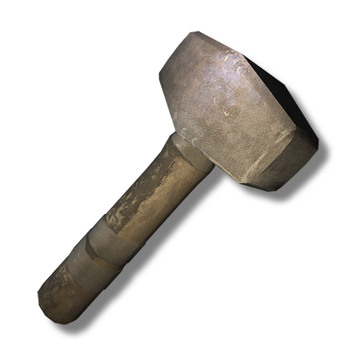 [Heavy Hammer](./Heavy%20Hammer.md)

| Object | Variant | Yield | Time | Tool Required |
| --- | --- | --- | --- | --- |
| [Barrel](./Barrel.md) |  | 2 x Reclaimed Wood 1 x Scrap Metal | 15 min | Hatchet, Improvised Hatchet, Heavy Hammer |
| [Bench](./Bench.md) | Table | 2 x Reclaimed Wood 1 x Scrap Metal | 15 min | Hatchet, Improvised Hatchet, Heavy Hammer |
| Bench | Couch | 5 x Reclaimed Wood 3 x Cloth 1 x Tinder Plug | 2 hour 30 min | Hatchet, Improvised Hatchet, Heavy Hammer |
| Bench | Chair | 6 x Reclaimed Wood | 60 min | Hatchet, Improvised Hatchet, Heavy Hammer |
| Bench | Small Table | 4 x Reclaimed Wood | 30 min | Hatchet, Improvised Hatchet, Heavy Hammer |
| [Broom](./Broom.md) |  | 1 x Reclaimed Wood | 8 min | Hatchet, Improvised Hatchet, Heavy Hammer |
| [Cabinet Door](./Cabinet%20Door.md) |  | 1 x Reclaimed Wood | 8 min | Hatchet, Improvised Hatchet |
| [Chair](./Chair.md) | Wooden | 4 x Reclaimed Wood | 60 min | Hatchet, Improvised Hatchet, Heavy Hammer |
| Chair | Cushioned | 3 x Reclaimed Wood 2 x Cloth 2 x Tinder Plug | 45 min | Hatchet, Improvised Hatchet, Heavy Hammer |
| Chair | Sofa Chair | 4 x Reclaimed Wood 6 x Cloth 2 x Tinder Plug | 90 min | Hatchet, Improvised Hatchet, Heavy Hammer |
| Chair | Stool | 3 x Reclaimed Wood | 30 min | Hatchet, Improvised Hatchet, Heavy Hammer |
| [Crate](./Crate.md) | Large | 6 x Reclaimed Wood | 45-90 min | Hand, Hatchet, Improvised Hatchet, Heavy Hammer |
| Crate | Medium/Small | 4 Reclaimed Wood | 30-60 min | Hand, Hatchet, Improvised Hatchet, Heavy Hammer |
| Crate | Small | 1 x Reclaimed Wood | 8-15 min | Hand, Hatchet, Improvised Hatchet, Heavy Hammer |
| Crate | Coal | 2 x Reclaimed Wood | 8-15 min | Hand, Hatchet, Improvised Hatchet, Heavy Hammer |
| [Ladder](./Ladder.md) |  | 6 x Reclaimed Wood | 78 min | Hatchet, Improvised Hatchet |
| [Paddle](./Paddle.md) |  | 2 x Reclaimed Wood | 6 min | Hatchet, Improvised Hatchet, Heavy Hammer |
| [Pallet](./Pallet.md) |  | 3 x Reclaimed Wood | 22-39 min | Hatchet, Improvised Hatchet, Heavy Hammer |
| [Pallets](./Pallets.md) | Stacked | 16 x Reclaimed Wood | 2-3 hours | Hatchet, Improvised Hatchet, Heavy Hammer |
| Pallets | Piled | 12 x Reclaimed Wood | 1 hour 30 min- 2 hour 15 min | Hatchet, Improvised Hatchet, Heavy Hammer |
| [Plank](./Plank.md) |  | 2 x Reclaimed Wood | 9-14 min | Hatchet, Improvised Hatchet, Heavy Hammer |
| [Planks](./Planks.md) |  | 6 x Reclaimed Wood | 30-45 min | Hatchet, Improvised Hatchet, Heavy Hammer |
| [Shelf](./Shelf.md) | Large Shelf | N/A | N/A | Hatchet, Improvised Hatchet, Heavy Hammer |
| Shelf | Bookshelf | N/A | N/A | Hatchet, Improvised Hatchet, Heavy Hammer |
| Shelf | Gun Rack | 2 x Reclaimed Wood | 15-22 min | Hatchet, Improvised Hatchet, Heavy Hammer |
| Shelf | Single Rack | 1 x Reclaimed Wood | 8-11 min | Hatchet, Improvised Hatchet, Heavy Hammer |
| [Table](./Table.md) | Small | 3 x Reclaimed Wood | 38-56 min | Hatchet, Improvised Hatchet, Heavy Hammer |
| Table | Coffee | 4 x Reclaimed Wood | 90-N/A min | Hatchet, Improvised Hatchet, Heavy Hammer |
| Table | Nightstand | 3 x Reclaimed Wood | 38-56 min | Hatchet, Improvised Hatchet, Heavy Hammer |
| Table | Dining | 6 x Reclaimed Wood 1 x Tinder Plug | 1 hour 57 min- 2 hour 15 min | Hatchet, Improvised Hatchet, Heavy Hammer |
| Table | Large | 6 x Reclaimed Wood | 90-N/A min | Hatchet, Improvised Hatchet, Heavy Hammer |
| [Wheel](./Wheel.md) |  | 6 x Reclaimed Wood | 38-56 min | Hatchet, Improvised Hatchet, Heavy Hammer |

### Objects that yield  [Stick](./Stick.md)

Branches can be broken byHand, but using a tool saves harvesting times at the expense of Tool Condition. Some objects require one of these Tools to break down:

-  [Hatchet](./Hatchet.md)
-  [Improvised Hatchet](./Improvised%20Hatchet.md)

| Object | Variant | Yield | Time | Tool Required |
| --- | --- | --- | --- | --- |
| [Branch](./Branch.md) |  | 3 x Stick | 10 min | Hand, Hatchet, Improvised Hatchet |
| [Scrub Brush](./Scrub%20Brush.md) | Single | 7 x Stick | 10-20 min | Hand, Hatchet, Improvised Hatchet |
| Scrub Brush | Patch | 12 x Stick | 18 min | Hatchet, Improvised Hatchet |

### Objects that yield  [Cedar Firewood](./Cedar%20Firewood.md)

| Object | Variant | Yield | Time | Tool Required |
| --- | --- | --- | --- | --- |
| [Cedar Limb](./Cedar%20Limb.md) | Small | 3 x Cedar Firewood 1 x Tinder Plug | 45-90 min | Hatchet, Improvised Hatchet, Hacksaw |
| [Cedar Limb](./Cedar%20Limb.md) | Large | 5 x Cedar Firewood 1 x Tinder Plug |  | Hatchet, Improvised Hatchet |

### Objects that yield  [Fir Firewood](./Fir%20Firewood.md)

| Object | Yield | Time | Tool Required |
| --- | --- | --- | --- |
| [Fir Limb](./Fir%20Limb.md) | 3 x Fir Firewood | 45-90 min | Hatchet, Improvised Hatchet, Hacksaw |

### Objects that yield  [Tinder Plug](./Tinder%20Plug.md)

This item can be broken by Hand, but using a tool saves harvesting times at the expense of Tool Condition. Some objects require one of these Tools to break down:

-  [Scrap Metal Shard](./Scrap%20Metal%20Shard.md)
-  [Hunting Knife](./Hunting%20Knife.md)
-  [Improvised Knife](./Improvised%20Knife.md)

| Object | Yield | Time | Tool Required |
| --- | --- | --- | --- |
| [Cardboard Box](./Cardboard%20Box.md) | 1-3 x Tinder Plug | 27 min | Hand, Scrap Metal Shard, Hunting Knife, Improvised Knife |

### Other

| Object | Yield | Time | Tool Required |
| --- | --- | --- | --- |
| [Can](./Can.md) | 1 x Recycled Can | 6 min | Hand |
| [Basin](./Basin.md) |  | Instant | Hand |
| [Industrial Toilet](./Industrial%20Toilet.md) |  | Instant | Hand |
| [Stored Water](./Stored%20Water.md) |  | Instant | Hand |
| [Toilet](./Toilet.md) |  | Instant | Hand |

## Harvestable Clothing

[Clothing](./Clothing.md) can often yield a either  [Cloth](./Cloth.md),  [Cured Leather](./Cured%20Leather.md), or Cured Animal Hides when harvested. All Clothing can be harvested by Hand and require no tools.

### Head

|  / *Clothing.png* | Clothing | Yield | Time |
| --- | --- | --- | --- |
| 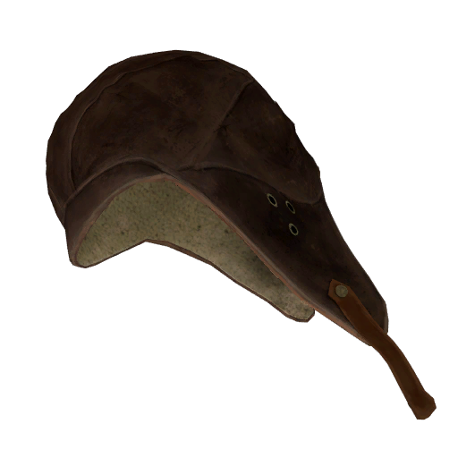 / *Aviator\_Cap\_icon.png* | [Aviator Cap](./Aviator%20Cap.md) | 1 x Cured Leather | 10 min |
|  / *Astrid's\_Toque\_icon.png* | *[Astrid's Toque](./Astrid%27s%20Toque.md)* | 1 x Cloth | 10 min |
|  / *Balaclava\_icon.png* | [Balaclava](./Balaclava.md) | 1 x Cloth | 10 min |
|  / *Baseball\_Cap\_icon.png* | [Baseball Cap](./Baseball%20Cap.md) | 1 x Cloth | 10 min |
| 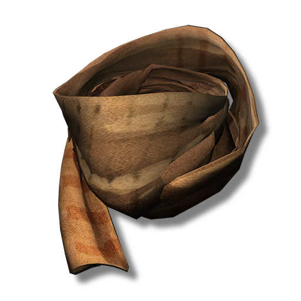 / *Cotton\_Scarf\_icon.png* | [Cotton Scarf](./Cotton%20Scarf.md) | 1 x Cloth | 10 min |
|  / *Cotton\_Toque\_icon.png* | [Cotton Toque](./Cotton%20Toque.md) | 1 x Cloth | 10 min |
| 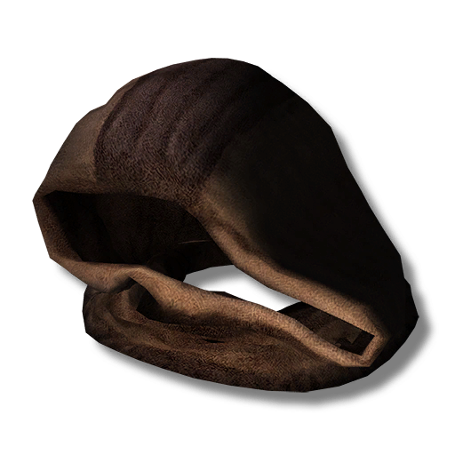 / *Fleece\_Cowl\_icon.png* | [Fleece Cowl](./Fleece%20Cowl.md) | 1 x Cloth | 10 min |
| 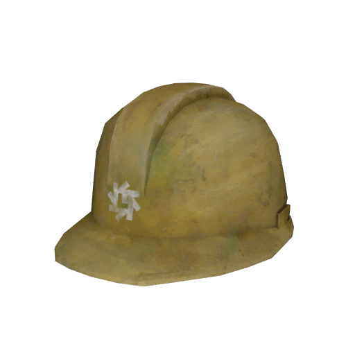 / *Hardhat\_icon.png* | [Hardhat](./Hardhat.md) | Cannot Harvest | N/A |
| 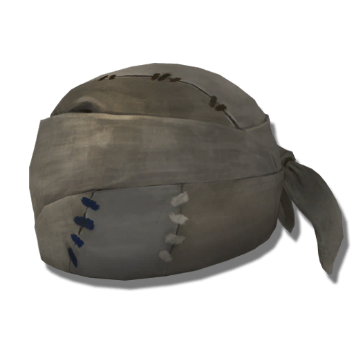 / *Improvised\_Head\_Wrap\_icon.png* | [Improvised Head Wrap](./Improvised%20Head%20Wrap.md) | 1 x Cloth | 10 min |
| 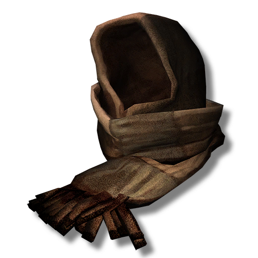 / *Long\_Wool\_Scarf\_icon.png* | [Long Wool Scarf](./Long%20Wool%20Scarf.md) | 1 x Cloth | 10 min |
|  / *Mackenzie's\_Toque\_icon.png* | *[Mackenzie's Toque](./Mackenzie%27s%20Toque.md)* | 1 x Cloth | 10 min |
|  / *Rabbitskin\_Hat\_icon.png* | [Rabbitskin Hat](./Rabbitskin%20Hat.md) | 1 x [Cured Rabbit Pelt](./Cured%20Rabbit%20Pelt.md) | 10 min |
| 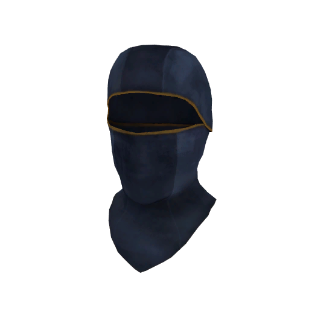 / *Technical\_Balaclava\_icon.png* | [Technical Balaclava](./Technical%20Balaclava.md) | 1 x Cloth | 10 min |
|  / *Wool\_Scarf\_icon.png* | [Wool Scarf](./Wool%20Scarf.md) | 1 x Cloth | 10 min |
|  / *Wool\_Toque\_icon.png* | [Wool Toque](./Wool%20Toque.md) | 1 x Cloth | 10 min |

### Hands

|  / *Clothing.png* | Clothing | Yield | Time |
| --- | --- | --- | --- |
|  / *Astrid's\_Gloves\_icon.png* | *[Astrid's Gloves](./Astrid%27s%20Gloves.md)* | 1 x Cloth | 10 min |
|  / *Driving\_Gloves\_icon.png* | [Driving Gloves](./Driving%20Gloves.md) | 1 x Cured Leather | 10 min |
|  / *Fleece\_Mittens\_icon.png* | [Fleece Mittens](./Fleece%20Mittens.md) | 1 x Cloth | 10 min |
| 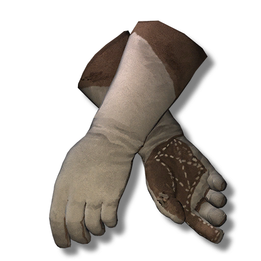 / *Gauntlets\_icon.png* | [Gauntlets](./Gauntlets.md) | 1 x Cured Leather | 10 min |
| 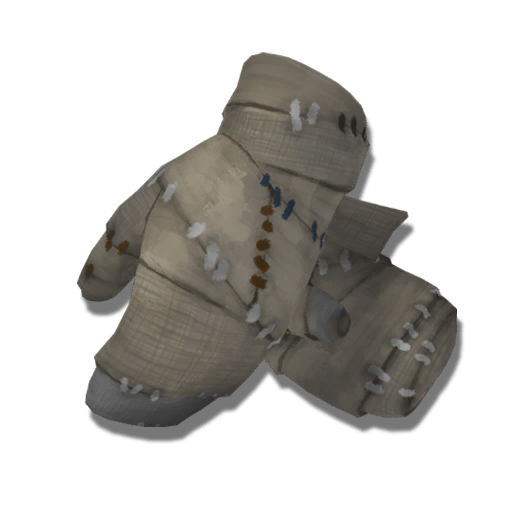 / *Improvised\_Hand\_Wraps\_icon.png* | [Improvised Hand Wraps](./Improvised%20Hand%20Wraps.md) | 1 x Cloth | 10 min |
|  / *Rabbitskin\_Mitts\_icon.png* | [Rabbitskin Mitts](./Rabbitskin%20Mitts.md) | 1 x [Cured Rabbit Pelt](./Cured%20Rabbit%20Pelt.md) | 10 min |
| 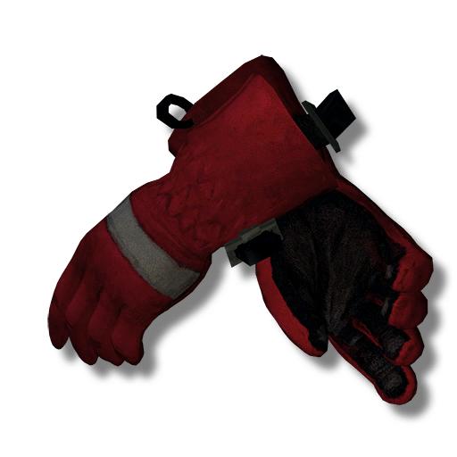 / *Ski\_Gloves\_icon.png* | [Ski Gloves](./Ski%20Gloves.md) | 1 x Cloth | 10 min |
|  / *Wool\_Mittens\_icon.png* | [Wool Mittens](./Wool%20Mittens.md) | 1 x Cloth | 10 min |
|  / *Work\_Gloves\_icon.png* | [Work Gloves](./Work%20Gloves.md) | 1 x Cured Leather | 10 min |

### Torso

#### Inner

|  / *Clothing.png* | Clothing | Yield | Time |
| --- | --- | --- | --- |
|  / *Astrid's\_Sweater\_icon.png* | *[Astrid's Sweater](./Astrid%27s%20Sweater.md)* | 1 x Cloth | 10 min |
| 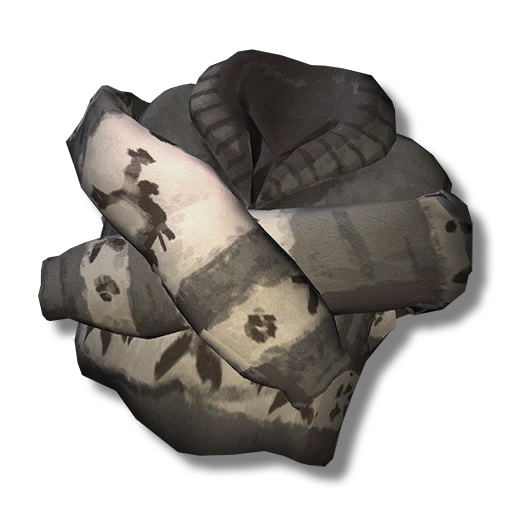 / *Cowichan\_Sweater\_icon.png* | [Cowichan Sweater](./Cowichan%20Sweater.md) | 1 x Cloth | 45 min |
| 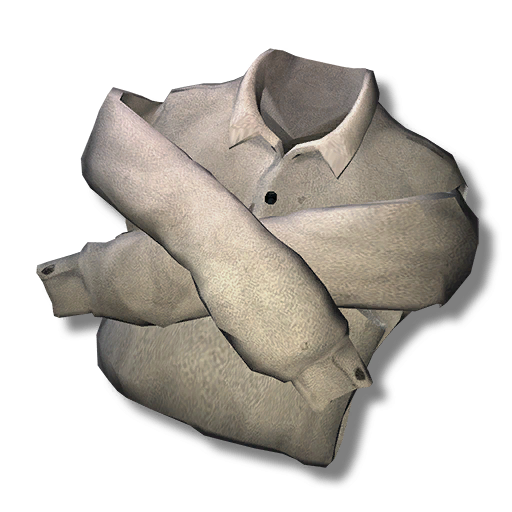 / *Dress\_Shirt\_icon.png* | [Dress Shirt](./Dress%20Shirt.md) | 1 x Cloth | 10 min |
|  / *Fisherman's\_Sweater\_icon.png* | [Fisherman's Sweater](./Fisherman%27s%20Sweater.md) | 1 x Cloth | 45 min |
|  / *Hockey\_Jersey\_icon.png* | [Hockey Jersey](./Hockey%20Jersey.md) | 1 x Cloth | 30 min |
|  / *Hoodie\_icon.png* | [Hoodie](./Hoodie.md) | 1 x Cloth | 45 min |
|  / *Mackenzie's\_Shirt\_icon.png* | *[Mackenzie's Shirt](./Mackenzie%27s%20Shirt.md)* | 1 x Cloth | 10 min |
|  / *Mackenzie's\_Sweater\_icon.png* | *[Mackenzie's Sweater](./Mackenzie%27s%20Sweater.md)* | 1 x Cloth | 10 min |
|  / *Plaid\_Shirt\_icon.png* | [Plaid Shirt](./Plaid%20Shirt.md) | 1 x Cloth | 10 min |
|  / *Sweatshirt\_icon.png* | [Sweatshirt](./Sweatshirt.md) | 1 x Cloth | 10 min |
|  / *Thick\_Wool\_Sweater\_icon.png* | [Thick Wool Sweater](./Thick%20Wool%20Sweater.md) | 1 x Cloth | 45 min |
|  / *Thin\_Wool\_Sweater\_icon.png* | [Thin Wool Sweater](./Thin%20Wool%20Sweater.md) | 1 x Cloth | 30 min |
|  / *T-Shirt\_icon.png* | [T-Shirt](./T-Shirt.md) | 1 x Cloth | 10 min |
|  / *Wool\_Shirt\_icon.png* | [Wool Shirt](./Wool%20Shirt.md) | 1 x Cloth | 10 min |

#### Outer

|  / *Clothing.png* | Clothing | Yield | Time |
| --- | --- | --- | --- |
|  / *Astrid's\_Jacket\_icon.png* | *[Astrid's Jacket](./Astrid%27s%20Jacket.md)* | 2 x Cloth | 20 min |
|  / *Bearskin\_Coat\_icon.png* | [Bearskin Coat](./Bearskin%20Coat.md) | 1 × [Cured Black Bear Hide](./Cured%20Black%20Bear%20Hide.md) | 120 min |
|  / *Down\_Vest\_icon.png* | [Down Vest](./Down%20Vest.md) | 2 x Cloth | 20 min |
| 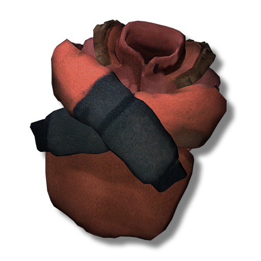 / *Expedition\_Parka\_icon.png* | [Expedition Parka](./Expedition%20Parka.md) | 2 x Cloth | 20 min |
| 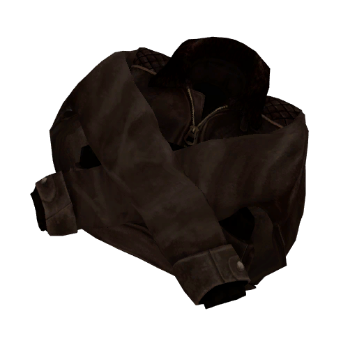 / *Flight\_Jacket\_icon.png* | [Flight Jacket](./Flight%20Jacket.md) | 3 x Cured Leather | 30 min |
|  / *Light\_Shell\_icon.png* | [Light Shell](./Light%20Shell.md) | 2 x Cloth | 40 min |
|  / *Mackenzie's\_Parka\_icon.png* | *[Mackenzie's Parka](./Mackenzie%27s%20Parka.md)* | 2 x Cloth | 20 min |
|  / *Mackinaw\_Jacket\_icon.png* | [Mackinaw Jacket](./Mackinaw%20Jacket.md) | 2 x Cloth | 20 min |
|  / *Mariner's\_Pea\_Coat\_icon.png* | [Mariner's Pea Coat](./Mariner%27s%20Pea%20Coat.md) | 2 x Cloth | 90 min |
| 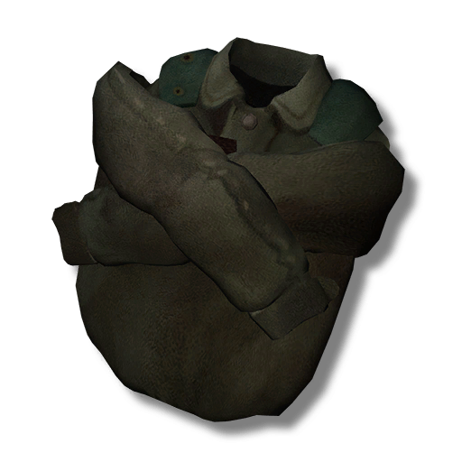 / *Military\_Coat\_icon.png* | [Military Coat](./Military%20Coat.md) | 2 x Cloth | 20 min |
|  / *Miner's\_Jacket\_icon.png* | [Miner's Jacket](./Miner%27s%20Jacket.md) | 2 x Cloth | 60 min |
|  / *Moose-Hide\_Cloak\_icon.png* | [Moose-Hide Cloak](./Moose-Hide%20Cloak.md) | 1 × [Cured Moose Hide](./Cured%20Moose%20Hide.md) | 120 minutes |
|  / *Old\_Fashioned\_Parka\_icon.png* | [Old Fashioned Parka](./Old%20Fashioned%20Parka.md) | 2 x Cloth | 20 min |
| 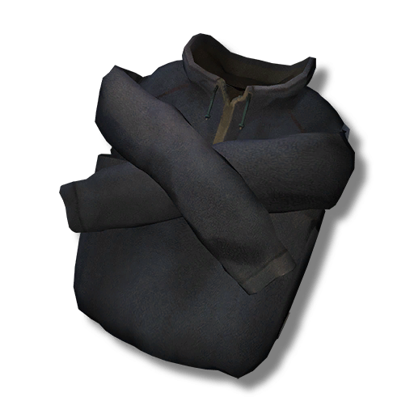 / *Simple\_Parka\_icon.png* | [Simple Parka](./Simple%20Parka.md) | 2 x Cloth | 20 min |
| 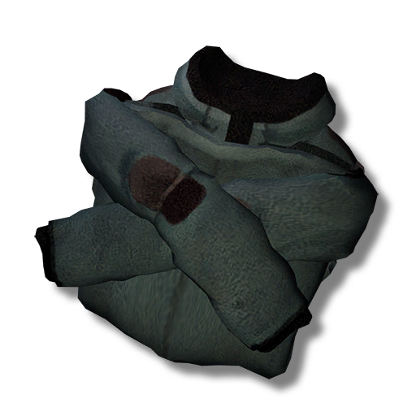 / *Ski\_Jacket\_icon.png* | [Ski Jacket](./Ski%20Jacket.md) | 2 x Cloth | 90 min |
| 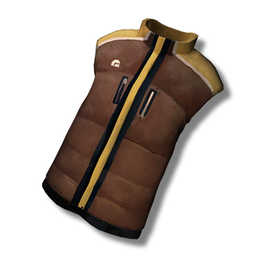 / *Sport\_Vest\_icon.png* | [Sport Vest](./Sport%20Vest.md) | 1 x Cloth | 20 min |
| 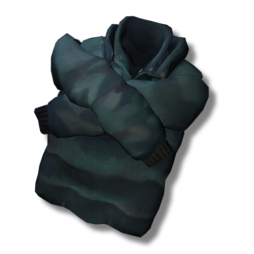 / *Urban\_Parka\_icon.png* | [Urban Parka](./Urban%20Parka.md) | 3 x Cloth | 20 min |
| 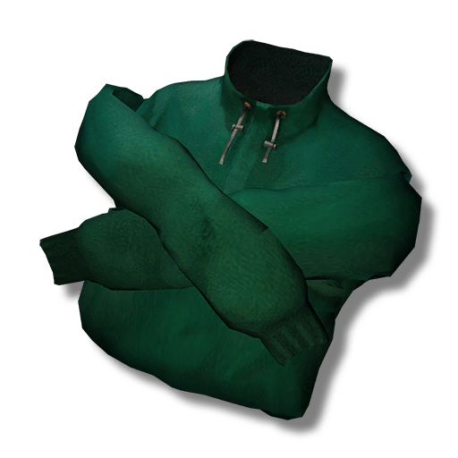 / *Windbreaker\_icon.png* | [Windbreaker](./Windbreaker.md) | 2 x Cloth | 20 min |
|  / *Wolfskin\_Coat\_icon.png* | [Wolfskin Coat](./Wolfskin%20Coat.md) | 1 × [Cured Wolf Pelt](./Cured%20Wolf%20Pelt.md) | 90 minutes |

### Legs

#### Inner

|  / *Clothing.png* | Clothing | Yield | Time |
| --- | --- | --- | --- |
|  / *Thermal\_Underwear\_icon.png* | [Thermal Underwear](./Thermal%20Underwear.md) | 1 x Cloth | 20 min |
|  / *Wool\_Longjohns\_icon.png* | [Wool Longjohns](./Wool%20Longjohns.md) | 1 x Cloth | 20 min |

#### Outer

|  / *Clothing.png* | Clothing | Yield | Time |
| --- | --- | --- | --- |
|  / *Astrid's\_Jeans\_icon.png* | *[Astrid's Jeans](./Astrid%27s%20Jeans.md)* | 1 x Cloth | 30 min |
|  / *Cargo\_Pants\_icon.png* | [Cargo Pants](./Cargo%20Pants.md) | 1 x Cloth | 30 min |
|  / *Combat\_Pants\_icon.png* | [Combat Pants](./Combat%20Pants.md) | 1 x Cloth | 30 min |
|  / *Deerskin\_Pants\_icon.png* | [Deerskin Pants](./Deerskin%20Pants.md) | 1 × [Cured Deer Hide](./Cured%20Deer%20Hide.md) | 30 min |
|  / *Jeans\_icon.png* | [Jeans](./Jeans.md) | 1 x Cloth | 30 min |
|  / *Mackenzie's\_Pants\_icon.png* | *[Mackenzie's Pants](./Mackenzie%27s%20Pants.md)* | 1 x Cloth | 30 min |
|  / *Miner's\_Pants\_icon.png* | [Miner's Pants](./Miner%27s%20Pants.md) | 1 x Cloth | 30 min |
|  / *Snow\_Pants\_icon.png* | [Snow Pants](./Snow%20Pants.md) | 1 x Cloth | 30 min |
|  / *Work\_Pants\_icon.png* | [Work Pants](./Work%20Pants.md) | 1 x Cloth | 30 min |

### Feet

#### Inner

|  / *Clothing.png* | Clothing | Yield | Time |
| --- | --- | --- | --- |
|  / *Climbing\_Socks\_icon.png* | [Climbing Socks](./Climbing%20Socks.md) | 1 x Cloth | 20 min |
| 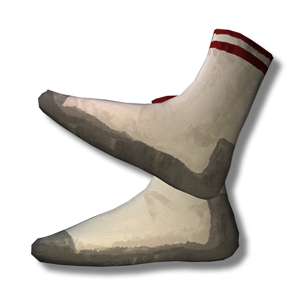 / *Sports\_Socks\_icon.png* | [Sports Socks](./Sports%20Socks.md) | 1 x Cloth | 10 min |
|  / *Wool\_Socks\_icon.png* | [Wool Socks](./Wool%20Socks.md) | 1 x Cloth | 20 min |

#### Outer

|  / *Clothing.png* | Clothing | Yield | Time |
| --- | --- | --- | --- |
|  / *Astrid's\_Boots\_icon.png* | *[Astrid's Boots](./Astrid%27s%20Boots.md)* | 1 x Cured Leather | 90 min |
| 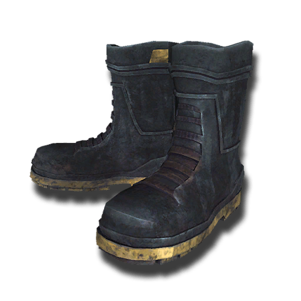 / *Chemical\_Boots\_icon.png* | [Chemical Boots](./Chemical%20Boots.md) | Cannot Harvest | N/A |
| 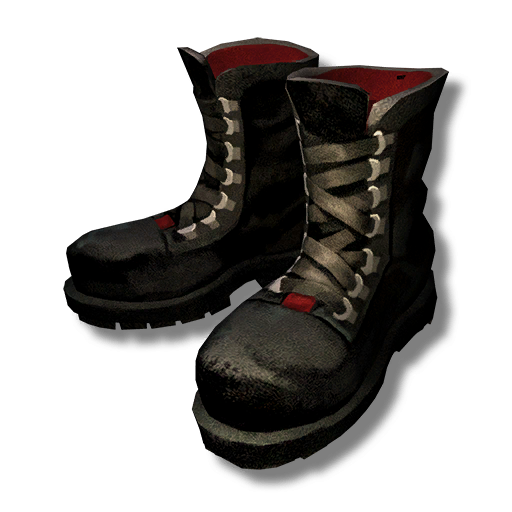 / *Combat\_Boots\_icon.png* | [Combat Boots](./Combat%20Boots.md) | 1 × Cured Leather | 90 min |
|  / *Deerskin\_Boots\_icon.png* | [Deerskin Boots](./Deerskin%20Boots.md) | 1 × [Cured Deer Hide](./Cured%20Deer%20Hide.md) | 110 min |
| 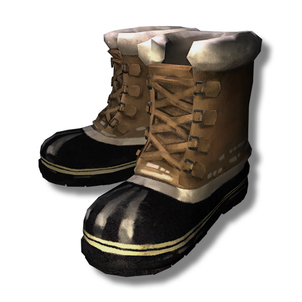 / *Insulated\_Boots\_icon.png* | [Insulated Boots](./Insulated%20Boots.md) | 1 x Cured Leather | 90 min |
| 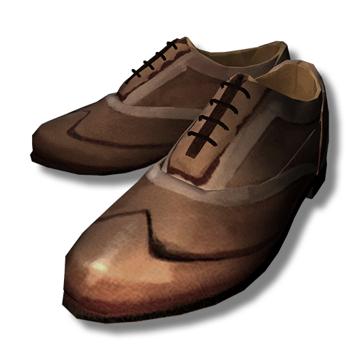 / *Leather\_Shoes\_icon.png* | [Leather Shoes](./Leather%20Shoes.md) | 2 × Cured Leather | 75 min |
|  / *Mackenzie's\_Boots\_icon.png* | *[Mackenzie's Boots](./Mackenzie%27s%20Boots.md)* | 1 x Cured Leather | 90 min |
| 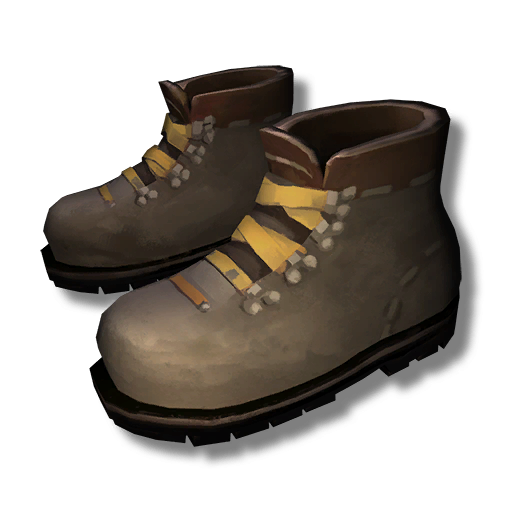 / *Mountaineering\_Boots\_icon.png* | *[Mountaineering Boots](./Mountaineering%20Boots.md)* | 2 × Cured Leather | 90 min |
|  / *Mukluks\_icon.png* | [Mukluks](./Mukluks.md) | 2 × Cured Leather | 90 min |
|  / *Running\_Shoes\_icon.png* | [Running Shoes](./Running%20Shoes.md) | 2 × Cured Leather | 75 min |
|  / *Ski\_Boots\_icon.png* | [Ski Boots](./Ski%20Boots.md) | 1 x Cured Leather | 90 min |
|  / *Trail\_Boots\_icon.png* | [Trail Boots](./Trail%20Boots.md) | 1 x Cured Leather | 90 min |
|  / *Work\_Boots\_icon.png* | [Work Boots](./Work%20Boots.md) | 2 × Cured Leather | 90 min |

### Accessories

|  / *Clothing.png* | Clothing | Yield | Time |
| --- | --- | --- | --- |
| 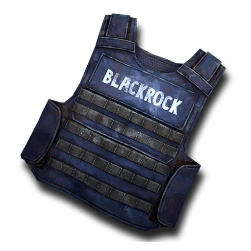 / *Ballistic\_Vest\_icon.png* | [Ballistic Vest](./Ballistic%20Vest.md) | Cannot Harvest | N/A |
|  / *Crampons\_icon.png* | [Crampons](./Crampons.md) | Cannot Harvest | N/A |
|  / *Foreman's\_Tool\_Belt\_icon.png* | [Foreman's Tool Belt](./Foreman%27s%20Tool%20Belt.md) | 2 x Cured Leather | 30 min |
|  / *Improvised\_Crampons\_icon.png* | [Improvised Crampons](./Improvised%20Crampons.md) | Cannot Harvest | N/A |
|  / *Improvised\_Insulation\_icon.png* | [Improvised Insulation](./Improvised%20Insulation.md) | 2 × [Cloth](./Cloth.md) 3 x [Ptarmigan Down](./Ptarmigan%20Down.md) | 20 min |
|  / *Moose-Hide\_Satchel\_icon.png* | [Moose-Hide Satchel](./Moose-Hide%20Satchel.md) | 1 x Cured Leather | 10 min |
|  / *Security\_Chief's\_Rifle\_Holster\_icon.png* | [Security Chief's Rifle Holster](./Security%20Chief%27s%20Rifle%20Holster.md) | 4 x Cured Leather | 30 min |
| 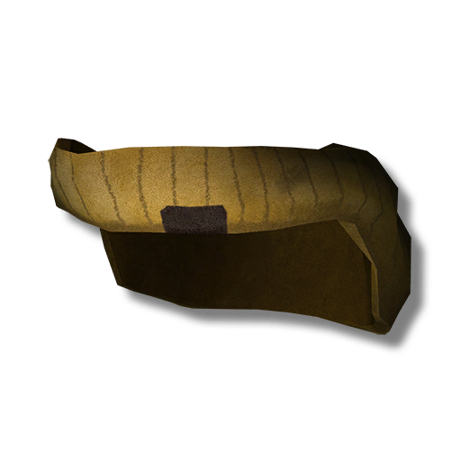 / *Wool\_Ear\_Wrap\_icon.png* | [Wool Ear Wrap](./Wool%20Ear%20Wrap.md) | 1 x Cloth | 10 min |

## Harvestable Tools

There are multiple Tools available in *[The Long Dark](./The%20Long%20Dark.md)*, however only the tools below can be harvested.

### Hand Tools

| Tool | Yield | Time |  |
| --- | --- | --- | --- |
|  / *Hacksaw\_icon.png* | [Hacksaw](./Hacksaw.md) | 2 × Scrap Metal | 1 hour |
|  / *Hatchet\_icon.png* | [Hatchet](./Hatchet.md) | 2 x Scrap Metal 1 x Fir Wood | 1 hour |
|  / *Hunting\_Knife\_icon.png* | [Hunting Knife](./Hunting%20Knife.md) | 1 x Scrap Metal | 45 min |
|  / *Improvised\_Hatchet\_icon.png* | [Improvised Hatchet](./Improvised%20Hatchet.md) | 2 x Scrap Metal | 1 hour |
|  / *Improvised\_Knife\_icon.png* | [Improvised Knife](./Improvised%20Knife.md) | 1 x Scrap Metal | 45 min |
|  / *Heavy\_Hammer\_icon.png* | [Heavy Hammer](./Heavy%20Hammer.md) | 2 x Scrap Metal 1 x Fir Wood | 30 min |
| 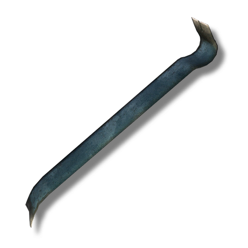 / *Prybar\_icon.png* | [Prybar](./Prybar.md) | 2 x Scrap Metal | 30 min |
|  / *Simple\_Tools\_icon.png* | [Simple Tools](./Simple%20Tools.md) | 3 x Scrap Metal | 1 hour |
|  / *Quality\_Tools\_icon.png* | [Quality Tools](./Quality%20Tools.md) | 3 x Scrap Metal | 1 hour |

### Firearms

| Tool | Yield | Time |  |
| --- | --- | --- | --- |
|  / *Hunting\_Rifle\_icon.png* | [Hunting Rifle](./Hunting%20Rifle.md) | 2 x Scrap Metal | 1 hour |
|  / *Barb's\_Rifle\_icon.png* | [Barb's Rifle](./Barb%27s%20Rifle.md) | 2 x Scrap Metal | 1 hour |
|  / *Curator's\_Rifle\_icon.png* | [Curator's Rifle](./Curator%27s%20Rifle.md) | 2 x Scrap Metal | 1 hour |
|  / *Vaughn's\_Rifle\_icon.png* | [Vaughn's Rifle](./Vaughn%27s%20Rifle.md) | 2 x Scrap Metal | 1 hour |

### Campcraft/Cooking

| Tool | Yield | Time |  |
| --- | --- | --- | --- |
|  / *Bedroll\_icon.png* | [Bedroll](./Bedroll.md) | 10 x Cloth | 90 min |
|  / *Bear\_Skin\_Bedroll\_icon.png* | [Bear Skin Bedroll](./Bear%20Skin%20Bedroll.md) | 1 x Cloth 1 x Cured Black Bear Hide | 90 min |
|  / *Improvised\_Down\_Bedroll\_icon.png* | [Improvised Down Bedroll](./Improvised%20Down%20Bedroll.md) | 10 x Cloth 5 x Ptarmigan Down | 90 min |
|  / *Can\_Opener\_icon.png* | [Can Opener](./Can%20Opener.md) | 1 x Scrap Metal | 15 min |
| 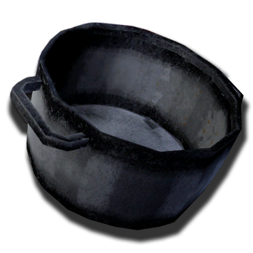 / *Cooking\_Pot\_icon.png* | [Cooking Pot](./Cooking%20Pot.md) | 1 x Scrap Metal | 90 min |
|  / *Cooking\_Skillet\_icon.png* | [Cooking Skillet](./Cooking%20Skillet.md) | 1 x Scrap Metal | 90 min |

### Lighting Tools

| Tool | Yield | Time |  |
| --- | --- | --- | --- |
|  / *Torch\_icon.png* | [Torch](./Torch.md) | 1 x Stick | 2 min |
|  / *Flashlight\_icon.png* | [Flashlight](./Flashlight.md) | 1 x Scrap Metal | 1 hour |
|  / *Miner's\_Flashlight\_icon.png* | [Miner's Flashlight](./Miner%27s%20Flashlight.md) | 1 x Scrap Metal | 1 hour |
| 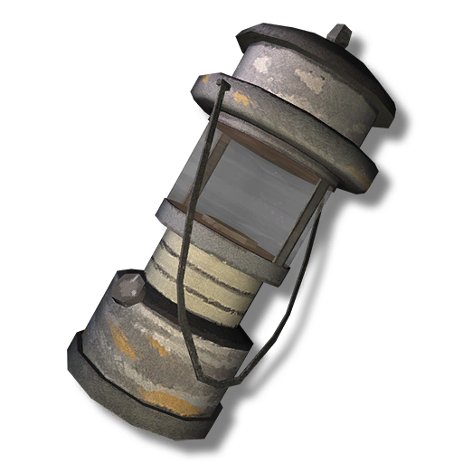 / *Storm\_Lantern\_icon.png* | [Storm Lantern](./Storm%20Lantern.md) | 1 x Scrap Metal 0.01-1.00kg Lantern Fuel | 1 hour |
|  / *Spelunker's\_Lantern\_icon.png* | [Spelunker's Lantern](./Spelunker%27s%20Lantern.md) | 1 x Scrap Metal 0.01-1.00kg Lantern Fuel | 1 hour |

### Other

| Tool | Yield | Time |  |
| --- | --- | --- | --- |
| 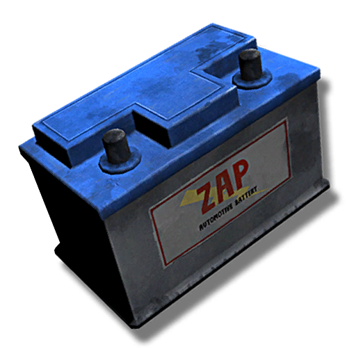 / *Car\_Battery\_icon.png* | [Car Battery](./Car%20Battery.md) | 6 x Scrap Lead | 30 Minutes with a Hacksaw |
|  / *Fishing\_Tip-Up\_icon.png* | [Fishing Tip-Up](./Fishing%20Tip-Up.md) | 1 x Scrap Metal 1 x Stick | 10 min |
|  / *Snare\_icon.png* | [Snare](./Snare.md) | 1 x Reclaimed Wood | 10 min |
|  / *Simple\_Arrow\_icon.png* | [Simple Arrow](./Simple%20Arrow.md) | 2 x Crow Feather 1 x Arrowhead | 5 min |
|  / *Broken\_Arrow\_icon.png* | [Broken Arrow](./Broken%20Arrow.md) | 2 x Crow Feather 1 x Arrowhead | 5 min |
|  / *Fire\_Hardened\_Arrow\_icon.png* | [Fire Hardened Arrow](./Fire%20Hardened%20Arrow.md) | 1 x Crow Feather | 5 min |
|  / *Broken\_Fire\_Hardened\_Arrow\_icon.png* | [Broken Fire Hardened Arrow](./Broken%20Fire%20Hardened%20Arrow.md) | 1 x Crow Feather | 5 min |
|  / *Rifle\_Ammunition\_icon.png* | [Rifle Ammunition](./Rifle%20Ammunition.md)[¹](#fn1) | 1 [Bullet](./Bullet.md) 1 [Rifle Shell Casing](./Rifle%20Shell%20Casing.md) 0.01kg [Can of Gunpowder](./Can%20of%20Gunpowder.md) | 5 min |
|  / *Revolver\_Ammunition\_icon.png* | [Revolver Ammunition](./Revolver%20Ammunition.md)[²](#fn2) | 1 [Bullet](./Bullet.md) 1 [Revolver Shell Casing](./Revolver%20Shell%20Casing.md) 0.01kg [Can of Gunpowder](./Can%20of%20Gunpowder.md) | 5 min |

## Carcass Harvesting

**[Carcass Harvesting](./Carcass%20Harvesting.md)** is a Survival [Skill](./Skills.md) that is used to harvest meat, [animal fat](./Animal%20Fat.md), hides, and [guts](./Fresh%20Gut.md) from [Wildlife](./Wildlife.md). There are 9 types of harvestable animals in *[The Long Dark](./The%20Long%20Dark.md)*, and apart from [Rabbit](./Rabbit.md) and [Ptarmigan](./Ptarmigan.md), all animals can only be harvested at the location of the carcass, unless that animal has been quartered. Higher levels in the carcass harvesting skill reduce the amount of time required to harvest and increase the amount that can be harvested by hand from a frozen carcass. The following Tools affect Carcass Harvesting:

| Tool | Harvest rate (minutes per kg) | Harvest rate (minutes per unit) | Tool decay (per hour) |  |  |  |
| --- | --- | --- | --- | --- | --- | --- |
| Meat | Frozen Meat | Hide | Gut |  |  |  |
|  / *Anywhere\_icon.png* | Bare Hand | 30.0 | N/A | 40.0 | 40.0 | None |
|  / *Hacksaw\_icon.png* | [Hacksaw](./Hacksaw.md) | 15.0 | 10.0 | 60.0 | 30.0 | 1.0% |
|  / *Hatchet\_icon.png* | [Hatchet](./Hatchet.md) | 15.0 | 10.0 | 45.0 | 20.0 | 1.0% |
|  / *Hunting\_Knife\_icon.png* | [Hunting Knife](./Hunting%20Knife.md) | 8.0 | 20.0 | 30.0 | 10.0 | 1.0% |
|  / *Improvised\_Hatchet\_icon.png* | [Improvised Hatchet](./Improvised%20Hatchet.md) | 20.0 | 15.0 | 60.0 | 30.0 | 1.5% |
|  / *Improvised\_Knife\_icon.png* | [Improvised Knife](./Improvised%20Knife.md) | 12.0 | 30.0 | 40.0 | 15.0 | 1.5% |
|  / *Cougar\_Claw\_Knife\_icon.png* | [Cougar Claw Knife](./Cougar%20Claw%20Knife.md) | 7.0 | 18.0 | 30.0 | 10.0 | 1.0% |
|  / *Survival\_Knife\_icon.png* | [Survival Knife](./Survival%20Knife.md) | 8.0 | 10.0 | 30.0 | 10.0 | 0.5% |
|  / *Scrap\_Metal\_Shard\_icon.png* | [Scrap Metal Shard](./Scrap%20Metal%20Shard.md) | 8.0 | 20.0 | 30.0 | 10.0 | 1.0% |

### Carcass Types

| Animal Carcass | Minimum Weight | Maximum Weight | Hide/Pelt/Other | Fresh Guts |
| --- | --- | --- | --- | --- |
| [Black Bear Carcass](./Black%20Bear%20Carcass.md) | 25.00 kg / *(55 lb)***Template:pic link** | 40.00 kg / *(88 lb)***Template:pic link** | 1 x  [Fresh Black Bear Hide](./Fresh%20Black%20Bear%20Hide.md) | 10 x **Template:pic link** |
| [Cougar Carcass](./Cougar%20Carcass.md) | N/A | N/A | N/A | N/A |
| [Deer Carcass](./Deer%20Carcass.md) | 6.00 kg / *(13.2 lb)***Template:pic link** | 11.00 kg / *(24.2 lb)***Template:pic link** | 1 x  [Fresh Deer Hide](./Fresh%20Deer%20Hide.md) | 2 x **Template:pic link** |
| [Moose Carcass](./Moose%20Carcass.md) | 32.00 kg / *(70.4 lb)***Template:pic link** | 45.00 kg / *(99 lb)***Template:pic link** | 1 x  [Fresh Moose Hide](./Fresh%20Moose%20Hide.md) | 12 x **Template:pic link** |
| [Poisoned Wolf Carcass](./Poisoned%20Wolf%20Carcass.md) | 0 kg / *(0 lb)* [Wolf Meat (Raw)](./Wolf%20Meat%20%28Raw%29.md) | 0 kg / *(0 lb)* [Wolf Meat (Raw)](./Wolf%20Meat%20%28Raw%29.md) | 1 x  [Fresh Wolf Pelt](./Fresh%20Wolf%20Pelt.md) | 2 x **Template:pic link** |
| [Ptarmigan Carcass](./Ptarmigan%20Carcass.md) | 0.60 kg / *(1.32 lb)***Template:pic link** | 1.20 kg / *(2.64 lb)***Template:pic link** | 4 x**Template:pic link** | None |
| [Rabbit Carcass](./Rabbit%20Carcass.md) | 0.80 kg / *(1.76 lb)***Template:iconlink** | 1.50 kg / *(3.3 lb)***Template:iconlink** | 1 x  [Fresh Rabbit Pelt](./Fresh%20Rabbit%20Pelt.md) | 1 x **Template:pic link** |
| [Timberwolf Carcass](./Timberwolf%20Carcass.md) | 4.00 kg / *(8.8 lb)* [Wolf Meat (Raw)](./Wolf%20Meat%20%28Raw%29.md) | 7.00 kg / *(15.4 lb)* [Wolf Meat (Raw)](./Wolf%20Meat%20%28Raw%29.md) | 1 x  [Fresh Wolf Pelt](./Fresh%20Wolf%20Pelt.md) | 2 x **Template:pic link** |
| [Wolf Carcass](./Wolf%20Carcass.md) | 3.00 kg / *(6.6 lb)* [Wolf Meat (Raw)](./Wolf%20Meat%20%28Raw%29.md) | 6.00 kg / *(13.2 lb)* [Wolf Meat (Raw)](./Wolf%20Meat%20%28Raw%29.md) | 1 x  [Fresh Wolf Pelt](./Fresh%20Wolf%20Pelt.md) | 2 x **Template:pic link** |

## Game History

Harvesting of stationary objects in larger scale has been introduced on August 1, 2015 in [version 0.256](./The%20Long%20Dark%20%E2%80%94%20Changelog.md#0.256).

**Lua execution error in Module:Navbox function navbox**

## Notes

---

1. There is a chance to recover components, but it depends on [Gunsmithing](./Gunsmithing.md) level[↩︎](#fnref1)
2.
