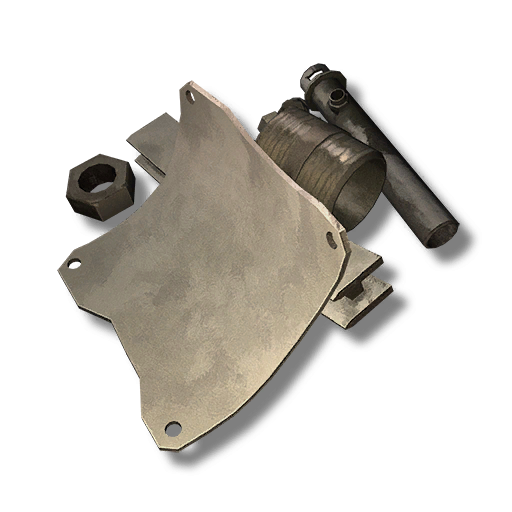
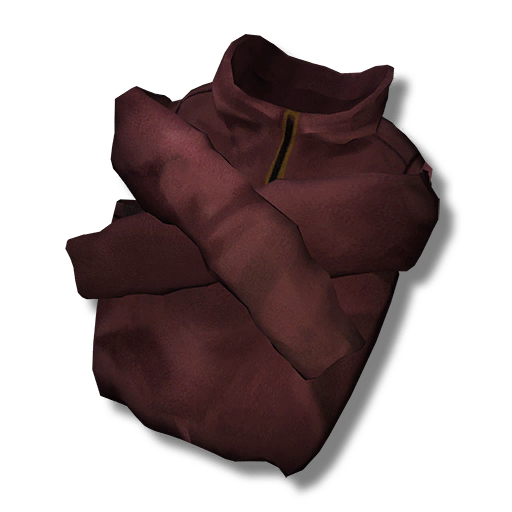
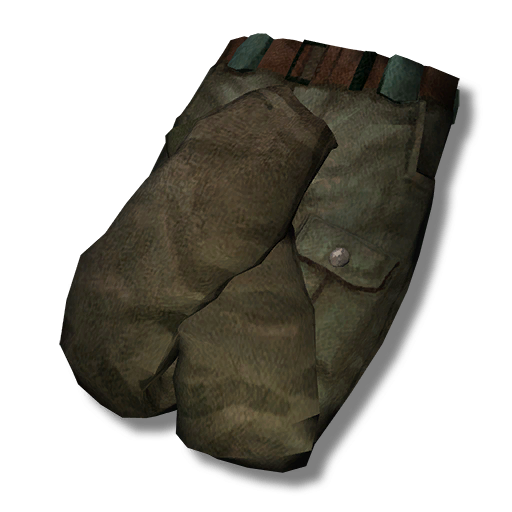
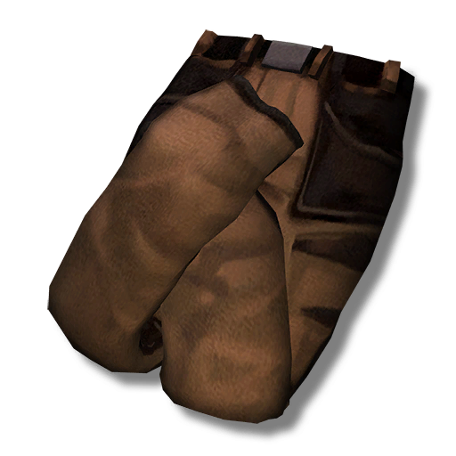
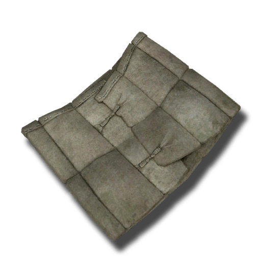

# Harvesting

**Categories:** Gameplay, Interactable Objects, Interactable objects · **Source:** [Fandom](https://thelongdark.fandom.com/wiki/Harvesting)

**Contents**

- [Overview](#overview)
- [Harvestable Environmental Objects:](#harvestable-environmental-objects)
- [Objects that yield Cloth](#objects-that-yield-cloth)
- [Objects that yield Scrap Metal](#objects-that-yield-scrap-metal)
- [Objects that yield Reclaimed Wood](#objects-that-yield-reclaimed-wood)
- [Objects that yield Stick](#objects-that-yield-stick)
- [Objects that yield Cedar Firewood](#objects-that-yield-cedar-firewood)
- [Objects that yield Fir Firewood](#objects-that-yield-fir-firewood)
- [Objects that yield Tinder Plug](#objects-that-yield-tinder-plug)
- [Other](#other)
- [Harvestable Clothing](#harvestable-clothing)
- [Head](#head)
- [Hands](#hands)
- [Torso](#torso)
- [Inner](#inner)
- [Outer](#outer)
- [Legs](#legs)
- [Inner](#inner-1)
- [Outer](#outer-1)
- [Feet](#feet)
- [Inner](#inner-2)
- [Outer](#outer-2)
- [Accessories](#accessories)
- [Harvestable Tools](#harvestable-tools)
- [Hand Tools](#hand-tools)
- [Firearms](#firearms)
- [Campcraft/Cooking](#campcraftcooking)
- [Lighting Tools](#lighting-tools)
- [Other](#other-1)
- [Carcass Harvesting](#carcass-harvesting)
- [Carcass Types](#carcass-types)
- [Game History](#game-history)

**Harvesting** is a mechanic in _[The Long Dark](./The%20Long%20Dark.md)_ that involves the breaking down of objects into usable [Materials](./Materials.md).

## Overview

Harvesting often involves destroying interactable environmental objects, but can also involve breaking down excess [Tools](./Tools.md) or [Clothing](./Clothing.md). [First Aid](./First%20Aid.md), [Fire Starting](./Fire%20Starting.md), and [Food And Drink](./Food%20And%20Drink.md) items cannot be Harvested.

The most common Materials gained from Harvesting are [Cloth](./Cloth.md), [Cured Leather](./Cured%20Leather.md), [Scrap Metal](./Scrap%20Metal.md), [Sticks](./Stick.md), and [Tinder Plugs](./Tinder%20Plug.md). You can harvest any wood, cardboard, or cloth item in the environment by selecting it, choosing your tool, and selecting "Break Down." Some items require tools to break down, and cannot be broken down with your bare hands. Containers cannot be harvested. Environment Objects that require a tool to harvest will give an error message if clicked on, such as "REQUIRES A HACKSAW TO BREAK DOWN" or "REQUIRES A TOOL TO BREAK DOWN", however some objects can be harvested by hand. _~10:00 PM, the end of natural daylight_ Harvesting by hand can be performed in darkness, but Harvesting with the use of any kind of Tool requires light, otherwise the message "REQUIRES LIGHT TO BREAK DOWN WITH TOOL" will be displayed. This can be daylight from dawn (6:00 AM) through 8:30 PM both indoors and outdoors, the light provided during [Auroras](./Aurora.md), natural starlight in case of clear [Weather](./Weather.md) at an outdoor location, or light from a lit fire or other source like a [Storm Lantern](./Storm%20Lantern.md). Note that fires only provide light in a few meters radius, beyond which it will be considered dark.

Very rarely, some objects can be broken down to yield paths to hidden locations/items. [Crates](./Crate.md) often have a chance to contain usable items inside, while [Scrub Brush](./Scrub%20Brush.md) in some regions block certain pathways.

## **Harvestable Environmental Objects:**

### Objects that yield  [Cloth](./Cloth.md)

These items can be broken by Hand, but using a tool saves harvesting times at the expense of Tool Condition. Some objects require one of these Tools to break down:

-  [Scrap Metal Shard](./Scrap%20Metal%20Shard.md)
-  [Hunting Knife](./Hunting%20Knife.md)
-  [Improvised Knife](./Improvised%20Knife.md)

| Object | Variant | Yield | Time | Tool Required |
| --- | --- | --- | --- | --- |
| [Cloth (Object)](./Cloth%20%28Object%29.md) | Blanket | 3 x Cloth | 9-15 min | Hand, Scrap Metal Shard, Hunting Knife, Improvised Knife |
| [Cloth (Object)](./Cloth%20%28Object%29.md) | Scarf | 1 x Cloth | 4-6 min | Hand, Scrap Metal Shard, Hunting Knife, Improvised Knife |
| [Cloth (Object)](./Cloth%20%28Object%29.md) | Bedsheet | 5 x Cloth | 18-30 min | Hand, Scrap Metal Shard, Hunting Knife, Improvised Knife |
| [Cloth (Object)](./Cloth%20%28Object%29.md) | Tarp | 4 x Cloth | 14-24 min | Hand, Scrap Metal Shard, Hunting Knife, Improvised Knife |
| [Cloth (Object)](./Cloth%20%28Object%29.md) | Large Tarp | 5 x Cloth | 18-30 min | Hand, Scrap Metal Shard, Hunting Knife, Improvised Knife |
| [Curtain](./Curtain.md) | Curtain | 2 x Cloth | 6-10 min | Hand, Scrap Metal Shard, Hunting Knife, Improvised Knife |
| [Curtain](./Curtain.md) | Bed Curtain | 3 x Cloth | 9-15 min | Hand, Scrap Metal Shard, Hunting Knife, Improvised Knife |
| [Old Bedroll](./Old%20Bedroll.md) |  | 6 x Cloth | 27 min | Scrap Metal Shard, Hunting Knife, Improvised Knife |
| [Pillow](./Pillow.md) |  | 2 x Cloth | 9-11 min | Scrap Metal Shard, Hunting Knife, Improvised Knife |
| [Towel](./Towel.md) |  | 2 x Cloth | 6-10 min | Hand, Scrap Metal Shard, Hunting Knife, Improvised Knife |

### Objects that yield  [Scrap Metal](./Scrap%20Metal.md)

These items can ONLY be broken down with a  [Hacksaw](./Hacksaw.md). Many objects take hours to completely harvest in one session. Some objects have multiple/larger variants that take longer to saw, but provide more Scrap Metal.

| Object | Variant | Yield | Time | Tool Required |
| --- | --- | --- | --- | --- |
| [Broken Metal Control Box](./Broken%20Metal%20Control%20Box.md) | Large Box | 2 x Scrap Metal | 30 min | Hacksaw |
| [Broken Metal Control Box](./Broken%20Metal%20Control%20Box.md) | Small Box | 1 x Scrap Metal | 15 min | Hacksaw |
| [Broken Metal Bed Frame](./Broken%20Metal%20Bed%20Frame.md) |  | 8 x Scrap Metal | 3 hours | Hacksaw |
| [Broken Metal Door](./Broken%20Metal%20Door.md) |  | 2 x Scrap Metal | 45 min | Hacksaw |
| [Hand Cart](./Hand%20Cart.md) |  | 4 x Scrap Metal | 1 hour 30 min | Hacksaw |
| [Metal Chair](./Metal%20Chair.md) | Small | 4 x Scrap Metal | 2 hours 24 min | Hacksaw |
| [Metal Chair](./Metal%20Chair.md) | Armrest | 6 x Scrap Metal 1 x Cloth | 2 hours 36 min | Hacksaw |
| [Metal Chair](./Metal%20Chair.md) | Bench | 6 x Scrap Metal 2 x Cloth | 2 hours 36 min | Hacksaw |
| [Metal Lamp](./Metal%20Lamp.md) | Small | 1 x Scrap Metal | 15 min | Hacksaw |
| [Metal Lamp](./Metal%20Lamp.md) | Large | 2 x Scrap Metal | 45 min | Hacksaw |
| [Metal Pail](./Metal%20Pail.md) |  | 1 Scrap Metal | 15 min | Hacksaw |
| [Metal Shelf](./Metal%20Shelf.md) | Locker | 4 x Scrap Metal | 90 min | Hacksaw |
| [Metal Shelf](./Metal%20Shelf.md) | Extra Small | 4 x Scrap Metal | 90 min | Hacksaw |
| [Metal Shelf](./Metal%20Shelf.md) | Small | 6 x Scrap Metal | 135 min | Hacksaw |
| [Metal Shelf](./Metal%20Shelf.md) | Large | 8 x Scrap Metal | 180 min | Hacksaw |
| [Metal Shelf](./Metal%20Shelf.md) | Extra Large | 10 x Scrap Metal | 210 min | Hacksaw |
| [Metal Table](./Metal%20Table.md) |  | 8 x Scrap Metal | 180 min | Hacksaw |
| [Switch Box](./Switch%20Box.md) |  | 2 x Scrap Metal | 30 min | Hacksaw |
| [Toaster](./Toaster.md) |  | 1 Scrap Metal | 15 min | Hacksaw |

### Objects that yield  [Reclaimed Wood](./Reclaimed%20Wood.md)

Most of these items **CANNOT** be broken by Hand, and require a Tool. This list regards objects that predominantly provide Reclaimed Wood when broken down, but sometimes they often contain other items when harvested, and will be categorized via variant for sake of convivence.

Some objects require a Tool to break down:

-  [Hatchet](./Hatchet.md)
-  [Improvised Hatchet](./Improvised%20Hatchet.md)
-  [Heavy Hammer](./Heavy%20Hammer.md)

| Object | Variant | Yield | Time | Tool Required |
| --- | --- | --- | --- | --- |
| [Barrel](./Barrel.md) |  | 2 x Reclaimed Wood 1 x Scrap Metal | 15 min | Hatchet, Improvised Hatchet, Heavy Hammer |
| [Bench](./Bench.md) | Table | 2 x Reclaimed Wood 1 x Scrap Metal | 15 min | Hatchet, Improvised Hatchet, Heavy Hammer |
| Bench | Couch | 5 x Reclaimed Wood 3 x Cloth 1 x Tinder Plug | 2 hour 30 min | Hatchet, Improvised Hatchet, Heavy Hammer |
| Bench | Chair | 6 x Reclaimed Wood | 60 min | Hatchet, Improvised Hatchet, Heavy Hammer |
| Bench | Small Table | 4 x Reclaimed Wood | 30 min | Hatchet, Improvised Hatchet, Heavy Hammer |
| [Broom](./Broom.md) |  | 1 x Reclaimed Wood | 8 min | Hatchet, Improvised Hatchet, Heavy Hammer |
| [Cabinet Door](./Cabinet%20Door.md) |  | 1 x Reclaimed Wood | 8 min | Hatchet, Improvised Hatchet |
| [Chair](./Chair.md) | Wooden | 4 x Reclaimed Wood | 60 min | Hatchet, Improvised Hatchet, Heavy Hammer |
| Chair | Cushioned | 3 x Reclaimed Wood 2 x Cloth 2 x Tinder Plug | 45 min | Hatchet, Improvised Hatchet, Heavy Hammer |
| Chair | Sofa Chair | 4 x Reclaimed Wood 6 x Cloth 2 x Tinder Plug | 90 min | Hatchet, Improvised Hatchet, Heavy Hammer |
| Chair | Stool | 3 x Reclaimed Wood | 30 min | Hatchet, Improvised Hatchet, Heavy Hammer |
| [Crate](./Crate.md) | Large | 6 x Reclaimed Wood | 45-90 min | Hand, Hatchet, Improvised Hatchet, Heavy Hammer |
| Crate | Medium/Small | 4 Reclaimed Wood | 30-60 min | Hand, Hatchet, Improvised Hatchet, Heavy Hammer |
| Crate | Small | 1 x Reclaimed Wood | 8-15 min | Hand, Hatchet, Improvised Hatchet, Heavy Hammer |
| Crate | Coal | 2 x Reclaimed Wood | 8-15 min | Hand, Hatchet, Improvised Hatchet, Heavy Hammer |
| [Ladder](./Ladder.md) |  | 6 x Reclaimed Wood | 78 min | Hatchet, Improvised Hatchet |
| [Paddle](./Paddle.md) |  | 2 x Reclaimed Wood | 6 min | Hatchet, Improvised Hatchet, Heavy Hammer |
| [Pallet](./Pallet.md) |  | 3 x Reclaimed Wood | 22-39 min | Hatchet, Improvised Hatchet, Heavy Hammer |
| [Pallets](./Pallets.md) | Stacked | 16 x Reclaimed Wood | 2-3 hours | Hatchet, Improvised Hatchet, Heavy Hammer |
| Pallets | Piled | 12 x Reclaimed Wood | 1 hour 30 min- 2 hour 15 min | Hatchet, Improvised Hatchet, Heavy Hammer |
| [Plank](./Plank.md) |  | 2 x Reclaimed Wood | 9-14 min | Hatchet, Improvised Hatchet, Heavy Hammer |
| [Planks](./Planks.md) |  | 6 x Reclaimed Wood | 30-45 min | Hatchet, Improvised Hatchet, Heavy Hammer |
| [Shelf](./Shelf.md) | Large Shelf | N/A | N/A | Hatchet, Improvised Hatchet, Heavy Hammer |
| Shelf | Bookshelf | N/A | N/A | Hatchet, Improvised Hatchet, Heavy Hammer |
| Shelf | Gun Rack | 2 x Reclaimed Wood | 15-22 min | Hatchet, Improvised Hatchet, Heavy Hammer |
| Shelf | Single Rack | 1 x Reclaimed Wood | 8-11 min | Hatchet, Improvised Hatchet, Heavy Hammer |
| [Table](./Table.md) | Small | 3 x Reclaimed Wood | 38-56 min | Hatchet, Improvised Hatchet, Heavy Hammer |
| Table | Coffee | 4 x Reclaimed Wood | 90-N/A min | Hatchet, Improvised Hatchet, Heavy Hammer |
| Table | Nightstand | 3 x Reclaimed Wood | 38-56 min | Hatchet, Improvised Hatchet, Heavy Hammer |
| Table | Dining | 6 x Reclaimed Wood 1 x Tinder Plug | 1 hour 57 min- 2 hour 15 min | Hatchet, Improvised Hatchet, Heavy Hammer |
| Table | Large | 6 x Reclaimed Wood | 90-N/A min | Hatchet, Improvised Hatchet, Heavy Hammer |
| [Wheel](./Wheel.md) |  | 6 x Reclaimed Wood | 38-56 min | Hatchet, Improvised Hatchet, Heavy Hammer |

### Objects that yield  [Stick](./Stick.md)

Branches can be broken byHand, but using a tool saves harvesting times at the expense of Tool Condition. Some objects require one of these Tools to break down:

-  [Hatchet](./Hatchet.md)
-  [Improvised Hatchet](./Improvised%20Hatchet.md)

| Object | Variant | Yield | Time | Tool Required |
| --- | --- | --- | --- | --- |
| [Branch](./Branch.md) |  | 3 x Stick | 10 min | Hand, Hatchet, Improvised Hatchet |
| [Scrub Brush](./Scrub%20Brush.md) | Single | 7 x Stick | 10-20 min | Hand, Hatchet, Improvised Hatchet |
| Scrub Brush | Patch | 12 x Stick | 18 min | Hatchet, Improvised Hatchet |

### Objects that yield  [Cedar Firewood](./Cedar%20Firewood.md)

| Object | Variant | Yield | Time | Tool Required |
| --- | --- | --- | --- | --- |
| [Cedar Limb](./Cedar%20Limb.md) | Small | 3 x Cedar Firewood 1 x Tinder Plug | 45-90 min | Hatchet, Improvised Hatchet, Hacksaw |
| [Cedar Limb](./Cedar%20Limb.md) | Large | 5 x Cedar Firewood 1 x Tinder Plug |  | Hatchet, Improvised Hatchet |

### Objects that yield  [Fir Firewood](./Fir%20Firewood.md)

| Object | Yield | Time | Tool Required |
| --- | --- | --- | --- |
| [Fir Limb](./Fir%20Limb.md) | 3 x Fir Firewood | 45-90 min | Hatchet, Improvised Hatchet, Hacksaw |

### Objects that yield  [Tinder Plug](./Tinder%20Plug.md)

This item can be broken by Hand, but using a tool saves harvesting times at the expense of Tool Condition. Some objects require one of these Tools to break down:

-  [Scrap Metal Shard](./Scrap%20Metal%20Shard.md)
-  [Hunting Knife](./Hunting%20Knife.md)
-  [Improvised Knife](./Improvised%20Knife.md)

| Object | Yield | Time | Tool Required |
| --- | --- | --- | --- |
| [Cardboard Box](./Cardboard%20Box.md) | 1-3 x Tinder Plug | 27 min | Hand, Scrap Metal Shard, Hunting Knife, Improvised Knife |

### Other

| Object | Yield | Time | Tool Required |
| --- | --- | --- | --- |
| [Can](./Can.md) | 1 x Recycled Can | 6 min | Hand |
| [Basin](./Basin.md) |  | Instant | Hand |
| [Industrial Toilet](./Industrial%20Toilet.md) |  | Instant | Hand |
| [Stored Water](./Stored%20Water.md) |  | Instant | Hand |
| [Toilet](./Toilet.md) |  | Instant | Hand |

## Harvestable Clothing

[Clothing](./Clothing.md) can often yield a either  [Cloth](./Cloth.md),  [Cured Leather](./Cured%20Leather.md), or Cured Animal Hides when harvested. All Clothing can be harvested by Hand and require no tools.

### Head

_Clothing.png_

Clothing

Yield

Time

_Aviator\_Cap\_icon.png_

[Aviator Cap](./Aviator%20Cap.md)

1 x Cured Leather

10 min

_Astrid's\_Toque\_icon.png_

_[Astrid's Toque](./Astrid%27s%20Toque.md)_

1 x Cloth

10 min

_Balaclava\_icon.png_

[Balaclava](./Balaclava.md)

1 x Cloth

10 min

_Baseball\_Cap\_icon.png_

[Baseball Cap](./Baseball%20Cap.md)

1 x Cloth

10 min

_Cotton\_Scarf\_icon.png_

[Cotton Scarf](./Cotton%20Scarf.md)

1 x Cloth

10 min

_Cotton\_Toque\_icon.png_

[Cotton Toque](./Cotton%20Toque.md)

1 x Cloth

10 min

_Fleece\_Cowl\_icon.png_

[Fleece Cowl](./Fleece%20Cowl.md)

1 x Cloth

10 min

_Hardhat\_icon.png_

[Hardhat](./Hardhat.md)

Cannot Harvest

N/A

_Improvised\_Head\_Wrap\_icon.png_

[Improvised Head Wrap](./Improvised%20Head%20Wrap.md)

1 x Cloth

10 min

_Long\_Wool\_Scarf\_icon.png_

[Long Wool Scarf](./Long%20Wool%20Scarf.md)

1 x Cloth

10 min

_Mackenzie's\_Toque\_icon.png_

_[Mackenzie's Toque](./Mackenzie%27s%20Toque.md)_

1 x Cloth

10 min

_Rabbitskin\_Hat\_icon.png_

[Rabbitskin Hat](./Rabbitskin%20Hat.md)

1 x [Cured Rabbit Pelt](./Cured%20Rabbit%20Pelt.md)

10 min

_Technical\_Balaclava\_icon.png_

[Technical Balaclava](./Technical%20Balaclava.md)

1 x Cloth

10 min

_Wool\_Scarf\_icon.png_

[Wool Scarf](./Wool%20Scarf.md)

1 x Cloth

10 min

_Wool\_Toque\_icon.png_

[Wool Toque](./Wool%20Toque.md)

1 x Cloth

10 min

### Hands

_Clothing.png_

Clothing

Yield

Time

_Astrid's\_Gloves\_icon.png_

_[Astrid's Gloves](./Astrid%27s%20Gloves.md)_

1 x Cloth

10 min

_Driving\_Gloves\_icon.png_

[Driving Gloves](./Driving%20Gloves.md)

1 x Cured Leather

10 min

_Fleece\_Mittens\_icon.png_

[Fleece Mittens](./Fleece%20Mittens.md)

1 x Cloth

10 min

_Gauntlets\_icon.png_

[Gauntlets](./Gauntlets.md)

1 x Cured Leather

10 min

_Improvised\_Hand\_Wraps\_icon.png_

[Improvised Hand Wraps](./Improvised%20Hand%20Wraps.md)

1 x Cloth

10 min

_Rabbitskin\_Mitts\_icon.png_

[Rabbitskin Mitts](./Rabbitskin%20Mitts.md)

1 x [Cured Rabbit Pelt](./Cured%20Rabbit%20Pelt.md)

10 min

_Ski\_Gloves\_icon.png_

[Ski Gloves](./Ski%20Gloves.md)

1 x Cloth

10 min

_Wool\_Mittens\_icon.png_

[Wool Mittens](./Wool%20Mittens.md)

1 x Cloth

10 min

_Work\_Gloves\_icon.png_

[Work Gloves](./Work%20Gloves.md)

1 x Cured Leather

10 min

### Torso

#### Inner

_Clothing.png_

Clothing

Yield

Time

_Astrid's\_Sweater\_icon.png_

_[Astrid's Sweater](./Astrid%27s%20Sweater.md)_

1 x Cloth

10 min

_Cowichan\_Sweater\_icon.png_

[Cowichan Sweater](./Cowichan%20Sweater.md)

1 x Cloth

45 min

_Dress\_Shirt\_icon.png_

[Dress Shirt](./Dress%20Shirt.md)

1 x Cloth

10 min

_Fisherman's\_Sweater\_icon.png_

[Fisherman's Sweater](./Fisherman%27s%20Sweater.md)

1 x Cloth

45 min

_Hockey\_Jersey\_icon.png_

[Hockey Jersey](./Hockey%20Jersey.md)

1 x Cloth

30 min

_Hoodie\_icon.png_

[Hoodie](./Hoodie.md)

1 x Cloth

45 min

_Mackenzie's\_Shirt\_icon.png_

_[Mackenzie's Shirt](./Mackenzie%27s%20Shirt.md)_

1 x Cloth

10 min

_Mackenzie's\_Sweater\_icon.png_

_[Mackenzie's Sweater](./Mackenzie%27s%20Sweater.md)_

1 x Cloth

10 min

_Plaid\_Shirt\_icon.png_

[Plaid Shirt](./Plaid%20Shirt.md)

1 x Cloth

10 min

_Sweatshirt\_icon.png_

[Sweatshirt](./Sweatshirt.md)

1 x Cloth

10 min

_Thick\_Wool\_Sweater\_icon.png_

[Thick Wool Sweater](./Thick%20Wool%20Sweater.md)

1 x Cloth

45 min

_Thin\_Wool\_Sweater\_icon.png_

[Thin Wool Sweater](./Thin%20Wool%20Sweater.md)

1 x Cloth

30 min

_T-Shirt\_icon.png_

[T-Shirt](./T-Shirt.md)

1 x Cloth

10 min

_Wool\_Shirt\_icon.png_

[Wool Shirt](./Wool%20Shirt.md)

1 x Cloth

10 min

#### Outer

_Clothing.png_

Clothing

Yield

Time

_Astrid's\_Jacket\_icon.png_

_[Astrid's Jacket](./Astrid%27s%20Jacket.md)_

2 x Cloth

20 min

_Bearskin\_Coat\_icon.png_

[Bearskin Coat](./Bearskin%20Coat.md)

1 × [Cured Black Bear Hide](./Cured%20Black%20Bear%20Hide.md)

120 min

_Down\_Vest\_icon.png_

[Down Vest](./Down%20Vest.md)

2 x Cloth

20 min

_Expedition\_Parka\_icon.png_

[Expedition Parka](./Expedition%20Parka.md)

2 x Cloth

20 min

_Flight\_Jacket\_icon.png_

[Flight Jacket](./Flight%20Jacket.md)

3 x Cured Leather

30 min

_Light\_Shell\_icon.png_

[Light Shell](./Light%20Shell.md)

2 x Cloth

40 min

_Mackenzie's\_Parka\_icon.png_

_[Mackenzie's Parka](./Mackenzie%27s%20Parka.md)_

2 x Cloth

20 min

_Mackinaw\_Jacket\_icon.png_

[Mackinaw Jacket](./Mackinaw%20Jacket.md)

2 x Cloth

20 min

_Mariner's\_Pea\_Coat\_icon.png_

[Mariner's Pea Coat](./Mariner%27s%20Pea%20Coat.md)

2 x Cloth

90 min

_Military\_Coat\_icon.png_

[Military Coat](./Military%20Coat.md)

2 x Cloth

20 min

_Miner's\_Jacket\_icon.png_

[Miner's Jacket](./Miner%27s%20Jacket.md)

2 x Cloth

60 min

_Moose-Hide\_Cloak\_icon.png_

[Moose-Hide Cloak](./Moose-Hide%20Cloak.md)

1 × [Cured Moose Hide](./Cured%20Moose%20Hide.md)

120 minutes

_Old\_Fashioned\_Parka\_icon.png_

[Old Fashioned Parka](./Old%20Fashioned%20Parka.md)

2 x Cloth

20 min

_Simple\_Parka\_icon.png_

[Simple Parka](./Simple%20Parka.md)

2 x Cloth

20 min

_Ski\_Jacket\_icon.png_

[Ski Jacket](./Ski%20Jacket.md)

2 x Cloth

90 min

_Sport\_Vest\_icon.png_

[Sport Vest](./Sport%20Vest.md)

1 x Cloth

20 min

_Urban\_Parka\_icon.png_

[Urban Parka](./Urban%20Parka.md)

3 x Cloth

20 min

_Windbreaker\_icon.png_

[Windbreaker](./Windbreaker.md)

2 x Cloth

20 min

_Wolfskin\_Coat\_icon.png_

[Wolfskin Coat](./Wolfskin%20Coat.md)

1 × [Cured Wolf Pelt](./Cured%20Wolf%20Pelt.md)

90 minutes

### Legs

#### Inner

_Clothing.png_

Clothing

Yield

Time

_Thermal\_Underwear\_icon.png_

[Thermal Underwear](./Thermal%20Underwear.md)

1 x Cloth

20 min

_Wool\_Longjohns\_icon.png_

[Wool Longjohns](./Wool%20Longjohns.md)

1 x Cloth

20 min

#### Outer

_Clothing.png_

Clothing

Yield

Time

_Astrid's\_Jeans\_icon.png_

_[Astrid's Jeans](./Astrid%27s%20Jeans.md)_

1 x Cloth

30 min

_Cargo\_Pants\_icon.png_

[Cargo Pants](./Cargo%20Pants.md)

1 x Cloth

30 min

_Combat\_Pants\_icon.png_

[Combat Pants](./Combat%20Pants.md)

1 x Cloth

30 min

_Deerskin\_Pants\_icon.png_

[Deerskin Pants](./Deerskin%20Pants.md)

1 × [Cured Deer Hide](./Cured%20Deer%20Hide.md)

30 min

_Jeans\_icon.png_

[Jeans](./Jeans.md)

1 x Cloth

30 min

_Mackenzie's\_Pants\_icon.png_

_[Mackenzie's Pants](./Mackenzie%27s%20Pants.md)_

1 x Cloth

30 min

_Miner's\_Pants\_icon.png_

[Miner's Pants](./Miner%27s%20Pants.md)

1 x Cloth

30 min

_Snow\_Pants\_icon.png_

[Snow Pants](./Snow%20Pants.md)

1 x Cloth

30 min

_Work\_Pants\_icon.png_

[Work Pants](./Work%20Pants.md)

1 x Cloth

30 min

### Feet

#### Inner

_Clothing.png_

Clothing

Yield

Time

_Climbing\_Socks\_icon.png_

[Climbing Socks](./Climbing%20Socks.md)

1 x Cloth

20 min

_Sports\_Socks\_icon.png_

[Sports Socks](./Sports%20Socks.md)

1 x Cloth

10 min

_Wool\_Socks\_icon.png_

[Wool Socks](./Wool%20Socks.md)

1 x Cloth

20 min

#### Outer

_Clothing.png_

Clothing

Yield

Time

_Astrid's\_Boots\_icon.png_

_[Astrid's Boots](./Astrid%27s%20Boots.md)_

1 x Cured Leather

90 min

_Chemical\_Boots\_icon.png_

[Chemical Boots](./Chemical%20Boots.md)

Cannot Harvest

N/A

_Combat\_Boots\_icon.png_

[Combat Boots](./Combat%20Boots.md)

1 × Cured Leather

90 min

_Deerskin\_Boots\_icon.png_

[Deerskin Boots](./Deerskin%20Boots.md)

1 × [Cured Deer Hide](./Cured%20Deer%20Hide.md)

110 min

_Insulated\_Boots\_icon.png_

[Insulated Boots](./Insulated%20Boots.md)

1 x Cured Leather

90 min

_Leather\_Shoes\_icon.png_

[Leather Shoes](./Leather%20Shoes.md)

2 × Cured Leather

75 min

_Mackenzie's\_Boots\_icon.png_

_[Mackenzie's Boots](./Mackenzie%27s%20Boots.md)_

1 x Cured Leather

90 min

_Mountaineering\_Boots\_icon.png_

_[Mountaineering Boots](./Mountaineering%20Boots.md)_

2 × Cured Leather

90 min

_Mukluks\_icon.png_

[Mukluks](./Mukluks.md)

2 × Cured Leather

90 min

_Running\_Shoes\_icon.png_

[Running Shoes](./Running%20Shoes.md)

2 × Cured Leather

75 min

_Ski\_Boots\_icon.png_

[Ski Boots](./Ski%20Boots.md)

1 x Cured Leather

90 min

_Trail\_Boots\_icon.png_

[Trail Boots](./Trail%20Boots.md)

1 x Cured Leather

90 min

_Work\_Boots\_icon.png_

[Work Boots](./Work%20Boots.md)

2 × Cured Leather

90 min

### Accessories

_Clothing.png_

Clothing

Yield

Time

_Ballistic\_Vest\_icon.png_

[Ballistic Vest](./Ballistic%20Vest.md)

Cannot Harvest

N/A

_Crampons\_icon.png_

[Crampons](./Crampons.md)

Cannot Harvest

N/A

_Foreman's\_Tool\_Belt\_icon.png_

[Foreman's Tool Belt](./Foreman%27s%20Tool%20Belt.md)

2 x Cured Leather

30 min

_Improvised\_Crampons\_icon.png_

[Improvised Crampons](./Improvised%20Crampons.md)

Cannot Harvest

N/A

_Improvised\_Insulation\_icon.png_

[Improvised Insulation](./Improvised%20Insulation.md)

2 × [Cloth](./Cloth.md) 3 x [Ptarmigan Down](./Ptarmigan%20Down.md)

20 min

_Moose-Hide\_Satchel\_icon.png_

[Moose-Hide Satchel](./Moose-Hide%20Satchel.md)

1 x Cured Leather

10 min

_Security\_Chief's\_Rifle\_Holster\_icon.png_

[Security Chief's Rifle Holster](./Security%20Chief%27s%20Rifle%20Holster.md)

4 x Cured Leather

30 min

_Wool\_Ear\_Wrap\_icon.png_

[Wool Ear Wrap](./Wool%20Ear%20Wrap.md)

1 x Cloth

10 min

## Harvestable Tools

There are multiple Tools available in _[The Long Dark](./The%20Long%20Dark.md)_, however only the tools below can be harvested.

### Hand Tools

Tool

Yield

Time

_Hacksaw\_icon.png_

[Hacksaw](./Hacksaw.md)

2 × Scrap Metal

1 hour

_Hatchet\_icon.png_

[Hatchet](./Hatchet.md)

2 x Scrap Metal 1 x Fir Wood

1 hour

_Hunting\_Knife\_icon.png_

[Hunting Knife](./Hunting%20Knife.md)

1 x Scrap Metal

45 min

_Improvised\_Hatchet\_icon.png_

[Improvised Hatchet](./Improvised%20Hatchet.md)

2 x Scrap Metal

1 hour

_Improvised\_Knife\_icon.png_

[Improvised Knife](./Improvised%20Knife.md)

1 x Scrap Metal

45 min

_Heavy\_Hammer\_icon.png_

[Heavy Hammer](./Heavy%20Hammer.md)

2 x Scrap Metal 1 x Fir Wood

30 min

_Prybar\_icon.png_

[Prybar](./Prybar.md)

2 x Scrap Metal

30 min

_Simple\_Tools\_icon.png_

[Simple Tools](./Simple%20Tools.md)

3 x Scrap Metal

1 hour

_Quality\_Tools\_icon.png_

[Quality Tools](./Quality%20Tools.md)

3 x Scrap Metal

1 hour

### Firearms

Tool

Yield

Time

_Hunting\_Rifle\_icon.png_

[Hunting Rifle](./Hunting%20Rifle.md)

2 x Scrap Metal

1 hour

_Barb's\_Rifle\_icon.png_

[Barb's Rifle](./Barb%27s%20Rifle.md)

2 x Scrap Metal

1 hour

_Curator's\_Rifle\_icon.png_

[Curator's Rifle](./Curator%27s%20Rifle.md)

2 x Scrap Metal

1 hour

_Vaughn's\_Rifle\_icon.png_

[Vaughn's Rifle](./Vaughn%27s%20Rifle.md)

2 x Scrap Metal

1 hour

### Campcraft/Cooking

Tool

Yield

Time

_Bedroll\_icon.png_

[Bedroll](./Bedroll.md)

10 x Cloth

90 min

_Bear\_Skin\_Bedroll\_icon.png_

[Bear Skin Bedroll](./Bear%20Skin%20Bedroll.md)

1 x Cloth 1 x Cured Black Bear Hide

90 min

_Improvised\_Down\_Bedroll\_icon.png_

[Improvised Down Bedroll](./Improvised%20Down%20Bedroll.md)

10 x Cloth 5 x Ptarmigan Down

90 min

_Can\_Opener\_icon.png_

[Can Opener](./Can%20Opener.md)

1 x Scrap Metal

15 min

_Cooking\_Pot\_icon.png_

[Cooking Pot](./Cooking%20Pot.md)

1 x Scrap Metal

90 min

_Cooking\_Skillet\_icon.png_

[Cooking Skillet](./Cooking%20Skillet.md)

1 x Scrap Metal

90 min

### Lighting Tools

Tool

Yield

Time

_Torch\_icon.png_

[Torch](./Torch.md)

1 x Stick

2 min

_Flashlight\_icon.png_

[Flashlight](./Flashlight.md)

1 x Scrap Metal

1 hour

_Miner's\_Flashlight\_icon.png_

[Miner's Flashlight](./Miner%27s%20Flashlight.md)

1 x Scrap Metal

1 hour

_Storm\_Lantern\_icon.png_

[Storm Lantern](./Storm%20Lantern.md)

1 x Scrap Metal 0.01-1.00kg Lantern Fuel

1 hour

_Spelunker's\_Lantern\_icon.png_

[Spelunker's Lantern](./Spelunker%27s%20Lantern.md)

1 x Scrap Metal 0.01-1.00kg Lantern Fuel

1 hour

### Other

Tool

Yield

Time

_Car\_Battery\_icon.png_

[Car Battery](./Car%20Battery.md)

6 x Scrap Lead

30 Minutes with a Hacksaw

_Fishing\_Tip-Up\_icon.png_

[Fishing Tip-Up](./Fishing%20Tip-Up.md)

1 x Scrap Metal 1 x Stick

10 min

_Snare\_icon.png_

[Snare](./Snare.md)

1 x Reclaimed Wood

10 min

_Simple\_Arrow\_icon.png_

[Simple Arrow](./Simple%20Arrow.md)

2 x Crow Feather 1 x Arrowhead

5 min

_Broken\_Arrow\_icon.png_

[Broken Arrow](./Broken%20Arrow.md)

2 x Crow Feather 1 x Arrowhead

5 min

_Fire\_Hardened\_Arrow\_icon.png_

[Fire Hardened Arrow](./Fire%20Hardened%20Arrow.md)

1 x Crow Feather

5 min

_Broken\_Fire\_Hardened\_Arrow\_icon.png_

[Broken Fire Hardened Arrow](./Broken%20Fire%20Hardened%20Arrow.md)

1 x Crow Feather

5 min

_Rifle\_Ammunition\_icon.png_

[Rifle Ammunition](./Rifle%20Ammunition.md)[¹](#fn1)

1 [Bullet](./Bullet.md) 1 [Rifle Shell Casing](./Rifle%20Shell%20Casing.md) 0.01kg [Can of Gunpowder](./Can%20of%20Gunpowder.md)

5 min

_Revolver\_Ammunition\_icon.png_

[Revolver Ammunition](./Revolver%20Ammunition.md)[²](#fn2)

1 [Bullet](./Bullet.md) 1 [Revolver Shell Casing](./Revolver%20Shell%20Casing.md) 0.01kg [Can of Gunpowder](./Can%20of%20Gunpowder.md)

5 min

## Carcass Harvesting

**[Carcass Harvesting](./Carcass%20Harvesting.md)** is a Survival [Skill](./Skills.md) that is used to harvest meat, [animal fat](./Animal%20Fat.md), hides, and [guts](./Fresh%20Gut.md) from [Wildlife](./Wildlife.md). There are 9 types of harvestable animals in _[The Long Dark](./The%20Long%20Dark.md)_, and apart from [Rabbit](./Rabbit.md) and [Ptarmigan](./Ptarmigan.md), all animals can only be harvested at the location of the carcass, unless that animal has been quartered. Higher levels in the carcass harvesting skill reduce the amount of time required to harvest and increase the amount that can be harvested by hand from a frozen carcass. The following Tools affect Carcass Harvesting:

Tool

Harvest rate (minutes per kg)

Harvest rate (minutes per unit)

Tool decay (per hour)

Meat

Frozen Meat

Hide

Gut

_Anywhere\_icon.png_

Bare Hand

30.0

N/A

40.0

40.0

None

_Hacksaw\_icon.png_

[Hacksaw](./Hacksaw.md)

15.0

10.0

60.0

30.0

1.0%

_Hatchet\_icon.png_

[Hatchet](./Hatchet.md)

15.0

10.0

45.0

20.0

1.0%

_Hunting\_Knife\_icon.png_

[Hunting Knife](./Hunting%20Knife.md)

8.0

20.0

30.0

10.0

1.0%

_Improvised\_Hatchet\_icon.png_

[Improvised Hatchet](./Improvised%20Hatchet.md)

20.0

15.0

60.0

30.0

1.5%

_Improvised\_Knife\_icon.png_

[Improvised Knife](./Improvised%20Knife.md)

12.0

30.0

40.0

15.0

1.5%

_Cougar\_Claw\_Knife\_icon.png_

[Cougar Claw Knife](./Cougar%20Claw%20Knife.md)

7.0

18.0

30.0

10.0

1.0%

_Survival\_Knife\_icon.png_

[Survival Knife](./Survival%20Knife.md)

8.0

10.0

30.0

10.0

0.5%

_Scrap\_Metal\_Shard\_icon.png_

[Scrap Metal Shard](./Scrap%20Metal%20Shard.md)

8.0

20.0

30.0

10.0

1.0%

### Carcass Types

Animal Carcass

Minimum Weight

Maximum Weight

Hide/Pelt/Other

Fresh Guts

[Black Bear Carcass](./Black%20Bear%20Carcass.md)

25.00 kg / _(55 lb)_

40.00 kg / _(88 lb)_

1 x  [Fresh Black Bear Hide](./Fresh%20Black%20Bear%20Hide.md)

10 x 

[Cougar Carcass](./Cougar%20Carcass.md)

N/A

N/A

N/A

N/A

[Deer Carcass](./Deer%20Carcass.md)

6.00 kg / _(13.2 lb)_

11.00 kg / _(24.2 lb)_

1 x  [Fresh Deer Hide](./Fresh%20Deer%20Hide.md)

2 x 

[Moose Carcass](./Moose%20Carcass.md)

32.00 kg / _(70.4 lb)_

45.00 kg / _(99 lb)_

1 x  [Fresh Moose Hide](./Fresh%20Moose%20Hide.md)

12 x 

[Poisoned Wolf Carcass](./Poisoned%20Wolf%20Carcass.md)

0 kg / _(0 lb)_ [Wolf Meat (Raw)](./Wolf%20Meat%20%28Raw%29.md)

0 kg / _(0 lb)_ [Wolf Meat (Raw)](./Wolf%20Meat%20%28Raw%29.md)

1 x  [Fresh Wolf Pelt](./Fresh%20Wolf%20Pelt.md)

2 x 

[Ptarmigan Carcass](./Ptarmigan%20Carcass.md)

0.60 kg / _(1.32 lb)_

1.20 kg / _(2.64 lb)_

4 x

None

[Rabbit Carcass](./Rabbit%20Carcass.md)

0.80 kg / _(1.76 lb)_

1.50 kg / _(3.3 lb)_

1 x  [Fresh Rabbit Pelt](./Fresh%20Rabbit%20Pelt.md)

1 x 

[Timberwolf Carcass](./Timberwolf%20Carcass.md)

4.00 kg / _(8.8 lb)_ [Wolf Meat (Raw)](./Wolf%20Meat%20%28Raw%29.md)

7.00 kg / _(15.4 lb)_ [Wolf Meat (Raw)](./Wolf%20Meat%20%28Raw%29.md)

1 x  [Fresh Wolf Pelt](./Fresh%20Wolf%20Pelt.md)

2 x 

[Wolf Carcass](./Wolf%20Carcass.md)

3.00 kg / _(6.6 lb)_ [Wolf Meat (Raw)](./Wolf%20Meat%20%28Raw%29.md)

6.00 kg / _(13.2 lb)_ [Wolf Meat (Raw)](./Wolf%20Meat%20%28Raw%29.md)

1 x  [Fresh Wolf Pelt](./Fresh%20Wolf%20Pelt.md)

2 x 

## Game History

Harvesting of stationary objects in larger scale has been introduced on August 1, 2015 in [version 0.256](./The%20Long%20Dark%20%E2%80%94%20Changelog.md#0.256).

## Notes

---

1. There is a chance to recover components, but it depends on [Gunsmithing](./Gunsmithing.md) level[↩︎](#fnref1)
