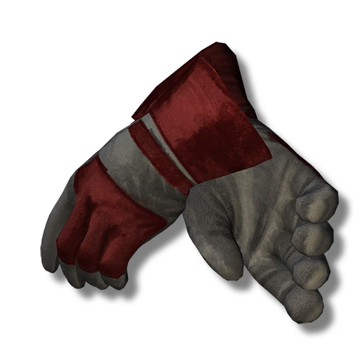
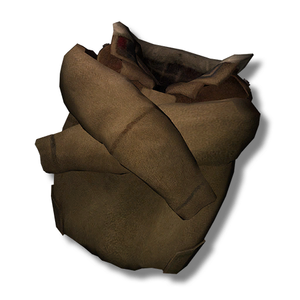
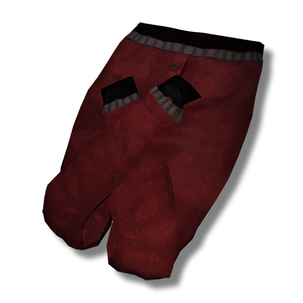
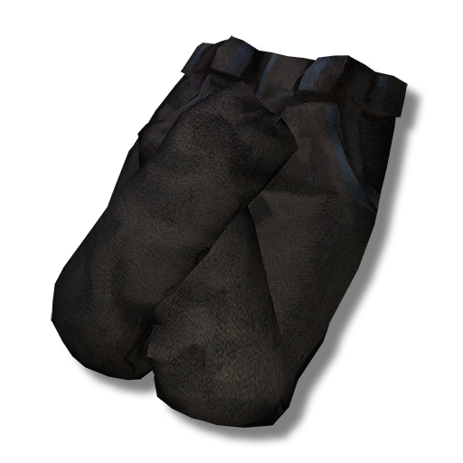
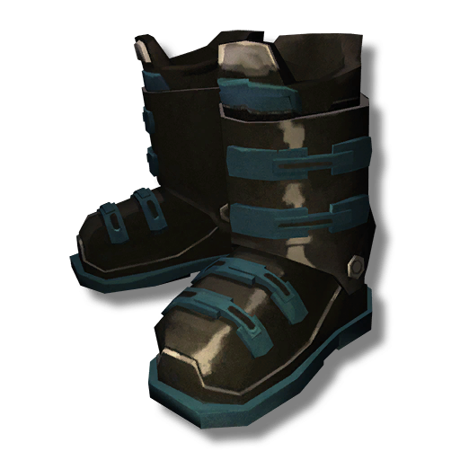
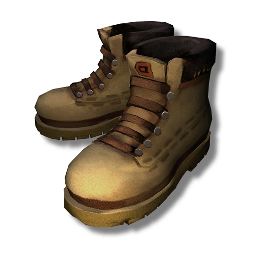
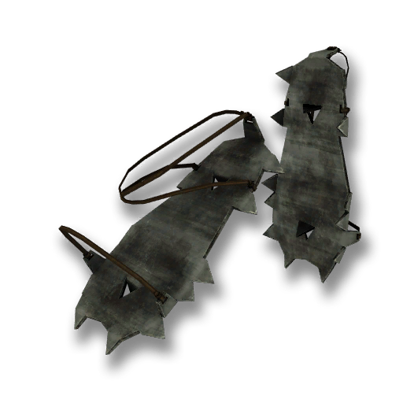
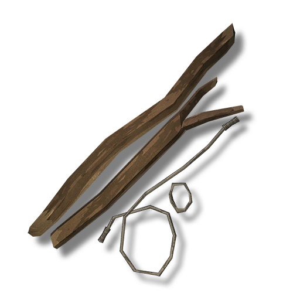

# Harvesting

**Contents**

- [Overview](#Overview)
- [Harvestable Environmental Objects:](#Harvestable_Environmental_Objects%3A)
- [Objects that yield  Cloth](#Objects_that_yield_%C2%A0Cloth)
- [Objects that yield  Scrap Metal](#Objects_that_yield_%C2%A0Scrap_Metal)
- [Objects that yield  Reclaimed Wood](#Objects_that_yield_%C2%A0Reclaimed_Wood)
- [Objects that yield  Stick](#Objects_that_yield_%C2%A0Stick)
- [Objects that yield  Cedar Firewood](#Objects_that_yield_%C2%A0Cedar_Firewood)
- [Objects that yield  Fir Firewood](#Objects_that_yield_%C2%A0Fir_Firewood)
- [Objects that yield  Tinder Plug](#Objects_that_yield_%C2%A0Tinder_Plug)
- [Other](#Other)
- [Harvestable Clothing](#Harvestable_Clothing)
- [Head](#Head)
- [Hands](#Hands)
- [Torso](#Torso)
- [Inner](#Inner)
- [Outer](#Outer)
- [Legs](#Legs)
- [Inner](#Inner_2)
- [Outer](#Outer_2)
- [Feet](#Feet)
- [Inner](#Inner_3)
- [Outer](#Outer_3)
- [Accessories](#Accessories)
- [Harvestable Tools](#Harvestable_Tools)
- [Hand Tools](#Hand_Tools)
- [Firearms](#Firearms)
- [Campcraft/Cooking](#Campcraft%2FCooking)
- [Lighting Tools](#Lighting_Tools)
- [Other](#Other_2)
- [Carcass Harvesting](#Carcass_Harvesting)
- [Carcass Types](#Carcass_Types)
- [Game History](#Game_History)

**Harvesting** is a mechanic in *<a href="./The%20Long%20Dark.md" class="wikilink" title="The Long Dark">The Long Dark</a>* that involves the breaking down of objects into usable <a href="./Materials.md" class="wikilink" title="Materials">Materials</a>.

## Overview

Harvesting often involves destroying interactable environmental objects, but can also involve breaking down excess <a href="./Tools.md" class="wikilink" title="Tools">Tools</a> or <a href="./Clothing.md" class="wikilink" title="Clothing">Clothing</a>. <a href="./First%20Aid.md" class="wikilink" title="First Aid">First Aid</a>, <a href="./Fire%20Starting.md" class="wikilink" title="Fire Starting">Fire Starting</a>, and <a href="./Food%20And%20Drink.md" class="wikilink" title="Food And Drink">Food And Drink</a> items cannot be Harvested.

The most common Materials gained from Harvesting are <a href="./Cloth.md" class="wikilink" title="Cloth">Cloth</a>, <a href="./Cured%20Leather.md" class="wikilink" title="Cured Leather">Cured Leather</a>, <a href="./Scrap%20Metal.md" class="wikilink" title="Scrap Metal">Scrap Metal</a>, <a href="./Stick.md" class="wikilink" title="Sticks">Sticks</a>, and <a href="./Tinder%20Plug.md" class="wikilink" title="Tinder Plugs">Tinder Plugs</a>. You can harvest any wood, cardboard, or cloth item in the environment by selecting it, choosing your tool, and selecting "Break Down." Some items require tools to break down, and cannot be broken down with your bare hands. Containers cannot be harvested. Environment Objects that require a tool to harvest will give an error message if clicked on, such as "REQUIRES A HACKSAW TO BREAK DOWN" or "REQUIRES A TOOL TO BREAK DOWN", however some objects can be harvested by hand. \[Missing image: Nighttime_start_10pm.jpg\] ~10:00 PM, the end of natural daylight Harvesting by hand can be performed in darkness, but Harvesting with the use of any kind of Tool requires light, otherwise the message "REQUIRES LIGHT TO BREAK DOWN WITH TOOL" will be displayed. This can be daylight from dawn (6:00 AM) through 8:30 PM both indoors and outdoors, the light provided during <a href="./Aurora.md" class="wikilink" title="Auroras">Auroras</a>, natural starlight in case of clear <a href="./Weather.md" class="wikilink" title="Weather">Weather</a> at an outdoor location, or light from a lit fire or other source like a <a href="./Storm%20Lantern.md" class="wikilink" title="Storm Lantern">Storm Lantern</a>. Note that fires only provide light in a few meters radius, beyond which it will be considered dark.

Very rarely, some objects can be broken down to yield paths to hidden locations/items. <a href="./Crate.md" class="wikilink" title="Crates">Crates</a> often have a chance to contain usable items inside, while <a href="./Scrub%20Brush.md" class="wikilink" title="Scrub Brush">Scrub Brush</a> in some regions block certain pathways.

## **Harvestable Environmental Objects:**

### Objects that yield  <a href="./Cloth.md" class="wikilink" title="Cloth">Cloth</a>

These items can be broken by Hand, but using a tool saves harvesting times at the expense of Tool Condition. Some objects require one of these Tools to break down:

-  <a href="./Scrap%20Metal%20Shard.md" class="wikilink" title="Scrap Metal Shard">Scrap Metal Shard</a>
-  <a href="./Hunting%20Knife.md" class="wikilink" title="Hunting Knife">Hunting Knife</a>
-  <a href="./Improvised%20Knife.md" class="wikilink" title="Improvised Knife">Improvised Knife</a>

| Object | Variant | Yield | Time | Tool Required |
|----|----|----|----|----|
| <a href="./Cloth%20%28Object%29.md" class="wikilink" title="Cloth (Object)">Cloth (Object)</a> | Blanket | 3 x Cloth | 9-15 min | Hand, Scrap Metal Shard, Hunting Knife, Improvised Knife |
| <a href="./Cloth%20%28Object%29.md" class="wikilink" title="Cloth (Object)">Cloth (Object)</a> | Scarf | 1 x Cloth | 4-6 min | Hand, Scrap Metal Shard, Hunting Knife, Improvised Knife |
| <a href="./Cloth%20%28Object%29.md" class="wikilink" title="Cloth (Object)">Cloth (Object)</a> | Bedsheet | 5 x Cloth | 18-30 min | Hand, Scrap Metal Shard, Hunting Knife, Improvised Knife |
| <a href="./Cloth%20%28Object%29.md" class="wikilink" title="Cloth (Object)">Cloth (Object)</a> | Tarp | 4 x Cloth | 14-24 min | Hand, Scrap Metal Shard, Hunting Knife, Improvised Knife |
| <a href="./Cloth%20%28Object%29.md" class="wikilink" title="Cloth (Object)">Cloth (Object)</a> | Large Tarp | 5 x Cloth | 18-30 min | Hand, Scrap Metal Shard, Hunting Knife, Improvised Knife |
| <a href="./Curtain.md" class="wikilink" title="Curtain">Curtain</a> | Curtain | 2 x Cloth | 6-10 min | Hand, Scrap Metal Shard, Hunting Knife, Improvised Knife |
| <a href="./Curtain.md" class="wikilink" title="Curtain">Curtain</a> | Bed Curtain | 3 x Cloth | 9-15 min | Hand, Scrap Metal Shard, Hunting Knife, Improvised Knife |
| <a href="./Old%20Bedroll.md" class="wikilink" title="Old Bedroll">Old Bedroll</a> |  | 6 x Cloth | 27 min | Scrap Metal Shard, Hunting Knife, Improvised Knife |
| <a href="./Pillow.md" class="wikilink" title="Pillow">Pillow</a> |  | 2 x Cloth | 9-11 min | Scrap Metal Shard, Hunting Knife, Improvised Knife |
| <a href="./Towel.md" class="wikilink" title="Towel">Towel</a> |  | 2 x Cloth | 6-10 min | Hand, Scrap Metal Shard, Hunting Knife, Improvised Knife |

### Objects that yield  <a href="./Scrap%20Metal.md" class="wikilink" title="Scrap Metal">Scrap Metal</a>

These items can ONLY be broken down with a  <a href="./Hacksaw.md" class="wikilink" title="Hacksaw">Hacksaw</a>. Many objects take hours to completely harvest in one session. Some objects have multiple/larger variants that take longer to saw, but provide more Scrap Metal.

| Object | Variant | Yield | Time | Tool Required |
|----|----|----|----|----|
| <a href="./Broken%20Metal%20Control%20Box.md" class="wikilink" title="Broken Metal Control Box">Broken Metal Control Box</a> | Large Box | 2 x Scrap Metal | 30 min | Hacksaw |
| <a href="./Broken%20Metal%20Control%20Box.md" class="wikilink" title="Broken Metal Control Box">Broken Metal Control Box</a> | Small Box | 1 x Scrap Metal | 15 min | Hacksaw |
| <a href="./Broken%20Metal%20Bed%20Frame.md" class="wikilink" title="Broken Metal Bed Frame">Broken Metal Bed Frame</a> |  | 8 x Scrap Metal | 3 hours | Hacksaw |
| <a href="./Broken%20Metal%20Door.md" class="wikilink" title="Broken Metal Door">Broken Metal Door</a> |  | 2 x Scrap Metal | 45 min | Hacksaw |
| <a href="./Hand%20Cart.md" class="wikilink" title="Hand Cart">Hand Cart</a> |  | 4 x Scrap Metal | 1 hour 30 min | Hacksaw |
| <a href="./Metal%20Chair.md" class="wikilink" title="Metal Chair">Metal Chair</a> | Small | 4 x Scrap Metal | 2 hours 24 min | Hacksaw |
| <a href="./Metal%20Chair.md" class="wikilink" title="Metal Chair">Metal Chair</a> | Armrest | 6 x Scrap Metal 1 x Cloth | 2 hours 36 min | Hacksaw |
| <a href="./Metal%20Chair.md" class="wikilink" title="Metal Chair">Metal Chair</a> | Bench | 6 x Scrap Metal 2 x Cloth | 2 hours 36 min | Hacksaw |
| <a href="./Metal%20Lamp.md" class="wikilink" title="Metal Lamp">Metal Lamp</a> | Small | 1 x Scrap Metal | 15 min | Hacksaw |
| <a href="./Metal%20Lamp.md" class="wikilink" title="Metal Lamp">Metal Lamp</a> | Large | 2 x Scrap Metal | 45 min | Hacksaw |
| <a href="./Metal%20Pail.md" class="wikilink" title="Metal Pail">Metal Pail</a> |  | 1 Scrap Metal | 15 min | Hacksaw |
| <a href="./Metal%20Shelf.md" class="wikilink" title="Metal Shelf">Metal Shelf</a> | Locker | 4 x Scrap Metal | 90 min | Hacksaw |
| <a href="./Metal%20Shelf.md" class="wikilink" title="Metal Shelf">Metal Shelf</a> | Extra Small | 4 x Scrap Metal | 90 min | Hacksaw |
| <a href="./Metal%20Shelf.md" class="wikilink" title="Metal Shelf">Metal Shelf</a> | Small | 6 x Scrap Metal | 135 min | Hacksaw |
| <a href="./Metal%20Shelf.md" class="wikilink" title="Metal Shelf">Metal Shelf</a> | Large | 8 x Scrap Metal | 180 min | Hacksaw |
| <a href="./Metal%20Shelf.md" class="wikilink" title="Metal Shelf">Metal Shelf</a> | Extra Large | 10 x Scrap Metal | 210 min | Hacksaw |
| <a href="./Metal%20Table.md" class="wikilink" title="Metal Table">Metal Table</a> |  | 8 x Scrap Metal | 180 min | Hacksaw |
| <a href="./Switch%20Box.md" class="wikilink" title="Switch Box">Switch Box</a> |  | 2 x Scrap Metal | 30 min | Hacksaw |
| <a href="./Toaster.md" class="wikilink" title="Toaster">Toaster</a> |  | 1 Scrap Metal | 15 min | Hacksaw |

### Objects that yield  <a href="./Reclaimed%20Wood.md" class="wikilink" title="Reclaimed Wood">Reclaimed Wood</a>

Most of these items **CANNOT** be broken by Hand, and require a Tool. This list regards objects that predominantly provide Reclaimed Wood when broken down, but sometimes they often contain other items when harvested, and will be categorized via variant for sake of convivence.

Some objects require a Tool to break down:

-  <a href="./Hatchet.md" class="wikilink" title="Hatchet">Hatchet</a>
-  <a href="./Improvised%20Hatchet.md" class="wikilink" title="Improvised Hatchet">Improvised Hatchet</a>
-  <a href="./Heavy%20Hammer.md" class="wikilink" title="Heavy Hammer">Heavy Hammer</a>

| Object | Variant | Yield | Time | Tool Required |
|----|----|----|----|----|
| <a href="./Barrel.md" class="wikilink" title="Barrel">Barrel</a> |  | 2 x Reclaimed Wood 1 x Scrap Metal | 15 min | Hatchet, Improvised Hatchet, Heavy Hammer |
| <a href="./Bench.md" class="wikilink" title="Bench">Bench</a> | Table | 2 x Reclaimed Wood 1 x Scrap Metal | 15 min | Hatchet, Improvised Hatchet, Heavy Hammer |
| Bench | Couch | 5 x Reclaimed Wood 3 x Cloth 1 x Tinder Plug | 2 hour 30 min | Hatchet, Improvised Hatchet, Heavy Hammer |
| Bench | Chair | 6 x Reclaimed Wood | 60 min | Hatchet, Improvised Hatchet, Heavy Hammer |
| Bench | Small Table | 4 x Reclaimed Wood | 30 min | Hatchet, Improvised Hatchet, Heavy Hammer |
| <a href="./Broom.md" class="wikilink" title="Broom">Broom</a> |  | 1 x Reclaimed Wood | 8 min | Hatchet, Improvised Hatchet, Heavy Hammer |
| <a href="./Cabinet%20Door.md" class="wikilink" title="Cabinet Door">Cabinet Door</a> |  | 1 x Reclaimed Wood | 8 min | Hatchet, Improvised Hatchet |
| <a href="./Chair.md" class="wikilink" title="Chair">Chair</a> | Wooden | 4 x Reclaimed Wood | 60 min | Hatchet, Improvised Hatchet, Heavy Hammer |
| Chair | Cushioned | 3 x Reclaimed Wood 2 x Cloth 2 x Tinder Plug | 45 min | Hatchet, Improvised Hatchet, Heavy Hammer |
| Chair | Sofa Chair | 4 x Reclaimed Wood 6 x Cloth 2 x Tinder Plug | 90 min | Hatchet, Improvised Hatchet, Heavy Hammer |
| Chair | Stool | 3 x Reclaimed Wood | 30 min | Hatchet, Improvised Hatchet, Heavy Hammer |
| <a href="./Crate.md" class="wikilink" title="Crate">Crate</a> | Large | 6 x Reclaimed Wood | 45-90 min | Hand, Hatchet, Improvised Hatchet, Heavy Hammer |
| Crate | Medium/Small | 4 Reclaimed Wood | 30-60 min | Hand, Hatchet, Improvised Hatchet, Heavy Hammer |
| Crate | Small | 1 x Reclaimed Wood | 8-15 min | Hand, Hatchet, Improvised Hatchet, Heavy Hammer |
| Crate | Coal | 2 x Reclaimed Wood | 8-15 min | Hand, Hatchet, Improvised Hatchet, Heavy Hammer |
| <a href="./Ladder.md" class="wikilink" title="Ladder">Ladder</a> |  | 6 x Reclaimed Wood | 78 min | Hatchet, Improvised Hatchet |
| <a href="./Paddle.md" class="wikilink" title="Paddle">Paddle</a> |  | 2 x Reclaimed Wood | 6 min | Hatchet, Improvised Hatchet, Heavy Hammer |
| <a href="./Pallet.md" class="wikilink" title="Pallet">Pallet</a> |  | 3 x Reclaimed Wood | 22-39 min | Hatchet, Improvised Hatchet, Heavy Hammer |
| <a href="./Pallets.md" class="wikilink" title="Pallets">Pallets</a> | Stacked | 16 x Reclaimed Wood | 2-3 hours | Hatchet, Improvised Hatchet, Heavy Hammer |
| Pallets | Piled | 12 x Reclaimed Wood | 1 hour 30 min- 2 hour 15 min | Hatchet, Improvised Hatchet, Heavy Hammer |
| <a href="./Plank.md" class="wikilink" title="Plank">Plank</a> |  | 2 x Reclaimed Wood | 9-14 min | Hatchet, Improvised Hatchet, Heavy Hammer |
| <a href="./Planks.md" class="wikilink" title="Planks">Planks</a> |  | 6 x Reclaimed Wood | 30-45 min | Hatchet, Improvised Hatchet, Heavy Hammer |
| <a href="./Shelf.md" class="wikilink" title="Shelf">Shelf</a> | Large Shelf | N/A | N/A | Hatchet, Improvised Hatchet, Heavy Hammer |
| Shelf | Bookshelf | N/A | N/A | Hatchet, Improvised Hatchet, Heavy Hammer |
| Shelf | Gun Rack | 2 x Reclaimed Wood | 15-22 min | Hatchet, Improvised Hatchet, Heavy Hammer |
| Shelf | Single Rack | 1 x Reclaimed Wood | 8-11 min | Hatchet, Improvised Hatchet, Heavy Hammer |
| <a href="./Table.md" class="wikilink" title="Table">Table</a> | Small | 3 x Reclaimed Wood | 38-56 min | Hatchet, Improvised Hatchet, Heavy Hammer |
| Table | Coffee | 4 x Reclaimed Wood | 90-N/A min | Hatchet, Improvised Hatchet, Heavy Hammer |
| Table | Nightstand | 3 x Reclaimed Wood | 38-56 min | Hatchet, Improvised Hatchet, Heavy Hammer |
| Table | Dining | 6 x Reclaimed Wood 1 x Tinder Plug | 1 hour 57 min- 2 hour 15 min | Hatchet, Improvised Hatchet, Heavy Hammer |
| Table | Large | 6 x Reclaimed Wood | 90-N/A min | Hatchet, Improvised Hatchet, Heavy Hammer |
| <a href="./Wheel.md" class="wikilink" title="Wheel">Wheel</a> |  | 6 x Reclaimed Wood | 38-56 min | Hatchet, Improvised Hatchet, Heavy Hammer |

### Objects that yield  <a href="./Stick.md" class="wikilink" title="Stick">Stick</a>

Branches can be broken byHand, but using a tool saves harvesting times at the expense of Tool Condition. Some objects require one of these Tools to break down:

-  <a href="./Hatchet.md" class="wikilink" title="Hatchet">Hatchet</a>
-  <a href="./Improvised%20Hatchet.md" class="wikilink" title="Improvised Hatchet">Improvised Hatchet</a>

| Object | Variant | Yield | Time | Tool Required |
|----|----|----|----|----|
| <a href="./Branch.md" class="wikilink" title="Branch">Branch</a> |  | 3 x Stick | 10 min | Hand, Hatchet, Improvised Hatchet |
| <a href="./Scrub%20Brush.md" class="wikilink" title="Scrub Brush">Scrub Brush</a> | Single | 7 x Stick | 10-20 min | Hand, Hatchet, Improvised Hatchet |
| Scrub Brush | Patch | 12 x Stick | 18 min | Hatchet, Improvised Hatchet |

### Objects that yield  <a href="./Cedar%20Firewood.md" class="wikilink" title="Cedar Firewood">Cedar Firewood</a>

| Object | Variant | Yield | Time | Tool Required |
|----|----|----|----|----|
| <a href="./Cedar%20Limb.md" class="wikilink" title="Cedar Limb">Cedar Limb</a> | Small | 3 x Cedar Firewood 1 x Tinder Plug | 45-90 min | Hatchet, Improvised Hatchet, Hacksaw |
| <a href="./Cedar%20Limb.md" class="wikilink" title="Cedar Limb">Cedar Limb</a> | Large | 5 x Cedar Firewood 1 x Tinder Plug |  | Hatchet, Improvised Hatchet |

### Objects that yield  <a href="./Fir%20Firewood.md" class="wikilink" title="Fir Firewood">Fir Firewood</a>

| Object | Yield | Time | Tool Required |
|----|----|----|----|
| <a href="./Fir%20Limb.md" class="wikilink" title="Fir Limb">Fir Limb</a> | 3 x Fir Firewood | 45-90 min | Hatchet, Improvised Hatchet, Hacksaw |

### Objects that yield  <a href="./Tinder%20Plug.md" class="wikilink" title="Tinder Plug">Tinder Plug</a>

This item can be broken by Hand, but using a tool saves harvesting times at the expense of Tool Condition. Some objects require one of these Tools to break down:

-  <a href="./Scrap%20Metal%20Shard.md" class="wikilink" title="Scrap Metal Shard">Scrap Metal Shard</a>
-  <a href="./Hunting%20Knife.md" class="wikilink" title="Hunting Knife">Hunting Knife</a>
-  <a href="./Improvised%20Knife.md" class="wikilink" title="Improvised Knife">Improvised Knife</a>

| Object | Yield | Time | Tool Required |
|----|----|----|----|
| <a href="./Cardboard%20Box.md" class="wikilink" title="Cardboard Box">Cardboard Box</a> | 1-3 x Tinder Plug | 27 min | Hand, Scrap Metal Shard, Hunting Knife, Improvised Knife |

### Other

| Object | Yield | Time | Tool Required |
|----|----|----|----|
| <a href="./Can.md" class="wikilink" title="Can">Can</a> | 1 x Recycled Can | 6 min | Hand |
| <a href="./Basin.md" class="wikilink" title="Basin">Basin</a> |  | Instant | Hand |
| <a href="./Industrial%20Toilet.md" class="wikilink" title="Industrial Toilet">Industrial Toilet</a> |  | Instant | Hand |
| <a href="./Stored%20Water.md" class="wikilink" title="Stored Water">Stored Water</a> |  | Instant | Hand |
| <a href="./Toilet.md" class="wikilink" title="Toilet">Toilet</a> |  | Instant | Hand |

## Harvestable Clothing

<a href="./Clothing.md" class="wikilink" title="Clothing">Clothing</a> can often yield a either  <a href="./Cloth.md" class="wikilink" title="Cloth">Cloth</a>,  <a href="./Cured%20Leather.md" class="wikilink" title="Cured Leather">Cured Leather</a>, or Cured Animal Hides when harvested. All Clothing can be harvested by Hand and require no tools.

### Head

<table>
<colgroup>
<col style="width: 25%" />
<col style="width: 25%" />
<col style="width: 25%" />
<col style="width: 25%" />
</colgroup>
<thead>
<tr>
<th><figure>

<figcaption>Clothing.png</figcaption>
</figure></th>
<th>
Clothing
</th>
<th>
Yield
</th>
<th>
Time
</th>
</tr>
</thead>
<tbody>
<tr>
<td><figure>

<figcaption>Aviator_Cap_icon.png</figcaption>
</figure></td>
<td>
<a href="./Aviator%20Cap.md" class="wikilink" title="Aviator Cap">Aviator Cap</a>
</td>
<td>
1 x Cured Leather
</td>
<td>
10 min
</td>
</tr>
<tr>
<td><figure>

<figcaption>Astrid's_Toque_icon.png</figcaption>
</figure></td>
<td>
<em><a href="./Astrid%27s%20Toque.md" class="wikilink" title="Astrid&#39;s Toque">Astrid's Toque</a></em>
</td>
<td>
1 x Cloth
</td>
<td>
10 min
</td>
</tr>
<tr>
<td><figure>

<figcaption>Balaclava_icon.png</figcaption>
</figure></td>
<td>
<a href="./Balaclava.md" class="wikilink" title="Balaclava">Balaclava</a>
</td>
<td>
1 x Cloth
</td>
<td>
10 min
</td>
</tr>
<tr>
<td><figure>

<figcaption>Baseball_Cap_icon.png</figcaption>
</figure></td>
<td>
<a href="./Baseball%20Cap.md" class="wikilink" title="Baseball Cap">Baseball Cap</a>
</td>
<td>
1 x Cloth
</td>
<td>
10 min
</td>
</tr>
<tr>
<td><figure>

<figcaption>Cotton_Scarf_icon.png</figcaption>
</figure></td>
<td>
<a href="./Cotton%20Scarf.md" class="wikilink" title="Cotton Scarf">Cotton Scarf</a>
</td>
<td>
1 x Cloth
</td>
<td>
10 min
</td>
</tr>
<tr>
<td><figure>

<figcaption>Cotton_Toque_icon.png</figcaption>
</figure></td>
<td>
<a href="./Cotton%20Toque.md" class="wikilink" title="Cotton Toque">Cotton Toque</a>
</td>
<td>
1 x Cloth
</td>
<td>
10 min
</td>
</tr>
<tr>
<td><figure>

<figcaption>Fleece_Cowl_icon.png</figcaption>
</figure></td>
<td>
<a href="./Fleece%20Cowl.md" class="wikilink" title="Fleece Cowl">Fleece Cowl</a>
</td>
<td>
1 x Cloth
</td>
<td>
10 min
</td>
</tr>
<tr>
<td><figure>

<figcaption>Hardhat_icon.png</figcaption>
</figure></td>
<td>
<a href="./Hardhat.md" class="wikilink" title="Hardhat">Hardhat</a>
</td>
<td>
Cannot Harvest
</td>
<td>
N/A
</td>
</tr>
<tr>
<td><figure>

<figcaption>Improvised_Head_Wrap_icon.png</figcaption>
</figure></td>
<td>
<a href="./Improvised%20Head%20Wrap.md" class="wikilink" title="Improvised Head Wrap">Improvised Head Wrap</a>
</td>
<td>
1 x Cloth
</td>
<td>
10 min
</td>
</tr>
<tr>
<td><figure>

<figcaption>Long_Wool_Scarf_icon.png</figcaption>
</figure></td>
<td>
<a href="./Long%20Wool%20Scarf.md" class="wikilink" title="Long Wool Scarf">Long Wool Scarf</a>
</td>
<td>
1 x Cloth
</td>
<td>
10 min
</td>
</tr>
<tr>
<td><figure>

<figcaption>Mackenzie's_Toque_icon.png</figcaption>
</figure></td>
<td>
<em><a href="./Mackenzie%27s%20Toque.md" class="wikilink" title="Mackenzie&#39;s Toque">Mackenzie's Toque</a></em>
</td>
<td>
1 x Cloth
</td>
<td>
10 min
</td>
</tr>
<tr>
<td><figure>

<figcaption>Rabbitskin_Hat_icon.png</figcaption>
</figure></td>
<td>
<a href="./Rabbitskin%20Hat.md" class="wikilink" title="Rabbitskin Hat">Rabbitskin Hat</a>
</td>
<td>
1 x <a href="./Cured%20Rabbit%20Pelt.md" class="wikilink" title="Cured Rabbit Pelt">Cured Rabbit Pelt</a>
</td>
<td>
10 min
</td>
</tr>
<tr>
<td><figure>

<figcaption>Technical_Balaclava_icon.png</figcaption>
</figure></td>
<td>
<a href="./Technical%20Balaclava.md" class="wikilink" title="Technical Balaclava">Technical Balaclava</a>
</td>
<td>
1 x Cloth
</td>
<td>
10 min
</td>
</tr>
<tr>
<td><figure>

<figcaption>Wool_Scarf_icon.png</figcaption>
</figure></td>
<td>
<a href="./Wool%20Scarf.md" class="wikilink" title="Wool Scarf">Wool Scarf</a>
</td>
<td>
1 x Cloth
</td>
<td>
10 min
</td>
</tr>
<tr>
<td><figure>

<figcaption>Wool_Toque_icon.png</figcaption>
</figure></td>
<td>
<a href="./Wool%20Toque.md" class="wikilink" title="Wool Toque">Wool Toque</a>
</td>
<td>
1 x Cloth
</td>
<td>
10 min
</td>
</tr>
</tbody>
</table>

### Hands

<table>
<colgroup>
<col style="width: 25%" />
<col style="width: 25%" />
<col style="width: 25%" />
<col style="width: 25%" />
</colgroup>
<thead>
<tr>
<th><figure>

<figcaption>Clothing.png</figcaption>
</figure></th>
<th>
Clothing
</th>
<th>
Yield
</th>
<th>
Time
</th>
</tr>
</thead>
<tbody>
<tr>
<td><figure>

<figcaption>Astrid's_Gloves_icon.png</figcaption>
</figure></td>
<td>
<em><a href="./Astrid%27s%20Gloves.md" class="wikilink" title="Astrid&#39;s Gloves">Astrid's Gloves</a></em>
</td>
<td>
1 x Cloth
</td>
<td>
10 min
</td>
</tr>
<tr>
<td><figure>

<figcaption>Driving_Gloves_icon.png</figcaption>
</figure></td>
<td>
<a href="./Driving%20Gloves.md" class="wikilink" title="Driving Gloves">Driving Gloves</a>
</td>
<td>
1 x Cured Leather
</td>
<td>
10 min
</td>
</tr>
<tr>
<td><figure>

<figcaption>Fleece_Mittens_icon.png</figcaption>
</figure></td>
<td>
<a href="./Fleece%20Mittens.md" class="wikilink" title="Fleece Mittens">Fleece Mittens</a>
</td>
<td>
1 x Cloth
</td>
<td>
10 min
</td>
</tr>
<tr>
<td><figure>

<figcaption>Gauntlets_icon.png</figcaption>
</figure></td>
<td>
<a href="./Gauntlets.md" class="wikilink" title="Gauntlets">Gauntlets</a>
</td>
<td>
1 x Cured Leather
</td>
<td>
10 min
</td>
</tr>
<tr>
<td><figure>

<figcaption>Improvised_Hand_Wraps_icon.png</figcaption>
</figure></td>
<td>
<a href="./Improvised%20Hand%20Wraps.md" class="wikilink" title="Improvised Hand Wraps">Improvised Hand Wraps</a>
</td>
<td>
1 x Cloth
</td>
<td>
10 min
</td>
</tr>
<tr>
<td><figure>

<figcaption>Rabbitskin_Mitts_icon.png</figcaption>
</figure></td>
<td>
<a href="./Rabbitskin%20Mitts.md" class="wikilink" title="Rabbitskin Mitts">Rabbitskin Mitts</a>
</td>
<td>
1 x <a href="./Cured%20Rabbit%20Pelt.md" class="wikilink" title="Cured Rabbit Pelt">Cured Rabbit Pelt</a>
</td>
<td>
10 min
</td>
</tr>
<tr>
<td><figure>

<figcaption>Ski_Gloves_icon.png</figcaption>
</figure></td>
<td>
<a href="./Ski%20Gloves.md" class="wikilink" title="Ski Gloves">Ski Gloves</a>
</td>
<td>
1 x Cloth
</td>
<td>
10 min
</td>
</tr>
<tr>
<td><figure>

<figcaption>Wool_Mittens_icon.png</figcaption>
</figure></td>
<td>
<a href="./Wool%20Mittens.md" class="wikilink" title="Wool Mittens">Wool Mittens</a>
</td>
<td>
1 x Cloth
</td>
<td>
10 min
</td>
</tr>
<tr>
<td><figure>

<figcaption>Work_Gloves_icon.png</figcaption>
</figure></td>
<td>
<a href="./Work%20Gloves.md" class="wikilink" title="Work Gloves">Work Gloves</a>
</td>
<td>
1 x Cured Leather
</td>
<td>
10 min
</td>
</tr>
</tbody>
</table>

### Torso

#### Inner

<table>
<colgroup>
<col style="width: 25%" />
<col style="width: 25%" />
<col style="width: 25%" />
<col style="width: 25%" />
</colgroup>
<thead>
<tr>
<th><figure>

<figcaption>Clothing.png</figcaption>
</figure></th>
<th>
Clothing
</th>
<th>
Yield
</th>
<th>
Time
</th>
</tr>
</thead>
<tbody>
<tr>
<td><figure>

<figcaption>Astrid's_Sweater_icon.png</figcaption>
</figure></td>
<td>
<em><a href="./Astrid%27s%20Sweater.md" class="wikilink" title="Astrid&#39;s Sweater">Astrid's Sweater</a></em>
</td>
<td>
1 x Cloth
</td>
<td>
10 min
</td>
</tr>
<tr>
<td><figure>

<figcaption>Cowichan_Sweater_icon.png</figcaption>
</figure></td>
<td>
<a href="./Cowichan%20Sweater.md" class="wikilink" title="Cowichan Sweater">Cowichan Sweater</a>
</td>
<td>
1 x Cloth
</td>
<td>
45 min
</td>
</tr>
<tr>
<td><figure>

<figcaption>Dress_Shirt_icon.png</figcaption>
</figure></td>
<td>
<a href="./Dress%20Shirt.md" class="wikilink" title="Dress Shirt">Dress Shirt</a>
</td>
<td>
1 x Cloth
</td>
<td>
10 min
</td>
</tr>
<tr>
<td><figure>

<figcaption>Fisherman's_Sweater_icon.png</figcaption>
</figure></td>
<td>
<a href="./Fisherman%27s%20Sweater.md" class="wikilink" title="Fisherman&#39;s Sweater">Fisherman's Sweater</a>
</td>
<td>
1 x Cloth
</td>
<td>
45 min
</td>
</tr>
<tr>
<td><figure>

<figcaption>Hockey_Jersey_icon.png</figcaption>
</figure></td>
<td>
<a href="./Hockey%20Jersey.md" class="wikilink" title="Hockey Jersey">Hockey Jersey</a>
</td>
<td>
1 x Cloth
</td>
<td>
30 min
</td>
</tr>
<tr>
<td><figure>

<figcaption>Hoodie_icon.png</figcaption>
</figure></td>
<td>
<a href="./Hoodie.md" class="wikilink" title="Hoodie">Hoodie</a>
</td>
<td>
1 x Cloth
</td>
<td>
45 min
</td>
</tr>
<tr>
<td><figure>

<figcaption>Mackenzie's_Shirt_icon.png</figcaption>
</figure></td>
<td>
<em><a href="./Mackenzie%27s%20Shirt.md" class="wikilink" title="Mackenzie&#39;s Shirt">Mackenzie's Shirt</a></em>
</td>
<td>
1 x Cloth
</td>
<td>
10 min
</td>
</tr>
<tr>
<td><figure>

<figcaption>Mackenzie's_Sweater_icon.png</figcaption>
</figure></td>
<td>
<em><a href="./Mackenzie%27s%20Sweater.md" class="wikilink" title="Mackenzie&#39;s Sweater">Mackenzie's Sweater</a></em>
</td>
<td>
1 x Cloth
</td>
<td>
10 min
</td>
</tr>
<tr>
<td><figure>

<figcaption>Plaid_Shirt_icon.png</figcaption>
</figure></td>
<td>
<a href="./Plaid%20Shirt.md" class="wikilink" title="Plaid Shirt">Plaid Shirt</a>
</td>
<td>
1 x Cloth
</td>
<td>
10 min
</td>
</tr>
<tr>
<td><figure>

<figcaption>Sweatshirt_icon.png</figcaption>
</figure></td>
<td>
<a href="./Sweatshirt.md" class="wikilink" title="Sweatshirt">Sweatshirt</a>
</td>
<td>
1 x Cloth
</td>
<td>
10 min
</td>
</tr>
<tr>
<td><figure>

<figcaption>Thick_Wool_Sweater_icon.png</figcaption>
</figure></td>
<td>
<a href="./Thick%20Wool%20Sweater.md" class="wikilink" title="Thick Wool Sweater">Thick Wool Sweater</a>
</td>
<td>
1 x Cloth
</td>
<td>
45 min
</td>
</tr>
<tr>
<td><figure>

<figcaption>Thin_Wool_Sweater_icon.png</figcaption>
</figure></td>
<td>
<a href="./Thin%20Wool%20Sweater.md" class="wikilink" title="Thin Wool Sweater">Thin Wool Sweater</a>
</td>
<td>
1 x Cloth
</td>
<td>
30 min
</td>
</tr>
<tr>
<td><figure>

<figcaption>T-Shirt_icon.png</figcaption>
</figure></td>
<td>
<a href="./T-Shirt.md" class="wikilink" title="T-Shirt">T-Shirt</a>
</td>
<td>
1 x Cloth
</td>
<td>
10 min
</td>
</tr>
<tr>
<td><figure>

<figcaption>Wool_Shirt_icon.png</figcaption>
</figure></td>
<td>
<a href="./Wool%20Shirt.md" class="wikilink" title="Wool Shirt">Wool Shirt</a>
</td>
<td>
1 x Cloth
</td>
<td>
10 min
</td>
</tr>
</tbody>
</table>

#### Outer

<table>
<colgroup>
<col style="width: 25%" />
<col style="width: 25%" />
<col style="width: 25%" />
<col style="width: 25%" />
</colgroup>
<thead>
<tr>
<th><figure>

<figcaption>Clothing.png</figcaption>
</figure></th>
<th>
Clothing
</th>
<th>
Yield
</th>
<th>
Time
</th>
</tr>
</thead>
<tbody>
<tr>
<td><figure>

<figcaption>Astrid's_Jacket_icon.png</figcaption>
</figure></td>
<td>
<em><a href="./Astrid%27s%20Jacket.md" class="wikilink" title="Astrid&#39;s Jacket">Astrid's Jacket</a></em>
</td>
<td>
2 x Cloth
</td>
<td>
20 min
</td>
</tr>
<tr>
<td><figure>

<figcaption>Bearskin_Coat_icon.png</figcaption>
</figure></td>
<td>
<a href="./Bearskin%20Coat.md" class="wikilink" title="Bearskin Coat">Bearskin Coat</a>
</td>
<td>
1 × <a href="./Cured%20Black%20Bear%20Hide.md" class="wikilink" title="Cured Black Bear Hide">Cured Black Bear Hide</a>
</td>
<td>
120 min
</td>
</tr>
<tr>
<td><figure>

<figcaption>Down_Vest_icon.png</figcaption>
</figure></td>
<td>
<a href="./Down%20Vest.md" class="wikilink" title="Down Vest">Down Vest</a>
</td>
<td>
2 x Cloth
</td>
<td>
20 min
</td>
</tr>
<tr>
<td><figure>

<figcaption>Expedition_Parka_icon.png</figcaption>
</figure></td>
<td>
<a href="./Expedition%20Parka.md" class="wikilink" title="Expedition Parka">Expedition Parka</a>
</td>
<td>
2 x Cloth
</td>
<td>
20 min
</td>
</tr>
<tr>
<td><figure>

<figcaption>Flight_Jacket_icon.png</figcaption>
</figure></td>
<td>
<a href="./Flight%20Jacket.md" class="wikilink" title="Flight Jacket">Flight Jacket</a>
</td>
<td>
3 x Cured Leather
</td>
<td>
30 min
</td>
</tr>
<tr>
<td><figure>

<figcaption>Light_Shell_icon.png</figcaption>
</figure></td>
<td>
<a href="./Light%20Shell.md" class="wikilink" title="Light Shell">Light Shell</a>
</td>
<td>
2 x Cloth
</td>
<td>
40 min
</td>
</tr>
<tr>
<td><figure>

<figcaption>Mackenzie's_Parka_icon.png</figcaption>
</figure></td>
<td>
<em><a href="./Mackenzie%27s%20Parka.md" class="wikilink" title="Mackenzie&#39;s Parka">Mackenzie's Parka</a></em>
</td>
<td>
2 x Cloth
</td>
<td>
20 min
</td>
</tr>
<tr>
<td><figure>

<figcaption>Mackinaw_Jacket_icon.png</figcaption>
</figure></td>
<td>
<a href="./Mackinaw%20Jacket.md" class="wikilink" title="Mackinaw Jacket">Mackinaw Jacket</a>
</td>
<td>
2 x Cloth
</td>
<td>
20 min
</td>
</tr>
<tr>
<td><figure>

<figcaption>Mariner's_Pea_Coat_icon.png</figcaption>
</figure></td>
<td>
<a href="./Mariner%27s%20Pea%20Coat.md" class="wikilink" title="Mariner&#39;s Pea Coat">Mariner's Pea Coat</a>
</td>
<td>
2 x Cloth
</td>
<td>
90 min
</td>
</tr>
<tr>
<td><figure>

<figcaption>Military_Coat_icon.png</figcaption>
</figure></td>
<td>
<a href="./Military%20Coat.md" class="wikilink" title="Military Coat">Military Coat</a>
</td>
<td>
2 x Cloth
</td>
<td>
20 min
</td>
</tr>
<tr>
<td><figure>

<figcaption>Miner's_Jacket_icon.png</figcaption>
</figure></td>
<td>
<a href="./Miner%27s%20Jacket.md" class="wikilink" title="Miner&#39;s Jacket">Miner's Jacket</a>
</td>
<td>
2 x Cloth
</td>
<td>
60 min
</td>
</tr>
<tr>
<td><figure>

<figcaption>Moose-Hide_Cloak_icon.png</figcaption>
</figure></td>
<td>
<a href="./Moose-Hide%20Cloak.md" class="wikilink" title="Moose-Hide Cloak">Moose-Hide Cloak</a>
</td>
<td>
1 × <a href="./Cured%20Moose%20Hide.md" class="wikilink" title="Cured Moose Hide">Cured Moose Hide</a>
</td>
<td>
120 minutes
</td>
</tr>
<tr>
<td><figure>

<figcaption>Old_Fashioned_Parka_icon.png</figcaption>
</figure></td>
<td>
<a href="./Old%20Fashioned%20Parka.md" class="wikilink" title="Old Fashioned Parka">Old Fashioned Parka</a>
</td>
<td>
2 x Cloth
</td>
<td>
20 min
</td>
</tr>
<tr>
<td><figure>

<figcaption>Simple_Parka_icon.png</figcaption>
</figure></td>
<td>
<a href="./Simple%20Parka.md" class="wikilink" title="Simple Parka">Simple Parka</a>
</td>
<td>
2 x Cloth
</td>
<td>
20 min
</td>
</tr>
<tr>
<td><figure>

<figcaption>Ski_Jacket_icon.png</figcaption>
</figure></td>
<td>
<a href="./Ski%20Jacket.md" class="wikilink" title="Ski Jacket">Ski Jacket</a>
</td>
<td>
2 x Cloth
</td>
<td>
90 min
</td>
</tr>
<tr>
<td><figure>

<figcaption>Sport_Vest_icon.png</figcaption>
</figure></td>
<td>
<a href="./Sport%20Vest.md" class="wikilink" title="Sport Vest">Sport Vest</a>
</td>
<td>
1 x Cloth
</td>
<td>
20 min
</td>
</tr>
<tr>
<td><figure>

<figcaption>Urban_Parka_icon.png</figcaption>
</figure></td>
<td>
<a href="./Urban%20Parka.md" class="wikilink" title="Urban Parka">Urban Parka</a>
</td>
<td>
3 x Cloth
</td>
<td>
20 min
</td>
</tr>
<tr>
<td><figure>

<figcaption>Windbreaker_icon.png</figcaption>
</figure></td>
<td>
<a href="./Windbreaker.md" class="wikilink" title="Windbreaker">Windbreaker</a>
</td>
<td>
2 x Cloth
</td>
<td>
20 min
</td>
</tr>
<tr>
<td><figure>

<figcaption>Wolfskin_Coat_icon.png</figcaption>
</figure></td>
<td>
<a href="./Wolfskin%20Coat.md" class="wikilink" title="Wolfskin Coat">Wolfskin Coat</a>
</td>
<td>
1 × <a href="./Cured%20Wolf%20Pelt.md" class="wikilink" title="Cured Wolf Pelt">Cured Wolf Pelt</a>
</td>
<td>
90 minutes
</td>
</tr>
</tbody>
</table>

### Legs

#### Inner

<table>
<colgroup>
<col style="width: 25%" />
<col style="width: 25%" />
<col style="width: 25%" />
<col style="width: 25%" />
</colgroup>
<thead>
<tr>
<th><figure>

<figcaption>Clothing.png</figcaption>
</figure></th>
<th>
Clothing
</th>
<th>
Yield
</th>
<th>
Time
</th>
</tr>
</thead>
<tbody>
<tr>
<td><figure>

<figcaption>Thermal_Underwear_icon.png</figcaption>
</figure></td>
<td>
<a href="./Thermal%20Underwear.md" class="wikilink" title="Thermal Underwear">Thermal Underwear</a>
</td>
<td>
1 x Cloth
</td>
<td>
20 min
</td>
</tr>
<tr>
<td><figure>

<figcaption>Wool_Longjohns_icon.png</figcaption>
</figure></td>
<td>
<a href="./Wool%20Longjohns.md" class="wikilink" title="Wool Longjohns">Wool Longjohns</a>
</td>
<td>
1 x Cloth
</td>
<td>
20 min
</td>
</tr>
</tbody>
</table>

#### Outer

<table>
<colgroup>
<col style="width: 25%" />
<col style="width: 25%" />
<col style="width: 25%" />
<col style="width: 25%" />
</colgroup>
<thead>
<tr>
<th><figure>

<figcaption>Clothing.png</figcaption>
</figure></th>
<th>
Clothing
</th>
<th>
Yield
</th>
<th>
Time
</th>
</tr>
</thead>
<tbody>
<tr>
<td><figure>

<figcaption>Astrid's_Jeans_icon.png</figcaption>
</figure></td>
<td>
<em><a href="./Astrid%27s%20Jeans.md" class="wikilink" title="Astrid&#39;s Jeans">Astrid's Jeans</a></em>
</td>
<td>
1 x Cloth
</td>
<td>
30 min
</td>
</tr>
<tr>
<td><figure>

<figcaption>Cargo_Pants_icon.png</figcaption>
</figure></td>
<td>
<a href="./Cargo%20Pants.md" class="wikilink" title="Cargo Pants">Cargo Pants</a>
</td>
<td>
1 x Cloth
</td>
<td>
30 min
</td>
</tr>
<tr>
<td><figure>

<figcaption>Combat_Pants_icon.png</figcaption>
</figure></td>
<td>
<a href="./Combat%20Pants.md" class="wikilink" title="Combat Pants">Combat Pants</a>
</td>
<td>
1 x Cloth
</td>
<td>
30 min
</td>
</tr>
<tr>
<td><figure>

<figcaption>Deerskin_Pants_icon.png</figcaption>
</figure></td>
<td>
<a href="./Deerskin%20Pants.md" class="wikilink" title="Deerskin Pants">Deerskin Pants</a>
</td>
<td>
1 × <a href="./Cured%20Deer%20Hide.md" class="wikilink" title="Cured Deer Hide">Cured Deer Hide</a>
</td>
<td>
30 min
</td>
</tr>
<tr>
<td><figure>

<figcaption>Jeans_icon.png</figcaption>
</figure></td>
<td>
<a href="./Jeans.md" class="wikilink" title="Jeans">Jeans</a>
</td>
<td>
1 x Cloth
</td>
<td>
30 min
</td>
</tr>
<tr>
<td><figure>

<figcaption>Mackenzie's_Pants_icon.png</figcaption>
</figure></td>
<td>
<em><a href="./Mackenzie%27s%20Pants.md" class="wikilink" title="Mackenzie&#39;s Pants">Mackenzie's Pants</a></em>
</td>
<td>
1 x Cloth
</td>
<td>
30 min
</td>
</tr>
<tr>
<td><figure>

<figcaption>Miner's_Pants_icon.png</figcaption>
</figure></td>
<td>
<a href="./Miner%27s%20Pants.md" class="wikilink" title="Miner&#39;s Pants">Miner's Pants</a>
</td>
<td>
1 x Cloth
</td>
<td>
30 min
</td>
</tr>
<tr>
<td><figure>

<figcaption>Snow_Pants_icon.png</figcaption>
</figure></td>
<td>
<a href="./Snow%20Pants.md" class="wikilink" title="Snow Pants">Snow Pants</a>
</td>
<td>
1 x Cloth
</td>
<td>
30 min
</td>
</tr>
<tr>
<td><figure>

<figcaption>Work_Pants_icon.png</figcaption>
</figure></td>
<td>
<a href="./Work%20Pants.md" class="wikilink" title="Work Pants">Work Pants</a>
</td>
<td>
1 x Cloth
</td>
<td>
30 min
</td>
</tr>
</tbody>
</table>

### Feet

#### Inner

<table>
<colgroup>
<col style="width: 25%" />
<col style="width: 25%" />
<col style="width: 25%" />
<col style="width: 25%" />
</colgroup>
<thead>
<tr>
<th><figure>

<figcaption>Clothing.png</figcaption>
</figure></th>
<th>
Clothing
</th>
<th>
Yield
</th>
<th>
Time
</th>
</tr>
</thead>
<tbody>
<tr>
<td><figure>

<figcaption>Climbing_Socks_icon.png</figcaption>
</figure></td>
<td>
<a href="./Climbing%20Socks.md" class="wikilink" title="Climbing Socks">Climbing Socks</a>
</td>
<td>
1 x Cloth
</td>
<td>
20 min
</td>
</tr>
<tr>
<td><figure>

<figcaption>Sports_Socks_icon.png</figcaption>
</figure></td>
<td>
<a href="./Sports%20Socks.md" class="wikilink" title="Sports Socks">Sports Socks</a>
</td>
<td>
1 x Cloth
</td>
<td>
10 min
</td>
</tr>
<tr>
<td><figure>

<figcaption>Wool_Socks_icon.png</figcaption>
</figure></td>
<td>
<a href="./Wool%20Socks.md" class="wikilink" title="Wool Socks">Wool Socks</a>
</td>
<td>
1 x Cloth
</td>
<td>
20 min
</td>
</tr>
</tbody>
</table>

#### Outer

<table>
<colgroup>
<col style="width: 25%" />
<col style="width: 25%" />
<col style="width: 25%" />
<col style="width: 25%" />
</colgroup>
<thead>
<tr>
<th><figure>

<figcaption>Clothing.png</figcaption>
</figure></th>
<th>
Clothing
</th>
<th>
Yield
</th>
<th>
Time
</th>
</tr>
</thead>
<tbody>
<tr>
<td><figure>

<figcaption>Astrid's_Boots_icon.png</figcaption>
</figure></td>
<td>
<em><a href="./Astrid%27s%20Boots.md" class="wikilink" title="Astrid&#39;s Boots">Astrid's Boots</a></em>
</td>
<td>
1 x Cured Leather
</td>
<td>
90 min
</td>
</tr>
<tr>
<td><figure>

<figcaption>Chemical_Boots_icon.png</figcaption>
</figure></td>
<td>
<a href="./Chemical%20Boots.md" class="wikilink" title="Chemical Boots">Chemical Boots</a>
</td>
<td>
Cannot Harvest
</td>
<td>
N/A
</td>
</tr>
<tr>
<td><figure>

<figcaption>Combat_Boots_icon.png</figcaption>
</figure></td>
<td>
<a href="./Combat%20Boots.md" class="wikilink" title="Combat Boots">Combat Boots</a>
</td>
<td>
1 × Cured Leather
</td>
<td>
90 min
</td>
</tr>
<tr>
<td><figure>

<figcaption>Deerskin_Boots_icon.png</figcaption>
</figure></td>
<td>
<a href="./Deerskin%20Boots.md" class="wikilink" title="Deerskin Boots">Deerskin Boots</a>
</td>
<td>
1 × <a href="./Cured%20Deer%20Hide.md" class="wikilink" title="Cured Deer Hide">Cured Deer Hide</a>
</td>
<td>
110 min
</td>
</tr>
<tr>
<td><figure>

<figcaption>Insulated_Boots_icon.png</figcaption>
</figure></td>
<td>
<a href="./Insulated%20Boots.md" class="wikilink" title="Insulated Boots">Insulated Boots</a>
</td>
<td>
1 x Cured Leather
</td>
<td>
90 min
</td>
</tr>
<tr>
<td><figure>

<figcaption>Leather_Shoes_icon.png</figcaption>
</figure></td>
<td>
<a href="./Leather%20Shoes.md" class="wikilink" title="Leather Shoes">Leather Shoes</a>
</td>
<td>
2 × Cured Leather
</td>
<td>
75 min
</td>
</tr>
<tr>
<td><figure>

<figcaption>Mackenzie's_Boots_icon.png</figcaption>
</figure></td>
<td>
<em><a href="./Mackenzie%27s%20Boots.md" class="wikilink" title="Mackenzie&#39;s Boots">Mackenzie's Boots</a></em>
</td>
<td>
1 x Cured Leather
</td>
<td>
90 min
</td>
</tr>
<tr>
<td><figure>

<figcaption>Mountaineering_Boots_icon.png</figcaption>
</figure></td>
<td>
<em><a href="./Mountaineering%20Boots.md" class="wikilink" title="Mountaineering Boots">Mountaineering Boots</a></em>
</td>
<td>
2 × Cured Leather
</td>
<td>
90 min
</td>
</tr>
<tr>
<td><figure>

<figcaption>Mukluks_icon.png</figcaption>
</figure></td>
<td>
<a href="./Mukluks.md" class="wikilink" title="Mukluks">Mukluks</a>
</td>
<td>
2 × Cured Leather
</td>
<td>
90 min
</td>
</tr>
<tr>
<td><figure>

<figcaption>Running_Shoes_icon.png</figcaption>
</figure></td>
<td>
<a href="./Running%20Shoes.md" class="wikilink" title="Running Shoes">Running Shoes</a>
</td>
<td>
2 × Cured Leather
</td>
<td>
75 min
</td>
</tr>
<tr>
<td><figure>

<figcaption>Ski_Boots_icon.png</figcaption>
</figure></td>
<td>
<a href="./Ski%20Boots.md" class="wikilink" title="Ski Boots">Ski Boots</a>
</td>
<td>
1 x Cured Leather
</td>
<td>
90 min
</td>
</tr>
<tr>
<td><figure>

<figcaption>Trail_Boots_icon.png</figcaption>
</figure></td>
<td>
<a href="./Trail%20Boots.md" class="wikilink" title="Trail Boots">Trail Boots</a>
</td>
<td>
1 x Cured Leather
</td>
<td>
90 min
</td>
</tr>
<tr>
<td><figure>

<figcaption>Work_Boots_icon.png</figcaption>
</figure></td>
<td>
<a href="./Work%20Boots.md" class="wikilink" title="Work Boots">Work Boots</a>
</td>
<td>
2 × Cured Leather
</td>
<td>
90 min
</td>
</tr>
</tbody>
</table>

### Accessories

<table>
<colgroup>
<col style="width: 25%" />
<col style="width: 25%" />
<col style="width: 25%" />
<col style="width: 25%" />
</colgroup>
<thead>
<tr>
<th><figure>

<figcaption>Clothing.png</figcaption>
</figure></th>
<th>
Clothing
</th>
<th>
Yield
</th>
<th>
Time
</th>
</tr>
</thead>
<tbody>
<tr>
<td><figure>

<figcaption>Ballistic_Vest_icon.png</figcaption>
</figure></td>
<td>
<a href="./Ballistic%20Vest.md" class="wikilink" title="Ballistic Vest">Ballistic Vest</a>
</td>
<td>
Cannot Harvest
</td>
<td>
N/A
</td>
</tr>
<tr>
<td><figure>

<figcaption>Crampons_icon.png</figcaption>
</figure></td>
<td>
<a href="./Crampons.md" class="wikilink" title="Crampons">Crampons</a>
</td>
<td>
Cannot Harvest
</td>
<td>
N/A
</td>
</tr>
<tr>
<td><figure>

<figcaption>Foreman's_Tool_Belt_icon.png</figcaption>
</figure></td>
<td>
<a href="./Foreman%27s%20Tool%20Belt.md" class="wikilink" title="Foreman&#39;s Tool Belt">Foreman's Tool Belt</a>
</td>
<td>
2 x Cured Leather
</td>
<td>
30 min
</td>
</tr>
<tr>
<td><figure>

<figcaption>Improvised_Crampons_icon.png</figcaption>
</figure></td>
<td>
<a href="./Improvised%20Crampons.md" class="wikilink" title="Improvised Crampons">Improvised Crampons</a>
</td>
<td>
Cannot Harvest
</td>
<td>
N/A
</td>
</tr>
<tr>
<td><figure>

<figcaption>Improvised_Insulation_icon.png</figcaption>
</figure></td>
<td>
<a href="./Improvised%20Insulation.md" class="wikilink" title="Improvised Insulation">Improvised Insulation</a>
</td>
<td>
2 × <a href="./Cloth.md" class="wikilink" title="Cloth">Cloth</a> 3 x <a href="./Ptarmigan%20Down.md" class="wikilink" title="Ptarmigan Down">Ptarmigan Down</a>
</td>
<td>
20 min
</td>
</tr>
<tr>
<td><figure>

<figcaption>Moose-Hide_Satchel_icon.png</figcaption>
</figure></td>
<td>
<a href="./Moose-Hide%20Satchel.md" class="wikilink" title="Moose-Hide Satchel">Moose-Hide Satchel</a>
</td>
<td>
1 x Cured Leather
</td>
<td>
10 min
</td>
</tr>
<tr>
<td><figure>

<figcaption>Security_Chief's_Rifle_Holster_icon.png</figcaption>
</figure></td>
<td>
<a href="./Security%20Chief%27s%20Rifle%20Holster.md" class="wikilink" title="Security Chief&#39;s Rifle Holster">Security Chief's Rifle Holster</a>
</td>
<td>
4 x Cured Leather
</td>
<td>
30 min
</td>
</tr>
<tr>
<td><figure>

<figcaption>Wool_Ear_Wrap_icon.png</figcaption>
</figure></td>
<td>
<a href="./Wool%20Ear%20Wrap.md" class="wikilink" title="Wool Ear Wrap">Wool Ear Wrap</a>
</td>
<td>
1 x Cloth
</td>
<td>
10 min
</td>
</tr>
</tbody>
</table>

## Harvestable Tools

There are multiple Tools available in *<a href="./The%20Long%20Dark.md" class="wikilink" title="The Long Dark">The Long Dark</a>*, however only the tools below can be harvested.

### Hand Tools

<table>
<colgroup>
<col style="width: 25%" />
<col style="width: 25%" />
<col style="width: 25%" />
<col style="width: 25%" />
</colgroup>
<thead>
<tr>
<th colspan="2">
Tool
</th>
<th>
Yield
</th>
<th>
Time
</th>
</tr>
</thead>
<tbody>
<tr>
<td><figure>

<figcaption>Hacksaw_icon.png</figcaption>
</figure></td>
<td>
<a href="./Hacksaw.md" class="wikilink" title="Hacksaw">Hacksaw</a>
</td>
<td>
2 × Scrap Metal
</td>
<td>
1 hour
</td>
</tr>
<tr>
<td><figure>

<figcaption>Hatchet_icon.png</figcaption>
</figure></td>
<td>
<a href="./Hatchet.md" class="wikilink" title="Hatchet">Hatchet</a>
</td>
<td>
2 x Scrap Metal 1 x Fir Wood
</td>
<td>
1 hour
</td>
</tr>
<tr>
<td><figure>

<figcaption>Hunting_Knife_icon.png</figcaption>
</figure></td>
<td>
<a href="./Hunting%20Knife.md" class="wikilink" title="Hunting Knife">Hunting Knife</a>
</td>
<td>
1 x Scrap Metal
</td>
<td>
45 min
</td>
</tr>
<tr>
<td><figure>

<figcaption>Improvised_Hatchet_icon.png</figcaption>
</figure></td>
<td>
<a href="./Improvised%20Hatchet.md" class="wikilink" title="Improvised Hatchet">Improvised Hatchet</a>
</td>
<td>
2 x Scrap Metal
</td>
<td>
1 hour
</td>
</tr>
<tr>
<td><figure>

<figcaption>Improvised_Knife_icon.png</figcaption>
</figure></td>
<td>
<a href="./Improvised%20Knife.md" class="wikilink" title="Improvised Knife">Improvised Knife</a>
</td>
<td>
1 x Scrap Metal
</td>
<td>
45 min
</td>
</tr>
<tr>
<td><figure>

<figcaption>Heavy_Hammer_icon.png</figcaption>
</figure></td>
<td>
<a href="./Heavy%20Hammer.md" class="wikilink" title="Heavy Hammer">Heavy Hammer</a>
</td>
<td>
2 x Scrap Metal 1 x Fir Wood
</td>
<td>
30 min
</td>
</tr>
<tr>
<td><figure>

<figcaption>Prybar_icon.png</figcaption>
</figure></td>
<td>
<a href="./Prybar.md" class="wikilink" title="Prybar">Prybar</a>
</td>
<td>
2 x Scrap Metal
</td>
<td>
30 min
</td>
</tr>
<tr>
<td><figure>

<figcaption>Simple_Tools_icon.png</figcaption>
</figure></td>
<td>
<a href="./Simple%20Tools.md" class="wikilink" title="Simple Tools">Simple Tools</a>
</td>
<td>
3 x Scrap Metal
</td>
<td>
1 hour
</td>
</tr>
<tr>
<td><figure>

<figcaption>Quality_Tools_icon.png</figcaption>
</figure></td>
<td>
<a href="./Quality%20Tools.md" class="wikilink" title="Quality Tools">Quality Tools</a>
</td>
<td>
3 x Scrap Metal
</td>
<td>
1 hour
</td>
</tr>
</tbody>
</table>

### Firearms

<table>
<colgroup>
<col style="width: 25%" />
<col style="width: 25%" />
<col style="width: 25%" />
<col style="width: 25%" />
</colgroup>
<thead>
<tr>
<th colspan="2">
Tool
</th>
<th>
Yield
</th>
<th>
Time
</th>
</tr>
</thead>
<tbody>
<tr>
<td><figure>

<figcaption>Hunting_Rifle_icon.png</figcaption>
</figure></td>
<td>
<a href="./Hunting%20Rifle.md" class="wikilink" title="Hunting Rifle">Hunting Rifle</a>
</td>
<td>
2 x Scrap Metal
</td>
<td>
1 hour
</td>
</tr>
<tr>
<td><figure>

<figcaption>Barb's_Rifle_icon.png</figcaption>
</figure></td>
<td>
<a href="./Barb%27s%20Rifle.md" class="wikilink" title="Barb&#39;s Rifle">Barb's Rifle</a>
</td>
<td>
2 x Scrap Metal
</td>
<td>
1 hour
</td>
</tr>
<tr>
<td><figure>

<figcaption>Curator's_Rifle_icon.png</figcaption>
</figure></td>
<td>
<a href="./Curator%27s%20Rifle.md" class="wikilink" title="Curator&#39;s Rifle">Curator's Rifle</a>
</td>
<td>
2 x Scrap Metal
</td>
<td>
1 hour
</td>
</tr>
<tr>
<td><figure>

<figcaption>Vaughn's_Rifle_icon.png</figcaption>
</figure></td>
<td>
<a href="./Vaughn%27s%20Rifle.md" class="wikilink" title="Vaughn&#39;s Rifle">Vaughn's Rifle</a>
</td>
<td>
2 x Scrap Metal
</td>
<td>
1 hour
</td>
</tr>
</tbody>
</table>

### Campcraft/Cooking

<table>
<colgroup>
<col style="width: 25%" />
<col style="width: 25%" />
<col style="width: 25%" />
<col style="width: 25%" />
</colgroup>
<thead>
<tr>
<th colspan="2">
Tool
</th>
<th>
Yield
</th>
<th>
Time
</th>
</tr>
</thead>
<tbody>
<tr>
<td><figure>

<figcaption>Bedroll_icon.png</figcaption>
</figure></td>
<td>
<a href="./Bedroll.md" class="wikilink" title="Bedroll">Bedroll</a>
</td>
<td>
10 x Cloth
</td>
<td>
90 min
</td>
</tr>
<tr>
<td><figure>

<figcaption>Bear_Skin_Bedroll_icon.png</figcaption>
</figure></td>
<td>
<a href="./Bear%20Skin%20Bedroll.md" class="wikilink" title="Bear Skin Bedroll">Bear Skin Bedroll</a>
</td>
<td>
1 x Cloth 1 x Cured Black Bear Hide
</td>
<td>
90 min
</td>
</tr>
<tr>
<td><figure>

<figcaption>Improvised_Down_Bedroll_icon.png</figcaption>
</figure></td>
<td>
<a href="./Improvised%20Down%20Bedroll.md" class="wikilink" title="Improvised Down Bedroll">Improvised Down Bedroll</a>
</td>
<td>
10 x Cloth 5 x Ptarmigan Down
</td>
<td>
90 min
</td>
</tr>
<tr>
<td><figure>

<figcaption>Can_Opener_icon.png</figcaption>
</figure></td>
<td>
<a href="./Can%20Opener.md" class="wikilink" title="Can Opener">Can Opener</a>
</td>
<td>
1 x Scrap Metal
</td>
<td>
15 min
</td>
</tr>
<tr>
<td><figure>

<figcaption>Cooking_Pot_icon.png</figcaption>
</figure></td>
<td>
<a href="./Cooking%20Pot.md" class="wikilink" title="Cooking Pot">Cooking Pot</a>
</td>
<td>
1 x Scrap Metal
</td>
<td>
90 min
</td>
</tr>
<tr>
<td><figure>

<figcaption>Cooking_Skillet_icon.png</figcaption>
</figure></td>
<td>
<a href="./Cooking%20Skillet.md" class="wikilink" title="Cooking Skillet">Cooking Skillet</a>
</td>
<td>
1 x Scrap Metal
</td>
<td>
90 min
</td>
</tr>
</tbody>
</table>

### Lighting Tools

<table>
<colgroup>
<col style="width: 25%" />
<col style="width: 25%" />
<col style="width: 25%" />
<col style="width: 25%" />
</colgroup>
<thead>
<tr>
<th colspan="2">
Tool
</th>
<th>
Yield
</th>
<th>
Time
</th>
</tr>
</thead>
<tbody>
<tr>
<td><figure>

<figcaption>Torch_icon.png</figcaption>
</figure></td>
<td>
<a href="./Torch.md" class="wikilink" title="Torch">Torch</a>
</td>
<td>
1 x Stick
</td>
<td>
2 min
</td>
</tr>
<tr>
<td><figure>

<figcaption>Flashlight_icon.png</figcaption>
</figure></td>
<td>
<a href="./Flashlight.md" class="wikilink" title="Flashlight">Flashlight</a>
</td>
<td>
1 x Scrap Metal
</td>
<td>
1 hour
</td>
</tr>
<tr>
<td><figure>

<figcaption>Miner's_Flashlight_icon.png</figcaption>
</figure></td>
<td>
<a href="./Miner%27s%20Flashlight.md" class="wikilink" title="Miner&#39;s Flashlight">Miner's Flashlight</a>
</td>
<td>
1 x Scrap Metal
</td>
<td>
1 hour
</td>
</tr>
<tr>
<td><figure>

<figcaption>Storm_Lantern_icon.png</figcaption>
</figure></td>
<td>
<a href="./Storm%20Lantern.md" class="wikilink" title="Storm Lantern">Storm Lantern</a>
</td>
<td>
1 x Scrap Metal 0.01-1.00kg Lantern Fuel
</td>
<td>
1 hour
</td>
</tr>
<tr>
<td><figure>

<figcaption>Spelunker's_Lantern_icon.png</figcaption>
</figure></td>
<td>
<a href="./Spelunker%27s%20Lantern.md" class="wikilink" title="Spelunker&#39;s Lantern">Spelunker's Lantern</a>
</td>
<td>
1 x Scrap Metal 0.01-1.00kg Lantern Fuel
</td>
<td>
1 hour
</td>
</tr>
</tbody>
</table>

### Other

<table>
<colgroup>
<col style="width: 25%" />
<col style="width: 25%" />
<col style="width: 25%" />
<col style="width: 25%" />
</colgroup>
<thead>
<tr>
<th colspan="2">
Tool
</th>
<th>
Yield
</th>
<th>
Time
</th>
</tr>
</thead>
<tbody>
<tr>
<td><figure>

<figcaption>Car_Battery_icon.png</figcaption>
</figure></td>
<td>
<a href="./Car%20Battery.md" class="wikilink" title="Car Battery">Car Battery</a>
</td>
<td>
6 x Scrap Lead
</td>
<td>
30 Minutes with a Hacksaw
</td>
</tr>
<tr>
<td><figure>

<figcaption>Fishing_Tip-Up_icon.png</figcaption>
</figure></td>
<td>
<a href="./Fishing%20Tip-Up.md" class="wikilink" title="Fishing Tip-Up">Fishing Tip-Up</a>
</td>
<td>
1 x Scrap Metal 1 x Stick
</td>
<td>
10 min
</td>
</tr>
<tr>
<td><figure>

<figcaption>Snare_icon.png</figcaption>
</figure></td>
<td>
<a href="./Snare.md" class="wikilink" title="Snare">Snare</a>
</td>
<td>
1 x Reclaimed Wood
</td>
<td>
10 min
</td>
</tr>
<tr>
<td><figure>

<figcaption>Simple_Arrow_icon.png</figcaption>
</figure></td>
<td>
<a href="./Simple%20Arrow.md" class="wikilink" title="Simple Arrow">Simple Arrow</a>
</td>
<td>
2 x Crow Feather 1 x Arrowhead
</td>
<td>
5 min
</td>
</tr>
<tr>
<td><figure>

<figcaption>Broken_Arrow_icon.png</figcaption>
</figure></td>
<td>
<a href="./Broken%20Arrow.md" class="wikilink" title="Broken Arrow">Broken Arrow</a>
</td>
<td>
2 x Crow Feather 1 x Arrowhead
</td>
<td>
5 min
</td>
</tr>
<tr>
<td><figure>

<figcaption>Fire_Hardened_Arrow_icon.png</figcaption>
</figure></td>
<td>
<a href="./Fire%20Hardened%20Arrow.md" class="wikilink" title="Fire Hardened Arrow">Fire Hardened Arrow</a>
</td>
<td>
1 x Crow Feather
</td>
<td>
5 min
</td>
</tr>
<tr>
<td><figure>

<figcaption>Broken_Fire_Hardened_Arrow_icon.png</figcaption>
</figure></td>
<td>
<a href="./Broken%20Fire%20Hardened%20Arrow.md" class="wikilink" title="Broken Fire Hardened Arrow">Broken Fire Hardened Arrow</a>
</td>
<td>
1 x Crow Feather
</td>
<td>
5 min
</td>
</tr>
<tr>
<td><figure>

<figcaption>Rifle_Ammunition_icon.png</figcaption>
</figure></td>
<td>
<a href="./Rifle%20Ammunition.md" class="wikilink" title="Rifle Ammunition">Rifle Ammunition</a><a href="#fn1" class="footnote-ref" id="fnref1" role="doc-noteref">1</a>
</td>
<td>
1 <a href="./Bullet.md" class="wikilink" title="Bullet">Bullet</a> 1 <a href="./Rifle%20Shell%20Casing.md" class="wikilink" title="Rifle Shell Casing">Rifle Shell Casing</a> 0.01kg <a href="./Can%20of%20Gunpowder.md" class="wikilink" title="Can of Gunpowder">Can of Gunpowder</a>
</td>
<td>
5 min
</td>
</tr>
<tr>
<td><figure>

<figcaption>Revolver_Ammunition_icon.png</figcaption>
</figure></td>
<td>
<a href="./Revolver%20Ammunition.md" class="wikilink" title="Revolver Ammunition">Revolver Ammunition</a><a href="#fn2" class="footnote-ref" id="fnref2" role="doc-noteref">2</a>
</td>
<td>
1 <a href="./Bullet.md" class="wikilink" title="Bullet">Bullet</a> 1 <a href="./Revolver%20Shell%20Casing.md" class="wikilink" title="Revolver Shell Casing">Revolver Shell Casing</a> 0.01kg <a href="./Can%20of%20Gunpowder.md" class="wikilink" title="Can of Gunpowder">Can of Gunpowder</a>
</td>
<td>
5 min
</td>
</tr>
</tbody>
</table>
<section id="footnotes" class="footnotes footnotes-end-of-document" role="doc-endnotes">

<ol>
<li id="fn1">There is a chance to recover components, but it depends on <a href="./Gunsmithing.md" class="wikilink" title="Gunsmithing">Gunsmithing</a> level<a href="#fnref1" class="footnote-back" role="doc-backlink">↩︎</a></li>
<li id="fn2"></li>
</ol>
</section>

## Carcass Harvesting

**<a href="./Carcass%20Harvesting.md" class="wikilink" title="Carcass Harvesting">Carcass Harvesting</a>** is a Survival <a href="./Skills.md" class="wikilink" title="Skill">Skill</a> that is used to harvest meat, <a href="./Animal%20Fat.md" class="wikilink" title="animal fat">animal fat</a>, hides, and <a href="./Fresh%20Gut.md" class="wikilink" title="guts">guts</a> from <a href="./Wildlife.md" class="wikilink" title="Wildlife">Wildlife</a>. There are 9 types of harvestable animals in *<a href="./The%20Long%20Dark.md" class="wikilink" title="The Long Dark">The Long Dark</a>*, and apart from <a href="./Rabbit.md" class="wikilink" title="Rabbit">Rabbit</a> and <a href="./Ptarmigan.md" class="wikilink" title="Ptarmigan">Ptarmigan</a>, all animals can only be harvested at the location of the carcass, unless that animal has been quartered. Higher levels in the carcass harvesting skill reduce the amount of time required to harvest and increase the amount that can be harvested by hand from a frozen carcass. The following Tools affect Carcass Harvesting:

<table style="width:100%;">
<colgroup>
<col style="width: 14%" />
<col style="width: 14%" />
<col style="width: 14%" />
<col style="width: 14%" />
<col style="width: 14%" />
<col style="width: 14%" />
<col style="width: 14%" />
</colgroup>
<thead>
<tr>
<th colspan="2">
Tool
</th>
<th colspan="2">
Harvest rate (minutes per kg)
</th>
<th colspan="2">
Harvest rate (minutes per unit)
</th>
<th>
Tool decay (per hour)
</th>
</tr>
</thead>
<tbody>
<tr>
<td>
Meat
</td>
<td>
Frozen Meat
</td>
<td>
Hide
</td>
<td>
Gut
</td>
<td></td>
<td></td>
<td></td>
</tr>
<tr>
<td><figure>

<figcaption>Anywhere_icon.png</figcaption>
</figure></td>
<td>
Bare Hand
</td>
<td>
30.0
</td>
<td>
N/A
</td>
<td>
40.0
</td>
<td>
40.0
</td>
<td>
None
</td>
</tr>
<tr>
<td><figure>

<figcaption>Hacksaw_icon.png</figcaption>
</figure></td>
<td>
<a href="./Hacksaw.md" class="wikilink" title="Hacksaw">Hacksaw</a>
</td>
<td>
15.0
</td>
<td>
10.0
</td>
<td>
60.0
</td>
<td>
30.0
</td>
<td>
1.0%
</td>
</tr>
<tr>
<td><figure>

<figcaption>Hatchet_icon.png</figcaption>
</figure></td>
<td>
<a href="./Hatchet.md" class="wikilink" title="Hatchet">Hatchet</a>
</td>
<td>
15.0
</td>
<td>
10.0
</td>
<td>
45.0
</td>
<td>
20.0
</td>
<td>
1.0%
</td>
</tr>
<tr>
<td><figure>

<figcaption>Hunting_Knife_icon.png</figcaption>
</figure></td>
<td>
<a href="./Hunting%20Knife.md" class="wikilink" title="Hunting Knife">Hunting Knife</a>
</td>
<td>
8.0
</td>
<td>
20.0
</td>
<td>
30.0
</td>
<td>
10.0
</td>
<td>
1.0%
</td>
</tr>
<tr>
<td><figure>

<figcaption>Improvised_Hatchet_icon.png</figcaption>
</figure></td>
<td>
<a href="./Improvised%20Hatchet.md" class="wikilink" title="Improvised Hatchet">Improvised Hatchet</a>
</td>
<td>
20.0
</td>
<td>
15.0
</td>
<td>
60.0
</td>
<td>
30.0
</td>
<td>
1.5%
</td>
</tr>
<tr>
<td><figure>

<figcaption>Improvised_Knife_icon.png</figcaption>
</figure></td>
<td>
<a href="./Improvised%20Knife.md" class="wikilink" title="Improvised Knife">Improvised Knife</a>
</td>
<td>
12.0
</td>
<td>
30.0
</td>
<td>
40.0
</td>
<td>
15.0
</td>
<td>
1.5%
</td>
</tr>
<tr>
<td><figure>

<figcaption>Cougar_Claw_Knife_icon.png</figcaption>
</figure></td>
<td>
<a href="./Cougar%20Claw%20Knife.md" class="wikilink" title="Cougar Claw Knife">Cougar Claw Knife</a>
</td>
<td>
7.0
</td>
<td>
18.0
</td>
<td>
30.0
</td>
<td>
10.0
</td>
<td>
1.0%
</td>
</tr>
<tr>
<td><figure>

<figcaption>Survival_Knife_icon.png</figcaption>
</figure></td>
<td>
<a href="./Survival%20Knife.md" class="wikilink" title="Survival Knife">Survival Knife</a>
</td>
<td>
8.0
</td>
<td>
10.0
</td>
<td>
30.0
</td>
<td>
10.0
</td>
<td>
0.5%
</td>
</tr>
<tr>
<td><figure>

<figcaption>Scrap_Metal_Shard_icon.png</figcaption>
</figure></td>
<td>
<a href="./Scrap%20Metal%20Shard.md" class="wikilink" title="Scrap Metal Shard">Scrap Metal Shard</a>
</td>
<td>
8.0
</td>
<td>
20.0
</td>
<td>
30.0
</td>
<td>
10.0
</td>
<td>
1.0%
</td>
</tr>
</tbody>
</table>

### Carcass Types

<table>
<colgroup>
<col style="width: 20%" />
<col style="width: 20%" />
<col style="width: 20%" />
<col style="width: 20%" />
<col style="width: 20%" />
</colgroup>
<thead>
<tr>
<th>
Animal Carcass
</th>
<th>
Minimum Weight
</th>
<th>
Maximum Weight
</th>
<th>
Hide/Pelt/Other
</th>
<th>
Fresh Guts
</th>
</tr>
</thead>
<tbody>
<tr>
<td>
<a href="./Black%20Bear%20Carcass.md" class="wikilink" title="Black Bear Carcass">Black Bear Carcass</a>
</td>
<td>
25.00 kg 
(55 lb)<strong>Template:pic link</strong>
</td>
<td>
40.00 kg 
(88 lb)<strong>Template:pic link</strong>
</td>
<td>
1 x  <a href="./Fresh%20Black%20Bear%20Hide.md" class="wikilink" title="Fresh Black Bear Hide">Fresh Black Bear Hide</a>
</td>
<td>
10 x <strong>Template:pic link</strong>
</td>
</tr>
<tr>
<td>
<a href="./Cougar%20Carcass.md" class="wikilink" title="Cougar Carcass">Cougar Carcass</a>
</td>
<td>
N/A
</td>
<td>
N/A
</td>
<td>
N/A
</td>
<td>
N/A
</td>
</tr>
<tr>
<td>
<a href="./Deer%20Carcass.md" class="wikilink" title="Deer Carcass">Deer Carcass</a>
</td>
<td>
6.00 kg 
(13.2 lb)<strong>Template:pic link</strong>
</td>
<td>
11.00 kg 
(24.2 lb)<strong>Template:pic link</strong>
</td>
<td>
1 x  <a href="./Fresh%20Deer%20Hide.md" class="wikilink" title="Fresh Deer Hide">Fresh Deer Hide</a>
</td>
<td>
2 x <strong>Template:pic link</strong>
</td>
</tr>
<tr>
<td>
<a href="./Moose%20Carcass.md" class="wikilink" title="Moose Carcass">Moose Carcass</a>
</td>
<td>
32.00 kg 
(70.4 lb)<strong>Template:pic link</strong>
</td>
<td>
45.00 kg 
(99 lb)<strong>Template:pic link</strong>
</td>
<td>
1 x  <a href="./Fresh%20Moose%20Hide.md" class="wikilink" title="Fresh Moose Hide">Fresh Moose Hide</a>
</td>
<td>
12 x <strong>Template:pic link</strong>
</td>
</tr>
<tr>
<td>
<a href="./Poisoned%20Wolf%20Carcass.md" class="wikilink" title="Poisoned Wolf Carcass">Poisoned Wolf Carcass</a>
</td>
<td>
0 kg 
(0 lb) <a href="./Wolf%20Meat%20%28Raw%29.md" class="wikilink" title="Wolf Meat (Raw)">Wolf Meat (Raw)</a>
</td>
<td>
0 kg 
(0 lb) <a href="./Wolf%20Meat%20%28Raw%29.md" class="wikilink" title="Wolf Meat (Raw)">Wolf Meat (Raw)</a>
</td>
<td>
1 x  <a href="./Fresh%20Wolf%20Pelt.md" class="wikilink" title="Fresh Wolf Pelt">Fresh Wolf Pelt</a>
</td>
<td>
2 x <strong>Template:pic link</strong>
</td>
</tr>
<tr>
<td>
<a href="./Ptarmigan%20Carcass.md" class="wikilink" title="Ptarmigan Carcass">Ptarmigan Carcass</a>
</td>
<td>
0.60 kg 
(1.32 lb)<strong>Template:pic link</strong>
</td>
<td>
1.20 kg 
(2.64 lb)<strong>Template:pic link</strong>
</td>
<td>
4 x<strong>Template:pic link</strong>
</td>
<td>
None
</td>
</tr>
<tr>
<td>
<a href="./Rabbit%20Carcass.md" class="wikilink" title="Rabbit Carcass">Rabbit Carcass</a>
</td>
<td>
0.80 kg 
(1.76 lb)<strong>Template:iconlink</strong>
</td>
<td>
1.50 kg 
(3.3 lb)<strong>Template:iconlink</strong>
</td>
<td>
1 x  <a href="./Fresh%20Rabbit%20Pelt.md" class="wikilink" title="Fresh Rabbit Pelt">Fresh Rabbit Pelt</a>
</td>
<td>
1 x <strong>Template:pic link</strong>
</td>
</tr>
<tr>
<td>
<a href="./Timberwolf%20Carcass.md" class="wikilink" title="Timberwolf Carcass">Timberwolf Carcass</a>
</td>
<td>
4.00 kg 
(8.8 lb) <a href="./Wolf%20Meat%20%28Raw%29.md" class="wikilink" title="Wolf Meat (Raw)">Wolf Meat (Raw)</a>
</td>
<td>
7.00 kg 
(15.4 lb) <a href="./Wolf%20Meat%20%28Raw%29.md" class="wikilink" title="Wolf Meat (Raw)">Wolf Meat (Raw)</a>
</td>
<td>
1 x  <a href="./Fresh%20Wolf%20Pelt.md" class="wikilink" title="Fresh Wolf Pelt">Fresh Wolf Pelt</a>
</td>
<td>
2 x <strong>Template:pic link</strong>
</td>
</tr>
<tr>
<td>
<a href="./Wolf%20Carcass.md" class="wikilink" title="Wolf Carcass">Wolf Carcass</a>
</td>
<td>
3.00 kg 
(6.6 lb) <a href="./Wolf%20Meat%20%28Raw%29.md" class="wikilink" title="Wolf Meat (Raw)">Wolf Meat (Raw)</a>
</td>
<td>
6.00 kg 
(13.2 lb) <a href="./Wolf%20Meat%20%28Raw%29.md" class="wikilink" title="Wolf Meat (Raw)">Wolf Meat (Raw)</a>
</td>
<td>
1 x  <a href="./Fresh%20Wolf%20Pelt.md" class="wikilink" title="Fresh Wolf Pelt">Fresh Wolf Pelt</a>
</td>
<td>
2 x <strong>Template:pic link</strong>
</td>
</tr>
</tbody>
</table>

## Game History

Harvesting of stationary objects in larger scale has been introduced on August 1, 2015 in <a href="./The%20Long%20Dark%20%E2%80%94%20Changelog.md#0.256" class="wikilink" title="version 0.256">version 0.256</a>.

**Lua execution error in Module:Navbox function navbox**

## Notes

