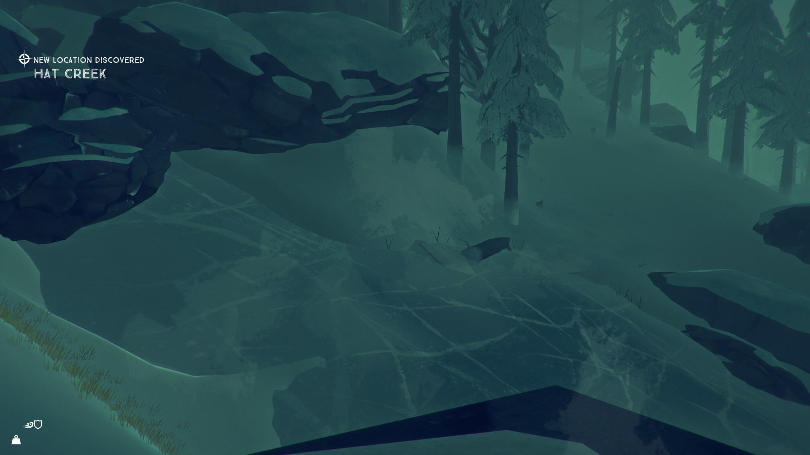
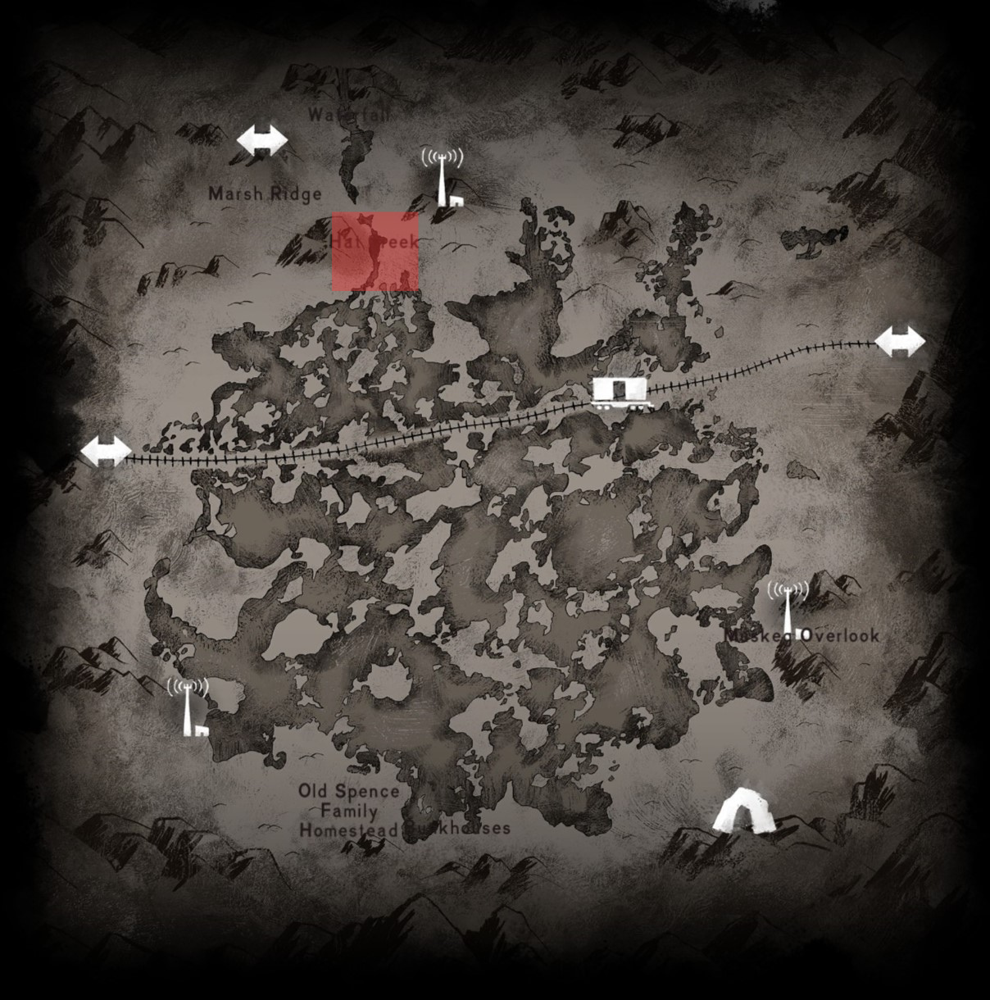

# Hat Creek

**Hat Creek**

| Property | Details |
| --- | --- |
|  |  / *20170304105847\_1.jpg* |
| **Location** |  |
|  |  / *Hat\_Creek\_Location.png* |
| Region | [Forlorn Muskeg](./Forlorn%20Muskeg.md)\|- |
| Type | Landmark\|- |
