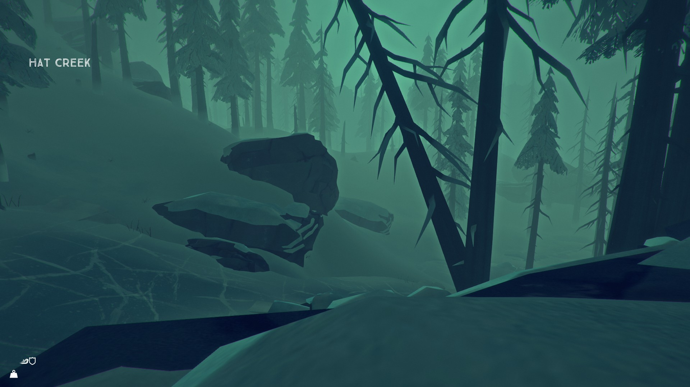

# Hat Creek

**Categories:** Article stubs, Articles in need of images, Landmarks, Locations, Locations in Forlorn Muskeg, Outdoor locations · **Source:** [Fandom](https://thelongdark.fandom.com/wiki/Hat_Creek)

**Hat Creek**

_20170304105847\_1.jpg_

**Location**

_Hat\_Creek\_Location.png_

**Region:** [Forlorn Muskeg](./Forlorn%20Muskeg.md)

**Type:** Landmark

## Overview

The creek is a good source of [Cat Tail](./Cat%20Tail.md). Right next to its waterfall is the entrance to an explorable cave that leads to the [Marsh Ridge](./Marsh%20Ridge.md). You can find a [Mountaineering Rope](./Mountaineering%20Rope.md), a [Deer Carcass](./Deer%20Carcass.md), and [Coal](./Coal.md) in this cave. Further right of the creek is the [Shortwave Tower.](./Shortwave%20Tower.md)

## Gallery

_20170304105849\_1.jpg_
