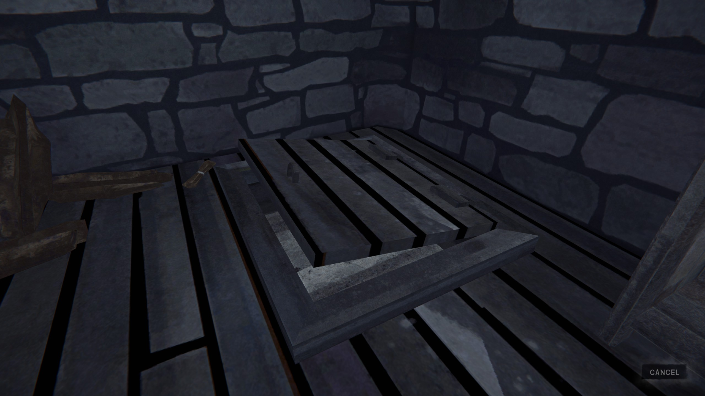
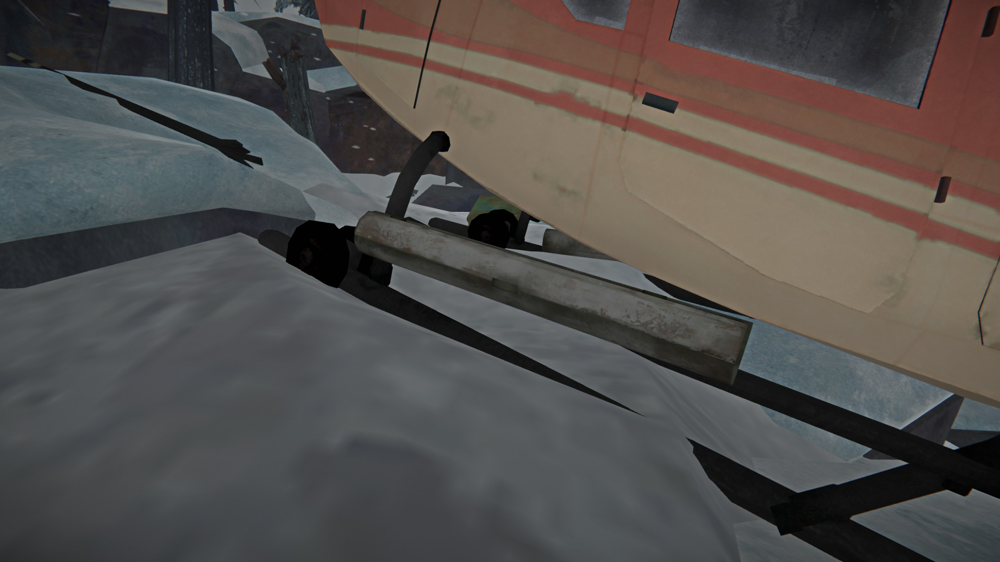
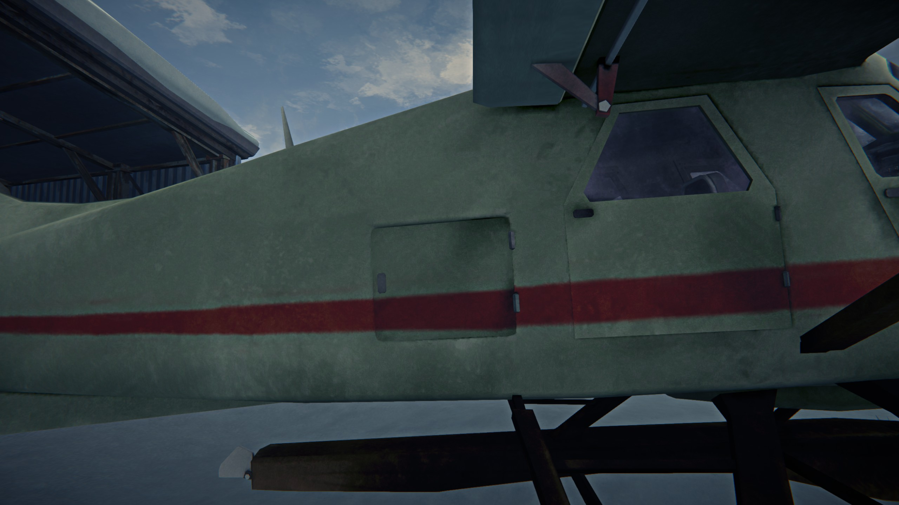

# Hatch

**Categories:** Interactable Objects, Story items · **Source:** [Fandom](https://thelongdark.fandom.com/wiki/Hatch)

**Hatch**

\[\[File:

250px\]\]

**General**

Item Type

Item

Wintermute

Yes A **Hatch** is a storage container found in various places across the Island. Wooden hatches can be found in the floors of cabins such as [Mountaineer's Hut](./Mountaineer%27s%20Hut.md) or [Bricklayer's Retreat](./Bricklayer%27s%20Retreat.md), while metal ones can be found on the sides of [Helicopters](./Helicopter.md) and [Airplanes](./Airplane.md). Helicopters have 4, while airplanes have 2.

Some hatches have a different storage capacity.

<!-- #floor_hatch -->
​

<!-- #Floor_Hatch -->
​

<!-- #Floor_hatch -->
​

<!-- #floor-hatch -->
## Floor Hatch

40.00 kg storage

<!-- #helicopterairplane_hatch -->
​

<!-- #Helicopter/Airplane_Hatch -->
​

<!-- #helicopter/airplane_hatch -->
​

<!-- #Helicopter/airplane_hatch -->
​

<!-- #Helicopter/airplane_Hatch -->
​

<!-- #helicopterairplane-hatch -->
## Helicopter/Airplane Hatch

40.00 kg storage
