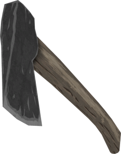

# Hatchet

**Categories:** Story items, Tools · **Source:** [Fandom](https://thelongdark.fandom.com/wiki/Hatchet)

**Contents**

- [Overview](#overview)
- [Obtaining](#obtaining)
- [Spawn-points](#spawn-points)
- [Pleasant Valley](#pleasant-valley)
- [Repair](#repair)
- [Trivia](#trivia)
- [Gallery](#gallery)

**Hatchet**

| Property | Details |
| --- | --- |
|  | [Hatchet icon](../assets/Hatchet_icon.png) |
| **General** |  |
| Item Type | Tool\|- |
| **Statistics** |  |
| Weight | [Weight icon](../assets/Weight_icon.png)1.50 kg(3.3 lbs) |
| Harvest | 2 × [Scrap Metal](./Scrap%20Metal.md) / 1 × [Fir Firewood](./Fir%20Firewood.md) / 1 hour |
| Repair | [Whetstone](./Whetstone.md) 12-5 minutes / 3%-5% |

_For the improvised variant, see [Improvised Hatchet](./Improvised%20Hatchet.md)._

> “**A small one-handed axe. Good for splitting wood. Can be used to hack meat in a pinch.**”
>
> — In-game description

The **Hatchet** is a tool in _The Long Dark_, primarily for woodcutting and self defense.

## Overview

The hatchet can be used to harvest [sticks](./Stick.md) from branches and some [Scrub Brush](./Scrub%20Brush.md), [Cedar Firewood](./Cedar%20Firewood.md) from cedar limbs, and [Fir Firewood](./Fir%20Firewood.md) from fir limbs. It can also be used to break down many wooden objects such as shelves and crates into [Reclaimed Wood](./Reclaimed%20Wood.md). Hatchets can also allow the player to cut down maple and birch saplings without a [Hacksaw](./Hacksaw.md).

Hatchets are repairable with [Whetstone](./Whetstone.md) or at the [Milling Machine](./Milling%20Machine.md).

Uses of Hatchet:

- Self Defense during a [Wolf Struggle](./Struggle.md).
- May be used to [harvest frozen carcasses](./Carcass%20Harvesting.md) (Knives have faster unfrozen meat, gut and hide harvesting speeds. Hatchets are only faster at harvesting frozen meat).
- Harvest downed tree limbs (for [Fir Firewood](./Fir%20Firewood.md) or [Cedar Firewood](./Cedar%20Firewood.md)).
- Open or maintain holes in the ice for [Ice Fishing](./Ice%20Fishing.md) (bladed tools break ice faster, but take more condition loss).
- Breaking down Furniture and Crates (for [Reclaimed Wood](./Reclaimed%20Wood.md) or [Cloth](./Cloth.md)).
- Crafting Arrow Shafts.
- Breaking Scrub Bushes.
- For the [Whiteout](./Whiteout.md) [challenge's](./Challenge.md) objective, an improvised hatchet may substitute the requirement of a hatchet.

When carried and selected for self-defense at the start of a Wolf Struggle, Hatchets deal high damage with a low chance per-hit to cause the wolf to flee, as well as a moderate chance to inflict [Blood Loss](./Blood%20Loss.md) on the Wolf (which is lethal over time). Hatchets take low damage from being used in a struggle, and are superior to [Improvised Hatchets](./Improvised%20Hatchet.md) when used in this way. For more information on Struggles, see: [Wildlife Struggles](./Struggle.md).

## Obtaining

Hatchets may be found in all regions, usually near frozen corpses or structures.

In Interloper mode hatchets will never spawn; requiring forging to create an [Improvised Hatchet](./Improvised%20Hatchet.md).

### Spawn-points

#### Pleasant Valley

- Stuck into the archery target at [Pleasant Valley Outbuildings](./Pleasant%20Valley%20Outbuildings.md)

## Repair

Hatchets may be repaired using a [Whetstone](./Whetstone.md) and the [Sharpening](./Sharpening.md) skill, restoring 3% condition to the hatchet and causing 5% condition damage to the whetstone.

The [Milling Machine](./Milling%20Machine.md) in [Bleak Inlet](./Bleak%20Inlet.md) or [Blackrock](./Blackrock.md) may repair a non-ruined hatchet to 100% condition for one scrap metal, during an active [Aurora](./Aurora.md). N.B. The hatchet has a breaking threshold at 15% condition, usage below this number risks ruining it for good.

## Trivia

- A broken Hatchet is the icon and logo for _The Long Dark_ on all platforms, including [the official Hinterlands website](https://hinterlandgames.com/), [forums](https://hinterlandforums.com/forums/) and [merchandise](https://www.hinterlandstore.com/).
- Unlike large axes, hatchets feature a hammerhead on their back; despite this, the hatchet is never used for this purpose in-game, even suffering a condition penalty when used to break ice for being a 'sharp tool'.

## Gallery

