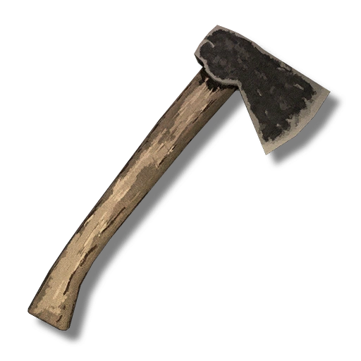

# Hatchet

**Contents**

- [Overview](#Overview)
- [Obtaining](#Obtaining)
- [Spawn-points](#Spawn-points)
- [Pleasant Valley](#Pleasant_Valley)
- [Repair](#Repair)
- [Trivia](#Trivia)
- [Gallery](#Gallery)

<table class="infobox">
<caption>Hatchet</caption>
<colgroup>
<col style="width: 50%" />
<col style="width: 50%" />
</colgroup>
<tbody>
<tr>
<td colspan="2"><figure>

<figcaption>Hatchet_icon.png</figcaption>
</figure></td>
</tr>
<tr>
<td colspan="2" class="section">
<strong>General</strong>
</td>
</tr>
<tr>
<td>
Item Type
</td>
<td>
Tool|-
</td>
</tr>
<tr>
<td colspan="2" class="section">
<strong>Statistics</strong>
</td>
</tr>
<tr>
<td>
Weight
</td>
<td>
1.50 kg(3.3 lbs)
</td>
</tr>
<tr>
<td>
Harvest
</td>
<td>
2 × <a href="./Scrap%20Metal.md" class="wikilink" title="Scrap Metal">Scrap Metal</a> 
1 × <a href="./Fir%20Firewood.md" class="wikilink" title="Fir Firewood">Fir Firewood</a> 
1 hour
</td>
</tr>
<tr>
<td>
Repair
</td>
<td>
<a href="./Whetstone.md" class="wikilink" title="Whetstone">Whetstone</a> 12-5 minutes 
3%-5%
</td>
</tr>
</tbody>
</table>

  
*For the improvised variant, see <a href="./Improvised%20Hatchet.md" class="wikilink" title="Improvised Hatchet">Improvised Hatchet</a>.*

<table>
<colgroup>
<col style="width: 33%" />
<col style="width: 33%" />
<col style="width: 33%" />
</colgroup>
<tbody>
<tr>
<td style="vertical-align: top; font-size: 3em; color: #5d5980; padding-right: 10px">
“
</td>
<td>
A small one-handed axe. Good for splitting wood. Can be used to hack meat in a pinch.

&#10;

In-game description

</td>
<td style="vertical-align: bottom; font-size: 3em; color: #5d5980; padding-left: 10px">
”
</td>
</tr>
</tbody>
</table>

The **Hatchet** is a tool in *The Long Dark*, primarily for woodcutting and self defense.

## Overview

The hatchet can be used to harvest <a href="./Stick.md" class="wikilink" title="stick">sticks</a> from branches and some <a href="./Scrub%20Brush.md" class="wikilink" title="Scrub Brush">Scrub Brush</a>, <a href="./Cedar%20Firewood.md" class="wikilink" title="Cedar Firewood">Cedar Firewood</a> from cedar limbs, and <a href="./Fir%20Firewood.md" class="wikilink" title="Fir Firewood">Fir Firewood</a> from fir limbs. It can also be used to break down many wooden objects such as shelves and crates into <a href="./Reclaimed%20Wood.md" class="wikilink" title="Reclaimed Wood">Reclaimed Wood</a>. Hatchets can also allow the player to cut down maple and birch saplings without a <a href="./Hacksaw.md" class="wikilink" title="Hacksaw">Hacksaw</a>.

Hatchets are repairable with <a href="./Whetstone.md" class="wikilink" title="Whetstone">Whetstone</a> or at the <a href="./Milling%20Machine.md" class="wikilink" title="Milling Machine">Milling Machine</a>.

Uses of Hatchet:

- Self Defense during a <a href="./Struggle.md" class="wikilink" title="Wolf Struggle">Wolf Struggle</a>.
- May be used to <a href="./Carcass%20Harvesting.md" class="wikilink" title="harvest frozen carcasses">harvest frozen carcasses</a> (Knives have faster unfrozen meat, gut and hide harvesting speeds. Hatchets are only faster at harvesting frozen meat).
- Harvest downed tree limbs (for <a href="./Fir%20Firewood.md" class="wikilink" title="Fir Firewood">Fir Firewood</a> or <a href="./Cedar%20Firewood.md" class="wikilink" title="Cedar Firewood">Cedar Firewood</a>).
- Open or maintain holes in the ice for <a href="./Ice%20Fishing.md" class="wikilink" title="Ice Fishing">Ice Fishing</a> (bladed tools break ice faster, but take more condition loss).
- Breaking down Furniture and Crates (for <a href="./Reclaimed%20Wood.md" class="wikilink" title="Reclaimed Wood">Reclaimed Wood</a> or <a href="./Cloth.md" class="wikilink" title="Cloth">Cloth</a>).
- Crafting Arrow Shafts.
- Breaking Scrub Bushes.
- For the <a href="./Whiteout.md" class="wikilink" title="Whiteout">Whiteout</a> <a href="./Challenge.md" class="wikilink" title="challenge&#39;s">challenge's</a> objective, an improvised hatchet may substitute the requirement of a hatchet.

When carried and selected for self-defense at the start of a Wolf Struggle, Hatchets deal high damage with a low chance per-hit to cause the wolf to flee, as well as a moderate chance to inflict <a href="./Blood%20Loss.md" class="wikilink" title="Blood Loss">Blood Loss</a> on the Wolf (which is lethal over time). Hatchets take low damage from being used in a struggle, and are superior to <a href="./Improvised%20Hatchet.md" class="wikilink" title="Improvised Hatchets">Improvised Hatchets</a> when used in this way. For more information on Struggles, see: <a href="./Struggle.md" class="wikilink" title="Wildlife Struggles">Wildlife Struggles</a>.

## Obtaining

Hatchets may be found in all regions, usually near frozen corpses or structures.

In Interloper mode hatchets will never spawn; requiring forging to create an <a href="./Improvised%20Hatchet.md" class="wikilink" title="Improvised Hatchet">Improvised Hatchet</a>.

### Spawn-points

#### Pleasant Valley

- Stuck into the archery target at <a href="./Pleasant%20Valley%20Outbuildings.md" class="wikilink" title="Pleasant Valley Outbuildings">Pleasant Valley Outbuildings</a>

## Repair

Hatchets may be repaired using a <a href="./Whetstone.md" class="wikilink" title="Whetstone">Whetstone</a> and the <a href="./Sharpening.md" class="wikilink" title="Sharpening">Sharpening</a> skill, restoring 3% condition to the hatchet and causing 5% condition damage to the whetstone.

The <a href="./Milling%20Machine.md" class="wikilink" title="Milling Machine">Milling Machine</a> in <a href="./Bleak%20Inlet.md" class="wikilink" title="Bleak Inlet">Bleak Inlet</a> or <a href="./Blackrock.md" class="wikilink" title="Blackrock">Blackrock</a> may repair a non-ruined hatchet to 100% condition for one scrap metal, during an active <a href="./Aurora.md" class="wikilink" title="Aurora">Aurora</a>. N.B. The hatchet has a breaking threshold at 15% condition, usage below this number risks ruining it for good.

## Trivia

- A broken Hatchet is the icon and logo for *The Long Dark* on all platforms, including [the official Hinterlands website](https://hinterlandgames.com/), [forums](https://hinterlandforums.com/forums/) and [merchandise](https://www.hinterlandstore.com/).
- Unlike large axes, hatchets feature a hammerhead on their back; despite this, the hatchet is never used for this purpose in-game, even suffering a condition penalty when used to break ice for being a 'sharp tool'.

## Gallery

<table class="gallery">
<colgroup>
<col style="width: 50%" />
<col style="width: 50%" />
</colgroup>
<tbody>
<tr>
<td><figure>

<figcaption>Old model.</figcaption>
</figure></td>
<td><figure>

<figcaption>Old icon</figcaption>
</figure></td>
</tr>
</tbody>
</table>

**Lua execution error in Module:Navbox function navbox**

<a href="ru:%D0%A2%D0%BE%D0%BF%D0%BE%D1%80%D0%B8%D0%BA" class="wikilink" title="ru:Топорик">ru:Топорик</a>

<a href="fr:Hachette" class="wikilink" title="fr:Hachette">fr:Hachette</a>

