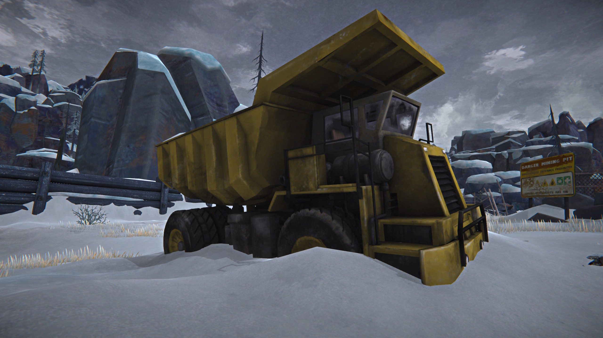
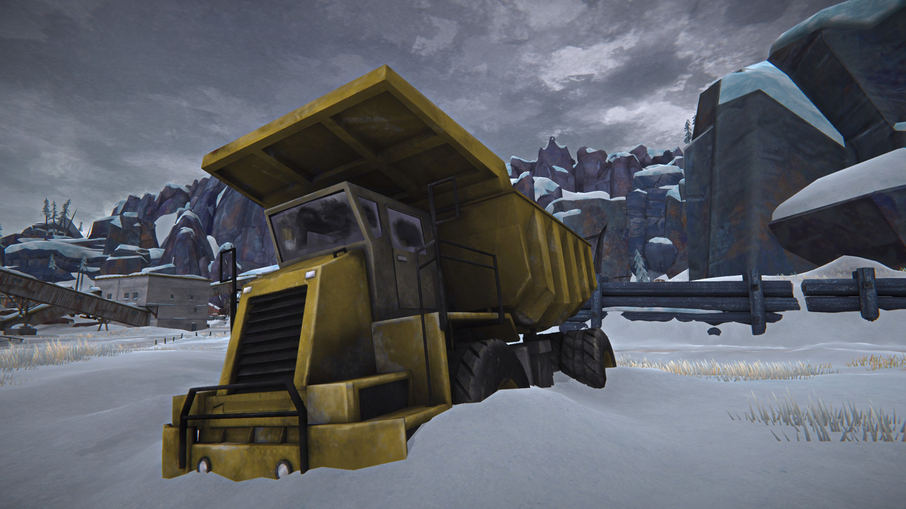

# Haul Truck

*Earth\_Mover.jpg*

A **Haul Truck** or **Dump Truck** is a [Vehicle](./Vehicle.md) found exclusively around the [Langston Mine](./Langston%20Mine.md) complex in the [Zone of Contamination](./Zone%20of%20Contamination.md). They contain a stairwell leading to a single door to the driver's seat that can be opened. Inside a player can find loot on the floorboard or sleep/pass time. There are currently 3 Earth Movers located around the open pit mine in the region, and they are the rarest land vehicle in the game. The Haul Truck on the edge of the open pit mine contains a [Polaroid](./Polaroids.md) on the dashboard.

| Column 1 |
| --- |
|  / *Earth\_Mover\_Driver\_Side.jpg* |

## Trivia

The Haul Truck is based on the truck found in front of the [Britannia Mine Museum](https://en.wikipedia.org/wiki/Britannia_Mine_Museum) that the [Concentrator](./Concentrator.md) is based on.**Lua execution error in Module:Navbox function navbox**
