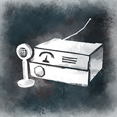

# He Lives

<table class="infobox">
<caption>He Lives</caption>
<colgroup>
<col style="width: 50%" />
<col style="width: 50%" />
</colgroup>
<tbody>
<tr>
<td colspan="2"><figure>

<figcaption>He_Lives_icon.png</figcaption>
</figure></td>
</tr>
<tr>
<td>
Description
</td>
<td>
Intercept the Radio transmission.
</td>
</tr>
</tbody>
</table>

**He Lives** is a <a href="./Wintermute.md" class="wikilink" title="Wintermute">Wintermute</a> <a href="./The%20Long%20Dark%20%E2%80%94%20Achievements.md" class="wikilink" title="achievement">achievement</a> in <a href="./Episode%203%20-%20Crossroads%20Elegy.md" class="wikilink" title="Episode 3: Crossroads Elegy">Episode 3: Crossroads Elegy</a> of *<a href="./The%20Long%20Dark.md" class="wikilink" title="The Long Dark">The Long Dark</a>*.

## Guide

This achievement is an unmissable story achievement obtained after interacting with the radio in <a href="./Signal%20Hill.md" class="wikilink" title="Signal Hill">Signal Hill</a> as part of the quest <a href="./Aftermath.md" class="wikilink" title="Aftermath">Aftermath</a>.

After <a href="./Astrid%20Greenwood.md" class="wikilink" title="Astrid Greenwood">Astrid Greenwood</a> interacts with the radio and finds it dead, she will go to sleep, only to awaken to the lights being turned on. She will rush to the radio and turn it on, only to hear a broadcast between <a href="./Perseverance%20Mills.md" class="wikilink" title="Perseverance Mills">Perseverance Mills</a> and <a href="./Will%20Mackenzie.md" class="wikilink" title="Will Mackenzie">Will Mackenzie</a>. After the cutscene ends, the achievement is awarded.

## Game History

- UPDATE **22 October 2019 (<a href="./The%20Long%20Dark%20%E2%80%94%20Changelog.md#1.60" class="wikilink" title="Update">Update</a>):**
  - Added to game.

**Lua execution error in Module:Navbox function navbox**==References==

