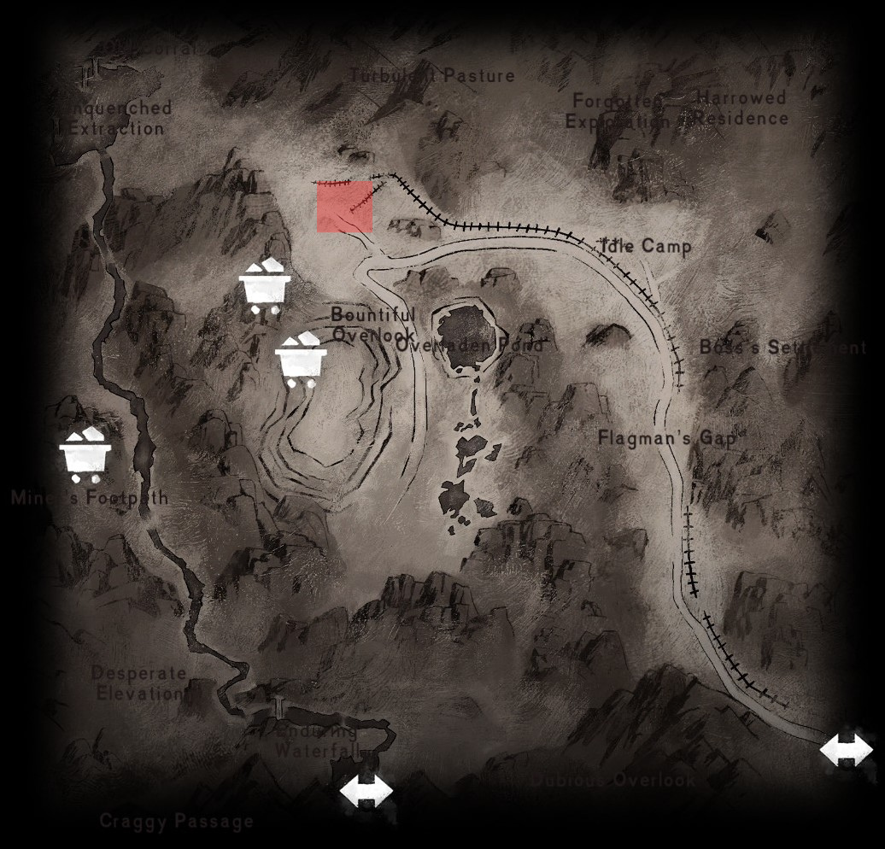

# Headframe Building

**Headframe Building**

| Property | Details |
| --- | --- |
|  |  / *Headframe\_Building.png* |
| **Location** |  |
|  |  / *Headframe\_Building\_Location.png* |
| Region | [Zone of Contamination](./Zone%20of%20Contamination.md)\|- |
| **General** |  |
| Type |  |
|  / *workbench\_icon\_green.png* | Has a workbench\|- |
