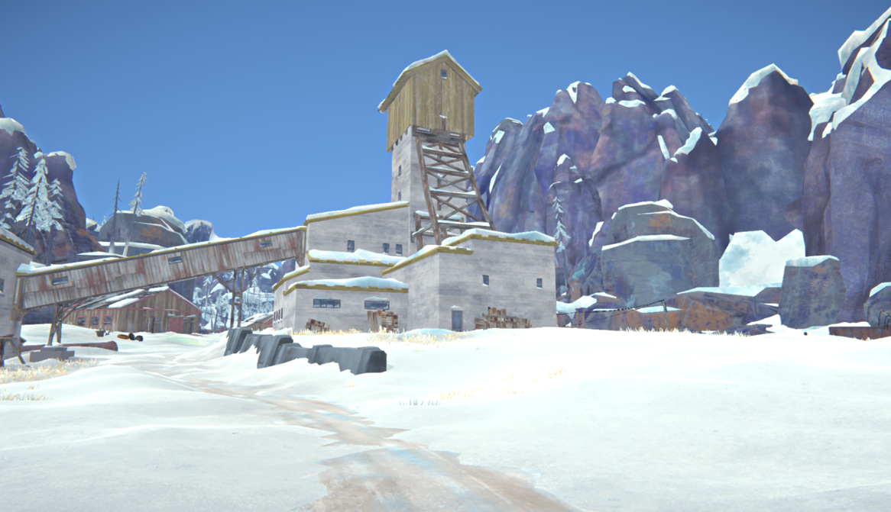

# Headframe Building

<table class="infobox">
<caption>Headframe Building</caption>
<colgroup>
<col style="width: 50%" />
<col style="width: 50%" />
</colgroup>
<tbody>
<tr>
<td colspan="2"><figure>

<figcaption>Headframe_Building.png</figcaption>
</figure></td>
</tr>
<tr>
<td colspan="2" class="section">
<strong>Location</strong>
</td>
</tr>
<tr>
<td colspan="2"><figure>
[Missing image: Headframe_Building_Location.png]
<figcaption>Headframe_Building_Location.png</figcaption>
</figure></td>
</tr>
<tr>
<td>
Region
</td>
<td>
<a href="./Zone%20of%20Contamination.md" class="wikilink" title="Zone of Contamination">Zone of Contamination</a>|-
</td>
</tr>
<tr>
<td colspan="2" class="section">
<strong>General</strong>
</td>
</tr>
<tr>
<td>
Type
</td>
<td></td>
</tr>
<tr>
<td><figure>

<figcaption>workbench_icon_green.png</figcaption>
</figure></td>
<td>
Has a workbench|-
</td>
</tr>
</tbody>
</table>

