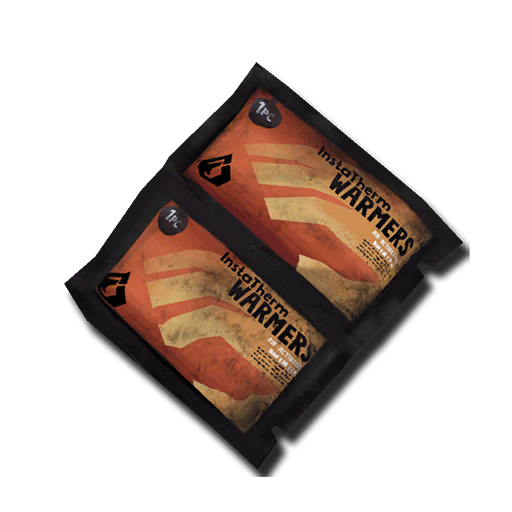

# Heat Pack \(Affliction\)

**Categories:** Afflictions, Pages with update history · **Source:** [Fandom](https://thelongdark.fandom.com/wiki/Heat_Pack_%28Affliction%29)

**Heat Pack**

| Property | Details |
| --- | --- |
|  |  / _Heat\_Pack\_(Affliction)\_icon.png_ |
| Release | [2 December 2024](./The%20Long%20Dark%20%E2%80%94%20Changelog.md#2.33) |
| Update | 2.33 |
| **Properties** |  |
| Category | [Afflictions](./Afflictions.md) |
| Description | You feel a gentle, temporary warmth from the Heat Pack tucked into your clothing. |
| Caused By | Active  [Heat Pack](./Heat%20Pack.md) in inventory |
| Effect | Positive |
| Type | Benefit |
| Affliction Duration | 6 Hours |
| Benefit Duration | Until [Heat Pack](./Heat%20Pack.md) wears off/is dropped |

> “__You feel a gentle, temporary warmth from the Heat Pack tucked into your clothing.__”
>
> — In-game Description

**Heat Pack** is a positive [Affliction](./Afflictions.md) obtained when using a [Heat Pack](./Heat%20Pack.md). The effect raises the survivor's [Warmth](./Warmth.md) and remains in effect as long as the Heat Pack remains in use and is in the player's inventory.

Despite the Affliction description stating that the Heat Pack is tucked into the player's Clothing while operating, Clothing is not needed to gain the benefits of an active Heat Pack.

## Effects

Once activated, a Heat Pack produces no Warmth to the player at first, but will gradually raise [Warmth](./Warmth.md) and overall [Feels Like](./Feels%20Like.md) over time.

- +0.1C (+0.2F) of Warmth is added by the pack every 30 seconds after activation and generates the Heat Pack (Affliction).
- The Warmth caps at +5.0C (+9F) 50 minutes after activation (time remaining will be 5 hours 10 minutes).
- The Warmth effect lasts for 6 hours for a single Heat Pack.
- Using multiple Heat Packs does not combine their effects. The Heat Pack (Affliction) only displays the time left on the Heat Pack with the most time remaining.
- Once 50 minutes remain after activation, the Heat Pack will slowly lose Warmth by -0.1C (-0.2F) every 30 seconds until time runs out to 0 minutes left.
- After time expires, the Condition of a Heat Pack will instantly turn to 0% and the item will be Ruined, providing no heat.

## Trivia

The Affliction icon is the same as [Warming Up](./Warming%20Up.md).

## Update history

- UPDATE **2 December 2024 ([Update](./The%20Long%20Dark%20%E2%80%94%20Changelog.md#2.33)):**
  - Added to game
