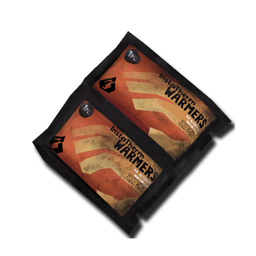
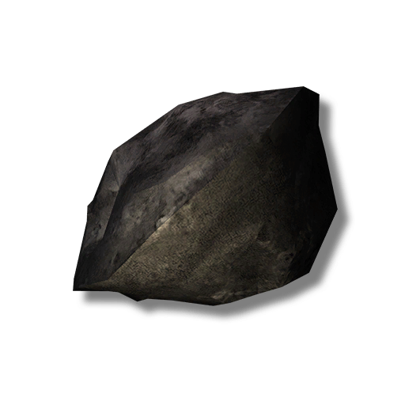

# Heat Pack

**Contents**

- [Overview](#Overview)
- [Benefits](#Benefits)
- [Limitations](#Limitations)
- [Trade Values](#Trade_Values)
- [Effects](#Effects)
- [Update history](#Update_history)

<table>
<colgroup>
<col style="width: 33%" />
<col style="width: 33%" />
<col style="width: 33%" />
</colgroup>
<tbody>
<tr>
<td width="40px"><figure>
[Missing image: Ptarmigan_icon.png]
<figcaption>Ptarmigan_icon.png</figcaption>
</figure></td>
<td>
<strong>DLC-Exclusive content.</strong> 

This content requires the <a href="./Tales%20from%20the%20Far%20Territory.md" class="wikilink" title="Tales from the Far Territory">Tales from the Far Territory</a> addon to be installed before it can be seen or used in regular gameplay.

</td>
<td>
|}

<table class="infobox">
<caption>Heat Pack</caption>
<colgroup>
<col style="width: 50%" />
<col style="width: 50%" />
</colgroup>
<tbody>
<tr>
<td colspan="2"><figure>

<figcaption>Heat_Pack_icon.png</figcaption>
</figure></td>
</tr>
<tr>
<td>
Release
</td>
<td>
<a href="./The%20Long%20Dark%20%E2%80%94%20Changelog.md#2.33" class="wikilink" title="2 December 2024">2 December 2024</a>
</td>
</tr>
<tr>
<td>
Wintermute
</td>
<td>
<a href="./Episode%205%20-%20The%20Light%20At%20The%20End%20Of%20All%20Things.md" class="wikilink" title="Episode 5">Episode 5</a>
</td>
</tr>
<tr>
<td>
Renewable
</td>
<td>
Yes (<a href="./Trader.md" class="wikilink" title="Trader">Trader</a> only)
</td>
</tr>
<tr>
<td colspan="2" class="section">
<strong>Properties</strong>
</td>
</tr>
<tr>
<td>
Item type
</td>
<td>
<a href="./First%20Aid.md" class="wikilink" title="First Aid">First Aid</a>|-
</td>
</tr>
<tr>
<td>
Stackable
</td>
<td>
No
</td>
</tr>
<tr>
<td>
Examine
</td>
<td>
A single-use, disposable Heat Pack. Provides a small amount of warmth when activated.
</td>
</tr>
<tr>
<td colspan="2" class="section">
<strong>Values</strong>
</td>
</tr>
<tr>
<td>
Weight
</td>
<td>
0.10 kg (0.22 lbs)
</td>
</tr>
<tr>
<td colspan="2" class="section">
<strong>Advanced data</strong>
</td>
</tr>
<tr>
<td>
Item key
</td>
<td>
GEAR_HeatPad
</td>
</tr>
</tbody>
</table>

The <strong>Heat Pack</strong> is a <a href="./First%20Aid.md" class="wikilink" title="First Aid">First Aid</a> item in <em><a href="./The%20Long%20Dark.md" class="wikilink" title="The Long Dark">The Long Dark</a></em> in <a href="./Survival%20Mode.md" class="wikilink" title="Survival Mode">Survival Mode</a>. They also appear in <a href="./Episode%205%20-%20The%20Light%20At%20The%20End%20Of%20All%20Things.md" class="wikilink" title="Episode 5: The Light At The End Of All Things">Episode 5: The Light At The End Of All Things</a>.

<h2 id="Overview">Overview</h2>

It is only acquired when trading with the <a href="./Trader.md" class="wikilink" title="Trader">Trader</a> at higher levels of Trust, or in Chapter Five of <a href="./Wintermute.md" class="wikilink" title="Wintermute">Wintermute</a>. It provides the positive <a href="./Heat%20Pack%20%28Affliction%29.md" class="wikilink" title="Heat Pack (Affliction)">Heat Pack (Affliction)</a> when used.

Dropping an active Heat Pack will remove the Warmth effect and will display on the item how much heat is being produced and how much time is left on the pack. The Heat Pack (Affliction) is also lost when the Pack is dropped. The stats of a Heat Pack do not update in real time in the player's inventory. Selecting another item, then the Heat Pack will update the stats of the Heat Pack.

Despite the Affliction description stating that the Heat Pack is tucked into the player's Clothing while operating, Clothing is not needed to gain the benefits of an active Heat Pack.

<h3 id="Benefits">Benefits</h3>
<ul>
<li>The effect raises the survivor's <a href="./Warmth.md" class="wikilink" title="Warmth">Warmth</a> by a solid +5.0C (+9F), equivalent to wearing 2 <a href="./Cowichan%20Sweater.md" class="wikilink" title="Cowichan Sweaters">Cowichan Sweaters</a> and remains in effect as long as the Heat Pack is carried in the inventory once activated.
<ul>
<li>As such, a Heat Pack can be especially helpful for emergency situations, such as being caught in a blizzard or having damaged clothing after an animal <a href="./Struggle.md" class="wikilink" title="Struggle">Struggle</a>.</li>
<li>They are quite useful for staying warm while exploring very cold regions, such as <a href="./Forsaken%20Airfield.md" class="wikilink" title="Forsaken Airfield">Forsaken Airfield</a> or the higher areas of <a href="./Sundered%20Pass.md" class="wikilink" title="Sundered Pass">Sundered Pass</a> (where the temperature continues to drop at higher elevations).</li>
<li>Late game <a href="./Interloper.md" class="wikilink" title="Interloper">Interloper</a>/<a href="./Misery.md" class="wikilink" title="Misery">Misery</a> players can stay especially warm with a Heat Pack while exploring the outdoors.</li>
</ul></li>
</ul>
<h3 id="Limitations">Limitations</h3>
<ul>
<li>Heat Packs can only be acquired by trading with the Trader at higher Trust levels, which can take considerable time to unlock as part of <a href="./Sutherland%27s%20Tale.md" class="wikilink" title="Sutherland&#39;s Tale">Sutherland's Tale</a>.</li>
<li>Up to 5 Heat Packs can be bought at once, but this can be quite pricey.</li>
<li>The player can only reap the benefits of 1 active Heat Pack at a time for balancing reasons. Using multiple Heat Packs will only produce benefits from the one with the most time left.</li>
</ul>
<h3 id="Trade_Values">Trade Values</h3>

Up to 5 Heat Packs can be traded for at once at the price of:

<ul>
<li>10  <a href="./Coal.md" class="wikilink" title="Coal">Coal</a></li>
<li>15  <a href="./Stick.md" class="wikilink" title="Stick">Stick</a></li>
</ul>

With discount:

<ul>
<li>7   <a href="./Coal.md" class="wikilink" title="Coal">Coal</a></li>
<li>12  <a href="./Stick.md" class="wikilink" title="Stick">Stick</a></li>
</ul>
<h2 id="Effects">Effects</h2>

Once activated, a Heat Pack produces no Warmth to the player at first, but will gradually raise <a href="./Warmth.md" class="wikilink" title="Warmth">Warmth</a> and overall <a href="./Feels%20Like.md" class="wikilink" title="Feels Like">Feels Like</a> over time.

<ul>
<li>+0.1C (+0.2F) of Warmth is added by the pack every 30 seconds after activation and generates the <a href="./Heat%20Pack%20%28Affliction%29.md" class="wikilink" title="Heat Pack (Affliction)">Heat Pack (Affliction)</a>.</li>
<li>The Warmth caps at +5.0C (+9F) 50 minutes after activation (time remaining will be 5 hours 10 minutes).</li>
<li>The Warmth effect lasts for 6 hours for a single Heat Pack.</li>
<li>Using multiple Heat Packs does not combine their effects. The Heat Pack (Affliction) only displays the time left on the Heat Pack with the most time remaining.</li>
<li>Once 50 minutes remain after activation, the Heat Pack will slowly lose Warmth by -0.1C (-0.2F) every 30 seconds until time runs out to 0 minutes left.</li>
<li>After time expires, the Condition of a Heat Pack will instantly turn to 0% and the item will be Ruined, providing no heat.</li>
</ul>
<h2 id="Update_history">Update history</h2>

<strong>Template:update historyLua execution error in Module:Navbox function navbox</strong>

<a href="ru:%D0%A2%D0%B5%D0%BF%D0%BB%D0%BE%D0%B2%D0%BE%D0%B9_%D0%BF%D0%B0%D0%BA%D0%B5%D1%82" class="wikilink" title="ru:Тепловой пакет">ru:Тепловой пакет</a>
</td>
</tr>
</tbody>
</table>

