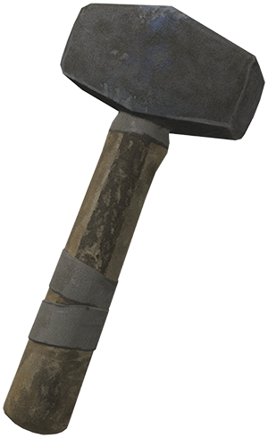

# Heavy Hammer

**Contents**

- [Overview](#Overview)
- [Harvesting Reclaimed Wood](#Harvesting_Reclaimed_Wood)
- [Locations](#Locations)
- [Ash Canyon](#Ash_Canyon)
- [Blackrock](#Blackrock)
- [Bleak Inlet](#Bleak_Inlet)
- [Mystery Lake (region)](#Mystery_Lake_%28region%29)
- [Coastal Highway](#Coastal_Highway)
- [Pleasant Valley](#Pleasant_Valley)
- [Desolation Point](#Desolation_Point)
- [Forlorn Muskeg](#Forlorn_Muskeg)
- [Hushed River Valley](#Hushed_River_Valley)
- [Timberwolf Mountain](#Timberwolf_Mountain)
- [Broken Railroad](#Broken_Railroad)
- [Ravine](#Ravine)
- [Mountain Town (Milton)](#Mountain_Town_%28Milton%29)
- [Notes](#Notes)
- [Gallery](#Gallery)
- [Game History](#Game_History)

<table class="infobox">
<caption>Heavy Hammer</caption>
<colgroup>
<col style="width: 50%" />
<col style="width: 50%" />
</colgroup>
<tbody>
<tr>
<td colspan="2"><figure>

<figcaption>Heavy_Hammer_icon.png</figcaption>
</figure></td>
</tr>
<tr>
<td colspan="2" class="section">
<strong>General</strong>
</td>
</tr>
<tr>
<td>
Item Type
</td>
<td>
Tool|-
</td>
</tr>
<tr>
<td>
Renewable
</td>
<td>
Yes (<a href="./Trader.md" class="wikilink" title="Trader">Trader</a> only) No (<a href="./Interloper.md" class="wikilink" title="Interloper">Interloper</a>)
</td>
</tr>
<tr>
<td colspan="2" class="section">
<strong>Statistics</strong>
</td>
</tr>
<tr>
<td>
Weight
</td>
<td>
2.00 kg(4.4 lbs)
</td>
</tr>
<tr>
<td>
Harvest
</td>
<td>
2 × <a href="./Scrap%20Metal.md" class="wikilink" title="Scrap Metal">Scrap Metal</a> 1 × <a href="./Fir%20Firewood.md" class="wikilink" title="Fir Firewood">Fir Firewood</a> 
30 minutes
</td>
</tr>
<tr>
<td>
Repair
</td>
<td>
1 × <a href="./Fir%20Firewood.md" class="wikilink" title="Fir Firewood">Fir Firewood</a> 20% Condition 
45 to 30 minutes
</td>
</tr>
</tbody>
</table>

<table>
<colgroup>
<col style="width: 33%" />
<col style="width: 33%" />
<col style="width: 33%" />
</colgroup>
<tbody>
<tr>
<td style="vertical-align: top; font-size: 3em; color: #5d5980; padding-right: 10px">
“
</td>
<td>
A hammer suitable for metalworking.

&#10;

In-game description

</td>
<td style="vertical-align: bottom; font-size: 3em; color: #5d5980; padding-left: 10px">
”
</td>
</tr>
</tbody>
</table>

**Heavy Hammer** is a tool in *The Long Dark*. It is used for <a href="./Forge.md" class="wikilink" title="forging">forging</a>, <a href="./Harvesting.md" class="wikilink" title="breaking">breaking</a> down furniture, making <a href="./Ice%20Fishing.md" class="wikilink" title="holes in the ice for fishing">holes in the ice for fishing</a>, or self defense during <a href="./Struggle.md" class="wikilink" title="wildlife struggles">wildlife struggles</a>.

## Overview

The Heavy Hammer is a multi-purpose tool, but is essential for <a href="./Forge.md" class="wikilink" title="Forging">Forging</a>: which is the only means for the survivor to craft their own tools, the <a href="./Improvised%20Hatchet.md" class="wikilink" title="Improvised Hatchet">Improvised Hatchet</a>, <a href="./Improvised%20Knife.md" class="wikilink" title="Improvised Knife">Improvised Knife</a> and <a href="./Arrowhead.md" class="wikilink" title="Arrowheads">Arrowheads</a>. Hammers lose small amounts of condition when used to forge, break furniture, or make holes in the ice, or during a struggle if selected.

Hammers are essential for long-term play as efficient and repairable tools for making holes for <a href="./Ice%20Fishing.md" class="wikilink" title="Ice Fishing">Ice Fishing</a> (for food or to avoid <a href="./Scurvy.md" class="wikilink" title="Scurvy">Scurvy</a>). On <a href="./Survival%20Mode.md" class="wikilink" title="Interloper mode">Interloper mode</a> where all Hatchets, Knives and Arrows never spawn, Heavy Hammers are essential to forge these items for self defense, and crafting <a href="./Wolfskin%20Coat.md" class="wikilink" title="animal-skin clothing">animal-skin clothing</a>, and using the <a href="./Survival%20Bow.md" class="wikilink" title="Survival Bow">Survival Bow</a>.

Heavy Hammers are repairable with <a href="./Fir%20Firewood.md" class="wikilink" title="Fir Firewood">Fir Firewood</a> and <a href="./Simple%20Tools.md" class="wikilink" title="Tools">Tools</a>.

Uses of Heavy Hammer:

- Self Defense during a <a href="./Struggle.md" class="wikilink" title="Wolf Struggle">Wolf Struggle</a>.
- Forging: <a href="./Improvised%20Hatchet.md" class="wikilink" title="Improvised Hatchet">Improvised Hatchet</a>, <a href="./Improvised%20Knife.md" class="wikilink" title="Improvised Knife">Improvised Knife</a>, and <a href="./Arrowhead.md" class="wikilink" title="Arrowheads">Arrowheads</a> (for crafting <a href="./Simple%20Arrow.md" class="wikilink" title="Simple Arrow">Simple Arrow</a>).
- Breaking down Furniture and Crates (for <a href="./Reclaimed%20Wood.md" class="wikilink" title="Reclaimed Wood">Reclaimed Wood</a> or <a href="./Cloth.md" class="wikilink" title="Cloth">Cloth</a>).
- Open or maintain holes in the ice for <a href="./Ice%20Fishing.md" class="wikilink" title="Ice Fishing">Ice Fishing</a>.
- Crafting <a href="./Acorn%20Grounds.md" class="wikilink" title="Acorns Grounds">Acorns Grounds</a>.

When carried and selected for self-defense at the start of a Wolf Struggle, Heavy Hammers deal middling damage with a high chance per-hit to cause the wolf to flee. Hammers take low damage from being used in a struggle, and never inflict Blood Loss to the Wolf. For more information on Struggles, see: <a href="./Struggle.md" class="wikilink" title="Wildlife Struggles">Wildlife Struggles</a>.

## Harvesting Reclaimed Wood

Heavy Hammer may be used to break down most (but not all) furniture for <a href="./Reclaimed%20Wood.md" class="wikilink" title="Reclaimed Wood">Reclaimed Wood</a> and <a href="./Cloth.md" class="wikilink" title="Cloth">Cloth</a>. Destroying furniture in this way is more calorie and time expensive than with a Hatchet, but is faster than by hand and allows breaking some furniture which cannot be broken down with bare hands. Heavy Hammers also weigh more than a Hatchet or Improvised Hatchet, but despite these drawbacks they are easier to repair: requiring <a href="./Simple%20Tools.md" class="wikilink" title="Simple Tools">Simple Tools</a> (Repair time: 45 minutes) or <a href="./Quality%20Tools.md" class="wikilink" title="Quality Tools">Quality Tools</a> (Repair time: 30 minutes) and <a href="./Fir%20Firewood.md" class="wikilink" title="Fir Firewood">Fir Firewood</a> (rather than the rare <a href="./Whetstone.md" class="wikilink" title="Whetstone">Whetstone</a> or <a href="./Milling%20Machine.md" class="wikilink" title="Milling Machine">Milling Machine</a> for Hatchets).

## Locations

Some particular observed locations in which a heavy hammer may be found include:

### <a href="./Ash%20Canyon.md" class="wikilink" title="Ash Canyon">Ash Canyon</a>

- On the floor in the ruins near the entrance of the <a href="./Gold%20Mine.md" class="wikilink" title="Gold Mine">Gold Mine</a>.

### <a href="./Blackrock.md" class="wikilink" title="Blackrock">Blackrock</a>

- In Cell Block 3 at <a href="./Blackrock%20Prison.md" class="wikilink" title="Blackrock Prison">Blackrock Prison</a> building, in the room where the went exits on a shelf.
- In the <a href="./Steam%20Tunnels.md" class="wikilink" title="Steam Tunnels">Steam Tunnels</a> closest to the <a href="./Power%20Plant.md" class="wikilink" title="Power Plant">Power Plant</a> entrance on the ground.

### <a href="./Bleak%20Inlet.md" class="wikilink" title="Bleak Inlet">Bleak Inlet</a>

- Near The Harbinger at <a href="./Last%20Resort%20Cannery.md" class="wikilink" title="Last Resort Cannery">Last Resort Cannery</a>.

### <a href="./Mystery%20Lake%20%28region%29.md" class="wikilink" title="Mystery Lake (region)">Mystery Lake (region)</a>

- At <a href="./Carter%20Hydro%20Dam.md" class="wikilink" title="Carter Hydro Dam">Carter Hydro Dam</a> inside the dam complex, at the workbench.
- In the <a href="./Forestry%20Lookout.md" class="wikilink" title="Forestry Lookout">Forestry Lookout</a>.
- At a fishing hut under the fireplace.
- At <a href="./Trapper%27s%20Homestead.md" class="wikilink" title="Trapper&#39;s Homestead">Trapper's Homestead</a> on the workbench.
- At Trapper's Homestead in the outbuilding
- Inside of the train car at <a href="./Derailment.md" class="wikilink" title="Derailment">Derailment</a>.
- Inside a trailer by the <a href="./Logging%20Camp.md" class="wikilink" title="Logging Camp">Logging Camp</a>.

### <a href="./Coastal%20Highway.md" class="wikilink" title="Coastal Highway">Coastal Highway</a>

- In one of the cars at <a href="./Coastal%20Highway.md" class="wikilink" title="Coastal Highway">Coastal Highway</a> near <a href="./Log%20Sort.md" class="wikilink" title="Log Sort">Log Sort</a> or at <a href="./Coastal%20Townsite.md" class="wikilink" title="Coastal Townsite">Coastal Townsite</a>.
- On the outside wall of the blue trailer at <a href="./Log%20Sort.md" class="wikilink" title="Log Sort">Log Sort</a>.
- On a metal shelf, and in the large toolbox in the garage work area, <a href="./Quonset%20Garage.md" class="wikilink" title="Quonset Garage">Quonset Garage</a>.
- On a metal barrel outside the <a href="./Quonset%20Garage.md" class="wikilink" title="Quonset Garage">Quonset Garage</a>.
- In one of the ice fishing huts under the fireplace.
- At the <a href="./Abandoned%20Lookout.md" class="wikilink" title="Abandoned Lookout">Abandoned Lookout</a>, under the chair.
- Under the workbench in <a href="./Fishing%20Camp.md" class="wikilink" title="Fishing Camp">Fishing Camp</a>
- In the <a href="./Cinder%20Hills%20Coal%20Mine.md" class="wikilink" title="Cinder Hills Coal Mine">Cinder Hills Coal Mine</a>
- On the ground next to a door at the house on Jackrabbit Island

### <a href="./Pleasant%20Valley.md" class="wikilink" title="Pleasant Valley">Pleasant Valley</a>

- On the upper level of the <a href="./Pleasant%20Valley%20Outbuildings.md" class="wikilink" title="Barn">Barn</a> in <a href="./Pleasant%20Valley.md" class="wikilink" title="Pleasant Valley">Pleasant Valley</a>.
- In the basement at <a href="./Pleasant%20Valley%20Farmstead.md" class="wikilink" title="Pleasant Valley Farmstead">Pleasant Valley Farmstead</a>.
- Under a shelf at <a href="./Signal%20Hill.md" class="wikilink" title="Signal Hill">Signal Hill</a>.

### <a href="./Desolation%20Point.md" class="wikilink" title="Desolation Point">Desolation Point</a>

- At <a href="./Hibernia%20Processing.md" class="wikilink" title="Hibernia Processing">Hibernia Processing</a> on the workbench or the tool rack shelves.
- Laying up against a knocked over barrel by the fire barrel in <a href="./Hibernia%20Processing.md" class="wikilink" title="Hibernia Processing">Hibernia Processing</a> lower level. (very easy to miss in low light conditions- near the railing with pallets behind it.)

### <a href="./Forlorn%20Muskeg.md" class="wikilink" title="Forlorn Muskeg">Forlorn Muskeg</a>

- In a red box in the <a href="./Old%20Spence%20Family%20Homestead.md" class="wikilink" title="Old Spence Family Homestead">Old Spence Family Homestead</a>. (or under the workbench, or outside the wall)
- Near one of the pallets at the <a href="./Bunkhouses.md" class="wikilink" title="Bunk Houses">Bunk Houses</a>.

### <a href="./Hushed%20River%20Valley.md" class="wikilink" title="Hushed River Valley">Hushed River Valley</a>

- Near the <a href="./Mysterious%20Signal%20Fire.md" class="wikilink" title="Mysterious Signal Fire">Mysterious Signal Fire</a>.
- Near a corpse in the southern <a href="./Ice%20Cave.md" class="wikilink" title="Ice Cave">Ice Cave</a>.

### <a href="./Timberwolf%20Mountain.md" class="wikilink" title="Timberwolf Mountain">Timberwolf Mountain</a>

- In one of the <a href="./Cargo%20Container.md" class="wikilink" title="Cargo Container">Cargo Containers</a> in the <a href="./Tail%20Section.md" class="wikilink" title="Tail Section">Tail Section</a> of <a href="./Timberwolf%20Mountain.md" class="wikilink" title="Timberwolf Mountain">Timberwolf Mountain</a>.
- Under the workbench at the <a href="./Mountaineer%27s%20Hut.md" class="wikilink" title="Mountaineer&#39;s Hut.">Mountaineer's Hut.</a>
- Under the stove in the fishing hut on <a href="./Crystal%20Lake.md" class="wikilink" title="Crystal Lake">Crystal Lake</a>.
- In one of the fishing boats next to the dock on <a href="./Crystal%20Lake.md" class="wikilink" title="Crystal Lake">Crystal Lake</a>.

### <a href="./Broken%20Railroad.md" class="wikilink" title="Broken Railroad">Broken Railroad</a>

- At a shelf in the <a href="./Maintenance%20Yard.md" class="wikilink" title="Maintenance Yard">Maintenance Yard</a>, in one of the toolboxes, or underneath the workbench.

### <a href="./The%20Ravine.md" class="wikilink" title="Ravine">Ravine</a>

- In a train carriage.
- In the fallen gondola.
- In a cave

### <a href="./Mountain%20Town.md" class="wikilink" title="Mountain Town">Mountain Town</a> (Milton)

- In the back of the truck in front of Bank Manager's house.
- In one of the low tier houses on a crate.
- In one of the low tier houses on a metal shelf.
- In the closet at <a href="./Paradise%20Meadows%20Farm.md" class="wikilink" title="Paradise Meadows Farm">Paradise Meadows Farmstead</a>.
- In the small guard shed in front of the Orca Gas Station.

## Notes

- The shape of the hammer is similar to a real-world [mini-sledge](https://www.google.com/search?q=mini+sledge).
- In real world metalworking, numerous different hammers (each with their own unique head shapes and weights) would be used for different applications, but for all intents and purposes the picture suits as merely just a reference.
- It's sometimes called a "Wolf Bonker" due to its high melee stats, capable of crippling limbs and ending Wolf <a href="./Struggle.md" class="wikilink" title="Struggles">Struggles</a> rapidly (15% chance to scare off immediately, 5% chance to kill instantly).

## Gallery

<table class="gallery">
<colgroup>
<col style="width: 100%" />
</colgroup>
<tbody>
<tr>
<td><figure>

<figcaption>Old model.</figcaption>
</figure></td>
</tr>
</tbody>
</table>

## Game History

- UPDATE **5 December 2022 (<a href="./The%20Long%20Dark%20%E2%80%94%20Changelog.md#2.03" class="wikilink" title="Update">Update</a>):**
  - Interloper has had its loot positions refreshed and more position randomness added to its important items (like hammers) to add less predictability.

<!-- -->

- UPDATE **16 December 2015 (<a href="./The%20Long%20Dark%20%E2%80%94%20Early%20Access%20Changelog.md#0.298" class="wikilink" title="Update">Update</a>):**
  - Fixed issue where the Hammer could not be used to clear Ice Fishing holes.

<!-- -->

- UPDATE **18 September 2015 (<a href="./The%20Long%20Dark%20%E2%80%94%20Early%20Access%20Changelog.md#0.264" class="wikilink" title="Update">Update</a>):**
  - Added Heavy Hammer (previously known as 'Hammer').
  - Modified struggle damage modifiers for various tools, and added modifiers for the new Hammer.
  - You can now clear ice-fishing holes with Hammers.
  - Hammers can be used to break down crates, furniture, etc.

**Lua execution error in Module:Navbox function navbox**

<a href="ru:%D0%A2%D1%8F%D0%B6%D0%B5%D0%BB%D1%8B%D0%B9_%D0%BC%D0%BE%D0%BB%D0%BE%D1%82" class="wikilink" title="ru:Тяжелый молот">ru:Тяжелый молот</a>

