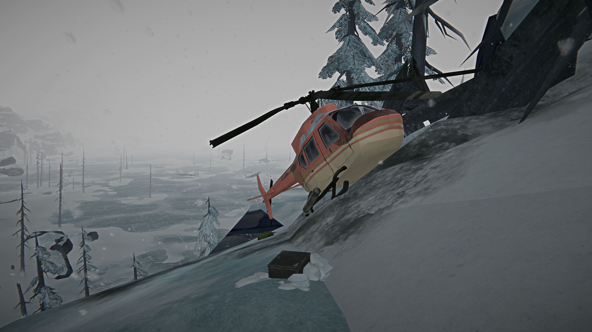
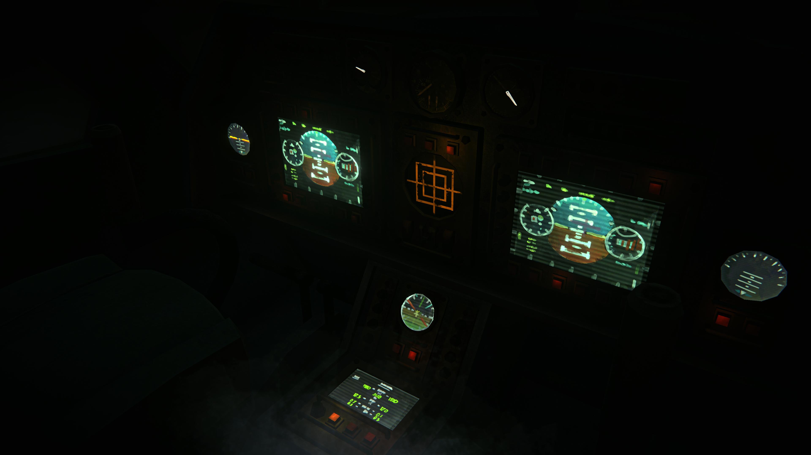
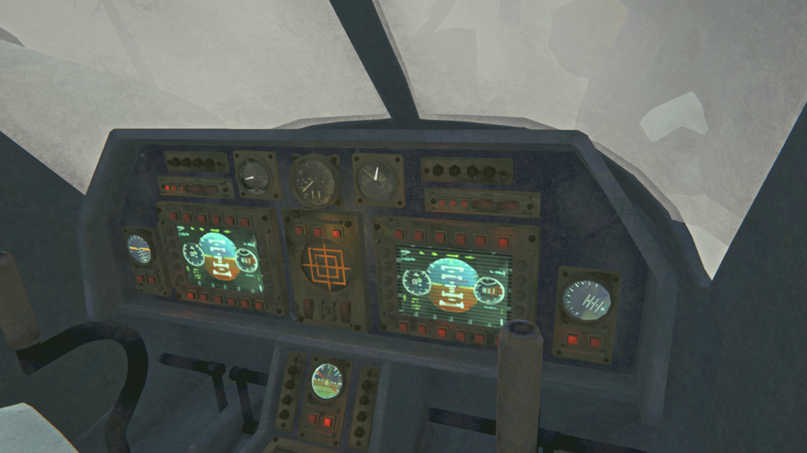

# Helicopter

\[Missing image: Helicopter.jpg\] **Helicopters** are the rarest of any <a href="./Vehicle.md" class="wikilink" title="Vehicle">Vehicle</a> on <a href="./Great%20Bear%20Island.md" class="wikilink" title="Great Bear Island">Great Bear Island</a>, second only to <a href="./Bus.md" class="wikilink" title="Buses">Buses</a> and <a href="./Haul%20Truck.md" class="wikilink" title="Earth Movers">Earth Movers</a>. Most are only found in the <a href="./Forsaken%20Airfield.md" class="wikilink" title="Forsaken Airfield">Forsaken Airfield</a> Region and provide a small warmth bonus and complete protection from wind-chill as <a href="./Car.md" class="wikilink" title="Cars">Cars</a>, <a href="./Truck.md" class="wikilink" title="Trucks">Trucks</a>, and <a href="./Tractor.md" class="wikilink" title="Tractors">Tractors</a> would. They can also be used as a temporary shelter to sleep or evade wildlife.

Helicopters contain the most loot containers of any vehicle, often containing 2 side hatches and 2 cylindrical hatches on the outside, 2 baskets that often contain loot, and many lockers inside the passenger cabin. Like other vehicles during an <a href="./Aurora.md" class="wikilink" title="Aurora">Aurora</a>, the electronics of a Helicopter will turn back on.

Most Helicopters can be found in the Forsaken Airfield Region around the abandoned tarmac of <a href="./Field%2031.md" class="wikilink" title="Field 31">Field 31</a>, as well as inside the <a href="./Main%20Hangar.md" class="wikilink" title="Main Hangar">Main Hangar</a>. A single crashed helicopter can be found in the mountains to the west of <a href="./Shoulder%20Lake.md" class="wikilink" title="Shoulder Lake">Shoulder Lake</a>. A unique rescue helicopter, <a href="./Final%20Approach.md" class="wikilink" title="Final Approach">Final Approach</a>, can be found in north of <a href="./Surveyor%27s%20Memory.md" class="wikilink" title="Surveyor&#39;s Memory">Surveyor's Memory</a> and contains a medical cot for sleeping, a chance to spawn a <a href="./Distress%20Pistol.md" class="wikilink" title="Distress Pistol">Distress Pistol</a> box, and various lockers that can be looted. Another crashed Helicopter located in the <a href="./Tales%20from%20the%20Far%20Territory.md" class="wikilink" title="Far Territory">Far Territory</a> is found in the mountains of the <a href="./Zone%20of%20Contamination.md" class="wikilink" title="Zone of Contamination">Zone of Contamination</a>, near <a href="./Old%20Corral.md" class="wikilink" title="Old Corral">Old Corral</a>.

Only 1 Helicopter can be found in Lower Great Bear, crashed on a ridge near <a href="./Muskeg%20Overlook.md" class="wikilink" title="Muskeg Overlook">Muskeg Overlook</a> in <a href="./Forlorn%20Muskeg.md" class="wikilink" title="Forlorn Muskeg">Forlorn Muskeg</a>.

<table class="gallery">
<colgroup>
<col style="width: 25%" />
<col style="width: 25%" />
<col style="width: 25%" />
<col style="width: 25%" />
</colgroup>
<tbody>
<tr>
<td><figure>

<figcaption>A crashed helicopter in Forlorn Muskeg</figcaption>
</figure></td>
<td><figure>

<figcaption>The cockpit during an aurora</figcaption>
</figure></td>
<td><figure>
[Missing image: Final_Approach_Close.jpg]
<figcaption>The Final Approach medical helicopter</figcaption>
</figure></td>
<td><figure>

<figcaption>Flight Instruments during <a href="./Glimmer%20Fog.md" class="wikilink" title="Glimmer Fog">Glimmer Fog</a></figcaption>
</figure></td>
</tr>
</tbody>
</table>

**Lua execution error in Module:Navbox function navbox**

