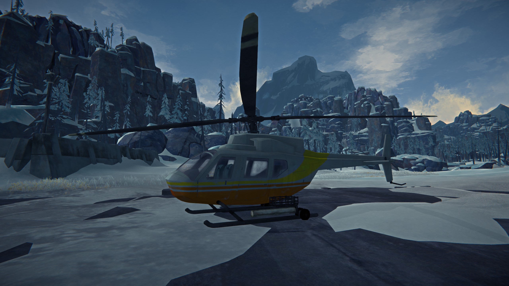

# Helicopter

**Categories:** Interactable Objects · **Source:** [Fandom](https://thelongdark.fandom.com/wiki/Helicopter)

 **Helicopters** are the rarest of any [Vehicle](./Vehicle.md) on [Great Bear Island](./Great%20Bear%20Island.md), second only to [Buses](./Bus.md) and [Earth Movers](./Haul%20Truck.md). Most are only found in the [Forsaken Airfield](./Forsaken%20Airfield.md) Region and provide a small warmth bonus and complete protection from wind-chill as [Cars](./Car.md), [Trucks](./Truck.md), and [Tractors](./Tractor.md) would. They can also be used as a temporary shelter to sleep or evade wildlife.

Helicopters contain the most loot containers of any vehicle, often containing 2 side hatches and 2 cylindrical hatches on the outside, 2 baskets that often contain loot, and many lockers inside the passenger cabin. Like other vehicles during an [Aurora](./Aurora.md), the electronics of a Helicopter will turn back on.

Most Helicopters can be found in the Forsaken Airfield Region around the abandoned tarmac of [Field 31](./Field%2031.md), as well as inside the [Main Hangar](./Main%20Hangar.md). A single crashed helicopter can be found in the mountains to the west of [Shoulder Lake](./Shoulder%20Lake.md). A unique rescue helicopter, [Final Approach](./Final%20Approach.md), can be found in north of [Surveyor's Memory](./Surveyor%27s%20Memory.md) and contains a medical cot for sleeping, a chance to spawn a [Distress Pistol](./Distress%20Pistol.md) box, and various lockers that can be looted. Another crashed Helicopter located in the [Far Territory](./Tales%20from%20the%20Far%20Territory.md) is found in the mountains of the [Zone of Contamination](./Zone%20of%20Contamination.md), near [Old Corral](./Old%20Corral.md).

Only 1 Helicopter can be found in Lower Great Bear, crashed on a ridge near [Muskeg Overlook](./Muskeg%20Overlook.md) in [Forlorn Muskeg](./Forlorn%20Muskeg.md).

_Flight Instruments during [Glimmer Fog](./Glimmer%20Fog.md)_
